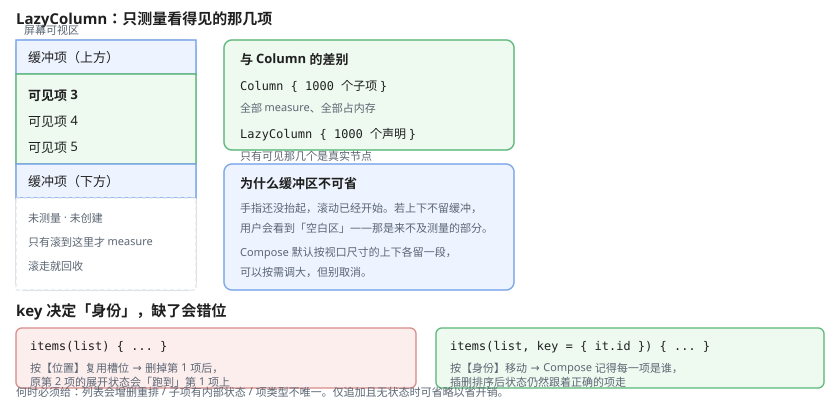

# 一、为什么是 Lazy 系列

`Column` 里放 1000 个子项会**一次性测量全部**——内存暴涨、滚动卡顿。`LazyColumn` 只测量**可见区域加一点缓冲**。



| | `Column` | `LazyColumn` |
| --- | --- | --- |
| 测量 | 全部 | 仅可见 + 缓冲 |
| 适用 | 少量固定项 | 任意长度列表 |
| 支持权重 | 是 | **否** |
| 可随意嵌套滚动 | 是 | **否**（需处理冲突） |

## (一) 基本用法

```kotlin
@Composable
fun LazyColumn(
    modifier: Modifier = Modifier,
    state: LazyListState = rememberLazyListState(),
    contentPadding: PaddingValues = PaddingValues(0.dp),
    reverseLayout: Boolean = false,
    verticalArrangement: Arrangement.Vertical = Arrangement.Top,
    horizontalAlignment: Alignment.Horizontal = Alignment.Start,
    userScrollEnabled: Boolean = true,
    content: LazyListScope.() -> Unit
)
```

```kotlin
@Composable
fun MessageList(messages: List<Message>) {
    LazyColumn(
        modifier = Modifier.fillMaxSize(),
        contentPadding = PaddingValues(horizontal = 16.dp, vertical = 8.dp),
        verticalArrangement = Arrangement.spacedBy(8.dp)
    ) {
        items(messages, key = { it.id }) { msg ->
            MessageRow(msg)
        }
    }
}
```

`contentPadding` 与 `padding` 的区别很重要：它给**内容区域**加内边距，滚动时首尾项能滑到边缘之外。聊天列表用 `contentPadding` 才正确——普通 `padding` 会让最后一条消息永远露不出来。

## (二) DSL 内容块

`LazyListScope` 的内容不是直接写子项，而是声明：

```kotlin
LazyColumn {
    item { Header() }                              // 单个

    items(3) { index -> Placeholder(index) }       // ★接数量，重复 3 次

    items(list) { item -> Row(item) }              // ★接集合

    items(list, key = { it.id }) { item -> Row(item) }

    item(span = { GridItemSpan(maxLineSpan) }) {   // 跨整行（网格里用）
        SectionTitle()
    }

    item {
        if (isLoading) {
            CircularProgressIndicator(Modifier.fillMaxWidth().padding(16.dp))
        }
    }
}
```

⚠ **`items(count)` 接数量、`items(list)` 接集合**。两个重载很容易混淆——`items(3)` 会渲染 3 个 `index = 0,1,2`，`items(listOf(...))` 才渲染真实数据。

# 二、key 的重要性

`key` 告诉 Compose 每个项的稳定身份。没有它，列表顺序变化时**状态会串位**。

```kotlin
// ❌ 无 key：删除第一项后，原来第二项的展开状态会跑到第一项上
items(list) { item ->
    var expanded by remember { mutableStateOf(false) }
    Card { if (expanded) Detail(item) }
}

// ✅ 有 key：Compose 按身份移动，而非按位置复用
items(list, key = { it.id }) { item ->
    var expanded by remember { mutableStateOf(false) }
    Card { if (expanded) Detail(item) }
}
```

**何时必须给 key**：

- 列表会**插入、删除、重排序**
- 子项有**内部状态**（展开 / 选中 / 动画）
- 列表项**类型不唯一**（需要区分不同的 item 布局）

如果列表只做追加且项无状态，省掉 key 能省一点开销。

⚠ **key 必须唯一**。用非唯一值（比如 `it.category`）会导致运行时异常或难以排查的状态错乱。用数据库主键或对象的稳定 id。

# 三、分组与粘性头

```kotlin
LazyColumn {
    sections.forEach { section ->
        stickyHeader {
            Text(
                text = section.title,
                modifier = Modifier
                    .fillMaxWidth()
                    .background(MaterialTheme.colorScheme.surfaceVariant)
                    .padding(16.dp)
            )
        }
        items(section.items, key = { it.id }) { ArticleRow(it) }
    }
}
```

⚠ **`stickyHeader` 是实验 API**，需要 `@OptIn(ExperimentalFoundationApi::class)`。

**分隔线不要给每个 item 加**——那会让每个项都多一次绘制：

```kotlin
// ❌ 每项都画一条
items(list) { item ->
    HorizontalDivider()
    Text(item.title)
}

// ✅ 只画在项之间：spacedBy(1.dp) + 背景色
LazyColumn(verticalArrangement = Arrangement.spacedBy(1.dp)) {
    items(list) { item ->
        Box(Modifier.background(MaterialTheme.colorScheme.surfaceVariant)) {
            Text(item.title, modifier = Modifier.padding(12.dp))
        }
    }
}
```

# 四、滚动控制

## (一) 滚到指定位置

```kotlin
val listState = rememberLazyListState()

// 滚到底部（聊天场景）
LaunchedEffect(messages.size) {
    if (messages.isNotEmpty()) {
        listState.animateScrollToItem(messages.size - 1)
    }
}

// 跳转到指定项（返回列表时保持位置）
LaunchedEffect(Unit) {
    listState.scrollToItem(restoredIndex)
}

// 监听当前可见项，用于高亮导航
val currentIndex by remember {
    derivedStateOf { listState.firstVisibleItemIndex }
}
```

⚠ **`scrollToItem` 是瞬时的，`animateScrollToItem` 有动画**。恢复滚动位置要用瞬时的，否则会看到一段无意义的滚动动画。

## (二) 滚动监听

```kotlin
LaunchedEffect(listState) {
    snapshotFlow { listState.layoutInfo.visibleItemsInfo }
        .map { info -> info.firstOrNull()?.index ?: 0 }
        .distinctUntilChanged()                      // ★去重，避免微滚也触发
        .collect { index -> analytics.visibleItem(index) }
}
```

**`snapshotFlow` 是把 Compose 状态变化转成流的官方 API**——`derivedStateOf` 内部的读取会被追踪，`snapshotFlow` 外部的不会。

`derivedStateOf` 的作用是**只在依赖真正影响输出的部分变化时触发**：

```kotlin
// ❌ 每次重组都会执行
LaunchedEffect(Unit) {
    while (true) {
        delay(100)
        onScroll(currentOffset())
    }
}

// ✅ 只有滚动位置真的变了才通知
val offset by remember {
    derivedStateOf {
        val item = listState.layoutInfo.visibleItemsInfo.firstOrNull()
        item?.let { -it.offset + listState.firstVisibleItemScrollOffset } ?: 0
    }
}
```

## (三) 滚动条

```kotlin
LazyColumn(state = listState) { ... }

if (listState.canScrollBackward) {
    VerticalScrollbar(
        adapter = rememberScrollbarAdapter(listState),
        modifier = Modifier.align(Alignment.CenterEnd)
    )
}
```

# 五、嵌套滚动

列表套列表（或 `Column` 里放 `LazyColumn`）时，内层会一直抢走滚动事件，**外层永远滚不动**。

```kotlin
// 同向嵌套滚动 Compose 默认就会协调：内层滚到底后，
// 剩余的 delta 自动传给外层，通常**不需要手写任何连接**
Column(Modifier.verticalScroll(outerState)) {
    Header()
    LazyColumn(state = innerState) { items(data) { Item(it) } }
}
```

只有当默认协调不满足需求时（比如要在内层到底时加阻尼），才自己实现 `NestedScrollConnection`——入口是修饰符 `Modifier.nestedScroll(connection)`，没有叫 `NestedScroll` 的 Composable，也不存在 `rememberNestedScrollConnection(outer, inner)` 这种重载。

```kotlin
// 方案二：内层固定高度，不用它滚 —— 最简单，够用就用这个
Box(Modifier.height(400.dp)) {
    LazyColumn(state = innerState) { items(data) { Item(it) } }
}
```

⚠ **给 `LazyColumn` 固定高度会牺牲惰性优势**（所有项都要测），只在项数不大时用。数据量大还是走方案一。

新版 Compose 的 `NestedScrollSource` 参数可指定内外优先级，比手工连线更省事。

# 六、网格布局

```kotlin
// 固定列数
LazyVerticalGrid(
    columns = GridCells.Fixed(3),
    contentPadding = PaddingValues(8.dp),
    horizontalArrangement = Arrangement.spacedBy(8.dp),
    verticalArrangement = Arrangement.spacedBy(8.dp)
) {
    items(photos, key = { it.id }) { Photo(it) }
}

// ★自适应列数：按宽度而不是按数量，平板/折叠屏表现好得多
LazyVerticalGrid(
    columns = GridCells.Adaptive(minSize = 120.dp),
    contentPadding = PaddingValues(8.dp)
) {
    items(photos, key = { it.id }) { Photo(it) }
}
```

`GridCells.Fixed(n)` 是「固定 n 列」，`GridCells.Adaptive(minSize)` 是「每格至少 minSize 宽，能放几列放几列」——**同一份代码在手机、平板、折叠屏上都能给出合理列数**，这是自适应布局的标准做法。

流式布局用 `FlowRow`：

```kotlin
// ★FlowRow 目前仍是实验 API
@OptIn(ExperimentalLayoutApi::class)
@Composable
fun TagCloud(tags: List<String>, onTagClick: (String) -> Unit) {
    FlowRow(
        horizontalArrangement = Arrangement.spacedBy(8.dp),
        verticalArrangement = Arrangement.spacedBy(8.dp)
    ) {
    tags.forEach { tag ->
        SuggestionChip(onClick = { onTagClick(tag) }, label = { Text(tag) })
    }
}
```

# 七、分页加载

手写分页的完整骨架：

```kotlin
@Composable
fun PagedList(
    items: List<Item>,
    hasMore: Boolean,
    isLoading: Boolean,
    error: String?,
    onLoadMore: () -> Unit,
    onRetry: () -> Unit
) {
    val listState = rememberLazyListState()

    // 加载更多：可见项接近末尾时触发
    LaunchedEffect(listState, items.size) {
        snapshotFlow { listState.layoutInfo.visibleItemsInfo.lastOrNull()?.index }
            .distinctUntilChanged()
            .collect { last ->
                if (last != null && last >= items.size - 3 && hasMore && !isLoading) {
                    onLoadMore()
                }
            }
    }

    LazyColumn(state = listState) {
        items(items, key = { it.id }) { Item(it) }

        item {                       // ★不占 key 的位置，状态不会错位
            when {
                isLoading -> CircularProgressIndicator(
                    Modifier.fillMaxWidth().padding(16.dp)
                )
                error != null -> RetryRow(error = error, onRetry = onRetry)
                !hasMore && items.isNotEmpty() -> Text(
                    text = "没有更多了",
                    modifier = Modifier.fillMaxWidth().padding(16.dp),
                    textAlign = TextAlign.Center
                )
            }
        }
    }
}
```

**三个关键点**：

1. 加载指示器放在**无 key 的 `item {}`** 里，不参与 `key` 匹配，避免重组时错位
2. `LaunchedEffect` 的 key 要包含 `items.size`，否则列表变长不会重新触发
3. `onLoadMore` 内部必须自己防重入（`if (isLoading) return`），`snapshotFlow` 不会帮你去重

大数据量建议直接用 **Paging 3**（`androidx.paging:paging-compose`）：

```kotlin
// pager.flow 本身就是 Flow<PagingData<T>>，再套 .pagingData 是 Paging 2 的旧写法
val lazyPagingItems = pager.flow.cachedIn(viewModelScope)

LazyColumn {
    items(lazyPagingItems.itemCount) { index ->
        lazyPagingItems[index]?.let { ArticleRow(it) }   // 可能为 null
    }

    loadState.mediator?.let { mediator ->
        when (mediator.loadState) {
            is LoadState.Loading -> item { Spinner() }
            is LoadState.Error -> item { RetryRow(mediator.loadState.error) { mediator.retry() } }
            else -> {}
        }
    }
}
```

**取舍**：Paging 3 内置预取、缓存、占位符与重试，代码量更少也更可靠；但列表逻辑固定、不需要预取和缓存时（比如内部管理数据），手写更直观。**别为了用 Paging 而用 Paging**。

# 八、常见问题排查

| 现象 | 原因 | 处理 |
| --- | --- | --- |
| 外层不滚 | 内层始终未滚到边界 | `NestedScroll` 连线或给内层固定高度 |
| 列表到底后不加载 | `LaunchedEffect` key 写错 | key 加 `items.size` |
| 删除项后状态错位 | 缺 `key` | `items(list, key = { it.id })` |
| 首次加载白屏 | 没有初始占位 | 加骨架屏或空态分支 |
| 滚动监听频繁触发 | 缺 `distinctUntilChanged` | 加上后只处理真实变化 |
| 连续触发多次加载 | 没防重入 | `onLoadMore` 里 `if (isLoading) return` |
| 网格在平板上列数不变 | 用了 `GridCells.Fixed` | 换 `GridCells.Adaptive` |
| 首尾项被状态栏盖住 | 用 `padding` 而非 `contentPadding` | 改 `contentPadding` + `Scaffold` 的 `innerPadding` |
| key 重复崩溃 | key 不唯一 | 用主键或稳定 id |

# 九、易错点

| 误区 | 事实 |
| --- | --- |
| `Column` 和 `LazyColumn` 可以随意替换 | 不行，Lazy 不支持权重，也不能随意嵌套滚动 |
| `items(3)` 和 `items(listOf(3))` 一样 | 前者是数量 3，后者是集合含一个元素 3 |
| 有了 key 就不需要 `contentPadding` | 无关，首尾项露出是 padding 的问题 |
| 分隔线给每个 item 加最简单 | 会多出 N 次绘制，用 `spacedBy` 统一处理 |
| 固定高度能解决所有嵌套滚动 | 会牺牲惰性优势，数据量大时不适用 |
| Paging 3 永远优于手写 | 不是，逻辑固定时手写更直观 |
| `snapshotFlow` 会自动去重 | 不会，要自己加 `distinctUntilChanged` |

# 十、参考资料

- [Compose 列表官方指南](https://developer.android.com/develop/ui/compose/lists) — 列表基础与惰性布局
- [Compose 集合](https://developer.android.com/develop/ui/compose/lists) — `items` 的 DSL 用法与 key
- [Paging 3 官方文档](https://developer.android.com/topic/libraries/architecture/paging/v3-overview) — 大列表分页方案
- [嵌套滚动](https://developer.android.com/develop/ui/compose/touch-input/pointer-input/nested-scroll) — `NestedScroll` 连接的官方说明
- [Compose API 参考](https://developer.android.com/reference/kotlin/androidx/compose/foundation/lazy/package-summary) — `LazyListScope` 完整 API
- [Material Design 列表规范](https://m3.material.io/components/lists/) — 列表的设计规范
