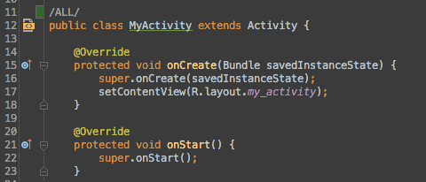
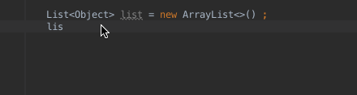
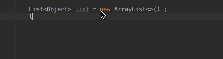
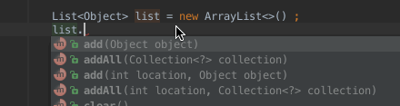
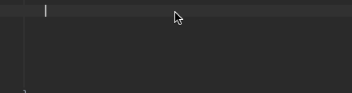
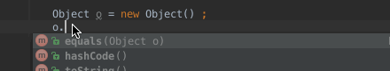
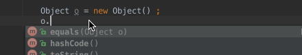
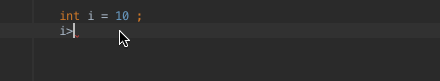
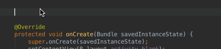
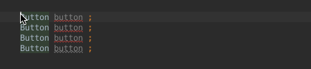

*keymap eclipse for windows*

# 一、Shortcut List

key|instuction
---|---
Alt+Enter|相当于QuickFix
Alt+Insert|生成方法
Ctrl+O|列出所有属性和方法
Shift 两次|Search EveryWhere
Ctrl+/|单行注释
Ctrl+F11|添加带标记的书签
Ctrl+书签标记|跳转到该标签
Ctrl+Shift+F11|添加书签
Shift+F11|显示书签列表
Alt+Q|上下文信息,当作用域定义超过滚动区域,显示所知的类或方法
Ctrl+Q|最后编辑位置
Ctrl+Shift+A|查找动作或操作
Alt+面板编号|根据编号打开面板,编号为IDE标示
Ctrl+标签页|打开文件所在位置或者关联路径
Ctrl+标识符或方法名|显示提示信息或者参数列表
Ctrl+Shift+I|查看方法或类的具体实现
Ctrl+E|最近访问的文件
Ctrl+Tab|窗口或文件之间切换
Alt+`|版本控制弹窗
Ctrl+D|删除当前行
Ctrl+L|跳到某一行
Alt+/|auto complete默认为ctrl+space，需更改设置
Alt+Shift+R|重命名，重构
Alt+Shift+M|提取方法
Ctrl+K|向下查找

# 二、layout和xml之间跳转

- 描述：该操作有助于在布局文件和 Activity/Fragment 之间轻松跳转。这也是一个快捷操作，在类名/布局顶端的左侧。
- 快捷键：Ctrl + Cmd + Up(OS X)、Ctrl + Alt + Home(Windows/Linux)

# 三、for循环快速实现

- `.for`：foreach 遍历

- `.fori`：正向遍历

- `.forr`：反向遍历

- `数字.for`

# 四、判空快速输入

- `对象.null`：判空

- `对象.notnull`：判非空

# 五、if快速输入

`判断的语句后面加上.if`

# 六、多行编辑

例如我们有四个 Button 要定义，可以先这样，按住 alt 键＋鼠标左键一直向下拉，就可以选中多行，然后编辑就可以同时对多行进行编辑。

块编辑：按住 alt 不放，拉对角线。

# 七、内容引用

- [最强 Android Studio 使用小技巧和快捷键](http://www.open-open.com/lib/view/open1458715872710.html)
- [Android studio 上非常好用的快捷键](http://gold.xitu.io/entry/579973e4a633bd0060d905ff/promote?utm_source=baidu&utm_medium=keyword&utm_content=android_studio_key&utm_campaign=q3_search)

> Written with [StackEdit](https://stackedit.io/).
