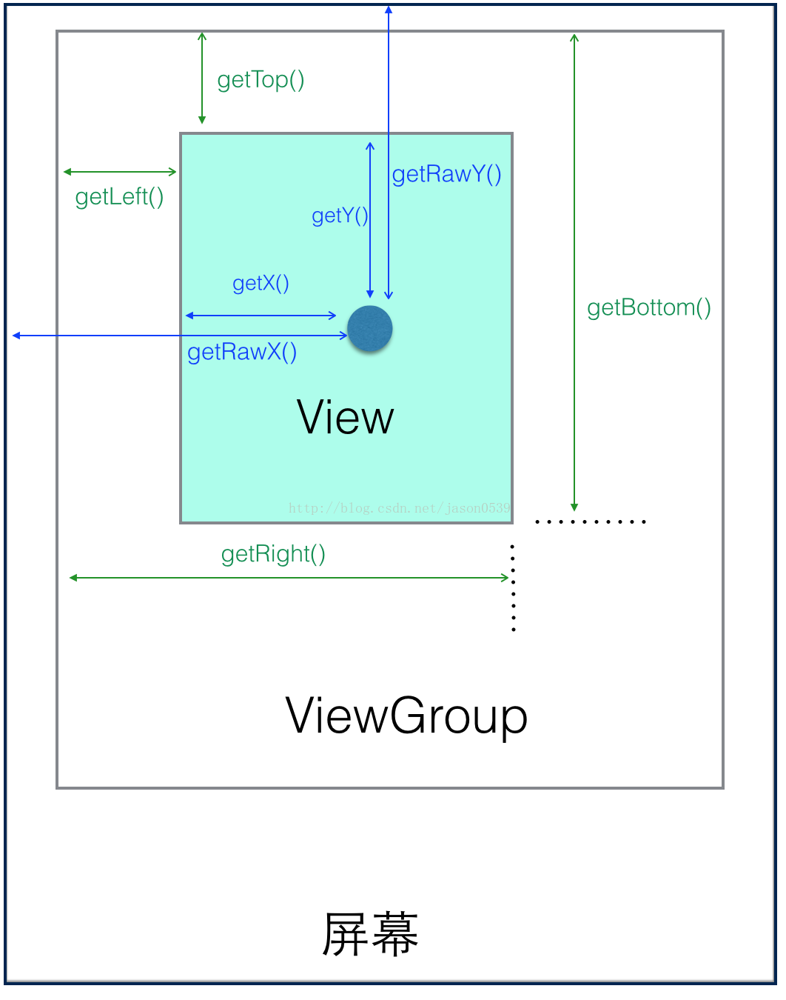

> 来源：[CSDN 博客《android之View坐标系（view获取自身坐标的方法和点击事件中坐标的获取）》](https://blog.csdn.net/jason0539/article/details/42743531)，作者 jason0539。

在做一个 view 背景特效的时候被坐标的各个获取方法搞晕了，几篇抄来抄去的博客也没弄很清楚。现在把整个总结一下，其实只要把下面这张图看明白就没问题了。

图中屏幕上放了一个 ViewGroup 布局，里面有个 View 控件。涉及到的方法一共有下面几个：

- view 获取自身坐标：`getLeft()`、`getTop()`、`getRight()`、`getBottom()`
- view 获取自身宽高：`getHeight()`、`getWidth()`
- motionEvent 获取坐标：`getX()`、`getY()`、`getRawX()`、`getRawY()`

## (一) view 的几个方法

获取自身的宽高的这两个方法很清楚，不用多说，获取坐标的这几个就有点混乱了。根据上面的图应该比较容易明白：

- `getTop()`：获取到的，是 view 自身的顶边到其父布局顶边的距离
- `getLeft()`：获取到的，是 view 自身的左边到其父布局左边的距离
- `getRight()`：获取到的，是 view 自身的右边到其父布局左边的距离
- `getBottom()`：获取到的，是 view 自身的底边到其父布局顶边的距离

### 1. 用在哪里

比如要实现一个自定义的特殊布局，像 <http://blog.csdn.net/singwhatiwanna/article/details/42614953>，这里要实现的是一个水波纹特效布局，该布局内的任何控件点击后都会出现波纹效果。

那么在点击了布局内的一个控件之后，就要通过不断刷新布局，去更新这个控件上面的波纹半径。为了节省资源，每次刷新布局时候不会整个布局都刷新，而是在布局的画布上每次只去更新点击事件所点击的对应的控件的位置，那么这里就可以用 view 的那四个方法，分别获取自身的四条边对应的坐标，从而让布局去刷新重绘。

当然博客中是使用绝对坐标去计算的，因为这里实现的是一个布局，可能里面还会嵌套另外的布局，经过多次嵌套之后所获取到的值，是相对于控件直接对应的父布局（这个布局有可能已经是我们重写的布局的子布局了）的距离，这样去刷新的区域肯定是不准确的，所以博客里面使用相对屏幕的绝对坐标计算需要刷新的控件区域。

如果这里自定义的不是布局，而只是一个控件的话，就可以通过以上方法获取到坐标，然后要求自己所在的布局去重绘这一区域就可以了。当然这只是一种思路，其实没必要去要求布局重绘，完全可以直接 view 自身重绘就可以了。

## (二) motionEvent 的方法

- `getX()`：获取点击事件相对控件左边的 x 轴坐标，即点击事件距离控件左边的距离
- `getY()`：获取点击事件相对控件顶边的 y 轴坐标，即点击事件距离控件顶边的距离
- `getRawX()`：获取点击事件相对整个屏幕左边的 x 轴坐标，即点击事件距离整个屏幕左边的距离
- `getRawY()`：获取点击事件相对整个屏幕顶边的 y 轴坐标，即点击事件距离整个屏幕顶边的距离

### 1. 用在哪里

`getRawX()` 和 `getRawY()` 在之前那篇博客里广泛使用了，可以去那里看用法；`getX()` 和 `getY()` 这两个方法在对 view 进行自定义的时候可能用的会比较多。

之后有篇博客写开头实现的特效，可以看下，下面是链接：[view 和 view group 重写](http://blog.csdn.net/jason0539/article/details/42755871)。

## (三) 作者信息

- 作者：jason0539
- 微博：<http://weibo.com/255371770703>
- 博客：<http://blog.csdn.net/jason0539>（转载请说明出处）
