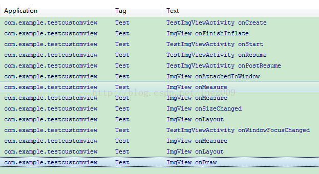
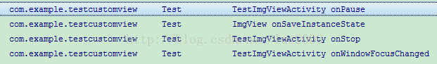
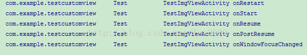
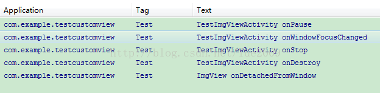
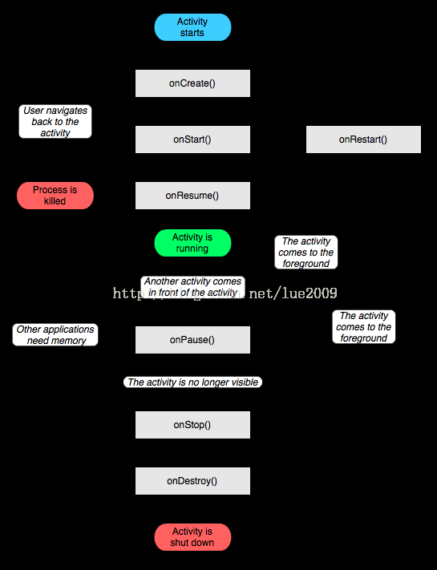

> 来源：[CSDN 博客《View的生命周期方法和Activity生命周期方法关系》](https://blog.csdn.net/lue2009/article/details/45692009)，作者 lue2009。

View 是在 Activity 中使用到的，所以在自定义 View 的时候，我们需要了解 Activity 生命周期方法和 View 的生命周期方法调用先后顺序。



## (一) 各场景下的调用顺序

1. 在 Activity `onCreate` 方法中初始化了 View，调用了 View 的 `onFinishInflate`
2. 在执行完 Activity 的 `onPostResume` 方法之后（第一次 `onResume` 之后）才真正开始了 View 的绘制工作：`onAttachedToWindow` --> `onMeasure` --> `onSizeChanged` --> `onLayout` --> `onDraw`
3. 当按住锁屏键的时候：Activity `onPause` 之后，调用了 View 的 `onSaveInstanceState` 方法



4. 当重新回到页面的时候：View 的生命周期方法没有被调用



5. 当点击回退的时候：Activity `onPause` -> `onStop` -> `onDestroy`，`onDestroy` 之后调用了 View 的 `onDetachedFromWindow` 方法



## (二) View 的生命周期顺序

```
[改变可见性] --> 构造View --> onFinishInflate --> onAttachedToWindow --> onMeasure
             --> onSizeChanged --> onLayout --> onDraw --> onDetackedFromWindow
```

## (三) 总的可以归结三点

1. 在 Activity `onCreate` 方法中初始化了 View 的时候，调用了 View 的 `onFinishInflate`
2. 在执行完 Activity 的 `onResume` 方法之后，才真正开始了 View 的绘制工作：`onMeasure` --> `onSizeChanged` --> `onLayout` --> `onDraw`
3. `onMeasure`、`onSizeChanged`、`onLayout`、`onDraw` 可能由于 `setVisible` 或 `onResume` 被调用多次；而 `onAttachedToWindow` 与 `onDetachedFromWindow` 在创建与销毁 View 的过程中只会调用一次

## (四) Activity 生命周期方法

Activity 生命周期方法 `onCreate`、`onStart`、`onResume`、`onPause`、`onStop`、`onDestroy` 的被调用先后顺序：



下面逐个说明每个方法（原文翻译自 4.2.2 Activity 源码方法的注释）。

### 1. onCreate

activity 开始的时候执行的方法，可以做如下初始化工作：

1. 调用 `setContentView(int)` 初始化 UI
2. 调用 `findViewById(int)` 初始化 UI 中的组件
3. 调用 `managedQuery(android.net.Uri, String[], String, String[], String)` 获取数据库数据显示

在 `onCreate` 方法中也可以调用 `finish()` 方法，此时会立刻触发 `onDestroy()` 方法，跳过了 `onStart`、`onResume`、`onPause` 等方法的执行。

Activity 子类覆盖此方法的时候必须调用父类方法，否则会出现异常。

### 2. onStart

在 `onCreate` 之后被调用，或 activity 停止之后调用 `onRestart` 方法之后被调用，此方法之后就是 `onResume` 方法。

Activity 子类覆盖此方法的时候必须调用父类方法，否则会出现异常。

### 3. onResume

此方法在 `onRestart`、`onRestoreInstanceState` 或 `onPause` 之后被调用，activity 开始和用户交互。

牢记：`onResume` 不是最好的说明 activity 对用户是可见的，因为可能锁屏可能在前面，可以通过 `onWindowFocusChanged` 方法来确定 activity 是否对用户可见。

Activity 子类覆盖此方法的时候必须调用父类方法，否则会出现异常。

### 4. onPause

Activity 进入后台且 Activity 进程还没被 kill 的时候被调用。当 Activity B 启动在 Activity A 前面的时候，此时 Activity A 的 `onPause` 方法会被调用，直到 Activity A 的 `onPause` 方法返回结果的时候，Activity B 的 `onCreate` 方法才会调用，因此不要在 `onPause` 方法进行耗时任务。

Activity 子类覆盖此方法的时候必须调用父类方法，否则会出现异常。

### 5. onStop

当 Activity 对用户不再可见的时候被调用。`onStop` 之后可能会调用 `onRestart` 或 `onDestroy`，或者什么不发生，取决于用户操作。内存不够的时候，调用了 `onPause` 之后 `onStop` 不会被调用。

Activity 子类覆盖此方法的时候必须调用父类方法，否则会出现异常。

### 6. onDestroy

执行最后的清除工作，在 activity 被销毁之前，此方法被调用可以出现以下情况：

1. activity 正在 finish（调用了 `finish()` 方法）
2. 系统为了保留空间暂时销毁此 Activity

可以通过调用 `isFinishing()` 来区分是以上哪种情形。
