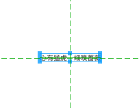
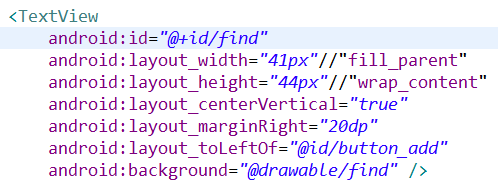
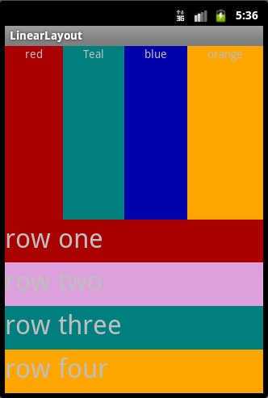

# 一、Android中常用的5大布局方式

布局|说明
---|---
相对布局（RelativeLayout）|相对其它组件的布局方式
线性布局（LinearLayout）|按照垂直或者水平方向布局的组件
帧布局（FrameLayout）|组件从屏幕左上方布局组件
表格布局（TableLayout）|按照行列方式布局组件
绝对布局（AbsoluteLayout）|按照绝对坐标来布局组件（已淘汰）

注意两点：

- Drawable 文件夹里面的图片命名不能大写
- 在 xml 中定义大小，TextView 建议使用 sp，其他使用 dp

# 二、相对布局（RelativeLayout）

相对布局是按照组件之间的相对位置来布局，比如在某个组件的左边、右边、上面和下面等。RelativeLayout 用到的一些重要的属性：

## (一) 居中显示

```
android:layout_centerHorizontal="true"
android:layout_centerVertical="true"
```





## (二) 三类属性

第一类：属性值为 true 或 false

- `android:layout_centerHorizontal`、`android:layout_centerVertical`：水平居中、垂直居中
- `android:layout_centerInParent`：相对于父元素完全居中
- `android:layout_alignParentBottom/Top/Left/Right`：贴紧父元素下/上/左/右边缘

第二类：属性值必须为 id 的引用名 `@id/id-name`

- `android:layout_below/above/toLeftOf/toRightOf`：在某元素的下/上/左/右
- `android:layout_alignBottom/Top/Left/Right`：某元素 X 边缘和另一元素 X 边缘对齐

第三类：属性值为具体的像素值，如 30dp、40px

- `android:layout_marginBottom/Top/Left/Right`：外边距
- `android:layout_paddingBottom/Top/Left/Right`：内边距

## (三) EditText 的 android:hint

设置 EditText 为空时输入框内的提示信息。

## (四) ImageView 的 android:scaleType

`android:scaleType` 控制图片如何 resized/moved 来匹配 ImageView 的 size。取值与含义：

取值|含义
---|---
CENTER / center|按图片的原来 size 居中显示，当图片长/宽超过 View 的长/宽，则截取图片的居中部分显示
CENTER_CROP / centerCrop|按比例扩大图片的 size 居中显示，使得图片长（宽）等于或大于 View 的长（宽）
CENTER_INSIDE / centerInside|将图片的内容完整居中显示，通过按比例缩小或原来的 size 使得图片长/宽等于或小于 View 的长/宽
FIT_CENTER / fitCenter|把图片按比例扩大/缩小到 View 的宽度，居中显示
FIT_END / fitEnd|把图片按比例扩大/缩小到 View 的宽度，显示在 View 的下部分位置
FIT_START / fitStart|把图片按比例扩大/缩小到 View 的宽度，显示在 View 的上部分位置
FIT_XY / fitXY|不按比例扩大/缩小到 View 的大小显示
MATRIX / matrix|用矩阵来绘制，动态缩小放大图片来显示

核心代码：main.xml

```
<?xml version="1.0" encoding="utf-8"?>
<RelativeLayout xmlns:android="http://schemas.android.com/apk/res/android"
    android:layout_width="fill_parent"
    android:layout_height="wrap_content"
    android:padding="10px">

    <TextView
        android:id="@+id/tev1"
        android:layout_width="wrap_content"
        android:layout_height="wrap_content"
        android:layout_marginBottom="30dp"
        android:text="Please Type Here:" />

    <EditText
        android:id="@+id/tx1"
        android:layout_width="match_parent"
        android:layout_height="wrap_content"
        android:layout_below="@id/tev1" />

    <Button
        android:id="@+id/btn1"
        android:layout_width="wrap_content"
        android:layout_height="wrap_content"
        android:layout_below="@id/tx1"
        android:layout_alignParentRight="true"
        android:text="确定" />

    <Button
        android:id="@+id/btn2"
        android:layout_width="wrap_content"
        android:layout_height="wrap_content"
        android:layout_below="@id/tx1"
        android:layout_toLeftOf="@id/btn1"
        android:layout_marginRight="30dp"
        android:text="取消" />
</RelativeLayout>
```

# 三、线性布局（LinearLayout）

线性布局是 Android 开发中最常见的一种布局方式，它是按照垂直或者水平方向来布局，通过 `android:orientation` 属性可以设置线性布局的方向。常用的属性：

- `android:orientation`：可以设置布局的方向
- `android:gravity`：用来控制组件的对齐方式
- `layout_weight`：控制各个组件在布局中的相对大小

`android:orientation` 的属性值有两种：垂直（vertical）和水平（horizontal）。

`android:gravity` 是对该 view 中内容的限定，`android:layout_gravity` 是设置该 view 相对于父 view 的位置。例如，在一个 Button 按钮控件中设置如下两个属性：`android:gravity="left"` 和 `android:text="提交"`，Button 上的“提交”将会位于 Button 的左部；`android:layout_gravity="left"` 表示该 Button 按钮将位于界面的左部。

fill_parent / match_parent 表示宽度或者高度布满整个屏幕，wrap_content 表示大小刚好足够显示当前控件里的内容。

1. `android:gravity="center_horizontal"`：垂直居中显示
2. `android:layout_gravity="center_horizontal"`：相对于父类的垂直居中
3. `android:orientation="vertical"`：垂直方向
4. `android:layout_weight="1"`：线性布局的权重



核心代码：mian.xml

```
<?xml version="1.0" encoding="utf-8"?>
<LinearLayout xmlns:android="http://schemas.android.com/apk/res/android"
    android:orientation="vertical"
    android:layout_width="fill_parent"
    android:layout_height="fill_parent">

    <LinearLayout
        android:orientation="horizontal"
        android:layout_width="fill_parent"
        android:layout_height="fill_parent"
        android:layout_weight="1">

        <TextView
            android:text="red"
            android:gravity="center_horizontal"
            android:background="#aa0000"
            android:layout_width="wrap_content"
            android:layout_height="fill_parent"
            android:layout_weight="1" />
        <!-- android:gravity="center_horizontal" 水平居中 -->
        <!-- layout_weight 属性以控制各个控件在布局中的相对大小。layout_weight 属性是一个非负整数值。
             线性布局会根据该控件 layout_weight 值与其所处布局中所有控件 layout_weight 值之和的比值为该控件分配占用的区域。
             例如，在水平布局的 LinearLayout 中有两个 Button，这两个 Button 的 layout_weight 属性值都为 1，
             那么这两个按钮都会被拉伸到整个屏幕宽度的一半。如果 layout_weight 指为 0，控件会按原大小显示，不会被拉伸；
             对于其余 layout_weight 属性值大于 0 的控件，系统将会减去 layout_weight 属性值为 0 的控件的宽度或者高度，
             再用剩余的宽度或高度按相应的比例来分配每一个控件显示的宽度或高度 -->

        <TextView
            android:text="Teal"
            android:gravity="center_horizontal"
            android:background="#008080"
            android:layout_width="wrap_content"
            android:layout_height="fill_parent"
            android:layout_weight="1" />

        <TextView
            android:text="blue"
            android:gravity="center_horizontal"
            android:background="#0000aa"
            android:layout_width="wrap_content"
            android:layout_height="fill_parent"
            android:layout_weight="1" />

        <TextView
            android:text="orange"
            android:gravity="center_horizontal"
            android:background="#FFA500"
            android:layout_width="wrap_content"
            android:layout_height="fill_parent"
            android:layout_weight="1" />
    </LinearLayout>

    <LinearLayout
        android:orientation="vertical"
        android:layout_width="fill_parent"
        android:layout_height="fill_parent"
        android:layout_weight="1">

        <TextView
            android:text="row one"
            android:textSize="15pt"
            android:background="#aa0000"
            android:layout_width="fill_parent"
            android:layout_height="wrap_content"
            android:layout_weight="1" />

        <TextView
            android:text="row two"
            android:background="#aa0000"
            android:layout_width="fill_parent"
            android:layout_height="wrap_content"
            android:layout_weight="1" />
    </LinearLayout>
</LinearLayout>
```

# 四、帧布局（FrameLayout）

帧布局是从屏幕的左上角（0,0）坐标开始布局，多个组件层叠排列，第一个添加的组件放到最底层，最后添加到框架中的视图显示在最上面，上一层的会覆盖下一层的控件。

核心代码：main.xml

```
<?xml version="1.0" encoding="utf-8"?>
<FrameLayout xmlns:android="http://schemas.android.com/apk/res/android"
    android:layout_width="fill_parent"
    android:layout_height="fill_parent">

    <TextView
        android:layout_width="300dp"
        android:layout_height="300dp"
        android:background="#00BFFF" />

    <TextView
        android:layout_width="260dp"
        android:layout_height="260dp"
        android:background="#FFC0CB" />

    <TextView
        android:layout_width="220dp"
        android:layout_height="220dp"
        android:background="#0000FF" />
</FrameLayout>
```
