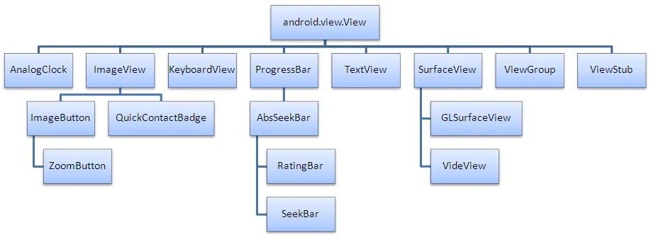

本篇要点：

1. java代码中修改UI控件的属性值
2. View与View子控件继承结构
3. View的常用属性
4. TextView常用属性
5. Button常用属性
6. EditText的常用属性

# 一、java代码中修改UI控件的属性值

获取控件对象的属性值：只要在java代码中得到UI的引用，就可以调用相应的方法(get)得到对象的属性

```
String s = textView.getText().toString();
int c1 = textView.getTextColors();
int w = textView.getWidth();
int a = textView.getAlpha();
```

只要在java代码中得到UI的引用后，一般可以使用set方法修改UI对象的属性，修改后，界面显示会即时产生变化

```
textView.setText(R.id.action_settings);
textView.setTextColor(Color.RED);
imageView.setImageResource(R.drawable.ic_launcher);
```

# 二、View与View子控件继承结构

View类是所有可视化控件的基类，主要提供了控件绘制和事务处理的方法。View的父类是Object



# 三、View的常用属性

属性|说明
---|---
android:autoLink|设置是否当文本为URL链接/email/电话号码/map时，文本显示为可点击的链接。
android:autoText|如果设置，将自动执行输入值的拼写纠正。此处无效果，在显示输入法并输入的时候起作用。
android:bufferType|指定getText()取得文本类别。选项editable 类似StringBuilder可追加字符，也就是getText后可调用append方法设置文本内容。spannable 则可在给定的字符区域使用样式，参见这里1、这里2。
android:capitalize|设置英文字母大写类型。此处无效果，需要弹出输入法才能看得到，参见EditView此属性说明。
android:cursorVisible|设定光标为显示/隐藏，默认显示。
android:digits|设置允许输入哪些字符。如“1234567890.+-*/% ()”
android:drawableBottom|在text的下方输出一个drawable，。如果指定一个颜色的话会把text的背景设为该颜色，并且同时和background使用时覆盖后者
android:drawablePadding|设置text与drawable(图片)的间隔，与drawableLeft、drawableRight、drawableTop、drawableBottom一起使用，可设置为负数，单独使用没有效果。
android:drawableRight|在text的右边输出一个drawable。
android:drawableTop|在text的正上方输出一个drawable。
android:editable|设置是否可编辑。
android:editorExtras|设置文本的额外的输入数据
android:ellipsize|设置当文字过长时，该控件该如何显示。有如下值设置：“start”——省略号显示在开头；“end”——省略号显示在结尾；“middle”——省略号显示在中间；“marquee”——以跑马灯的方式显示（动画横向移动）
android:freezesText|设置保存文本的内容以及光标的位置。
android:gravity|设置文本位置，如设置成“center”，文本将居中显示。
android:hintText|为空时显示的文字提示信息，可通过
android:textColorHint|设置提示信息的颜色。此属性在 EditView 中使用，但是这里也可以用
android:imeOptions|附加功能，设置右下角IME动作与编辑框相关的动作，如actionDone右下角将显示一个“完成”，而不设置默认是一个回车符号。这个在EditView中再详细 说明，此处无用。
android:imeActionId|设置IME动作ID。
android:imeActionLabel|设置IME动作标签。
android:includeFontPadding|设置文本是否包含顶部和底部额外空白，默认为true。
android:inputMethod|为文本指定输入法，需要完全限定名(完整的包名)。例如：com.google.android.inputmethod.pinyin，但是这里报错找不到。
android:inputType|设置文本的类型，用于帮助输入法显示合适的键盘类型。在EditView中再详细说明，这里无效果
android:linksClickable|设置链接是否点击连接，即使设置了autoLink。
android:marqueeRepeatLimit|在ellipsize指定marquee的情况下，设置重复滚动的次数，当设置为marquee_forever时表示无限次。
android:ems|设置TextView的宽度为N个字符的宽度。这里测试为一个汉字字符宽度
android:maxEms|设置TextView的宽度为最长为N个字符的宽度。与ems同时使用时覆盖ems选项。
android:minEms|设置TextView的宽度为最短为N个字符的宽度。与ems同时使用时覆盖ems选项。
android:maxLength|限制显示的文本长度，超出部分不显示
android:lines|设置文本的行数，设置两行就显示两行，即使第二行没有数据
android:maxLines|设置文本的最大显示行数，与width或者layout_width结合使用，超出部分自动换行，超出行数将不显示。
android:minLines|设置文本的最小行数，与lines类似。
android:lineSpacingExtra|设置行间距。
android:lineSpacingMultiplier|设置行间距的倍数。如”1.2”
android:numeric|如果被设置，该TextView有一个数字输入法。此处无用，设置后唯一效果是TextView有点击效果，此属性在EdtiView将详细说明
android:password|以小点“.”显示文本
android:phoneNumber|设置为电话号码的输入方式。
android:privateImeOptions|设置输入法选项，此处无用，在EditText将进一步讨论。
android:scrollHorizontally|设置文本超出TextView的宽度的情况下，是否出现横拉条。
android:selectAllOnFocus|如果文本是可选择的，让他获取焦点而不是将光标移动为文本的开始位置或者末尾位置。TextView中设置后无效果。
android:shadowColor|指定文本阴影的颜色，需要与shadowRadius一起使用。
android:shadowDx|设置阴影横向坐标开始位置。
android:shadowDy|设置阴影纵向坐标开始位置。
android:shadowRadius|设置阴影的半径。设置为0.1就变成字体的颜色了，一般设置为3.0的效果比较好。
android:singleLine|设置单行显示。如果和layout_width一起使用，当文本不能全部显示时，后面用“…”来表示。如android:text="test_ singleLine " android:singleLine="true" android:layout_width="20dp"将只显示“t…”。如果不设置singleLine或者设置为false，文本将自动换行
android:text|设置显示文本.
android:textAppearance|设置文字外观。如“?android:attr/textAppearanceLargeInverse”这里引用的是系统自带的一个外观，?表示系统是否有这种外观，否则使用默认的 外观。可设置的值如下：textAppearanceButton/textAppearanceInverse/textAppearanceLarge/textAppearanceLargeInverse/textAppearanceMedium/textAppearanceMediumInverse/textAppearanceSmall/textAppearanceSmallInverse
android:textColor|设置文本颜色
android:textColorHighlight|被选中文字的底色，默认为蓝色
android:textColorHint|设置提示信息文字的颜色，默认为灰色。与hint一起使用。
android:textColorLink|文字链接的颜色
android:textScaleX|设置文字之间间隔，默认为1.0f。
android:textSize|设置文字大小，推荐度量单位”sp”，如”15sp”
android:textStyle|设置字形[bold(粗体) 0, italic(斜体) 1, bolditalic(又粗又斜) 2] 可以设置一个或多个，用“\|”隔开
android:typeface|设置文本字体，必须是以下常量值之一：normal 0, sans 1, serif 2, monospace(等宽字体) 3]
android:height|设置文本区域的高度，支持度量单位：px(像素)/dp/sp/in/mm(毫米)
android:maxHeight|设置文本区域的最大高度
android:minHeight|设置文本区域的最小高度
android:width|设置文本区域的宽度，支持度量单位：px(像素)/dp/sp/in/mm(毫米)，与layout_width的区别看这里。
android:maxWidth|设置文本区域的最大宽度
android:minWidth|设置文本区域的最小宽度

# 四、TextView常用属性

```
<?xml version="1.0" encoding="utf-8"?>
<LinearLayout xmlns:android="http://schemas.android.com/apk/res/android"
    android:orientation="vertical"
    android:layout_width="fill_parent"
    android:layout_height="fill_parent">
    <!-- 设置字体为20pt，文本框结尾处绘制图片  -->
    <TextView
        android:layout_width="fill_parent"
        android:layout_height="wrap_content"
        android:text="我爱Java"
        android:textSize="20pt"
        android:drawableEnd="@drawable/ic_launcher"
        />
    <!-- 设置中间省略， 所有字母大写 -->
    <TextView
        android:layout_width="fill_parent"
        android:layout_height="wrap_content"
        android:singleLine="true"
        android:text="我爱Java我爱Java我爱Java我爱Java我爱Java我aaaJava"
        android:ellipsize="middle"
        android:textAllCaps="true"
        />
    <!-- 对邮件、电话增加链接 -->
    <TextView
        android:layout_width="fill_parent"
        android:layout_height="wrap_content"
        android:singleLine="true"
        android:text="邮件是kongyeeku@163.com，电话是02088888888"
        android:autoLink="email|phone"
        />
    <!-- 设置文字颜色 、大小，并使用阴影 -->
    <TextView
        android:layout_width="fill_parent"
        android:layout_height="wrap_content"
        android:text="测试文字"
        android:shadowColor="#0000ff"
        android:shadowDx="10.0"
        android:shadowDy="8.0"
        android:shadowRadius="3.0"
        android:textColor="#f00"
        android:textSize="18pt"
        />
    <!-- 测试密码框 -->
    <TextView android:id="@+id/passwd"
        android:layout_width="fill_parent"
        android:layout_height="wrap_content"
        android:text="@string/hello"
        android:password="true"
        />
    <!-- 测试CheckedTextView
    通过checkMark设置该文本框的勾选图标
    -->
    <CheckedTextView
        android:layout_width="fill_parent"
        android:layout_height="wrap_content"
        android:text="可勾选的文本"
        android:checkMark="@drawable/ok"
        />
</LinearLayout>
```

# 五、Button常用属性

TextView的子类，所以继承了TextView的特性

# 六、EditText的常用属性

EditText继承关系：View-->TextView-->EditText

EditText的属性很多，这里介绍几个：

```
android:hint="请输入数字！"//设置显示在空间上的提示信息
android:numeric="integer"//设置只能输入整数，如果是小数则是：decimal
android:singleLine="true"//设置单行输入，一旦设置为true，则文字不会自动换行
android:password="true"//设置只能输入密码
android:phoneNumber //输入电话号码
android:autoLink="all" //设置文本超链接样式当点击网址时，跳向该网址
android:gray="top" //多行中指针在第一行第一位置
```

android:drawableLeft在text的左边输出一个drawable，如图片。
