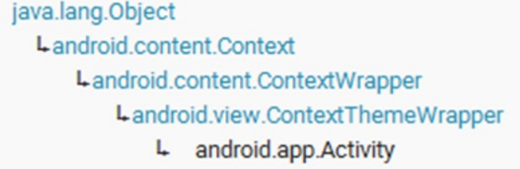

本篇要点：

1. Activity的findViewById取出控件
2. View的事件
3. onClick属性、clickable属性与事件监听
4. Button事件监听
5. Activity的继承结构

# 一、Activity的findViewById取出控件

```
<TextView
    android:id="@+id/mytextView"
    android:layout_width="wrap_content"
    android:layout_height="wrap_content"
    android:text="干什么" />

<Button
    android:id="@+id/myButton"
    android:layout_width="wrap_content"
    android:layout_height="wrap_content"
    android:text="点我" />
```

```
Button button= (Button)this.findViewById(R.id.myButton);

private void createButton_login() {
    button_login = (TextView) this.findViewById(R.id.login_page_login_button2);
    button_login.setOnClickListener(this);  //这里的this是对象见下面的回调机制
}

private void createEditText_passWd() {
    editText_passWd = (EditText) this.findViewById(R.id.login_page_edit_passwd);
}
```

# 二、View的事件

1. 事件源:产生事件的对象, 该对象可能是表示View的对象、表示硬件的对象(如GPS)、表示系统设置的对象(如设置语言)、表示手机按键(如声音键)。
2. 事件:事件源在特定情况下产生的事情，如Button(事件源)被点击会产生点击事件，屏(事件源)监听手势后产生的手势事件，封装了事件信息，该对象会被传到事件处理回调用方法的参数中
3. 监听器:事件产生后负责处理事件的对象,即监听器对象会调用自己的方法来处理.
4. 事件处理回调方法:事件产生后处理事件的方法，该方法可能在监听器类中，也可能在其它相关类中(回调用方法类似ARM的中断处理方法)，回调用方法的参数中一般都存在一个事件对象，从该对象中我们就可以取出相应的事件信息

事件发生后被处理的方式分两种：

1. 基于监听器的处理 （委托方式）
2. 基于回调方法的处理

# 三、onClick属性、clickable属性与事件监听

`onClick="方法名"` 不建议使用 `clickable="true"`，否则 `onClick` 不生效

继承implements OnClickListener，复写 onClick(View v)

```
@Override
public void onClick(View v) {
    int id = v.getId();
    switch (id) {
        case R.id.login_page:
            loginAction();
            break;
    }
}

//点击按钮时的吐司效果处理
private void loginAction() {
    String userName = editText_userName.getText().toString();
    String passWd = editText_passWd.getText().toString();
    //吐司效果
    Toast.makeText(this, "用户名是:" + userName + ",密码是:" + passWd, 500).show();
}
```

Android开源组件：http://blog.csdn.net/ethan_xue/article/details/8742691

# 四、Button事件监听

```
button.setOnKeyListener(this);
```

# 五、Activity的继承结构


