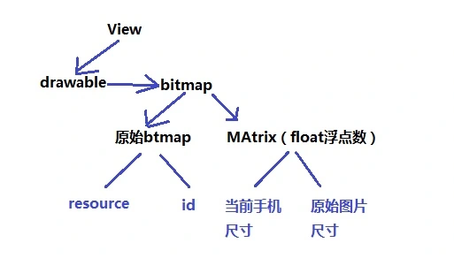
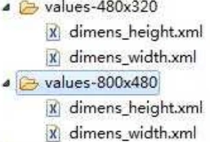
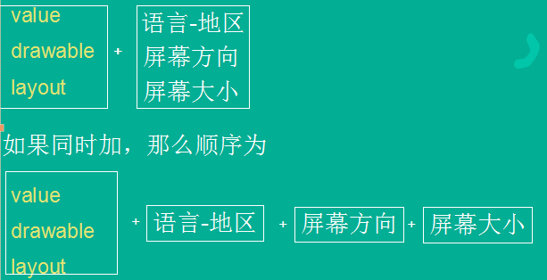

# 一、屏幕属性

```
<supports-screens android:resizeable=["true"| "false"]
    android:smallScreens=["true" | "false"]
    android:normalScreens=["true" | "false"]
    android:largeScreens=["true" | "false"]
    android:xlargeScreens=["true" | "false"]
    android:anyDensity=["true" | "false"]
    android:requiresSmallestWidthDp="integer"
    android:compatibleWidthLimitDp="integer"
    android:largestWidthLimitDp="integer"/>
```

http://blog.csdn.net/zhufuing/article/details/8024441

## (一) 屏幕尺寸

屏幕尺寸指屏幕的对角线的长度，单位是英寸，1英寸=2.54厘米

比如常见的屏幕尺寸有2.4、2.8、3.5、3.7、4.2、5.0、5.5、6.0等

## (二) 屏幕分辨率

屏幕分辨率是指在横纵向上的像素点数，单位是px，1px=1个像素点。一般以纵向像素*横向像素，如1960*1080。

屏幕像素密度（dpi ）

屏幕像素密度是指每英寸上的像素点数，单位是dpi，即“dot per inch”的缩写。屏幕像素密度与屏幕尺寸和屏幕分辨率有关，在单一变化条件下，屏幕尺寸越小、分辨率越高，像素密度越大，反之越小。dp、dip、dpi、sp、px

dip和dp是一个意思，即密度无关像素，dpi是屏幕像素密度，假如一英寸里面有160个像素，这个屏幕的像素密度就是160dpi，那么在这种情况下，dp和px如何换算呢？在Android中，规定以160dpi为基准，1dip=1px，如果密度是320dpi，则1dip=2px，以此类推。

假如同样都是画一条320px的线，在480*800分辨率手机上显示为2/3屏幕宽度，在320*480的手机上则占满了全屏，如果使用dp为单位，在这两种分辨率下，160dp都显示为屏幕一半的长度。这也是为什么在Android开发中，写布局的时候要尽量使用dp而不是px的原因。

而sp，即scale-independent pixels，与dp类似，但是可以根据文字大小首选项进行放缩，SP是设置字体大小的御用单位。

## (三) mdpi、hdpi、xdpi、xxdpi

mdpi、hdpi、xdpi、xxdpi用来修饰Android中的drawable文件夹及values文件夹，用来区分不同像素密度下的图片和dimen值。

当一个apk运行起来时，Android系统会根据其所运行的手机的屏幕密度去相对应的图片文件夹里找指定名称的图片。 注意， 先去哪个目录里找，看屏幕密度。UI适配经验：http://blog.csdn.net/xiebudong/article/details/37040263

## (四) UI屏幕适配全攻略

http://www.cocoachina.com/android/20151030/13971.html

# 二、获取屏幕尺寸

1. 获取DisplayMetrics对象
2. 调用 DisplayMetrics方法获取屏幕的宽高，像素密度（dpi）
3. 通过宽高，像素密度计算出屏幕分辨率

适配原理：



## (一) 获取DisplayMetrics对象并计算屏幕分辨率

```
//获取DisplayMetrics对象
DisplayMetrics metrics = new DisplayMetrics();
getWindowManager().getDefaultDisplay().getMetrics(metrics);

//获取屏幕的宽，高
int h = metrics.heightPixels;
int w = metrics.widthPixels;

//获取像素密度（屏幕密度）
float density = metrics.density;
int densityDpi = metrics.densityDpi;

//获取尺寸
double hInch = (double)h / (double)densityDpi;
double wInch = (double)w / (double)densityDpi;

//通过宽高，像素密度计算出屏幕分辨率
double size = Math.sqrt(hInch * hInch + wInch * wInch);
```

## (二) Bitmap-Drawable区别和转换

Bitmap - 位图，一般位图的文件格式后缀为bmp，当然编码器也有很多如RGB565、RGB888。作为一种逐像素的显示对象执行效率高，但是缺点也很明显存储效率低。我们理解为一种存储对象比较好。

Drawable - Android通用的图形对象，它可以装载常用格式的图像，比如GIF、PNG、JPG，当然也支持BMP，当然还提供一些高级的可视化对象，比如渐变、图形等。

**Drawable 转成 Bitmap**

```
((BitmapDrawable)res.getDrawable(R.drawable.youricon)).getBitmap();
```

**Bitmap 转成 Drawable**

```
Drawable d = new BitmapDrawable(bitmap);
```

## (三) 获取当前屏幕宽高，Bitmap，Matrix缩放图片

```
//获取当前手机屏幕的宽与高 （display方法）
//当前手机屏幕的宽，高
static int currentwidth;
static int currentheight;

static public void getDisplay() {
    DisplayMetrics m_DisplayMetrics= new DisplayMetrics();
    getWindowManager().getDefaultDisplay().getMetrics(m_DisplayMetrics);
    MyBitmap.getDisplay(m_DisplayMetrics);
    currentwidth = m_DisplayMetrics.widthPixels;
    currentheight = m_DisplayMetrics.heightPixels;
    setData();  //DisplayMetrics获取屏幕分辨率
}

//获取Bitmap
static public Bitmap getBitmap(Context context,int id) {
    // 获取bitmap
    Bitmap buffer = BitmapFactory.decodeResource(context.getResources(), id);
    // 获得当前图片的宽
    int width = buffer.getWidth();
    // 获得当前图片的高
    int height = buffer.getHeight();
    // 获取Matrix对象用来进行缩放
    Matrix m_Matrix = new Matrix();
    // 设置缩放的比例
    m_Matrix.setScale(w, h);
    return Bitmap.createBitmap(buffer, 0, 0, width, height, m_Matrix, true);
}  // 根据现有的图片进行缩放

//获取Drawable
static public Drawable getDrawable(Context context,int id) {
    return new BitmapDrawable(context.getResources(), getBitmap(context,id));
}

// 获取'当前手机屏幕'和'原始图宽高'比例(美术做的效果图)
static private void setData() {
    if (w == 0 || h == 0) {
        w = (float) currentwidth / width / 2;
        h = (float) currentheight / height / 2;
    }
}
```

```
import android.content.Context;
import android.graphics.Bitmap;
import android.graphics.BitmapFactory;
import android.graphics.Matrix;
import android.graphics.drawable.BitmapDrawable;
import android.graphics.drawable.Drawable;
import android.util.DisplayMetrics;

public class MyBitmap {
    static final int width = 720;
    static final int height = 1280;
    static float w = 0;
    static float h = 0;
    /**
     * 当前手机屏幕的宽
     */
    static public int currentwidth;
    /**
     * 当前手机屏幕的高
     */
    static public int currentheight;
    /**
     * 获取Drawable
     */
    static public Drawable getDrawable(Context context, int id) {
        return new BitmapDrawable(context.getResources(),
                getBitmap(context, id));
    }
    /**
     * 获取Drawable
     */
    static public Drawable getDrawable(Context context, Bitmap bitmap) {
        return new BitmapDrawable(context.getResources(), bitmap);
    }
    /**
     * 获取bitmap
     */
    static public Bitmap getBitmap(Context context, int id) {
        // 获取bitmap
        Bitmap buffer = BitmapFactory
                .decodeResource(context.getResources(), id);
        // 获得当前图片的宽
        int width = buffer.getWidth();
        // 获得当前图片的高
        int height = buffer.getHeight();
        // 获取Matrix对象用来进行缩放
        Matrix m_Matrix = new Matrix();
        // 设置缩放的比例
        m_Matrix.setScale(w, h);
        return Bitmap.createBitmap(buffer, 0, 0, width, height, m_Matrix, true);
    }
    /**
     *      * @param context
     *            上下文
     * @param id
     *            图片ID
     * @param value
     *            如果value=0，缩放比例以宽为主，如果value=1，缩放的比例以高为主
     * @return
     */
    static public Bitmap getBitmap(Context context, int id, int value) {
        // 获取bitmap
        Bitmap buffer = BitmapFactory
                .decodeResource(context.getResources(), id);
        // 获得当前图片的宽
        int width = buffer.getWidth();
        // 获得当前图片的高
        int height = buffer.getHeight();
        // 获取Matrix对象用来进行缩放
        Matrix m_Matrix = new Matrix();
        // 设置缩放的比例
        if (value == 0) {
            m_Matrix.setScale(w, w);
        } else {
            m_Matrix.setScale(h, h);
        }
        return Bitmap.createBitmap(buffer, 0, 0, width, height, m_Matrix, true);
    }
    /**
     * 获取'当前手机屏幕'和'原始效果图的宽和高(美术做的效果图)'的比例
     */
    static private void setData() {
        // 获取当前手机屏幕的宽与高
        if (w == 0 || h == 0) {
            w = (float) currentwidth / width / 2;
            h = (float) currentheight / height / 2;
        }
    }
    /**
     * 获取当前手机屏幕的宽与高
     */
    static public void getDisplay(DisplayMetrics m_DisplayMetrics) {
        currentwidth = m_DisplayMetrics.widthPixels;
        currentheight = m_DisplayMetrics.heightPixels;
        setData();
    }
}
```

# 三、屏幕适配的3种方式？

1. 根据分辨率制作多种分辨率的图标（谷歌推荐）
2. 根据图片和屏幕的比例进行屏幕适配
3. 联网线上下载最适合的图片

# 四、自适应

## (一) layout自适应

1）layout自适应直接使用确定的大小作为布局文件所在文件夹名字的末字符（高x宽） Layout匹配优先级：物理尺寸》方向》像素尺寸。

**按像素尺寸自适应**

layout-640x360:创建适应640x360的布局文件 layout-800x480:创建适应800x480的布局文件 layout-480x320:创建适应480x320的布局文件 ..... layout:创建一个通用版的布局文件

**按方向自适应**

layout-land表示横屏自适应  layout-port表示竖屏自适应  如果屏幕大小横屏竖屏同适应，则在layout-port或layout-land后再加屏幕大小layout-port-640x360 layout-land-640x360

**按物理尺寸自适应**

layout-small (屏幕尺寸小于3英寸左右的布局）

layout-normal (屏幕尺寸小于4.5英寸左右）

layout-large  (4英寸-7英寸之间）

layout-xlarge (7-10英寸之间）

同时加上横屏竖屏自适应: layout-port-large、layout-land-large

## (二) drawable自适应

图片所在文件夹的名字如下，把图片放入其中

- ldpi：240x320（120dpi）
- mdpi：320x480（160dpi）
- hdpi：480x800、480x854（240dpi）
- xhdpi：至少960*720（320dpi）
- xxhdpi：1280×720

比如480x320的手机会先在mdpi中找，如果没有找到，会去hdpi中，如果在hdpi中找到了，就使用之，但是系统会认为该图片需要被缩小，因此，会将图片缩小后再使用。

## (三) value文件自适应

value与drawable和layout相同，可以采用类似的策略



# 五、国际化

创建value文件名后面加上“语言-地区”，可以让value中资源文件国际化

在drawable文件名后面加上“语言-地区”，可以让图片中资源文件国际化

语言码由两个小写字母组成：中文（zh）

国家码由两个大写字母组成：China（CN）



获取本机的区域和语言：

```
Locale mLocale = Locale.getDefault();
String country = mLocale.getCountry();
String language = mLocale.getLanguage();
```
