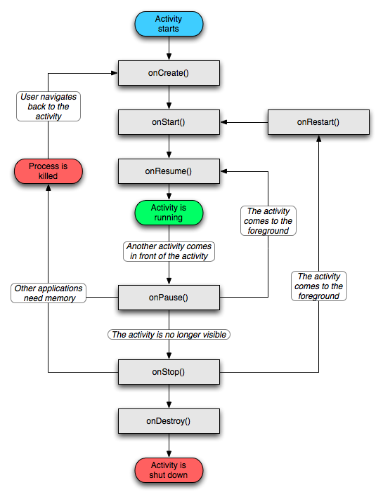

# 一、Activity状态保存

当应用被关掉时，数据在什么保存

```
protected void onsavedInstanceState(Bundle savedInstanceState) {};
```

当应用再次被启动时，在什么地方取回数据

```
protected void onRestoreInstanceState(Bundle savedInstanceState) {};

protected void onCreate(Bundle savedInstanceState);
```

保存Activity运行状态 http://blog.csdn.net/tangcheng_ok/article/details/6755194

通过重写onSaveInstanceState()方法来实现Activity的运行状态，注意以下几点：

1. 由于activity 对象被暂停或停止时，它仍然保留在内存里面，关于它的成员信息和当前状态都是活动的，所以此时可以保存Activity的状态，从而使用户所作的Activity的更改保存在内存中
2. 当系统回收内存而将Activity销毁时，就无法保存其状态，所以需要调用onSaveInstanceState()方法来实现状态的保存
3. 很多情况并不需要保持状态信息，比如按下返回键直接关闭程序，所以并不能保证会调用onSaveInstanceState()。如果调用了该方法，一般是在onStop 方法之前且可能在 onPause 之后调用。尽管如此，即使你没做任何操作或没有实现 onSaveInstanceState() 方法，你的 activity 状态也能通过Activity 类里面默认实现的 onSaveInstanceState 方法恢复出来。特别是会为布局中的视图（ View ）默认调用onSaveInstanceState 方法，并在这个方法中允许每一个视图提供它需要恢复的任何信息。几乎每一个 Android框架中的 widget 都视情况实现了这个方法。

注：因为 onSaveInstanceState 方法不一定会被调用，所以你应该只是用它来保存一些 activity 的转换过程状态（即 UI 的状态），而不能用来保存永久性数据。但你可以用 onPause 方法在用户离开 activity 时来保存永久性数据，比如需要保存到数据库的数据。

有一个很好的方法可以用来检验应用程序保存状态的能力，就是简单地旋转你的设备来改变屏幕的方向。因为当屏幕方向改变时，系统为了给新的方向提供一个可能合适的代替资源，会销毁 activity 并新建一个新的。由于这个原因，你的 activity 是否能在其重新创建时完成保存状态就显得尤为重要，因为用户经常会在使用应用程序时旋转屏幕的。

# 二、Activity被返回键

在activity里面重写`public boolean onKeyDown(int keyCode, KeyEvent event)`

如果当前的 keyCode==KeyEvent.KEYCODE_BACK 就说明当前页面被点击了返回按键

Activity对话框实现：android:theme="@android:style/Theme.Dialog"

监听返回键并退出所有Activity示例 http://www.tuicool.com/articles/e6JbIz

```
@Override
public boolean onKeyDown(int keyCode, KeyEvent event) {
    // TODO Auto-generated method stub

    if (keyCode == KeyEvent.KEYCODE_BACK){
        // 弹出确定退出对话框
        new AlertDialog.Builder(this)
                .setTitle("退出")
                .setMessage("确定退出吗？")
                .setPositiveButton("确定", new DialogInterface.OnClickListener() {

                    @Override
                    public void onClick(DialogInterface dialog, int which) {
                        // TODO Auto-generated method stub

                        Intent exit = new Intent(Intent.ACTION_MAIN);
                        exit.addCategory(Intent.CATEGORY_HOME);
                        exit.setFlags(Intent.FLAG_ACTIVITY_NEW_TASK);
                        startActivity(exit);
                        System.exit(0);
                    }
                })
                .setNegativeButton("取消", new DialogInterface.OnClickListener() {

                    @Override
                    public void onClick(DialogInterface dialog, int which) {
                        // TODO Auto-generated method stub
                        dialog.cancel();
                    }
                })
                .show();
        // 这里不需要执行父类的点击事件，所以直接return
        return true;
    }
    // 继续执行父类的其他点击事件
    return super.onKeyDown(keyCode, event);
}
```

# 三、关闭一个 Activity

finish方法销毁：当前activity调用this.finish();

# 四、Activity启动模式

四种启动模式

如何启动

Activity有四种加载模式：

http://blog.csdn.net/zapzqc/article/details/8493481

- standard
- singleTop
- singleTask
- singleInstance

设置的位置在AndroidManifest.xml文件中activity元素的android:launchMode属性：

```
<activity android:name="ActB" android:launchMode="singleTask"></activity>
```

## (一) standard

http://blog.csdn.net/shinay/article/details/7898492

默认模式，可以不用写配置。“拿来主义”standard模式。哪里需要调用我我就去哪里，可以多次实例化，可以几个相同的Activity重叠。

例如：

若我有一个Activity名为A1, 上面有一个按钮可跳转到A1。那么如果我点击按钮，便会新启一个Activity A1叠在刚才的A1之上，再点击，又会再新启一个在它之上……

点back键会依照栈顺序依次退出。

## (二) singleTop

“拒绝堆叠”singleTop模式。可以多次实例化，但是不可以多个相同的Activity重叠，当堆栈的顶部为相同的Activity时，会调用onNewIntent函数。

例如：

若我有两个Activity名为B1,B2,两个Activity内容功能完全相同，都有两个按钮可以跳到B1或者B2，唯一不同的是B1为standard，B2为singleTop。

若我意图打开的顺序为B1->B2->B2，则实际打开的顺序为B1->B2（后一次意图打开B2，实际只调用了前一个的onNewIntent方法）

若我意图打开的顺序为B1->B2->B1->B2，则实际打开的顺序与意图的一致，为B1->B2->B1->B2。

## (三) singleTask

只有一个实例。在同一个应用程序中启动他的时候，若Activity不存在，则会在当前task创建一个新的实例，若存在，则会把task中在其之上的其它Activity destory掉并调用它的onNewIntent方法。

如果是在别的应用程序中启动它，则会新建一个task，并在该task中启动这个Activity，singleTask允许别的Activity与其在一个task中共存，也就是说，如果我在这个singleTask的实例中再打开新的Activity，这个新的Activity还是会在singleTask的实例的task中。

例如：

若我的应用程序中有三个Activity,C1,C2,C3，三个Activity可互相启动，其中C2为singleTask模式，那么，无论我在这个程序中如何点击启动，如：C1->C2->C3->C2->C3->C1-C2，C1,C3可能存在多个实例，但是C2只会存在一个，并且这三个Activity都在同一个task里面。

但是C1->C2->C3->C2->C3->C1-C2，这样的操作过程实际应该是如下这样的，因为singleTask会把task中在其之上的其它Activity destory掉。

操作：C1->C2  C1->C2->C3  C1->C2->C3->C2  C1->C2->C3->C2->C3->C1  C1->C2->C3->C2->C3->C1-C2

实际：C1->C2  C1->C2->C3  C1->C2  C1->C2->C3->C1  C1->C2

## (四) singleInstance

只有一个实例，并且这个实例独立运行在一个task中，这个task只有这个实例，不允许有别的Activity存在。例如：程序有三个ActivityD1,D2,D3，三个Activity可互相启动，其中D2为singleInstance模式。那么程序从D1开始运行，假设D1的taskId为200，那么从D1启动D2时，D2会新启动一个task，即D2与D1不在一个task中运行。假设D2的taskId为201，再从D2启动D3时，D3的taskId为200，也就是说它被压到了D1启动的任务栈中。若是在别的应用程序打开D2，假设Other的taskId为200，打开D2，D2会新建一个task运行，假设它的taskId为201，那么如果这时再从D2启动D1或者D3，则又会再创建一个task，因此，若操作步骤为other->D2->D1，这过程就涉及到了3个task了。

## (五) 启动一个 Activity（无参，带参）

http://blog.csdn.net/sam_zhang1984/article/details/6430817

通过调用 startActivity() 方法，并传递进一个描述你想要启动activity的意图，你就可以启动其它 activity 了。被传递的这个意图即可以明显指定你要启动的 activity ，也可以描述你想执行的动作。通过后者的方式，系统会为你选择一个合适的 activity 来执行，当然是包括不同应用中的activity 。一个意图同时可以携带一些目标 activity 需要的轻量级数据。

当在你自己的应用程序中工作时，你经常需要启动一个已知的 activity 。启动方法就用一个包含有类名明的意图确指定你想启动的 activity ，然后传递过去就行。下面例子就演示了如何启动一个名叫 SignInActivity 的 activity ：

```
Intent intent = new Intent(this, SignInActivity.class);
startActivity(intent);
```

你有时可能需要用你自己的数据然后在其它 activity 中执行某一个动作，比如发邮件、发短信或更新状态等。在这种情况下，有可能你自己的应用程序中没有可以执行这个动作的 activity ，那么你就可以使用另一种代替的方法来完成这个操作：让设备上其它应用程序中能为你执行这个动作的 activity 为你执行。这就是意图的真正价值所在，你可以创建一个描述你要执行动作的意图，然后系统就会为你激发一个其它程序中合适的 activity 。如果设备上有多个 activity 能胜任这个动作，那么就由用户自己去选择是用哪一个去执行。以下给出创建一个能让用户发邮件的意图：

```
Intent intent = new Intent(Intent.ACTION_SEND);
intent.putExtra(Intent.EXTRA_EMAIL, recipientArray);
startActivity(intent);
```

上面的 EXTRA_EMAIL 附加字符串数据就是送邮件时收件人的地址（ EXTRA_EMAIL 是一个键，真正的值即收件人地址是后面 recipientArray @Sam ）。当一个 Email 程序对这个意图进行响应时，它会把这个附加字符串放到新建邮件的收信人一栏中。这时 Email 程序的 activity 将被启动，当你完成了发邮件操作后返回时，你的 activity 就又恢复了！

## (六) 启动一个带返回值的 activity

有时你可能需要从你所启动的 activity 中返回数据，这种情况下，启动 activity 时就需要调用 startActivityForResult() 而不是 startActivity() 。通过实现 onActivityResult() 回调方法，就可以接收被启动 activity 的返回值。当被启动 activity 执行完成后，它将返回一个意图（ Intent ）给 onActivityResult() 方法。

举个例子，你或许需要用户去选取一个联系人，然后你的 activity 就可以对这个联系人信息进行相关处理。下面就给出了如何去创建这样一个意图并其返回值的代码：

```
private void pickContact() {
    // Create an intent to "pick" a contact, as defined by the content provider URI
    Intent intent = new Intent(Intent.ACTION_PICK, Contacts.CONTENT_URI);
    startActivityForResult(intent, PICK_CONTACT_REQUEST);
}

@Override
protected void onActivityResult(int requestCode, int resultCode, Intent data) {
    // If the request went well (OK) and the request was PICK_CONTACT_REQUEST
    if (resultCode == Activity.RESULT_OK && requestCode == PICK_CONTACT_REQUEST) {
        // Perform a query to the contact's content provider for the contact's name
        Cursor cursor = getContentResolver().query(data.getData(),
                new String[] {Contacts.DISPLAY_NAME}, null, null, null);
        if (cursor.moveToFirst()) { // True if the cursor is not empty
            int columnIndex = cursor.getColumnIndex(Contacts.DISPLAY_NAME);
            String name = cursor.getString(columnIndex);
            // Do something with the selected contact's name...
        }
    }
}
```

这个例子为我们展现了用 onActivityResult() 方法处理 activity 返回值的基本逻辑模型。首先，检测请求是否成功（即 resultCode 是否为RESULT_OK ）；其次，检测是否是当前请求是否是已知的（即 requestCode 是否与 startActivityForResult() 的第二个参数匹配）；最后，代码中通过查询一个 Intent 类型数据（即第三个参数 data ）来处理 activity 返回值。  其中有一个 ContentResolver 执行了一个针对内容提供器（ content provider ）的查询，并返回一个允许去读限实际数据的游标（ Cursor ）。

# 五、Application数据保存

http://www.cnblogs.com/renqingping/archive/2012/10/24/Application.html

1. 定义一个类继承Application
2. 重写onCreate()
3. 在当前类实现单例
4. 在（AndroidManifest.xml）文件注册

Application类

Application和Activity,Service一样是Android框架的一个系统组件，当Android程序启动时系统会创建一个Application对象，用来存储系统的一些信息。

Android系统自动会为每个程序运行时创建一个Application类的对象且只创建一个，所以Application可以说是单例（singleton）模式的一个类。

通常我们是不需要指定一个Application的，系统会自动帮我们创建，如果需要创建自己的Application，那也很简单！创建一个类继承Application并在AndroidManifest.xml文件中的application标签中进行注册（只需要给application标签增加name属性，并添加自己的 Application的名字即可）。

启动Application时，系统会创建一个PID，即进程ID，所有的Activity都会在此进程上运行。那么我们在Application创建的时候初始化全局变量，同一个应用的所有Activity都可以取到这些全局变量的值，换句话说，我们在某一个Activity中改变了这些全局变量的值，那么在同一个应用的其他Activity中值就会改变。

Application对象的生命周期是整个程序中最长的，它的生命周期就等于这个程序的生命周期。因为它是全局的单例的，所以在不同的Activity,Service中获得的对象都是同一个对象。所以可以通过Application来进行一些，如：数据传递、数据共享和数据缓存等操作。

应用场景：

在Android中，可以通过继承Application类来实现应用程序级的全局变量，这种全局变量方法相对静态类更有保障，直到应用的所有Activity全部被destory掉之后才会被释放掉。

1. 继承Application

2. 重写onCreate()

   ```
   public class CustomApplication extends Application
   {
     private static final String VALUE = "Harvey";

     private String value;// 单例模式

     @Override
     public void onCreate()
     {
       super.onCreate();
       setValue(VALUE); // 初始化全局变量
     }
   }
   ```

3. 在ApplicationManifest.xml文件中配置自定义的Application

   ```
   <application
     android:name="CustomApplication"> </application>
   ```

# 六、什么是Activity，Activity生命周期？

1. 创建对象onCreate（）
2. 界面显示onStart（）onRestart（）
3. 可交互onResume（）
4. 失去交互onPause（）
5. 界面消失onStop（）
6. 对象销毁onDestroy（)

开始运行app的的时候执行创建对象onCreate（）界面显示onStart（）可交互onResume（）

退出按钮的时候执行失去交互onPause（）界面消失onStop（）对象销毁onDestroy（)

返回桌面的时候执行失去交互onPause（）界面消失onStop（）

再次回到app时执行onRestart（）界面显示onStart（）可交互onResume（）

跳转到其他Activity时执行失去交互onPause（）

从其他Activity返回来执行onResume（）



Activity就是布满整个窗口或者悬浮于其他窗口上的交互界面。在一个应用程序中通常由多个Activity构成，都会在Manifest.xml中指定一个主的Activity，如下设置

```
<action android:name="android.intent.action.MAIN" />
```

一般情况下，在一个应用程序的多个 Activity 中有一个 Activity 会被指定成主 Activity ，这样当程序第一次运行时用户就会首先看到这个 Activity 的界面。程序运行后，每一个 Activity 都可以启动其它 Activity 来实现用户的操作，当启动了一个新的 Activity 后，旧的 Activity 将会停止，而新的 Activity 会被系统压到一个栈中（称为“ back stack ”）。即当有一个新的 Activity 启动时，系统会把这个 Activity 压入到 back stack 中并获取用户的焦点。这个 back stack 遵循“后进先出”的队列原则，因此，当用户操作完当前 Activity 并按了“返回”值后，当前这个 Activity 将会从栈中被弹出并销毁，之前的 Activity 将重新恢复。

当一个 Activity 由于有新的 Activity 被启动而停止时，它将会通过 Activity 的生命周期回调方法获取到这个状态改变的信息。一个 Activity 可能会因为状态的改变而收到多个回调方法，无论是系统创建了这个 Activity 、停止这个 Activity 、恢复这个 Activity ，还是销毁这个 Activity ，都会接收到一个回调方法。利用这些回调方法，你可以在 Activity 状态改变时进行一些相应的操作工作，比如当 Activity 在停止时，你可以释放像网络连接和数据库连接这样的一些重量级的对象；当 Activity 恢复时，你可以重新申请必要的资源和恢复一些中断的动作。这些状态之间的转换就构成了一个 Activity 生命周期。
