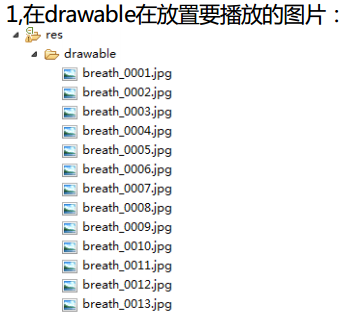
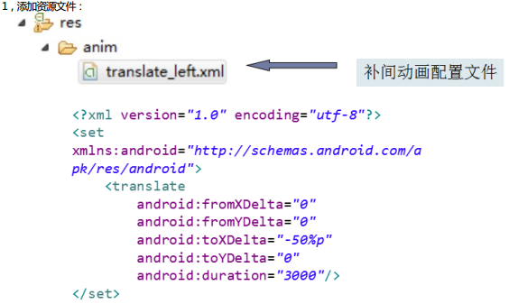

- 动画有几种和区别？
- 自定view
  - 自定义类，并且继承View，重写构造函数
  - 创建一个Bitmap
  - 重写方法 onDraw(Canvas canvas)
  - 绘制图片  先创建一个画笔  paint = new Paint();
- 帧动画的实现
- 补间动画实现

# 一、动画有几种和区别？

http://wang-peng1.iteye.com/blog/572886

逐帧动画(frame-by-frame animation)：是用一组图片轮流绘制，产生动画的感觉。类似于gif图片。

补间动画(tween animation)：通过改变UI的属性(大小、位置、透明度等)来实现动画效果。可以控制动画的播放快慢以及加速度。

区别：补间也叫渐变动画的所有操作是通过矩阵变换对同一个物体（绘制的一个view或者图片）进行操作产生动画。逐帧动画是多个物体（多张图片）进行绘制，可以说这多张图片是不相关的（从播放的角度来看只能说是内容相关）。

# 二、自定view

## (一) 编码一个自定义的view,并且继承RelativeLayout

## (二) 重写它的构造函数

```
public TabView(Context context, AttributeSet attrs, int defStyle)
public TabView(Context context, AttributeSet attrs)
public TabView(Context context)
```

## (三) 把上下文环境保存为全局变量

## (四) 把某个布局文件转换为view

```
View view=  ((Activity) context).getLayoutInflater().inflate(R.layout.tab_view, null);
```

其中R.layout.tab_view是已经写好了的布局文件

## (五) 把转换的view添加到自定义view （ this.addView(view); ）

## (六) 获取View里面的控件

- （1）自定义类，并且继承View，重写构造函数
- （2）创建一个Bitmap
- （3）重写方法 onDraw(Canvas canvas)
- （4）绘制图片  先创建一个画笔  paint = new Paint();

View即普通的控件，没有子布局的，如Button、TextView等。

ViewGroup继承自View，表示可以有子控件，如Linearlayout、Listview等。

```
public class MyView extends View implements Runnable {

    public MyView(Context context, AttributeSet attrs, int defStyle) {
        super(context, attrs, defStyle);
        init(context);
    }

    public MyView(Context context, AttributeSet attrs) {
        super(context, attrs);
        init(context);
    }

    public MyView(Context context) {
        super(context);
        init(context);
    }

    //飞机图片
    Bitmap bitmapPlayer;
    //飞机的坐标
    int playerX, playerY;
    //画笔
    Paint m_paint;
    Context context

    private void init(Context context) {
        this.context = context; (另一个类传过来的context)
        createBitmap();
        createPaint();
        startThread();
    }

    // 创建相关的图片
    private void createBitmap() {
        createBitmapPlayer();
    }

    // 创建飞机图片
    private void createBitmapPlayer() {
        bitmapPlayer = MyBitmap.getBitmap(context, R.drawable.player);

        //获得当前飞机图片的宽
        int playerWidth = bitmapPlayer.getWidth();
        //获得当前飞机图片的高
        int playerHeight = bitmapPlayer.getHeight();

        playerX = 0;
        playerY = MyBitmap.currentheight / 2;
    }

    private void createPaint() {
        m_paint = new Paint();
        // 设置为抗锯齿
        m_paint.setAntiAlias(true);
    }

    @Override
    protected void onDraw(Canvas canvas) {
        super.onDraw(canvas);
        canvas.drawBitmap(bitmapPlayer, playerX, playerY, m_paint);
    }
}
```

# 三、帧动画的实现



在res/drawable/文件夹下创建一个XML文件

```
<animation-list
    xmlns:android="http://schemas.android.com/apk/res/android"
    android:oneshot="false">

    <item android:drawable="@drawable/qq001" android:duration="80" />
    <item android:drawable="@drawable/qq002" android:duration="80" />
    <item android:drawable="@drawable/qq003" android:duration="80" />
    <item android:drawable="@drawable/qq004" android:duration="80" />
    <item android:drawable="@drawable/qq005" android:duration="80" />
    <item android:drawable="@drawable/qq006" android:duration="80" />
    <item android:drawable="@drawable/qq007" android:duration="80" />
    <item android:drawable="@drawable/qq008" android:duration="80" />
</animation-list>
```

2,在drawable创建帧动画配置文件，配置文件中要配置的是图片列表，以即每张图片的停留时间:

3,为View背景属性设置成帧动画配置文件:

方式一 android:background="@drawable/帧动画配置文件名"

方式二 view.setBackgroundResource(R.drawable.帧动画配置文件名);

4,通过上一步的view取出AnimationDrawable 对象 :

```
AnimationDrawable anim = (AnimationDrawable) view.getBackground();
```

5,为AnimationDrawable设置属性:

1. anim.setOneShot(true);设置只播放一次
2. anim.stop();停止播放
3. anim.start();开发播放

# 四、补间动画的实现

- 1 补间动画原理
- 2 补间动画四大类
- 3 应用

## (一) 补间动画原理

实现该动画时，只需要给出两个关键帧的相关属性，Android会给你生给定成时间段内的两关键帧的动画渐变过程。



## (二) 创建动画

```
Animation animation1 = AnimationUtils.loadAnimation(this, R.anim.translate_left);
```

## (三) 开始动画

```
view.startAnimation(animation1);
```

## (四) 设置监听器

```
animation1.setAnimationListener(new AnimationListener() {
    @Override  //监听补间动画开始
    public void onAnimationStart(Animation arg0) {
    }

    @Override  //监听重开始补间动画
    public void onAnimationRepeat(Animation arg0) {
    }

    @Override  //监听补间动画结束
    public void onAnimationEnd(Animation arg0) {
    }
});
```

```
public class MainActivity extends Activity implements OnClickListener {

    private Button startBtn;
    private View view;

    @Override
    protected void onCreate(Bundle savedInstanceState) {
        super.onCreate(savedInstanceState);
        this.setContentView(R.layout.activity_main);
        this.init();
    }

    private void init() {
        this.startBtn = (Button) this.findViewById(R.id.startBtn);
        this.view = this.findViewById(R.id.view);
        this.startBtn.setOnClickListener(this);
    }

    @Override
    public void onClick(View v) {
        // 创建补间动画
        Animation animation1 = AnimationUtils.loadAnimation(this, R.anim.t);
        // 让view开始动画
        view.startAnimation(animation1);

        animation1.setAnimationListener(new AnimationListener() {
            // 动画开始事件
            @Override
            public void onAnimationStart(Animation animation) {
                Toast.makeText(MainActivity.this, "开始动了", 1).show();
            }

            // 重得执行动画事件
            @Override
            public void onAnimationRepeat(Animation animation) {
            }

            // 动画结束事件
            @Override
            public void onAnimationEnd(Animation animation) {
                Toast.makeText(MainActivity.this, "结束动了", 1).show();
            }
        });
    }
}
```

## (五) 补间动画四大类

1)透明补间动画示例

```
<?xml version="1.0" encoding="utf-8"?>
<set xmlns:android="http://schemas.android.com/apk/res/android"
    android:fillAfter="true"
    android:fillEnabled="true" >

    <alpha
        android:duration="2000"
        android:fromAlpha="1"
        android:repeatCount="1"
        android:repeatMode="reverse"
        android:toAlpha="0" />
</set>
```

2) 旋转补间动画

```
<?xml version="1.0" encoding="utf-8"?>
<set xmlns:android="http://schemas.android.com/apk/res/android" >

    <rotate
        android:duration="2000"
        android:fromDegrees="0"
        android:interpolator="@android:anim/accelerate_interpolator"
        android:pivotX="50%"
        android:pivotY="50%"
        android:toDegrees="720" >
    </rotate>

    <rotate
        android:duration="2000"
        android:fromDegrees="360"
        android:interpolator="@android:anim/accelerate_interpolator"
        android:pivotX="50%"
        android:pivotY="50%"
        android:startOffset="2000"
        android:toDegrees="0" >
    </rotate>
</set>
```

3) 缩放补间动画

```
<?xml version="1.0" encoding="utf-8"?>
<set xmlns:android="http://schemas.android.com/apk/res/android" >

    <scale
        android:duration="2000"
        android:fillAfter="true"
        android:fromXScale="1"
        android:fromYScale="1"
        android:interpolator="@android:anim/decelerate_interpolator"
        android:pivotX="50%"
        android:pivotY="50%"
        android:repeatCount="1"
        android:repeatMode="reverse"
        android:toXScale="2.0"
        android:toYScale="2.0" />
</set>
```

4) 移动补间动画

```
<?xml version="1.0" encoding="utf-8"?>
<set xmlns:android="http://schemas.android.com/apk/res/android" >

    <translate
        android:duration="2000"
        android:fillAfter="true"
        android:fromXDelta="0"
        android:fromYDelta="0"
        android:repeatCount="1"
        android:repeatMode="reverse"
        android:toXDelta="860"
        android:toYDelta="0" >
    </translate>
</set>
```

## (六) 应用

```
<?xml version="1.0" encoding="utf-8"?>
<set xmlns:android="http://schemas.android.com/apk/res/android"
    android:fillAfter="true" >

    <scale
        android:duration="2000"
        android:fromXScale="1"
        android:fromYScale="1"
        android:interpolator="@android:anim/decelerate_interpolator"
        android:pivotX="50%"
        android:pivotY="50%"
        android:repeatCount="1"
        android:repeatMode="reverse"
        android:toXScale="2.0"
        android:toYScale="2.0" />

    <translate
        android:duration="2000"
        android:fromXDelta="0"
        android:fromYDelta="0"
        android:repeatCount="1"
        android:repeatMode="reverse"
        android:toXDelta="860"
        android:toYDelta="0" />
</set>
```
