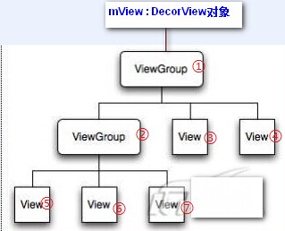

1. 原理，流程 http://www.cnblogs.com/linjzong/p/4191891.html
2. 了解MotionEvent(一) http://www.cnblogs.com/leaven/p/3462455.html
   Muilti-touch 双指缩放的实现探索 http://blog.csdn.net/barryhappy/article/details/73923262
3. dispatchTouchEvent（事件的分发）
4. onInterceptTouchEvent（事件的拦截）
5. onTouchEvent事件（事件的处理）

# 一、原理，流程

原理： Touch事件分发中只有两个主角:ViewGroup，View。

View即普通的控件，没有子布局的，如Button、TextView等。 ViewGroup继承自View，表示可以有子控件，如Linearlayout、Listview等。

Activity的Touch事件事实上是调用它内部的ViewGroup的Touch事件，可以直接当成ViewGroup处理。

ViewGroup触发OnTouch事件时Android的ViewGroup会调用如下三个函数：

- `public boolean dispatchTouchEvent(MotionEvent ev)`——用于事件的分发
- `public boolean onInterceptTouchEvent(MotionEvent ev)`——用于事件的拦截
- `public boolean onTouchEvent(MotionEvent ev)`——用于事件的处理

当然我们可以在容器类中如继承自ViewGroup的类中重写这三个方法。而继承View类的子类只能重写dispatchTouchEvent和onTouchEvent两个方法。当点击后这三个方法相继执行。

View的相关事件只有两个：

dispatchTouchEvent、onTouchEvent。

流程：先分析ViewGroup的处理流程：首先得有个结构模型概念：ViewGroup和View组成了一棵树形结构，最顶层为Activity的ViewGroup，下面有若干的ViewGroup节点，每个节点之下又有若干的ViewGroup节点或者View节点，依次类推。如图：

下发顺序是这样的：①-②-⑤-⑥-⑦-③-④。

dispatchTouchEvent方法只负责事件的分发，当返回为true时，顺序下发会中断。

在上述例子中如果⑤的dispatchTouchEvent返回结果为true，那么⑥-⑦-③-④将都接收不到本次Touch事件。

## (一) onTouch方法：（先）

onTouch方法是View的 OnTouchListener接口中定义的方法。当一个View绑定了OnTouchLister后，当有touch事件触发时，就会调用onTouch方法。（当把手放到View上后，onTouch方法被一遍一遍地被调用）

## (二) onTouchEvent方法：（后）

onTouchEvent方法是override 的Activity的方法。重写了Activity的onTouchEvent方法后，当屏幕有touch事件时，此方法就会别调用。（当把手放到Activity上时，onTouchEvent方法就会一遍一遍地被调用）

## (三) touch事件的传递

在一个Activity里面放一个TextView的实例tv，并且这个tv的属性设定为 fill_parent

在这种情况下，当手放到屏幕上的时候，首先会是tv响应touch事件，执行onTouch方法。

如果onTouch返回值为true，表示这个touch事件被onTouch方法处理完毕，不会把touch事件再传递给Activity，也就是说onTouchEvent方法不会被调用。（当把手放到屏幕上后，onTouch方法被一遍一遍地被调用）

如果onTouch的返回值是false，表示这个touch事件没有被tv完全处理，onTouch返回以后，touch事件被传递给Activity，onTouchEvent方法被调用。

# 二、dispatchTouchEvent（事件的分发）

dispatchTouchEvent：此方法一般用于初步处理事件，因为动作是由此分发  通常会调用super.dispatchTouchEvent。这样就会继续调用onInterceptTouchEvent，再由onInterceptTouchEvent决定事件流向。

当我们触摸屏幕时，就会触发Activity的dispatchTouchEvent()。dispatchTouchEvent方法只负责事件的分发，它拥有boolean类型的返回值，当返回为true时，顺序下发会中断。

而事件即MotionEvent，最重要的有3个:

- MotionEvent.ACTION_DOWN——按下View，是所有事件的开始
- MotionEvent.ACTION_MOVE——滑动事件
- MotionEvent.ACTION_UP——松开View，也表示开始

# 三、onInterceptTouchEvent（事件的拦截）

onInterceptTouchEvent： 是ViewGroup提供的方法， 默认返回false这样才能把事件传给View里的onTouchEvent， 返回true表示拦截。

若返回值为True事件会传递到自己的onTouchEvent()。

若返回值为False传递到下一个view的dispatchTouchEvent()。

# 四、onTouchEvent事件（事件的处理）

onTouchEvent()： ViewGroup里的onTouchEvent默认值是false。 View里的onTouchEvent返回默认值是true， 表示消费了这个事件， 这样才能执行多次touch事件。

若返回值为True，事件由自己处理消耗，后续动作序列让其处理。

若返回值为False，自己不消耗事件了，向上返回让其他的父view的onTouchEvent接受处理。
