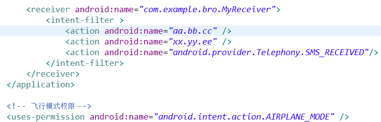
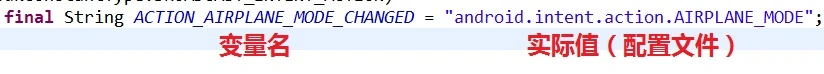
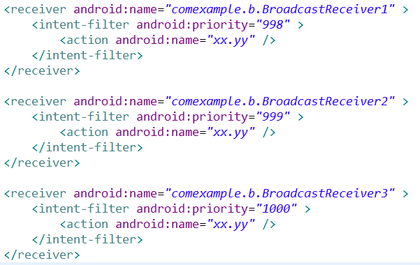

- 广播的机制
- 广播的发送，创建和注册
- 广播的生命周期
- 广播的种类
  1. Normal Broadcast：普通广播
  2. System Broadcast: 系统广播
  3. Ordered broadcast：有序广播
  4. Sticky Broadcast：粘性广播（淘汰）
  5. Local Broadcast：App应用内广播
- 项目开机自启动

# 一、广播的机制

http://www.cnblogs.com/lwbqqyumidi/p/4168017.html

- 广播分为两个方面：广播发送者和广播接收者
- 广播发送和接收都需要指定频率
- 广播通信方式：

1. 同一app内部的同一组件内的消息通信（单个或多个线程之间）
2. 同一app内部的不同组件之间的消息通信（单个进程）；
3. 同一app具有多个进程的不同组件之间的消息通信；
4. 不同app之间的组件之间消息通信；
5. Android系统在特定情况下与App之间的消息通信。

# 二、广播的发送，创建和注册

发送，创建：

http://blog.csdn.net/xiazdong/article/details/7768807/

注册：

http://liangruijun.blog.51cto.com/blog/3061169/655885

## (一) 广播发送者

广播发送者：

```
Intent intent = new Intent();
intent.setAction("...");
Context.sendBroadcast(intent);
```

```
//Object  Context  ContextWrapper  ContextThemeWrapper  Activity MainActivity
```

sendBroadcast方法继承自ContextWrapper，是Context的抽象类

```
public class MainActivity extends Activity {

    @Override
    protected void onCreate(Bundle savedInstanceState) {
        super.onCreate(savedInstanceState);
        setContentView(R.layout.activity_main);
    }

    //带参数

    public void send1(View v) {
        Intent intent = new Intent();
        intent.setAction("aa.bb.cc");
        //参数代表广播类型，是自定义的任意字符串

        Bundle bundle = new Bundle();
        bundle.putChar("sex", '男');
        bundle.putString("name", "小王");
        bundle.putInt("age", 30);
        intent.putExtras(bundle);

        //再调用ContextWrapper为中的sendBroadcast(Intent intent);
        this.sendBroadcast(intent);
        //发广播
    }

    //不带参数

    public void send2(View v) {
        Intent intent = new Intent();
        intent.setAction("xx.yy.ee");
        //参数代表广播类型，是自定义的任意字符串

        //再调用ContextWrapper为中的sendBroadcast(Intent intent);
        this.sendBroadcast(intent);
        //发广播
    }

}
```

## (二) 广播接收者（配置文件 && 权限）

广播接收者（配置文件）：

```
public class Receiver extends BroadcastReceiver{
    public void onReceive(Context context, Intent intent) {
        Bundle bundle = intent.getExtras();
        ...
    }
}
```

、



```
<receiver android:name="com.example.bro.MyReceiver">

    <intent-filter>
        <action android:name="aa.bb.cc" />
        <action android:name="xx.yy.ee" />
        <action android:name="android.provider.Telephony.SMS_RECEIVED"/>
    </intent-filter>

</receiver>
```



```
public class MyReceiver extends BroadcastReceiver {

    @Override
    public void onReceive(Context context, Intent intent) {

        String s = Intent.ACTION_AIRPLANE_MODE_CHANGED;    //变量

        String type = intent.getAction();    //广播类型

        if ("aa.bb.cc".equals(type)) {
            //带参数广播普通类型

            Toast.makeText(context, "收到广播了"+type, Toast.LENGTH_LONG).show();

            Bundle b = intent.getExtras();
            int age = b.getInt("age");    //30
            String name = b.getString("name");    //小王
            char sex = b.getChar("sex");    //男

            Toast.makeText(context, "name:"+name+",age:"+age+",sex:"+sex, Toast.LENGTH_LONG).show();
        }else if("xx.yy.ee".equals(type)) {
            //不带参数广播普通类型

            Toast.makeText(context, "收到广播了"+type, Toast.LENGTH_LONG).show();
        }else if("android.provider.Telephony.SMS_RECEIVED".equals(type)) {
            Toast.makeText(context, "收到广播了"+type, Toast.LENGTH_LONG).show();
            //通过intent取出短信内容。在通知栏上通知。
        }

    }

}
```

## (三) 注册BroadcastReceiver两种方式

1. 方式一，静态的在AndroidManifest.xml中用`<receiver>`标签声明注册，并在标签内用`<intent-filter>`标签设置过滤器。
2. 方式二，动态地在代码中先定义并设置好一个 IntentFilter对象，然后需要才调用注册：

```
BroadcastReceiver mReceiver = new MyBroadcastReceiver(tv);
IntentFilter mFilter = new IntentFilter();
mFilter.addAction(String);
registerReceiver(mReceiver, mFilter);
```

# 三、广播的生命周期

广播接收器监听到广播创建对象。当 onReceive() 返回后，生命周期就结束；将此耗时工作通过Intent发送给Service，由Service完成，不能直接创建子线程

创建对象—— onReceive() ——结束

onReceive方法必须在10秒内完成，如果没有完成，则抛“Application No Response”当广播接收者onReceive方法需要执行很长时间时，最好将此耗时工作通过Intent发送给Service，由Service完成，并且不能使用子线程解决，因为BroadcastReceiver是接收到广播后才创建的，并且生命周期很短，因此子线程可能在没有执行完就已经被杀死了。

# 四、广播的种类

## (一) Normal Broadcast：普通广播

此处将普通广播界定为：开发者自己定义的intent，以context.sendBroadcast_"AsUser"(intent, ...)形式。具体可以使用的方法有：sendBroadcast(intent)/sendBroadcast(intent, receiverPermission)/sendBroadcastAsUser(intent, userHandler)/sendBroadcastAsUser(intent, userHandler,receiverPermission)。普通广播会被注册了的相应的感兴趣（intent-filter匹配）接收，且顺序是无序的。如果发送广播时有相应的权限要求，BroadCastReceiver如果想要接收此广播，也需要有相应的权限。

## (二) System Broadcast: 系统广播

Android系统中内置了多个系统广播，只要涉及到手机的基本操作，基本上都会发出相应的系统广播。如：开启启动，网络状态改变，拍照，屏幕关闭与开启，点亮不足等等。每个系统广播都具有特定的intent-filter，其中主要包括具体的action，系统广播发出后，将被相应的BroadcastReceiver接收。系统广播在系统内部当特定事件发生时，有系统自动发出。

## (三) Ordered broadcast：有序广播

有序广播的有序广播中的“有序”是针对广播接收者而言的，指的是发送出去的广播被BroadcastReceiver按照先后循序接收。有序广播的定义过程与普通广播无异，只是其的主要发送方式变为：sendOrderedBroadcast(intent, receiverPermission, ...)。

对于有序广播，其主要特点总结如下：

1. 多个具当前已经注册且有效的BroadcastReceiver接收有序广播时，是按照先后顺序接收的，先后顺序判定标准遵循为：将当前系统中所有有效的动态注册和静态注册的BroadcastReceiver按照priority属性值从大到小排序，对于具有相同的priority的动态广播和静态广播，动态广播会排在前面。

2. 先接收的BroadcastReceiver可以对此有序广播进行截断，使后面的BroadcastReceiver不再接收到此广播，也可以对广播进行修改，使后面的BroadcastReceiver接收到广播后解析得到错误的参数值。当然，一般情况下，不建议对有序广播进行此类操作，尤其是针对系统中的有序广播。

## (四) Sticky Broadcast：粘性广播

(在 android 5.0/api 21中deprecated,不再推荐使用，相应的还有粘性有序广播，同样已经deprecated)。

## (五) Local Broadcast：App应用内广播

（此处的App应用以App应用进程为界）

由前文阐述可知，Android中的广播可以跨进程甚至跨App直接通信，且注册是exported对于有intent-filter的情况下默认值是true，由此将可能出现安全隐患如下：

1. 其他App可能会针对性的发出与当前App intent-filter相匹配的广播，由此导致当前App不断接收到广播并处理；
2. 其他App可以注册与当前App一致的intent-filter用于接收广播，获取广播具体信息。

无论哪种情形，这些安全隐患都确实是存在的。由此，最常见的增加安全性的方案是：

1. 对于同一App内部发送和接收广播，将exported属性人为设置成false，使得非本App内部发出的此广播不被接收；
2. 在广播发送和接收时，都增加上相应的permission，用于权限验证；
3. 发送广播时，指定特定广播接收器所在的包名，具体是通过intent.setPackage(packageName)指定在，这样此广播将只会发送到此包中的App内与之相匹配的有效广播接收器中。

App应用内广播可以理解成一种局部广播的形式，广播的发送者和接收者都同属于一个App。实际的业务需求中，App应用内广播确实可能需要用到。同时，之所以使用应用内广播时，而不是使用全局广播的形式，更多的考虑到的是Android广播机制中的安全性问题。

相比于全局广播，App应用内广播优势体现在：

1. 安全性更高；
2. 更加高效。

为此，Android v4兼容包中给出了封装好的LocalBroadcastManager类，用于统一处理App应用内的广播问题，使用方式上与通常的全局广播几乎相同，只是注册/取消注册广播接收器和发送广播时将主调context变成了LocalBroadcastManager的单一实例。

## (六) 有序广播发送与接收

### 1. 有序广播发送者

```
//发送有序方法

public void send(View v) {

    Intent intent = new Intent();
    intent.setAction("xx.yy");

    this.sendBroadcast(intent,"w.g.r");//发送普通广播
    this.sendOrderedBroadcast(intent, "w.g.r");//发送有序广播

}

}
```

### 2. 有序广播接受者



配置优先级，理论上是interger的最大值２^31-1,但是谷歌官方推荐-1000 到 1000

```
//接受有序方法

public class BroadcastReceiver2 extends BroadcastReceiver {

    @Override
    public void onReceive(Context context, Intent intent) {
        Toast.makeText(context, "BroadcastReceiver2", 1).show();
        this.abortBroadcast();
        //中断广播
    }

}
```

普通广播是完全异步的， 可以被所有的接收者接收到，并且接收者无法终止广播的传播。

有序广播是按照接收者声明的优先级别，被接收者依次接收到.接收者可以终止广播Intent的传播，广播Intent的传播一旦终止，后面的接收者就无法接收到广播。

# 五、项目开机自启动

XML配置权限

```
<!-- 开机启动权限 -->

<uses-permission android:name="android.permission.RECEIVE_BOOT_COMPLETED" />

<!-- 去掉开机屏幕锁 -->

<uses-permission android:name="android.permission.DISABLE_KEYGUARD" />
```

```
public class MyReceiver extends BroadcastReceiver {

    @Override
    public void onReceive(Context context, Intent intent) {
        if (intent.getAction().equals("android.intent.action.BOOT_COMPLETED")) {
            Intent intent2 = new Intent(context, MainActivity.class);
            intent2.addFlags(Intent.FLAG_ACTIVITY_NEW_TASK);//必设置
            context.startActivity(intent2);
        }
    }

    @Override
    protected void onDestroy() {
        super.onDestroy();
        ActivityUtil.LIST.remove(this);
    }

}
```
