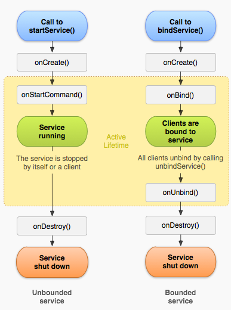

- 服务基础
  1. 概述
  2. 类型（Started，Bound）
  3. 方法，声明
  4. 生命周期
- 区别
  - 服务与直接开子线程
    1. 服务的子线程比直接开启子线程更不容易销毁（无服务的空进程系统先销毁，android最多空进程数20个）
    2. 广播onReceiver()中开子线程只能用服务
    3. 服务启动的子线程其他项目也能调用
  - IntentService类 与 Service类
    1. Service类started服务可以开辟多个子线程，且同时执行。
    2. IntentService类服务中只有一个子线程，并且按队列执行（必须等待上次执行完成才能执行下个动作）排队执行onHandleIntent方法。
  - StartedService与 BoundService
    1. 启动Started服务的Activity不同生共死；启动Bound服务的Activity同生共死（此种情况仅表现在BoundService仅绑定此一个）
    2. Started服务与Bound服务重复调用时仅会创建一次Service,不会重新实例化，但Started服务会多次调用onStartCommand()而Bound服务不会重复调用onBind
    3. 当StartedService与BoundService同时启动时，服务倾向于BoundService,可以销毁服务，而StartedService不可以
- Started类服务的启动，停止（2个类）
  - Service （粘粘性服务）
  - IntentService
- bound类服务的启动，停止
  1. 扩展Binder类
  2. 使用Messenger
  3. 使用AIDL
  - Binder类：android默认常用进程间通信的机制，对linux底层进程共享机制的封装
  - Service类：子线程放在onStartCommand()；IntentService类的子线程不能放在onHandleIntent（本身就是子线程，封装好了）
  - BoundService：子线程放在onCreat()

# 一、服务基础

http://www.android-doc.com/guide/components/services.html

## (一) 服务概述

1. Service是一个应用程序组件，它能够在后台执行一些耗时较长的操作，并且不提供用户界面。
2. 服务能被其它应用程序的组件启动，即使用户切换到另外的应用时还能保持后台运行。
3. 应用程序组件还能与服务绑定，并与服务进行交互，甚至能进行进程间通信（IPC）。

比如，服务可以处理网络传输、音乐播放、执行文件I/O、或者与content provider进行交互，所有这些都是后台进行的。

## (二) 服务类型（一般，绑定）

- Started类服务：实现onStartCommand()以允许组件启动服务。如果一个应用程序组件（比如一个activity）通过调用startService()来启动服务，则该服务就是被“started”了。一旦被启动，服务就能在后台一直运行下去，即使启动它的组件已经被销毁了。 通常，started的服务执行单一的操作并且不会向调用者返回结果。比如，它可以通过网络下载或上传文件。当操作完成后，服务应该自行终止。
- Bound类服务：实现onBind()以允许绑定。如果一个应用程序组件通过调用bindService()绑定到服务上，则该服务就是被“bound”了。bound服务提供了一个客户端/服务器接口，允许组件与服务进行交互、发送请求、获取结果，甚至可以利用进程间通信（IPC）跨进程执行这些操作。绑定服务的生存期和被绑定的应用程序组件一致。 多个组件可以同时与一个服务绑定，不过所有的组件解除绑定后，服务也就会被销毁。

## (三) 方法

onCreate()：当服务第一次被创建时，系统会调用本方法，用于执行一次性的配置工作（之前已调用过onStartCommand()或onBind()) 了。如果服务已经运行，则本方法就不会被调用。

onStartCommand()：当其它组件，比如一个activity，通过调用startService()请求started方式的服务时，系统将会调用本方法。 一旦本方法执行，服务就被启动，并在后台一直运行下去。 如果你的代码实现了本方法，你就有责任在完成工作后通过调用stopSelf()或stopService()终止服务。

onDestroy()：当服务用不上了并要被销毁时，系统会调用本方法。这也是服务收到的最后一个调用。

onBind()：当其它组件需要通过bindService()绑定服务时（比如执行RPC），系统会调用本方法。 在本方法的实现代码中，你必须返回IBinder来提供一个接口，客户端用它来和服务进行通信。 你必须确保实现本方法，不过假如你不需要提供绑定，那就返回null即可。

## (四) 声明：在manifest中声明服务

```
<manifest ... >
    <application ... >
        <service android:name="com.example.service.MyService">
            <intent-filter>
                <!-- 启动类型，能被其它组件启动 -->
                <action android:name="aa.bb.cc"/>
            </intent-filter>
        </service>
    </application>
</manifest>
```

## (五) 生命周期



服务的生命周期：

- 一个started服务：这类服务由其它组件调用startService()来创建。然后保持运行，且必须通过调用stopSelf()自行终止。其它组件也可通过调用stopService() 终止这类服务。服务终止后，系统会把它销毁
- 一个bound服务：服务由其它组件（客户端）调用bindService()来创建。然后客户端通过一个IBinder接口与服务进行通信。客户端可以通过调用unbindService()来关闭联接。多个客户端可以绑定到同一个服务上，当所有的客户端都解除绑定后，系统会销毁服务。（服务不需要自行终止。）

# 二、区别

服务与直接开子线程:

1. 服务的子线程比直接开启子线程更不容易销毁（无服务的空进程系统先销毁，android最多空进程数20个）
2. 广播onReceiver()中开子线程只能用服务
3. 服务启动的子线程其他项目也能调用，

IntentService类 与 Service类:

1. Service类started服务可以开辟多个子线程，且同时执行。
2. IntentService类服务中只有一个子线程，并且按队列执行（必须等待上次执行完成才能执行下个动作）排队执行onHandleIntent方法。

StartedService与 BoundService:

1. 启动Started服务的Activity不同生共死；启动Bound服务的Activity同生共死（此种情况仅表现在BoundService仅绑定此一个）
2. Started服务与Bound服务重复调用时仅会创建一次Service,不会重新实例化，但Started服务会多次调用onStartCommand()而Bound服务不会重复调用onBind
3. 当StartedService与BoundService同时启动时，服务倾向于BoundService,可以销毁服务，而StartedService不可以

# 三、Started 类服务的启动，停止（2个类）

Service （extends Service类）：这是所有服务的基类。如果你要扩展该类，则很重要的一点是：请在其中创建一个新的线程来完成所有的服务工作。 因为服务默认是使用应用程序的主线程的，这会降低应用程序中activity的运行性能。

IntentService （extends IntentService类）：这是Service类的子类，它使用了工作（worker）线程来处理所有的启动请求，每次请求都会启动一个线程。 如果服务不需要同时处理多个请求的话，这是最佳的选择。 所有你要做的工作就是实现onHandleIntent()即可，它会接收每个启动请求的intent，然后就可在后台完成工作。

区别：Service类started服务可以开辟多个子线程，且同时执行。IntentService类服务中只有一个子线程，并且按队列执行（必须等待上次执行完成才能执行下个动作）排队执行onHandleIntent方法。

## (一) 扩展 Service 类（extends Service类）

扩展 Service 类

对于每一个启动请求，它都用一个工作线程来完成处理工作，并且每次只处理一个请求。

因为是自行处理每个 onStartCommand() 调用，你可以同时处理多个请求。 本例中没有这么去实现，但只要你愿意，你就可以为每个请求创建一个新的线程，并立即运行它们（而不是等待前一个请求处理完毕）。

（粘粘性服务）

http://www.android-doc.com/guide/components/services.html

请注意 onStartCommand() 方法必须返回一个整数。

这个整数是描述系统在杀死服务之后应该如何继续运行（上一节中缺省的 IntentService 实现代码会替你处理这一点，当然那样你就无法修改这个处理过程）。

onStartCommand() 的返回值必须是以下常量之一：

- START_NOT_STICKY 如果系统在onStartCommand()返回后杀死了服务，则不会重建服务了，除非还存在未发送的intent。 当服务不再是必需的，并且应用程序能够简单地重启那些未完成的工作时，这是避免服务运行的最安全的选项。
- START_STICKY 如果系统在onStartCommand()返回后杀死了服务，则将重建服务并调用onStartCommand()，但不会再次送入上一个intent， 而是用null intent来调用onStartCommand() 。除非还有启动服务的intent未发送完，那么这些剩下的intent会继续发送。 这适用于媒体播放器（或类似服务），它们不执行命令，但需要一直运行并随时待命。
- START_REDELIVER_INTENT 如果系统在onStartCommand()返回后杀死了服务，则将重建服务并用上一个已送过的intent调用onStartCommand()。任何未发送完的intent也都会依次送入。这适用于那些需要立即恢复工作的活跃服务，比如下载文件。

```
//Object  Context  ContextWrapper  ContextThemeWrapper  Activity  MainActivity
public class MainActivity extends Activity {

    //Activity界面启动服务
    @Override
    protected void onCreate(Bundle savedInstanceState) {
        super.onCreate(savedInstanceState);
        setContentView(R.layout.activity_main);
    }

    //启动服务
    public void start(View v) {
        //配置文件 android:onclick="start"
        Intent intent = new Intent();
        intent.setAction("aa.bb.cc");
        /*决定了启动哪个服务*/
        this.startService(intent);
        //启动服务
    }

    //停止服务
    public void stop(View v) {
        // View是事件源，也就是点击事件
        Intent intent = new Intent();
        intent.setAction("aa.bb.cc");
        //决定了停止哪个服务
        this.stopService(intent);
        //停止服务
    }
}
```

```
/**
 * 服务类：  extends Service的类
 *
 * 服务的生命周期
 *一、启动服务: 一定会调用onStartcommand方法
 *  1.如果服务对象不存在, 系统会
 *  (1)创建服务对象
 *  (2)调用onCreate方法
 *  (3)调用onStartCommand方法//开子线程做费时操作
 *  2.如果服务对象存在 , 系统会调用onStartcommand方法
 *
 *二、停止服务:
 *  1.如果服务对象不存在:系统不会做任何事
 *  2.如果服务对象存在,系统会
 *  (1)调用onDestroy方法
 *  (2)销毁服务对象
 */
public class MyService extends Service {

    @Override
    public IBinder onBind(Intent intent) {
        return null;
    }

    @Override
    public void onCreate() {
        System.out.println("onCreate");
    }

    @Override
    public int onStartCommand(Intent intent, int flags, int startId) {
        System.out.println("onStartCommand");
        new Thread() {
            public void run() {
                //子线程
                for (int i = 0; i < 1110; i++) {
                    System.out.println(i);
                    try {
                        Thread.sleep(1000);
                    } catch (InterruptedException e) {
                        e.printStackTrace();
                    }
                }
            }
        }.start();
        return super.onStartCommand(intent, flags, startId);
    }

    @Override
    public void onDestroy() {
        System.out.println("onDestroy");
    }
}
```

## (二) 扩展 IntentService 类（extends IntentService类）

因为大多数started服务都不需要同时处理多个请求（这实际上是一个危险的多线程情况），所以最佳方式也许就是用 IntentService 类来实现你的服务。

IntentService 将执行以下步骤：

1. 创建一个缺省的工作（worker）线程，它独立于应用程序主线程来执行所有发送到 onStartCommand() 的intent。
2. 创建一个工作队列，每次向你的 onHandleIntent() 传入一个intent，这样你就永远不必担心多线程问题了。
3. 在处理完所有的启动请求后，终止服务，因此你就永远不需调用 stopSelf() 了。
4. 提供缺省的 onBind() 实现代码，它返回null。
5. 提供缺省的 onStartCommand() 实现代码，它把intent送入工作队列，稍后会再传给你的 onHandleIntent() 实现代码。

以上所有步骤将汇成一个结果：你要做的全部工作就是实现 onHandleIntent() 的代码，来完成客户端提交的任务。

（当然你还需要为服务提供一小段构造方法。）

步骤：

1. 写构造函数
2. 实现虚函数onHandleIntent，并在里面根据Intent的不同进行不同的事务处理

```
//Object  Context  ContextWrapper  ContextThemeWrapper  Activity  MainActivity
public class MainActivity extends Activity {

    //Activity界面启动服务
    @Override
    protected void onCreate(Bundle savedInstanceState) {
        super.onCreate(savedInstanceState);
        setContentView(R.layout.activity_main);
    }

    //启动服务
    public void start(View v) {
        //配置文件 android:onclick="start"
        Intent intent = new Intent();
        intent.setAction("my.intent.service");
        /*决定了启动哪个服务*/
        this.startService(intent);
        //启动服务
    }

    //停止服务
    public void stop(View v) {
        // View是事件源，也就是点击事件
        Intent intent = new Intent();
        intent.setAction("my.intent.service");
        //决定了停止哪个服务
        this.stopService(intent);
        //停止服务
    }
}
```

```
public class HelloIntentService extends IntentService {

    /**
      * 构造方法是必需的，必须用工作线程名称作为参数
      * 调用父类的构造方法。
      */
    public HelloIntentService(){
        super("HelloIntentService");
    }

    //如果你还决定重写其它的回调方法，比如onCreate()、onStartCommand()、onDestroy(，
    //请确保调用一下父类的实现代码，以便IntentService能正确处理工作线程的生命周期。
    //比如说，onStartCommand()必须返回缺省实现代码的结果
    @Override
    public int onStartCommand(Intent intent,int flags,int startId){
        Toast.makeText(this,"service starting",Toast.LENGTH_SHORT).show();
        return super.onStartCommand(intent,flags,startId);
    }

    /**
      * IntentService从缺省的工作线程中调用本方法，并用启动服务的intent作为参数。
      * 本方法返回后，IntentService将适时终止这个服务，因此你就永远不需调用stopSelf()了
      */
    @Override
    protected void onHandleIntent(Intent intent){
        // 通常我们会在这里执行一些工作，比如下载文件。
        // 作为例子，我们只是睡5秒钟。
        long endTime = System.currentTimeMillis()+5*1000;
        while(System.currentTimeMillis()< endTime){
            synchronized(this){
                try {
                    wait(endTime -System.currentTimeMillis());
                }catch(Exception e){
                }
            }
        }
    }
}
```

# 四、bound 服务的启动，停止

1. 扩展Binder类
2. 使用Messenger
3. 使用AIDL

http://www.android-doc.com/guide/components/bound-services.html#.E6.89.A9.E5.B1.95Binder.E7.B1.BB

如果你的服务只是为你自己的应用程序执行一些后台工作，那这就是首选的技术方案。

不用这种方式来创建接口的理由只有一个，就是服务要被其它应用程序使用或者要跨多个进程使用。

1) 要创建一个bound服务，你必须实现 onBind() 回调方法，并返回一个 IBinder 对象，此对象定义了与服务进行通信的接口。 然后，客户端会调用 ServiceConnection 中的onServiceConnected() 方法，传递一个 IBinder 。

服务只在为绑定的应用程序组件工作时才会存活，因此，只要没有组件绑定到服务，系统就会自动销毁服务（你不需要像started服务中那样通过 onStartCommand() 来终止一个bound服务）。

2) 要创建一个bound服务，首先必须定义好接口，用于指明客户端如何与服务进行通信。 这个客户端与服务之间的接口必须是一个 IBinder 对象的实现，并且你的服务必须在 onBind() 回调方法中返回这个对象。一旦客户端接收到这个 IBinder ，它就可以通过这个接口来与服务进行交互。

3) 同一个服务可以被多个客户端绑定。当客户端完成交互时，会调用 unbindService() 来解除绑定。一旦不存在客户端与服务绑定时，系统就会销毁该服务。

```
/**
 * 只绑定服务不启动服务时，绑定服务与解绑服务的生命周期
 *
 * 一、绑定服务时
 *  1.如果服务对象不存在，系统会创建服务对象，调用onCreate方法
 *     1.1系统创建服务对象
 *     1.2系统调用onCreate方法
 *     1.3系统调用onBind方法
 *  2.如果服务对象存在，系统不会做任何事件，但是也不会报错
 *
 * 二、解绑服务时，
 *  1.如果没有服务对象被绑定，解绑会报错
 *  2.如果有服务对象被绑定，解绑会调用onDestroy方法，再销毁服务对象
 *
 * 三、当服务对象被成功绑定后系统会调用onServiceConnected方法；
 *  前提是服务类中onBind方法返回Binder类的子类对象
 * */
```

```
//Object  Context  ContextWrapper  ContextThemeWrapper  Activity  MainActivity
public class MainActivity extends Activity {

    //Activity界面启动服务
    private MyBinder myBinder;

    private boolean isBind = false;
    //逻辑判断
    //没有用匿名内部类new 接口是因为解绑，绑定需要同一个接口conn
    private ServiceConnection conn =  new MyServiceConnection();

    @Override
    protected void onCreate(Bundle savedInstanceState) {
        super.onCreate(savedInstanceState);
        setContentView(R.layout.activity_main);
    }

    //绑定
    public void bind(View v) {
        Intent intent = new Intent();
        intent.setAction("aa.bb");
        this.bindService(intent, this.conn, Context.BIND_AUTO_CREATE);
    }

    //解绑
    public void unBind(View v) {
        if(isBind) {
            this.unbindService(this.conn);
        }
    }

    //得到进度
    public void get(View v) {
        //布局文件onclick="get"
        Button btn = (Button) v;
        //接收到了服务类的返回的对象，调用对象的方法
        int pro = MainActivity.this.myBinder.getProgress();
        btn.setText("下载到百分之"+pro);
    }

    class MyServiceConnection implements ServiceConnection {

        //当服务对象被成功绑定后调用,前提是，服务类中onBind方法返回
        //Binder类的子类对象iBinder
        @Override
        public void onServiceConnected(ComponentName name, IBinder iBinder) {
            //iBinder 接口对象的应用变量
            isBind = true;
            System.out.println("onServiceConnected");
            MainActivity.this.myBinder = (MyBinder)iBinder;
        }

        @Override
        public void onServiceDisconnected(ComponentName name) {
            //服务异常中断才会调用这个方法
            Toast.makeText(MainActivity.this, "坏了", 1).show();
        }
    }
}
```

```
public class MyService extends Service {

    private int progress = 0;
    // 表示下载进度

    //  Binder:android默认常用进程间通信的机制，对linux底层进程共享机制的封装
    public class MyBinder extends Binder {
        public int getProgress() {
            return MyService.this.progress; //对象.成员变量progress，返回进度到Activity
        }
    }

    @Override
    // 主线程
    public IBinder onBind(Intent intent) {
        //  IBinder是接口，返回一个接口
        System.out.println("onBind");
        return new MyBinder();
        // 返回一个接口对象，返回到onServiceConnected类里
    }

    @Override
    public void onCreate() {
        System.out.println("onCreate");
        new Thread() {
            // 子线程
            public void run() {
                for (int i = 0; i < 100; i++) {
                    try {
                        Thread.sleep(1000);
                    } catch (InterruptedException e) {
                        e.printStackTrace();
                    }
                    progress = i;
                }
            }
        }.start();
        super.onCreate();
    }

    @Override
    public void onDestroy() {
        System.out.println("onDestroy");
        super.onDestroy();
    }
}
```
