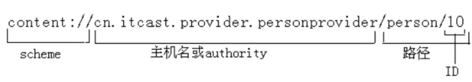

# 一、内容提供者

## (一) 什么是内容提供者？

内容提供者主要是被其他应用程序引用，通过提供者客户端对象访问提供者。提供者和提供者客户端为数据提供一个一致的、标准的接口，处理进程间的联系和数据安全访问。

- 内容提供者是 Android 中的四大组件之一，可以将应用中的数据对外进行共享
- 内容提供者将数据的访问方式统一，不必针对不同数据类型采取不同的访问策略
- 内容提供者将数据封装，只暴露出我们希望提供给其他程序的数据
- 内容提供者中数据更改可被监听

## (二) URI、URL 介绍，封装，解析，判断



`scheme` 表示协议，是 URI 的标准前缀；`authority` 是内容提供者域名。

```
content://user_dictionary/words/<id_value>
```

每个内容提供者显示一个公用的 URI（当作一个 `Uri` 对象包裹起来），它是数据集的标识。一个内容提供者控制多个数据集合（多个表格），并把每一个解释成一个独立的 URI。内容提供者的所有的 URIs 都以字符串 `content://` 开始。

# 二、访问一个提供者（ContentResolver-URI）

`ContentResolver` 是代理类，`ContentProvider` 是真实角色类。

- `ContentResolver` 调用增删改查方法，实际上是 URI 找到了 `ContentProvider` 里的对应方法
- `ContentResolver` 的返回值会传到 `ContentProvider` 方法中作为返回值
- `ContentResolver` 的很多方法与 `ContentProvider` 一一对应，所以它也存在 `insert`、`query`、`update`、`delete` 等方法

## (一) AndroidManifest.xml 文件配置

```
// Uri uri = Uri.parse("content://aa.bb");
<provider  android:name="com.example.pro.MycontentProvider"  // 包名，类名
            android:authorities="aa.bb"                      // 域名，是内容提供者自身 URI
            android:exported="true"                          // 可以被其他进程访问
            android:multiprocess="true" />                   // 可以被同一进程其他线程访问
```

## (二) ContentResolver 对象通过 URI 访问

对象 `ContentResolver` 解析 URI 的权限，使用它。

```
// 操作内容提供者的代理
ContentResolver contentResolver = this.getContentResolver();
String str = "content://aa.bb";
Uri uri = Uri.parse(str);
```

## (三) 操作数据库（创建/删除表，增删改查）

```
// insert
public void insert(View v) {
    // 操作内容提供者的代理
    ContentResolver contentResolver = this.getContentResolver();
    String str = "content://aa.bb";
    Uri uri = Uri.parse(str);

    ContentValues values = new ContentValues();
    values.put("name", "小明");
    values.put("sex", "男");
    values.put("age", 23);

    contentResolver.insert(uri, values);
}

// delete
public void delete(View v) {
    ContentResolver contentResolver = this.getContentResolver();
    Uri uri = Uri.parse(str);
    contentResolver.delete(uri, "_id>? and _id<?", new String[]{"0", "1000"});
}

// update
public void update(View v) {
    ContentResolver contentResolver = this.getContentResolver();
    Uri uri = Uri.parse(str);

    ContentValues values = new ContentValues();
    values.put("name", "小明22");
    values.put("age", 100);

    contentResolver.update(uri, values, "_id>? and _id<?", new String[]{"0", "1000"});
}

// select
public void select(View v) {
    ContentResolver contentResolver = this.getContentResolver();
    Uri uri = Uri.parse(str);

    Cursor cursor = contentResolver.query(uri, new String[]{"_id","name","sex","age"},
                                          "_id>?", new String[]{"0"}, "age");
    List<Stu> list = new ArrayList<Stu>();

    while (cursor.moveToNext()) {
        int  _id = cursor.getInt(cursor.getColumnIndex("_id"));
        String name = cursor.getString(cursor.getColumnIndex("name"));
        String sex = cursor.getString(cursor.getColumnIndex("sex"));
        int  age = cursor.getInt(cursor.getColumnIndex("age"));

        list.add(new Stu(_id, name, sex, age));  // 封装类
    }

    cursor.close();  // 4) 关闭游标
    this.show(list);
}
```

`ContentResolver` 查询返回的 `Cursor` 对象是访问结果的记录集。`Cursor` 对象为每种数据类型提供独立的方法，比如 `getString()`、`getInt()` 和 `getFloat()`（大多数情况下，如果你调用读字串方法，`Cursor` 对象将给出该数据所表示的字串值）。`Cursor` 对象可让你从列索引读取列名，或者从列名读取列索引：

```
String name = cursor.getString(cursor.getColumnIndex("name"));
```

## (四) 关闭数据库

```
public class MainActivity extends Activity {
    private String str = "content://aa.bb";

    @Override
    protected void onCreate(Bundle savedInstanceState) {
        super.onCreate(savedInstanceState);
        setContentView(R.layout.activity_main);
        this.setTitle("使用代理访问内容提供者");
    }

    private void show(List<Stu> list) {
        TextView tv = (TextView) this.findViewById(R.id.result_textView);

        String inf = "";
        for (int i = 0; i < list.size(); i++) {
            Stu stu = list.get(i);
            inf = inf + stu.toString() + "\n";
        }

        if (inf.length() > 0) {
            inf = inf.substring(0, inf.length() - 1);
        }

        tv.setText(inf);
    }
}
```

# 三、创建一个提供者（ContentProvider）

## (一) Manifest 文件注册 ContentProvider

```
// Uri uri = Uri.parse("content://aa.bb");
<provider  android:name="com.example.pro.MycontentProvider"  // 包名，类名
            android:authorities="aa.bb"                      // 域名，是内容提供者自身 URI
            android:exported="true"                          // 可以被其他进程访问
            android:multiprocess="true" />                   // 可以被同一进程其他线程访问
```

## (二) 继承 ContentProvider 类重写抽象方法

方法|说明
---|---
public boolean onCreate()|在 ContentProvider 创建后就会被调用，Android 在系统启动时就会创建 ContentProvider
public Uri insert(Uri uri, ContentValues values)|供外部应用往 ContentProvider 添加数据
public int delete(Uri uri, String selection, String[] selectionArgs)|供外部应用从 ContentProvider 删除数据
public int update(Uri uri, ContentValues values, String selection, String[] selectionArgs)|供外部应用更新 ContentProvider 中的数据
public Cursor query(Uri uri, String[] projection, String selection, String[] selectionArgs, String sortOrder)|供外部应用从 ContentProvider 中获取数据
public String getType(Uri uri)|返回当前 URI 所代表数据的 MIME 类型

```
public class MycontentProvider extends ContentProvider {
    // 第一次运行本项目时，该方法会被调用
    @Override
    public boolean onCreate() {
        // 创建数据库，创建表
        System.out.println("onCreate()");
        return true;
    }

    @Override
    public Uri insert(Uri uri, ContentValues values) {
    }

    // 操作数据库
    @Override
    public Cursor query(Uri uri, String[] projection, String selection,
                        String[] selectionArgs, String sortOrder) {
        return cursor;
    }

    @Override
    public String getType(Uri uri) {
        return null;
    }
}
```

## (三) 操作数据库（创建/删除表，增删改查）

```
public class MycontentProvider extends ContentProvider {

    private SQLiteDatabase getDB() {
        MySqliteOpenhelper mySqliteOpenhelper =
                new MySqliteOpenhelper(this.getContext(), "wgr.db", null, 1);
        SQLiteDatabase db = mySqliteOpenhelper.getWritableDatabase();
        return db;
    }

    // 第一次运行本项目时，该方法会被调用
    @Override
    public boolean onCreate() {
        // 创建数据库，创建表
        System.out.println("onCreate()");

        SQLiteDatabase db = this.getDB();
        db.close();
        return false;
    }

    //  ContentValues values = new ContentValues();//封装健值对
    //  values.put("name", "小明");
    //  values.put("sex", sex);
    //  values.put("age", 23+i);

    @Override
    public Uri insert(Uri uri, ContentValues values) {
        SQLiteDatabase db = this.getDB();
        db.insert("stu", "name, sex, age", values);
        db.close();
        return null;
    }

    //  selection  _id>? and _id<?
    //  selectionArgs new String[]{"0", "100"};

    @Override
    public int delete(Uri uri, String selection, String[] selectionArgs) {
        SQLiteDatabase db = this.getDB();
        db.delete("stu", selection, selectionArgs);
        db.close();
        return 0;
    }

    //  selection  _id>? and _id<?
    //  selectionArgs  new String[]{"0", "100"};

    @Override
    public int update(Uri uri, ContentValues values, String selection, String[] selectionArgs) {
        SQLiteDatabase db = this.getDB();
        db.update("stu", values, selection, selectionArgs);
        db.close();
        return 0;
    }

    //  本方法中千万不可关闭db与cursor
    //  projection  new String[]{"_id","name", "sex", "age"}
    //  selection  _id>? and _id<?
    //  selectionArgs new String[]{"0", "100"};
    //  sortOrder  age

    @Override
    public Cursor query(Uri uri, String[] projection, String selection,
                        String[] selectionArgs, String sortOrder) {
        SQLiteDatabase db = this.getDB();
        Cursor cursor = db.query("stu", projection, selection, selectionArgs, null, null, sortOrder);
        return cursor;
    }

    @Override
    public String getType(Uri uri) {
        return null;
    }
}
```
