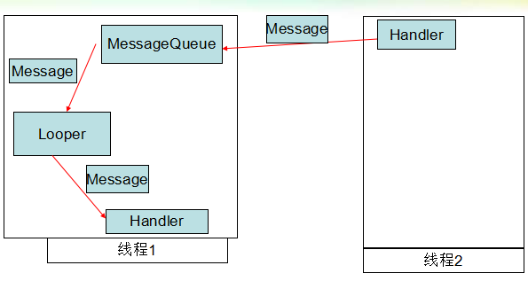

- Handler机制
  1. 什么是Handler机制？
  2. Handler机制作用？
  3. Handler机制的原理
  4. 注意事项
- 子线程向UI线程发送消息
  1. 主线程创建Handler对象，重写handleMessage()方法，该方法是Handler处理消息的回调函数
  2. 在子线程创建Message对象，Message对象主要用来封装要传递的数据
- UI线程向子线程发送消息
  1. 创建子线程
  2. 在run方法中执行Looper.prepare()，初始化Looper
  3. 创建Handler对象（一定创建在Looper.prepare()之后）
  4. 在run方法最后执行Looper.loop()，启动Looper
  5. 在主线程，使用子线程创建的Handler对象，发送Message对象到子线程的MessageQueue
  6. 当程序退出时，需要停止子线程。mHandler.getLooper().quit();

# 一、Handler机制

## (一) 什么是Handler机制？

http://blog.csdn.net/beijingshi1/article/details/7713531

Handler 是一个消息分发对象。而消息分发，有赖于消息循环Looper。在Looper初始化的时候会创建一个消息队列MessageQueue，在一个线程中，Looper 阻塞线程，等待消息构成循环。有了消息，分配到对应的 Handler，让他进一步分发处理。

## (二) Handler机制的作用

实现不同线程之间传递信息。

## (三) Handler机制的原理

Handler机制涉及的主要类有：Handler、Looper、MessageQueue、Message。

- Message：封装线程间通信的数据类。
- Handler：用来发送Message以及处理Message的类。Handler会将消息发送到创建Handler对象的线程中的MessageQueue中，Handler处理Message的代码会在创建Handler对象的线程中执行。
- MessageQueue：以队列形式存储Handler发送的Message。
- Looper：从MessageQueue中以阻塞形式获取Message对象，并交给同线程创建的Handler处理。在主线程中它是默认存在并工作的（不断从MessageQueue中取Message），但是在子线程中，我们需要创建，并启动它。

在主线程中Looper是默认工作的，而在子线程中Looper默认是不工作的。



在线程1中创建Handler对象，因为Handler对象是在线程1中创建的，因此Handler处理Message的代码会在线程1中执行。 线程2获取到在线程1中创建的Handler对象，通过该对象发送Message对象，此时该Message对象会被发送到创建Handler对象的线程中的MessageQueue中。 线程1中Looper不断从MessageQueue中获取Message对象，并交给Handler处理。 在主线程中Looper是默认工作的，而在子线程中Looper默认是不工作的。 因此，子线程向UI线程发送消息，和UI线程向子线程发送消息是不同的。 调用Thread.currentThread().getId()方法可以获取当前代码执行的线程id号

# 二、子线程向UI线程发送消息

步骤：

1. 在主线程创建Handler对象，重写handleMessage()方法，该方法是Handler处理消息的回调函数
2. 在子线程创建Message对象，Message对象主要用来封装要传递的数据，主要有4个属性可以设置：what，arg1， arg2，obj。并通过主线程中创建的Handler对象，发送给主线程的MessageQueue。

```
public class MainActivity extends Activity {

    Button btnStart;

    TextView tvNum;

    private static final int MSG_UPDATE_NUM = 100;

    Handler mHandler = new Handler() {

        // 匿名内部类
        //1. 重写handleMessage方法，该方法会在创建该Handler对象的线程中执行
        @Override
        public void handleMessage(Message msg) {
            // TODO Auto-generated method stub
            super.handleMessage(msg);
            // 打印线程ID
            Log.i("FSLog", "handleMessage tid = " + Thread.currentThread().getId());
            // 从接收到的msg中获取数据，并显示到UI控件中
            switch (msg.what) {
                case MSG_UPDATE_NUM:
                    tvNum.setText("" + msg.arg1);
                    break;
                default:
                    break;
            }
        }
    };r

    @Override
    protected void onCreate(Bundle savedInstanceState) {
        super.onCreate(savedInstanceState);
        // 函数入口
        setContentView(R.layout.activity_main);
        init();
    }

    public void init() {
        btnStart = (Button) findViewById(R.id.btn_start_main);
        btnStart.setOnClickListener(new OnClickListener() {
            @Override
            public void onClick(View v) {
                // TODO Auto-generated method stu
                new CountThread().start();  // 点击启动子线程，在子线程中修改tvNum中的内容
            }
        });
        tvNum = (TextView) findViewById(R.id.tv_num_main);
    }

    class CountThread extends Thread {

        //子线程  内部类
        @Override
        public void run() {
            // TODO Auto-generated method stub
            super.run();
            Log.i("FSLog", "CountThread tid = " + Thread.currentThread().getId());
            for (int i = 0; i < 10; i++) {
                try {
                    sleep(1000);
                } catch (InterruptedException e) {
                    // TODO Auto-generated catch block
                    e.printStackTrace();
                }
                // 发送消息到主线程，让主线程修改UI
                // tvNum.setText("" + i);
                // 2.通过在主线程中创建的Handler对象，将Message发送到主线程
                Message msg = Message.obtain();
                msg.what = MSG_UPDATE_NUM;
                msg.arg1 = i;
                mHandler.sendMessage(msg);  // 内部类调用成员变量mHandler
                //Message msg = Message.obtain(mHandler, what);
                //msg.sendToTarget();
            }
        }
    }

    @Override
    public boolean onCreateOptionsMenu(Menu menu) {
        // Inflate the menu; this adds items to the action bar if it is present.
        getMenuInflater().inflate(R.menu.main, menu);
        return true;
    }
}
```

# 三、UI线程向子线程发送消息(不常发生)

步骤：

1. 创建子线程,
2. 在run方法中执行Looper.prepare()，初始化Looper
3. 创建Handler对象（一定创建在Looper.prepare()之后）
4. 在run方法最后执行Looper.loop()，启动Looper，此后，Looper将不断从MessageQueue取消息并交给Handler处理。
5. 在主线程，使用子线程创建的Handler对象，发送Message对象到子线程的MessageQueue
6. 当程序退出时，需要停止子线程。mHandler.getLooper().quit();

PS：这些Message只会一个一个处理

```
public class MainActivity extends Activity implements OnClickListener {

    Button btn0_4, btn0_9;

    private static final int MSG_0_4 = 100;

    private static final int MSG_0_9 = 101;

    Handler mHandler = null;

    @Override
    protected void onCreate(Bundle savedInstanceState) {
        super.onCreate(savedInstanceState);
        setContentView(R.layout.activity_main);
        new MyWorkThread().start();
        // 1.创建启动子线程
        init();
    }

    private void init() {
        btn0_4 = (Button) findViewById(R.id.btn_0_4_main);
        btn0_4.setOnClickListener(this);
        btn0_9 = (Button) findViewById(R.id.btn_0_9_main);
        btn0_9.setOnClickListener(this);
    }

    @Override
    public boolean onCreateOptionsMenu(Menu menu) {
        getMenuInflater().inflate(R.menu.main, menu);
        return true;
    }

    @Override
    public void onClick(View v) {
        switch (v.getId()) {
            case R.id.btn_0_4_main:
                // 5.创建Message
                Message msg = Message.obtain();
                msg.what = MSG_0_4;
                if (mHandler != null) {
                    // 发送Message
                    mHandler.sendMessage(msg);
                }
                break;

            case R.id.btn_0_9_main:
                // 5.创建Message
                Message msg1 = Message.obtain();
                msg1.what = MSG_0_9;
                if (mHandler != null) {
                    // 发送Message
                    mHandler.sendMessage(msg1);
                }
                break;

            default:
                break;
        }
    }

    @Override
    protected void onDestroy() {
        super.onDestroy();
        // 6.退出线程
        if (mHandler != null) {
            mHandler.getLooper().quit();
        }
    }

    class MyWorkThread extends Thread {

        // 子线程
        @Override
        public void run() {
            super.run();
            // 2.在run方法里初始化Looper,实质是为线程创建Looper对象
            Looper.prepare();
            // 3.在子线程中创建Handler对象，
            //注意内部类中的方法里在次写内部类需要把引用变量弄做全局的
            mHandler = new Handler() {
                @Override
                public void handleMessage(Message msg) {
                    super.handleMessage(msg);
                    Log.i("FSLog", "handleMessage tid = " + Thread.currentThread().getId());
                    switch (msg.what) {
                        case MSG_0_4:
                            for (int i = 0; i < 5; i++) {
                                try {
                                    sleep(1000);
                                } catch (InterruptedException e) {
                                    e.printStackTrace();
                                }
                                Log.i("FSLog", "" + i);
                            }
                            break;

                        case MSG_0_9:
                            for (int i = 0; i < 10; i++) {
                                try {
                                    sleep(1000);
                                } catch (InterruptedException e) {
                                    e.printStackTrace();
                                }
                                Log.i("FSLog", "" + i);
                            }
                            break;

                        default:
                            break;
                    }
                }
            };
            // 4.启动looper
            Looper.loop();
            Log.i("FSLog", "thread end");
        }
    }
}
```
