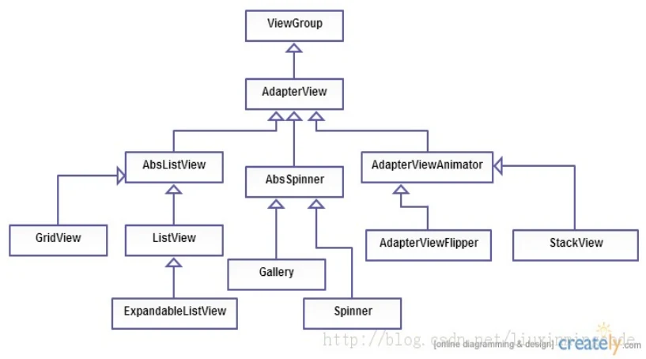
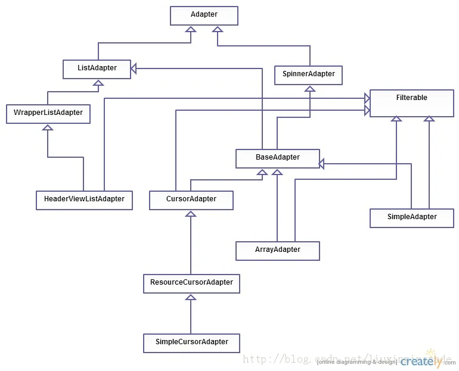
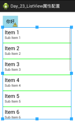
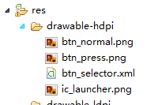
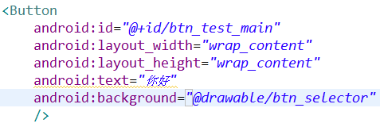
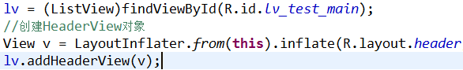
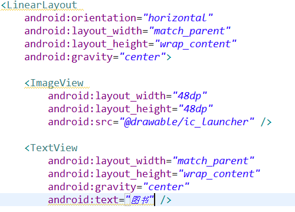
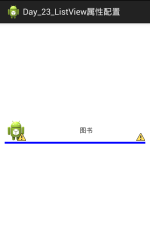

- MVC设计框架
  1. 数据源(M)
  2. AdapterView显示数据的载体(V) （ListView.Spinner.GridView）
  3. Adapter 作为数据处理的实体(C) （Array.Simple.baseAdapter）
- ListView
  1. 配置资源文件。（Selector.header.Strings等）
  2. 常用属性
- ArrayAdapter
  1. 介绍 与构造方法
  2. ArrayAdapter与ListView
  3. ArrayAdapter与ListActivity
- SimpleAdapter
  1. 介绍， 实现，优点，用法
  2. SimpleAdapter制作文本ListView
  3. SimpleAdapter做图片+文本的ListView

# 一、MVC设计框架

## (一) AdapterView

显示数据的载体(V)

作用：以列表的形式显示数据。内容：显示包含有数据的多个列表项。 特点 :将前端显示和后端数据分离 内容不能通过add的形式添加列表项，需指定一个Adapter对象，通过它决定要的显示数据 lv.setAdapter(mAdapter);超出屏幕显示之后，自动加上滚动条



- 子类：
  - ListView：最常用的列表视图之一。
  - Spinner：下拉列表。
  - GridView：网格图，以表格形式显示资源。默认垂直滑动，如果想水平滑动，可以和HorizontalScrollView配合使用。

注意：View即普通的控件，没有子布局的，如Button、TextView等。它的父类是Object；ViewGroup继承自View，表示可以有子控件，如Linearlayout、Listview等。

## (二) Adapter

作为数据处理的实体(C)

作用：把数据源中数据以某种View(列表项)显示在视图中。



- 子类：
  - ArrayAdapter：只能处理列表项内容全是文本的情况。数据源：数组或者List对象 或者数组等其他
  - SimpleAdapter：出文本外，当列表项中还有其他控件时，也可以处理。（图片等）数据源：只能为List形式的数据
  - BaseAdapter：根据xml文件中定义的样式，自定义列表项的布局，适用性最强。

# 二、ListView

配置资源文件。（Strings，Selector，header等）

- `android:entries` 指明使用的数据源，如果列表项的内容是固定不变的，可以使用。不够灵活，不常用。
- `android:divider` 列表项间的分割线，可以是drawable或者color
- `android:dividerHeight` 列表项间的分割线的高度



自定义点击效果Selector






添加 Header或者Footer（header和footer都是ListView的一部分。）

1. 配置资源文件hearder.XML
2. 创建对象

```
View v = LayoutInflater.from(this).inflate(R.layout.header, null);
```

3. 调用 `addHeaderView` / `addFooterView` 添加。







## (一) 常用属性

- `android:divider="#ff00ff00"` 列表项间的分割线，可以是drawable或者color
- `android:dividerHeight ="3dp"` 列表项间的分割线的高度
- `android:headerDividersEnabled ="true"` 显示header的分割线。
- `android:choiceMode` 列表项的选择模式，单选，多选等。
- `android:transcriptMode` 设置列表是否自动滑动到底部。（QQ微信消息自动下拉到最新）
- `android:drawSelectorOnTop ="true"` 选择器将绘制在选中条目的上层
- `android:fastScrollEnabled ="true"` 设置是否允许使用快速滚动滑块。
- `android:listSelector` 设置选中项显示的可绘制对象，可以是图片或者颜色属性。
- `android:scrollingCache ="true"` 设置在滚动时是否使用绘制缓存。true则将使滚动表现更快速，但会占用更内存。默认为true。
- `android:cacheColorHint` 表明这个列表的背景始终以单一、固定的颜色绘制，可以优化绘制过程。
- `android:textFilterEnabled ="true"` 列表会将结果过滤为用户类型。前提是这个列表的Adapter必须支持Filterable接口。

# 三、ArrayAdapter

## (一) 介绍 与构造方法

ArrayAdapter，是一个跟Array结构对应的Adapter，所以它展示的内容取决于Array里面装的对象,一般只用来展示一些文字方面的效果，比如文章列表，联系人列表等比较简洁的描述。

ArrayAdapter<T> 它接受一个泛型对象(决定数据源中的数据类型)。

ArrayAdapter的构造方法：

```
public ArrayAdapter(Context context, int textViewResourceId,T[] objects)
```

第一个参数：上下文

第二个参数：布局文件id （ListView中item的布局，可以使用Android系统提供的 android.R.layout.simple_list_item_1）

第三个参数：数据源，数组。

## (二) ArrayAdapter与ListView

用ArrayAdapter可以实现简单的ListView的数据绑定。默认情况下，ArrayAdapter绑定每个对象的toString值到layout中预先定义的TextView控件上。ArrayAdapter的使用非常简单。

```
public class MainActivity extends Activity {

    //创建数据源

    String[] data = {"语文", "语文1", "语文2"};

    //视图

    ListView lv;

    @Override
    protected void onCreate(Bundle savedInstanceState) {
        super.onCreate(savedInstanceState);
        setContentView(R.layout.activity_main);
        init();
    }

    private void init() {
        lv = (ListView)findViewById(R.id.lv_main);

        //创建控制器C

        ArrayAdapter<String> adapter = new ArrayAdapter<String>(this, android.R.layout.simple_list_item_1, data);

        //将控制器设置到ListView

        lv.setAdapter(adapter);
    }

}
```

## (三) ArrayAdapter与ListActivity

ArrayAdapter是所有Adapter中最简单的Adapter，这种Adapter只使用一种场景（列表项中只显示一个字符串）。

如果使用ListActivity配合ArrayAdapter使用，将更简单，用户只需要创建一个类继承ListActivity，不要设置布局文件(setContentView)，然后调用setListAdapter，设置一个ArrayAdapter即可。

```
public class MainActivity extends ListActivity {

    // 创建数据源

    String[] data = { "语文", "语文1", "语文2", };

    @Override
    protected void onCreate(Bundle savedInstanceState) {
        super.onCreate(savedInstanceState);

        // setContentView(R.layout.activity_main);

        // 创建控制器C

        ArrayAdapter<String> adapter = new ArrayAdapter<String>(this,
                android.R.layout.simple_list_item_1, data);

        setListAdapter(adapter);
    }

}
```

# 四、SimpleAdapter

## (一) 介绍， 实现，优点，用法

介绍：SimpleAdapter可以将静态的数据关联到XML布局文件中的某个View控件上。

实现：通常将静态的数据保存在Map对象的集合中，一个Map对象对应列表中一项所包含的所有数据，通过Map对象中的关键字来区分一项中那一列的数据。

优点：SimpleAdapter是扩展性最好的适配器，可以定义各种你想要的布局，而且使用很方便。可以放上ImageView（图片），还可以放上Button（按钮），CheckBox（复选框）等等。

用法：（和ArrayAdapter类似一个和listVieew，ListActivity）

1. SimpleAdapter可以使用自定义的ListView，然后调用setContentView方法即可。
2. 也可以直接使用系统自带的ListAcitivity，该ListActivity实现了ListView，显示ListView的时候做了很多优化。ListActivity直接继承 ListActivity即可，不在调用setContentView方法

```
SimpleAdapter(Context context, List<? extends Map<String, ?>> data, int resource, String[] from, int[] to)
```

- context：上下文，比如this。关联SimpleAdapter运行的视图上下文 参数
- data：一个Map组成的List。在列表中的每个条目对应列表中的一行,每一个map中应该包含所有在from参数中指定的键 参数
- resource：ListView单项布局文件的Id,这个布局就是你自定义的布局了，你想显示什么样子的布局都在这个布局中。这个布局中必须包括了to中定义的控件id 参数
- from：一个被添加到Map上关联每一个项目列名称的列表，数组里面是列名称 参数
- to：是一个int数组，数组里面的id是自定义布局中各个控件的id，需要与上面的from对应

比如，显示信息【姓名，年龄，性别】，我们可以使用一个List装入所有希望显示出来的数据。List中每一个元素都是一个Map对象（该对象代表了要显示的一行中的所有信息），Map中通过key来指明该数据显示在哪一列上。

```
List<HashMap<String, String>> data = new ArrayList<HashMap<String, String>>();

//第一行

HashMap<String, String> row1 = new HashMap<String, String>();

//3列

row1.put("name", "zhang3");

row1.put("age", "1");

row1.put("gender", "male");

//添加一行的数据

data.add(row1);
```

...

## (二) SimpleAdapter制作文本ListView

步骤：

1. 创建数据源对象（List，泛型）
2. 初始化数据（键值对add数据）
3. 通过SimpleAdapter对象获取ListView

```
public class MainActivity extends Activity {

    ListView lv;

    ArrayList<HashMap<String, String>> data = new ArrayList<HashMap<String, String>>();

    @Override
    protected void onCreate(Bundle savedInstanceState) {
        super.onCreate(savedInstanceState);
        setContentView(R.layout.activity_main);

        //创建数据源内容

        //创建行0

        HashMap<String, String> row0 = new HashMap<String, String>();

        //创建行0中，列的内容

        row0.put("name", "zhang3");
        row0.put("age", "30");
        row0.put("gender", "male");

        data.add(row0);

        //创建行1

        HashMap<String, String> row1 = new HashMap<String, String>();

        //创建行1中，列的内容

        row1.put("name", "li4");
        row1.put("age", "22");
        row1.put("gender", "male");

        data.add(row1);

        //创建行2

        HashMap<String, String> row2 = new HashMap<String, String>();

        //创建行2中，列的内容

        row2.put("name", "wang5");
        row2.put("age", "18");
        row2.put("gender", "female");

        data.add(row2);

        lv = (ListView)findViewById(R.id.lv_main);

        //创建simpleAdapter对象

        SimpleAdapter mAdapter = new SimpleAdapter(this,
                data,
                R.layout.item,
                new String[]{"name", "age", "gender"},
                new int[]{R.id.tv_name_main, R.id.tv_age_main, R.id.tv_gender_main});

        lv.setAdapter(mAdapter);
    }

}
```

## (三) SimpleAdapter做图片+文本的ListView

步骤：

1. 创建数据源对象（List，泛型）
2. 初始化数据（键值对add数据）
3. 通过SimpleAdapter对象获取ListView

```
public class MainActivity extends Activity {

    //创建数据源

    ArrayList<HashMap<String, Object>> data = new ArrayList<HashMap<String, Object>>();

    ListView lv;

    @Override
    protected void onCreate(Bundle savedInstanceState) {
        super.onCreate(savedInstanceState);
        setContentView(R.layout.activity_main);

        //初始化数据

        HashMap<String, Object> row0 = new HashMap<String, Object>();
        row0.put("img", R.drawable.ic_launcher);
        row0.put("text", "up");
        data.add(row0);

        HashMap<String, Object> row1 = new HashMap<String, Object>();
        row1.put("img", R.drawable.ic_launcher_down);
        row1.put("text", "down");
        data.add(row1);

        HashMap<String, Object> row2 = new HashMap<String, Object>();
        row2.put("img", R.drawable.ic_launcher_left);
        row2.put("text", "left");
        data.add(row2);

        HashMap<String, Object> row3 = new HashMap<String, Object>();
        row3.put("img", R.drawable.ic_launcher_right);
        row3.put("text", "right");
        data.add(row3);

        //通过SimpleAdapter对象获取ListView

        lv = (ListView)findViewById(R.id.lv_main);

        SimpleAdapter mAdapter = new SimpleAdapter(this,
                data,
                R.layout.item,
                new String[]{"img", "text"},
                new int[]{R.id.iv_item, R.id.tv_item});

        lv.setAdapter(mAdapter);
    }

}
```
