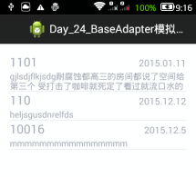
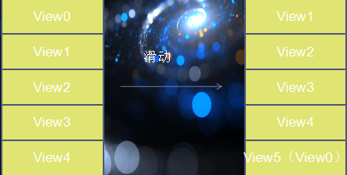
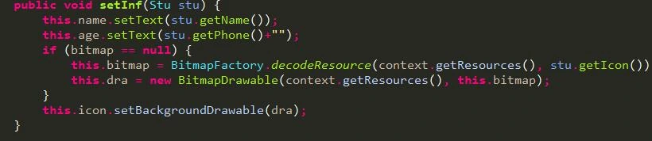
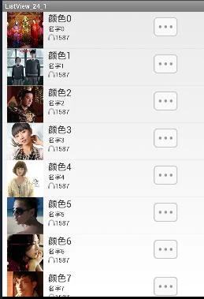
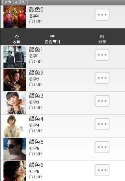

- 自定义适配器baseAdapter
  - 使用步骤
  - 模拟短信列表
- ListView的优化（cpu，硬盘）
  - ListView绘制原理
  - View的复用（convertView判断）
  - 减少findViewById的使用（setTag,getTag）
  - 列表项缓存优化（buffer）
- ListView的事件处理
- TextView中添加图片背景

# 一、自定义适配器baseAdapter

一般用法：

1. 自定义类继承BaseAdapter类
2. 重写其中的4个抽象方法

getCount：返回需要显示的总行数。 getItem：返回指定position上的数据源中的数据。 getItemId：返回指定position上的数据对应的id号。 getView：返回指定position上需要显示的View对象，该View对象会被系统自动绘制到ListView上。

按照MVC的顺序来规范使用顺序。

1. 创建数据源（Javabean）
2. 创建ListView对象
3. 创建自定义Adapter类
4. 将Adapter对象设置给ListView对象（setAdapter）



```
public class MainActivity extends Activity {

    //创建javabean，表示每一行中需要显示的数据
    class Data {
        String strAddr, strTime, strContent;

        public Data(String strAddr, String strTime, String strContent) {
            super();
            this.strAddr = strAddr;
            this.strTime = strTime;
            this.strContent = strContent;
        }
    }

    //创建数据源（m）
    ArrayList<Data> data = new ArrayList<Data>();

    //创建ListView（v）
    ListView lvSms;

    @Override
    protected void onCreate(Bundle savedInstanceState) {
        super.onCreate(savedInstanceState);
        setContentView(R.layout.activity_main);
        data.add(new Data("110", "2015.01.01", "短信你是不是我最深爱的人"));
        data.add(new Data("120", "2015.01.02", "短信hdsfgsdf"));
        data.add(new Data("119", "2015.01.05", "短信mmmmm"));
        data.add(new Data("119", "2015.01.05", "短信"));

        //获取ListView
        lvSms = (ListView)findViewById(R.id.lv_sms_main);
        lvSms.setAdapter(new MyAdapter());
    }

    //自定义adapter
    class MyAdapter extends BaseAdapter {
        @Override
        public int getCount() {
            return data.size();       //返回总行数
        }

        @Override
        public Object getItem(int position) {
            return data.get(position);      //返回position位置上的数据元素
        }

        @Override
        public long getItemId(int position) {
            return 0;
        }

        //返回position位置上显示的View对象
        @Override
        public View getView(int position, View convertView, ViewGroup parent) {
            //创建View对象
            View v = LayoutInflater.from(MainActivity.this).inflate(R.layout.item, null);

            //设置该View对象中控件的值
            TextView tvAddr = (TextView)v.findViewById(R.id.tv_addr_item);
            tvAddr.setText(data.get(position).strAddr);

            TextView tvTime = (TextView)v.findViewById(R.id.tv_time_item);
            tvTime.setText(data.get(position).strTime);

            TextView tvContent = (TextView)v.findViewById(R.id.tv_content_item);
            tvContent.setText(data.get(position).strContent);

            return v;     //返回position位置上显示的View对象
        }
    }
}
```

# 二、ListView的优化（cpu，硬盘）

## (一) ListView绘制原理

1）Android系统会根据当前的显示情况决定回调一次getView方法，而不会一次性将所有的视图对象都创建出来。

比如：总共有1000行数据，但是，屏幕一次只能显示10行数据，那么，在程序运行之初，会调用10次getView方法，传入的position为0-9。当滑动ListView时再根据需要绘制其他行。

2）当滑动ListView时，如果需要显示View5，此时，又由于View0已经不可见，那么，聪明的Android系统会将View0视图复用，并传递给getView方法。



优化思路 ：

优化1：利用自带的列表项缓存机制，复用视图对象。

优化2：利用View可以保存Object对象的特性，减少findViewById的次数（将视图中的所有控件对象保存到View对象中，在View对象被复用的时候，直接调用getTag方法获取所有控件对象，修改其中的内容即可）。

## (二) View的复用（convertView判断）

```
public View getView(int position, View convertView, ViewGroup parent) {
    ViewHolder mHolder;

    //convertView是屏幕上消失的View，为空则绘制，不为空则复用
    if(convertView == null) {
        convertView = LayoutInflater.from(MainActivity.this).inflate(R.layout.item, null);
    }  //复用，注意在findViewById前要加convertView

    TextView tv = (TextView) convertView.findViewById(R.id.tv_content_item);

    return convertView;
}
```

## (三) 减少findViewById的使用（setTag,getTag）

```
public View getView(int position, View convertView, ViewGroup parent) {
    ViewHolder mHolder;

    //第一层优化，View的复用
    if(convertView == null) {
        convertView = LayoutInflater.from(MainActivity.this).inflate(R.layout.item, null);
        //第二层优化，使用ViewHolder保存View中的每一个小控件，当发生View的复用时，直接从之前保存的ViewHolder中找到控件并修改即可，不需要使用findViewById来获取控件
        //需要自己创建View对象，就创建一个ViewHolder对象
        TextView tv = (TextView)convertView.findViewById(R.id.tv_content_item);
        mHolder = new ViewHolder(tv);

        //将Holder对象保存到View中
        convertView.setTag(mHolder);
    } else {
        //如果发生了复用，将ViewHolder直接从复用的View对象中取出即可
        mHolder = (ViewHolder)convertView.getTag();
    }

    mHolder.tv.setText(data.get(position));

    return convertView;
}
}

//创建类，保存View中显示的控件对象
class ViewHolder {
    TextView tv;

    public ViewHolder(TextView tv) {
        //构造方法
        super();
        this.tv = tv;
    }
}
```

## (四) 列表项缓存优化（buffer）

```
public View getView(int location, View view, ViewGroup parent) {
    Buffer buffer = null;
    if (view == null) {
        buffer = new Buffer();
        view = ((Activity) context).getLayoutInflater().inflate(R.layout.tab_view, null);
        buffer.name = (TextView) view.findViewById(R.id.car_name);
        buffer.singer = (TextView) view.findViewById(R.id.car_color);
        view.setTag(buffer);
    } else {
        buffer = (Buffer) view.getTag();
    }

    buffer.name.setText(list.get(location).getName());
    buffer.singer.setText(list.get(location).getMusicName());
    return view;
}

static class Buffer {
    TextView name;
    TextView singer;
}
```

# 三、ListView的事件处理

使用ListView的同时，可以对它设置监听器，常用的监听器有

1. OnItemClickListener（列表项被点击时触发）
2. OnTouchListener（按下时触发）
3. OnScrollListener （监听器在ListView滚动时触发）
4. OnItemLongClickedListener（长按触发）

## (一) OnItemClickListener（列表项被点击时触发）

列表项被点击时触发  实现onItemClick回调

```
public void onItemClick(AdapterView<?> parent, View view, int position, long id)
```

参数1：AdapterView，就是ListView本身

参数2：被点击的列表项

参数3：点击的位置

参数4：该位置对应的id号

```
lv = (ListView) findViewById(R.id.lv_main);
lv.setOnItemClickListener(new OnItemClickListener() {
    @Override
    public void onItemClick(AdapterView<?> parent, View view, int position, long id) {
        String[] data = getResources().getStringArray(R.array.data);
        Toast.makeText(MainActivity.this, "click pos = " + position + " id = " + id
                + " " + data[position], 2000).show();
    }
});
```

## (二) OnTouchListener（按下时触发）

监听器在触碰到ListView时触发  实现onTouch回调

```
public boolean onTouch(View v, MotionEvent event)
```

参数1：ListView控件本身

参数2：触碰事件

- MotionEvent.ACTION_MOVE表示移动事件
- MotionEvent.ACTION_UP 离开ListView事件
- MotionEvent.ACTION_DOWN 接触到ListView事件

onTouch回调的返回值为boolean型，表示触屏事件是否有被成功消耗掉。如果返回为true，表示触屏事件被消耗了。

```
lv.setOnTouchListener(new OnTouchListener() {
    @Override
    public boolean onTouch(View v, MotionEvent event) {
        Log.i("FSLog", "UP = " + MotionEvent.ACTION_UP + " DOWN = "
                + MotionEvent.ACTION_DOWN + " MOVE = "
                + MotionEvent.ACTION_MOVE);
        return false;
    }
});
```

## (三) OnScrollListener（监听器在ListView滚动时触发）

监听滑动事件  实现onScroll回调

```
public void onScrollStateChanged(AbsListView view, int scrollState)
```

参数1：ListView本身

参数2：当前滑动状态：SCROLL_STATE_TOUCH_SCROLL 或者 SCROLL_STATE_IDLE

```
public void onScroll(AbsListView view, int firstVisibleItem, int visibleItemCount, int totalItemCount)
```

参数1：ListView本身

参数2：第一个可见项的position

参数3：可见项个数

参数4：总项数

```
lv.setOnScrollListener(new OnScrollListener() {
    @Override
    public void onScrollStateChanged(AbsListView view, int scrollState) {
    }

    @Override
    public void onScroll(AbsListView view, int firstVisibleItem,
                         int visibleItemCount, int totalItemCount) {
        Log.i("FSLog", "firstVisibleItem " + firstVisibleItem);
    }
});
```

## (四) OnItemLongClickedListener（长按触发）

- 监听长按事件  实现onItemLongClick回调

```
public boolean onItemLongClick(AdapterView<?> parent, View view, int position, long id)
```

- 参数1：ListView本身
- 参数2：被长按的View
- 参数3：被点击的View的position
- 参数4：被点击的View的ID

onItemLongClick回调的返回值为boolean型，true表示确实长按成功。

```
lv.setOnItemLongClickListener(new OnItemLongClickListener() {
    @Override
    public boolean onItemLongClick(AdapterView<?> parent, View view, int position, long id) {
        Log.i("FSLog", "position = " + position);
        return false;
    }
});
```

# 四、TextView中添加图片背景



测试源代码如下：

界面效果如图：





黑色框是点击按钮后出现的，在布局文件中添加一个Relativelayout然后按钮通过控制他的隐藏显示来实现显示（自定义View）
