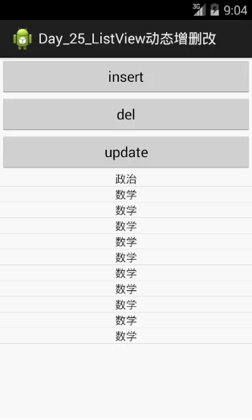
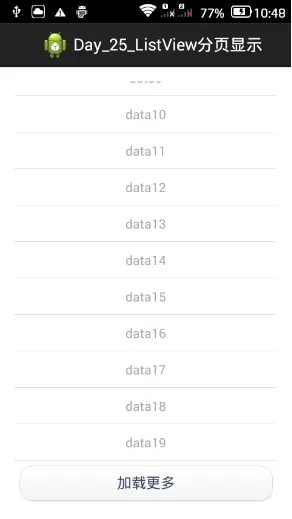

- 列表动态增，删，改
  - 原理（修改数据源 ，通知修改）
  - notifyDatasetChanged方法
- ListView分页加载
  - 原理，做法，步骤（自定义Adapter ，Http通信Post请求， JSON解析 ）
  - JSON格式数据
  - JSON解析（Gson包，自带）
  - Http通信Post请求
  - 代码

# 一、列表动态增，删，改

```
//1.修改数据源
//2.通知adapter刷新,调用adapter的实例方法notifyDatasetChanged

data.add("hello");                     //添加数据源
data.remove(0);                        //删除数据源
data.set(0,"My World");                //修改数据源

((BaseAdapter)lv.getAdapter()).notifyDataSetChanged();
```





# 二、ListView分页加载

## (一) 原理，做法，步骤

ListView分页原理：每次从服务器获取部分数据进行显示，当需要加载更多数据时，再从服务器加载新数据。

ListView分页做法：为ListView设置一个footer，点击footer中的按钮时向服务器发送请求，指明需要获取数据的起始position以及数量。 解析服务器返回的json数据，并添加到数据源中。 刷新ListView显示。 （联网要权限且需要在子线程中进行）

ListView分页步骤：

1. 按照MVC的属性，创建ListView + BaseAdapter
2. 给ListView添加footer，点击footer时加载新数据

   PS：footer本身也会占一行position

3. 将服务器返回的json数据解析，然后添加到数据源中，并通知Adapter刷新界面（PS：最好将数据源的修改和Adapter的刷新放在主线程中）

## (二) JSON格式数据

一种轻量级的数据交换格式，按照键值对存数据。在处理 JSON 格式的数据时，没有需要遵守的预定义的约束。

```
{ "programmers": [{ "firstName": "Brett", "lastName":"McLaughlin", "email": "aaaa" },
                  { "firstName": "Jason", "lastName":"Hunter", "email": "bbbb" },
                  { "firstName": "Elliotte", "lastName":"Harold", "email": "cccc" }],
  "authors": [{ "firstName": "Isaac", "lastName":"Asimov", "genre": "science fiction" },
              { "firstName": "Tad", "lastName":"Williams", "genre": "fantasy" },
              { "firstName": "Frank", "lastName":"Peretti", "genre": "christian fiction" }]}
```

```
{name:"中国", province:[ { name:"黑龙江", cities:{ city:["哈尔滨","大庆"] }, {name:"广东", cities:{ city:["广州","深圳","珠海"] }
```

## (三) JSON解析（Gson包，自带）

http://www.cnblogs.com/xiaoluo501395377/p/3446605.html

普通形式的只需用 `JSONObject`，带数组形式使用 `JSONArray` 将其变成一个 `list`

```
//解析json并添加到数据源中
JSONObject root = new JSONObject(result);
JSONArray arr = root.getJSONArray("data");
for(int i = 0; i < arr.length(); i ++) {
    JSONObject node = arr.getJSONObject(i);
    String d = node.getString("name");
    data.add(d);
```

## (四) Http通信Post请求

```
protected String doInBackground(String... params) {
    String str = "";
    //发送Post请求到服务器获取json数据
    HttpClient client = new DefaultHttpClient();
    HttpPost reqPost = new HttpPost(params[0]);
    ArrayList<NameValuePair> datas = new ArrayList<NameValuePair>();
    datas.add(new BasicNameValuePair("startIndex", params[1]));
    datas.add(new BasicNameValuePair("num", params[2]));
    try {
        reqPost.setEntity(new UrlEncodedFormEntity(datas));
        HttpResponse rsp = client.execute(reqPost);
        if(rsp.getStatusLine().getStatusCode() == HttpStatus.SC_OK) {
            InputStream is = rsp.getEntity().getContent();
            byte[] tmp = new byte[1024];
            int n = -1;
            while((n = is.read(tmp)) != -1) {
                str += new String(tmp, 0, n);
            }
        } else {
        }
    } catch (Exception e) {
        e.printStackTrace();
    }
    return str;
}
```

## (五) 代码

```
public class MainActivity extends Activity {

    ArrayList<String> data = new ArrayList<String>();
    ListView lv;

    public static final String MY_URL = "http://xxx:8080/Day_25_Server/MyServlet";
    public static final int NUM_OF_PAGE = 10;

    MyAdapter mAdapter;

    @Override
    protected void onCreate(Bundle savedInstanceState) {
        super.onCreate(savedInstanceState);
        setContentView(R.layout.activity_main);
        lv = (ListView)findViewById(R.id.lv_main);

        //设置footer
        View v = LayoutInflater.from(this).inflate(R.layout.footer, null);
        v.setOnClickListener(new OnClickListener() {
            @Override
            public void onClick(View v) {
                //每次从第几行position开始取数据，取几行数据
                new MyTask().execute(MY_URL, "" + lv.getLastVisiblePosition(), "" + NUM_OF_PAGE);
            }
        });

        //添加footer  创建自定义Adapter
        lv.addFooterView(v);

        mAdapter = new MyAdapter();
        lv.setAdapter(mAdapter);
    }

    //AsyncTask异步从服务器获取Json数据
    class MyTask extends AsyncTask<String, Void, String> {
        @Override
        protected String doInBackground(String... params) {
            String str = "";
            //发送Post请求到服务器获取json数据
            HttpClient client = new DefaultHttpClient();
            HttpPost reqPost = new HttpPost(params[0]);
            ArrayList<NameValuePair> datas = new ArrayList<NameValuePair>();
            datas.add(new BasicNameValuePair("startIndex", params[1]));
            datas.add(new BasicNameValuePair("num", params[2]));
            try {
                reqPost.setEntity(new UrlEncodedFormEntity(datas));
                HttpResponse rsp = client.execute(reqPost);
                if(rsp.getStatusLine().getStatusCode() == HttpStatus.SC_OK) {
                    InputStream is = rsp.getEntity().getContent();
                    byte[] tmp = new byte[1024];
                    int n = -1;
                    while((n = is.read(tmp)) != -1) {
                        str += new String(tmp, 0, n);
                    }
                    Log.i("FSLog", str);
                } else {
                }
            } catch (Exception e) {
                e.printStackTrace();
            }
            return str;
        }

        @Override
        protected void onPreExecute() {
            super.onPreExecute();
        }

        @Override
        protected void onPostExecute(String result) {
            super.onPostExecute(result);

            //将ListView数据源的改变和通知修改界面的操作，放在一个线程中完成
            if(result != null && !result.isEmpty()) {
                try {
                    //解析json并添加到数据源中
                    JSONObject root = new JSONObject(result);
                    JSONArray arr = root.getJSONArray("data");
                    for(int i = 0; i < arr.length(); i ++) {
                        JSONObject node = arr.getJSONObject(i);
                        String d = node.getString("name");
                        data.add(d);
                    }
                    //刷新listView，notifyDataSetChanged最好放在主线程中
                    mAdapter.notifyDataSetChanged();
                } catch(Exception e) {
                }
            }
        }

        @Override
        protected void onProgressUpdate(Void... values) {
            super.onProgressUpdate(values);
        }
    }

    //创建自定义Adapter
    class MyAdapter extends BaseAdapter {
        @Override
        public int getCount() {
            return data.size();
        }

        @Override
        public Object getItem(int position) {
            return data.get(position);
        }

        @Override
        public long getItemId(int position) {
            return 0;
        }

        @Override
        public View getView(int position, View convertView, ViewGroup parent) {
            //2层ListView优化
            ViewHolder mHolder;
            if(convertView == null) {
                convertView = LayoutInflater.from(MainActivity.this).inflate(R.layout.item, null);
                TextView tvContent = (TextView)convertView.findViewById(R.id.tv_content_item);
                mHolder = new ViewHolder(tvContent);
                convertView.setTag(mHolder);
            } else {
                mHolder = (ViewHolder)convertView.getTag();
            }

            mHolder.tvContent.setText(data.get(position));
            return convertView;
        }
    }

    class ViewHolder {
        TextView tvContent;

        public ViewHolder(TextView tvContent) {
            super();
            this.tvContent = tvContent;
        }
    }
}
```
