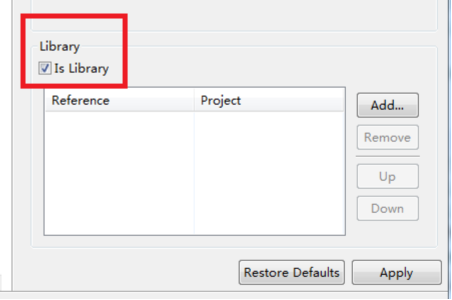
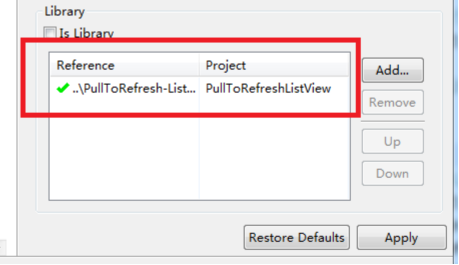

- 三方框架PullToRefresh实现
  - 效果图
  - 步骤
  - 源码：https://github.com/erikwt/PullToRefresh-ListView
- 独立实现下拉刷新效果
  - 做法，步骤
  - 代码

# 一、三方框架PullToRefresh实现

该框架的本质就是一个自定义的ListView控件，因此，使用的方法和使用普通的ListView基本一致。

效果图：

步骤：下载源码导入libraryproject项目到开发环境（Eclipse） 设置该项目为library(项目-properties-android) （下图左）创建工程，并设置依赖关系（下图右）





1. 创建每一行的布局
2. 创建数据源 在布局文件中添加 eu.erikwt.PullToRefreshListView 控件
3. 自定义Adapter 将自定义Adapter对象设置给 PullToRefreshListView 控件
4. 设置 PullToRefreshListView 的刷新监听 setOnRefreshListener，
5. 该方法在刷新时回调 在刷新结束后调用 onRefreshComplete 方法，该方法必须在UI线程执行

PS：如果需要修改该框架的界面显示，需要修改框架项目中的ptr_default_style.xml中的内容

```
public class MainActivity extends Activity {

    ArrayList<String> data = new ArrayList<String>();
    PullToRefreshListView ptrl;

    private static final int MSG_FINISH = 1000;

    MyAdapter mAdapter;

    Handler mHandler = new Handler() {
        @Override
        public void handleMessage(Message msg) {
            // TODO Auto-generated method stub
            super.handleMessage(msg);
            switch (msg.what) {
                case MSG_FINISH:
                    ptrl.onRefreshComplete();
                    mAdapter.notifyDataSetChanged();
                    break;
                default:
                    break;
            }
        }
    };

    @Override
    protected void onCreate(Bundle savedInstanceState) {
        super.onCreate(savedInstanceState);
        setContentView(R.layout.activity_main);

        for(int i = 0; i < 10; i ++) {
            data.add("data" + i);
        }

        ptrl = (PullToRefreshListView)findViewById(R.id.ptrl_main);

        ptrl.setOnRefreshListener(new OnRefreshListener() {
            @Override
            public void onRefresh() {
                //再次可以执行刷新的函数，或者从网络获取数据，或者从数据库重新查询
                //执行完数据更新之后需要调用onRefreshComplete方法，结束刷新
                Thread thr = new Thread() {
                    @Override
                    public void run() {
                        super.run();
                        try {
                            Thread.sleep(5000);
                        } catch (InterruptedException e) {
                            e.printStackTrace();
                        }

                        for(int i = 0; i < 10; i ++) {
                            data.add("data" + i);
                        }

                        Message.obtain(mHandler, MSG_FINISH).sendToTarget();
                    }
                };

                thr.start();
            }
        });

        mAdapter = new MyAdapter();
        ptrl.setAdapter(new MyAdapter());
    }

    class MyAdapter extends BaseAdapter {
        @Override
        public int getCount() {
            return data.size();
        }

        @Override
        public Object getItem(int position) {
            return data.get(position);
        }

        @Override
        public long getItemId(int position) {
            return 0;
        }

        @Override
        public View getView(int position, View convertView, ViewGroup parent) {
            ViewHolder mHolder;
            if(convertView == null) {
                convertView = LayoutInflater.from(MainActivity.this).inflate(R.layout.item, null);
                TextView tvContent = (TextView)convertView.findViewById(R.id.tv_content_item);
                mHolder = new ViewHolder(tvContent);
                convertView.setTag(mHolder);
            } else {
                mHolder = (ViewHolder)convertView.getTag();
            }

            mHolder.tvContent.setText(data.get(position));

            return convertView;
        }
    }

    class ViewHolder {
        TextView tvContent;

        public ViewHolder(TextView tvContent) {
            super();
            this.tvContent = tvContent;
        }
    }
}
```

# 二、独立实现下拉刷新效果

步骤：

1. 设置一个Header，Margin设置为负（header这个View的外面）
2. 在onCreate方法获取控件的大小（还未绘制View无法通过getHeight获取高度）
3. ViewTreeObserver对象调用addOnPreDrawListener方法实现回调方法onPreDraw()
4. 在onPreDraw()才能通过getHeight获取高度
5. Listview对象调用setOnScrollListener方法实现接口复写onScroll回调方法（根据header是否可见来判断时候能实现刷新效果）
6. Listview对象调用setOnOnTouchListener方法实现接口复写onTouch回调方法（根据MotionEvent event的状态来决定header的移动）
7. 释放时候通过设置时间来返回原点

```
public class MainActivity extends Activity {

    //代码只做了下拉的效果，释放只需要获取header高度设置时间使header自动返回原点
    ArrayList<String> data = new ArrayList<String>();
    ListView lv;
    View header;
    int header_height = -1;
    boolean bRefreshable = false;

    //现在的屏幕的Y坐标
    float curY = -1;

    @Override
    protected void onCreate(Bundle savedInstanceState) {
        super.onCreate(savedInstanceState);
        setContentView(R.layout.activity_main);

        for (int i = 0; i < 10; i++) {
            data.add("data" + i);
        }

        lv = (ListView) findViewById(R.id.lv_main);

        View headerContainer = LayoutInflater.from(this).inflate(R.layout.header, null);
        header = headerContainer.findViewById(R.id.ll_header);

        // 在onCreate方法中获取控件的大小（只是获取还没绘制）onStart后才绘制完
        ViewTreeObserver mViewTreeObserver = header.getViewTreeObserver();
        mViewTreeObserver.addOnPreDrawListener(new OnPreDrawListener() {
            @Override
            public boolean onPreDraw() {
                if (header_height == -1) {
                    //
                    // header_height设置为-1是为了只获取1次高度
                    header_height = header.getHeight();
                    Log.i("FSLog", "" + header.getHeight());

                    // 将header的margin top设置为-header_height
                    MarginLayoutParams mlp = (MarginLayoutParams) header.getLayoutParams();
                    mlp.setMargins(0, -header_height, 0, 0);
                    header.setLayoutParams(mlp);
                }
                return true;
            }
        });

        lv.setOnScrollListener(new OnScrollListener() {
            @Override
            public void onScrollStateChanged(AbsListView view, int scrollState) {
            }

            @Override
            public void onScroll(AbsListView view, int firstVisibleItem,
                                 int visibleItemCount, int totalItemCount) {
                if (firstVisibleItem == 0) {
                    bRefreshable = true;
                    Log.i("FSLog", "freshable");
                } else {
                    bRefreshable = false;
                    Log.i("FSLog", "unfreshable");
                }
            }
        });

        lv.setOnTouchListener(new OnTouchListener() {
            @Override
            public boolean onTouch(View v, MotionEvent event) {
                switch (event.getAction()) {
                    case MotionEvent.ACTION_DOWN:
                        //当点击屏幕时获取触点的Y坐标
                        curY = event.getY();
                        break;

                    case MotionEvent.ACTION_MOVE:
                        //当离开屏幕时获取触点的Y坐标从而获取滑动的距离
                        float distance = event.getY() - curY;
                        curY = event.getY();

                        MarginLayoutParams mlp = (MarginLayoutParams) header.getLayoutParams();
                        int top = mlp.topMargin;
                        top += distance / 2;
                        mlp.setMargins(0, top, 0, 0);
                        header.setLayoutParams(mlp);
                        break;

                    case MotionEvent.ACTION_UP:
                        break;

                    default:
                        break;
                }
                return false;
            }
        });

        lv.addHeaderView(headerContainer);

        // 初始header的margin top为负的高度
        lv.setAdapter(new ArrayAdapter<String>(this, android.R.layout.simple_list_item_1, data));
    }
}
```
