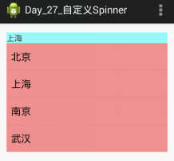
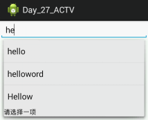

- GridView（网格图）
  1. 配置文件中配置
  2. 获取对象，数据绑定
  3. 设置监听（OnItemClickListener）
- Spinner（下拉列表）
  1. 简单用法（学习用）
  2. PopupWindow+TestView自定义Spinner
  3. Spinner事件处理（AdapterView.OnItemSelectedListener 列表项被选择时触发）
- AutoCompleteTextView（自动完成文本框）
  1. 什么是自动完成文本框？
  2. 简单用法（学习用）

# 一、GridView

用途：GridView用于在界面上按行、列分布的方式来显示多个组件，

特点：GridView和ListView有共同的父类 ： AbsListView, 所以GridView和ListView的使用特别相似。

区别：ListView只显示一列，而GridView可以显示多列，GridView也需要通过Adapter来提供显示的数据

## (一) 配置文件中配置

```
<GridView
    ..... />
```

- `android:columnWidth`：列宽
- `android:horizontalSpacing`：水平空白，列之间的间距
- `android:verticalSpacing`：垂直空白，行之间的间距
- `android:gravity`：设置元素内部的布局相对于元素的位置
- `android:numColumns`：列数，auto_fit：自适应，即根据屏幕的宽度决定列数
- `android:stretchMode`：伸展模式
  - none：不放缩，默认值。每一列宽度就是之前设置的值
  - spacingWidth：放缩元素间的水平间距，达到平均分布的效果
    - columnWidth：放缩元素自身的宽度，达到平均分布的效果

## (二) 获取对象，数据绑定

```
GridView gridview = (GridView) findViewById(R.id.gridview);

gridview.setAdapter(new ImageAdapter(this));
```

## (三) 设置监听

```
设置监听gridview.setOnItemClickListener(new OnItemClickListener() {
    @Override
    public void onItemClick(AdapterView<?> parent, View view,int position, long id) {
        Toast.makeText(MainActivity.this, "" + position,1).show();
    }
});
```

# 二、Spinner

Spinner控件也是一种列表类型的控件，可以极大地提高用户的体验性。

当需要用户选择时，可以提供一个下拉列表将所有可选的项列出来，供用户选择。

Spinner位于 android.widget包下，是View类的一个子类，是ViewGroup的间接子类，它和其他的Android控件一样，数据需要使用Adapter进行封装。

## (一) 一般用法

配置文件XML中配置：

```
<Spinner
    android:id="@+id/sp_main"
    android:layout_width="match_parent"
    android:layout_height="wrap_content"
    android:spinnerMode="dropdown"
    android:entries="@array/cities"
    />
```

- `android:spinnerMode`：列表显示的模式，有两个选择，为弹出列表（dialog）以及下拉列表（dropdown），如果不特别设置，为下拉列表。
- `android:prompt`：对当前下拉列表设置标题，仅在dialog模式下有效。

获取控件的对象：

```
Spinner spinner = (Spinner) findViewById(R.id.spinner);
```

准备数据，res/values/strings.xml：

```
<string-array name="cities">
    <item>北京</item>
    <item>上海</item>
    <item>广东</item>
    <item>深圳</item>
</string-array>
```

创建控制器，与控件绑定：`Spinner.setAdapter(adapter);`

## (二) 使用PopupWindow自定义Spinner

1. 点击TextView时，在其正下方弹出PopupWindow。
2. 点击PopupWindow中item时刷新TextView显示点击的值。



### 1. 配置XML文件

配置XML文件popup_window.xml 和（下拉列表的XML，用ListVIew做）：

```
<ListView
    android:id="@+id/lv_pw"
    android:layout_width="match_parent"
    android:layout_height="match_parent">
</ListView>
```

配置XML文件item.xml（TextView的XML）：

```
<LinearLayout xmlns:android="http://schemas.android.com/apk/res/android"
    android:layout_width="match_parent"
    android:layout_height="match_parent"
    android:orientation="vertical"
    android:padding="10dp"
    android:background="@drawable/item_selector"> <!-- 点击后会变色 -->

    <TextView
        android:id="@+id/tv_item"
        android:layout_width="match_parent"
        android:layout_height="wrap_content"
        android:textSize="20sp" />
</LinearLayout>
```

### 2. 将下拉布局转换成View对象，并设置监听

```
public void showPopupWindow() {
    //点击之后显示popupwindow

    View popupWindowView = LayoutInflater.from(MainActivity.this).inflate(R.layout.popup_window, null);

    //获取ListView(向上转型)，并设置adapter

    lv = (ListView)popupWindowView.findViewById(R.id.lv_pw);

    //给ListView设置点击监听器，点击后需设置TextView内容，以及使popupwindow消失

    lv.setOnItemClickListener(new OnItemClickListener() {
        @Override
        public void onItemClick(AdapterView<?> parent, View view, int position, long id) {
            tv.setText(data.get(position));
            //让popupwindow消失
            if(pw != null && pw.isShowing()) {
                pw.dismiss();
                pw = null;
            }
        }
    });

    lv.setAdapter(new MyAdapter());

    pw = new PopupWindow(popupWindowView);

    //设置宽高，如果不设置则不显示

    pw.setWidth(tv.getWidth());
    pw.setHeight(LayoutParams.WRAP_CONTENT);

    //设置显示位置和偏移量

    pw.showAsDropDown(tv, 0, 5);
}
```

### 3. 点击TextView是弹出PopupWindow

```
tv = (TextView)findViewById(R.id.tv_main);

tv.setText(data.get(0));

tv.setOnClickListener(new OnClickListener() {
    @Override
    public void onClick(View v) {
        //判断，如果popupwindow已经显示出来了，就使其消失
        if(pw != null && pw.isShowing()) {
            pw.dismiss();
            pw = null;
        } else {
            showPopupWindow();
        }
    }
});
```

## (三) Spinner事件处理

作为一个列表选择控件，Spinner具有一些选中选项可以触发的事件，但它本身没有定义这些事件，均继承自间接父类 AdapterView 。

AdapterView.OnItemSelectedListener：列表项被选择时触发。

# 三、AutoCompleteTextView（自动完成文本框）

## (一) 什么是自动完成文本框？

在我们平常上网的时候经常会用到谷歌或百度，在输入框中输入我们想要输入的信息就会出现其他与其相关的提示信息，非常方便。这种效果在Android中是用AutoCompleteTextView实现的。

自动完成文本框（AutoCompleteTextView），可以从官方文档上看出，是从EditText继承而来，所以它实际上也是一个文本编辑框，只是多了一个自动提示输入补全的功能。功能类似于：当用户输入一定字符之后，自动完成文本框会显示一个下拉列表，供用户从中选择，当用户选择某个菜单项之后，AutoCompleteTextView会按照你的选择自动填写该文本框。

## (二) 一般用法（学习用）



第一步：配置文件XML中配置AutoCompleteTextView控件属性

```
<AutoCompleteTextView
    android:completionHint：设置出现在下拉菜单中的提示标题，会显示在最下头
    android:completionThreshold：设置用户至少输入多少个字符才会显示提示
    android:dropDownHorizontalOffset：下拉菜单于文本框之间的水平偏移。默认与文本框左对齐
    android:dropDownHeight：下拉菜单的高度，可以为WrapContent
    android:dropDownWidth：下拉菜单的宽度，可以为matchParent
    android:singleLine：单行显示
    android:dropDownVerticalOffset：垂直偏移量
    />
```

第二步：为自动完成文本框设置adapter，注意该adapter要求要实现Filterable接口。

PS：Arrayadapter，Simpleadapter有Filterable接口，而baseadapter没有

```
@Override
protected void onCreate(Bundle savedInstanceState) {
    super.onCreate(savedInstanceState);
    setContentView(R.layout.activity_main);

    //获取AutoCompleteTextView

    AutoCompleteTextView actv;

    String[] data = {"hello", "nihao", "aaaahel", "ooo", "HELLO"};

    actv = (AutoCompleteTextView)findViewById(R.id.actv_main);

    ArrayAdapter<String> adapter = new ArrayAdapter<String>(this,
            android.R.layout.simple_list_item_1,
            data);

    //为该控件设置Adapter，当输入字符达到指定数量时，弹出ListView提示用户选择

    actv.setAdapter(adapter);
}
```
