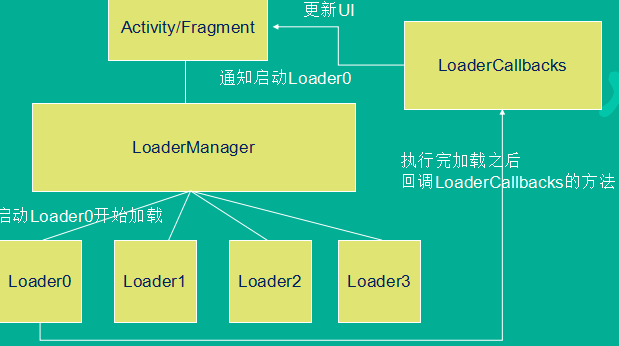
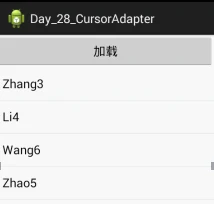

- Loader
  - 作用，特征：轻松实现Activity和Fragments中的异步数据加载
  - 核心类（5个）
  - 如何使用
  - CursorLoader，AsyncTaskLoader实现思路
- CursorLoader加载联系人名字
  - 思路
  - 代码
- 异步任务加载联系人名字
  - 代码
- 自定义 AsyncTaskLoader
  - 思路，优点
  - 代码

# 一、Loader

## (一) 作用与特征

作用：轻松实现Activity和Fragments中的异步数据加载。

特征：

1. 对于所有Activity和Fragment可见。
2. 提供异步数据加载 它们实时观察着数据源，
3. 一旦数据源被改动，它们会及时将新的结果上报给界面
4. 当配置发生改变时，自动重连数据源

## (二) 核心类（5个）

1）LoaderManager：为Activity或者Fragment管理一个或者多个Loader对象。一个Activity或者Fragment只能存在一个LoaderManager，但是一个LoaderManager可以管理多个Loader

2）LoaderManager.LoaderCallbacks：Activity或者Fragment用来与LoaderManager通信的接口

3）Loader：所有Loader的父类，他是一个抽象类。

4）AsyncTaskLoader：继承Loader的抽象类，封装了一个AsyncTask，来完成异步任务。

5）CursorLoader：AsyncTaskLoader的子类，实现异步加载数据库的功能，在后台子线程完成数据库查询工作。需要和ContentProvider联合使用。

## (三) 如何使用Loader（6步骤）

1. 创建Activity或者Fragment
2. 创建LoaderManager对象
3. 创建Loader对象，可以使用CursorLoader（加载数据库内容），或者自定义AsyncTaskLoader的实现类，加载其他数据源的数据。
4. 实现LoaderManager.LoaderCallbacks回调方法，用来创建和管理Loaders
5. 显示数据的策略，可以使用SimpleCursorAdapter。
6. 一个数据源，可以是ContentProvider或者其他

## (四) 获取LoaderManager对象

在Activity的onCreate方法中，或者在Fragment的onActivityCreated方法中执行 `getLoaderManager()` 方法。

## (五) 获取Loader对象

调用LoaderManager对象的

```
initLoader(
    int id,
    Bundle args,
    LoaderCallbacks<D> callback
)
```

参数1：创建的Loader的id，在一个LoaderManager中必须唯一

参数2：可选参数，如果Loader之前不存在，该参数会被传递到Loader中作为创建的参数使用。如果Loader已存在，该参数被忽略。可以为null

参数3：LoaderManager.LoaderCallbacks的实现类对象，用来监听Loader状态变化。

PS：

1. 执行initLoader 方法之后，如果Loader已存在，直接使用之。如果不存在，则会创建之，并会回调LoaderManager.LoaderCallbacks的onCreateLoader()方法。我们只需要在该方法中创建Loader对象返回即可。如果对于已存在的Loader希望它能重新执行一次加载，可以使用restartLoader方法。

2. initLoader方法会返回一个Loader对象，但是一般情况下我们不需要保存改引用，因为LoaderManager会为我们做好一切。

## (六) LoaderManager.LoaderCallbacks的回调方法

1. onCreateLoader(int id, Bundle args) — 当需要创建Loader时被回调，返回一个Loader对象.（主线程）

   参数1：创建的loader的id

   参数2：传递过来的Bundle参数

2. onLoadFinished(Loader<Cursor> loader, Cursor data) — 当Loader加载完数据(也就是异步任务完成)后被回调.（主线程）

   参数1：Loader对象

   参数2：加载后的返回Cursor

3. onLoaderReset(Loader<Cursor> loader) — 当Loader被重置时回调.（主线程）

   参数1：Loader对象

## (七) CursorLoader，AsyncTaskLoader实现思路



# 二、CursorLoader加载联系人名字

## (一) 思路

1. 使用ListView + Adapter的方式显示数据
2. 点击加载创建Loader。

   PS：使用restartLoad的方式创建Loader.(init只创建一次Loader)

3. 在LoaderCallbacks的onCreateLoader方法中创建CursorLoader对象，并返回。
4. 当异步加载完毕后，会回调onLoadFinished方法，在该方法中，修改ListView的数据源，然后刷新ListView



## (二) 代码

代码: 详细见上

### 1. 实现LoaderCallbacks

该接口是一个泛型接口，指明了加载完成之后的返回数据的类

```
public class MainActivity extends Activity implements LoaderCallbacks<Cursor> {
}
```

### 2. 通过LoaderManager创建Loader

```
LoaderManager mLoaderManager = getLoaderManager();

//可以使用Bundler传递数据到onCreateLoader回调，也可以为null
Bundle bundle = new Bundle(); bundle.putString("data", "hello");

//initLoader中的任务只会执行一次
mLoaderManager.restartLoader(0, bundle, MainActivity.this);
```

### 3. 实现onCreateLoader回调，返回CursorLoader对象

```
//主线程：当开始创建Loader时被回调
@Override
public Loader<Cursor> onCreateLoader(int id, Bundle args) {
    Log.i("FSLog", "onCreateLoader id = " + id +  " args = " + args.getString("key") +  " tid = " + Thread.currentThread().getId());

    //返回一个loader对象，该对象被返回之后会被自动执行，执行完后回调onLoadFinished方法
    CursorLoader loader = new CursorLoader(this, Contacts.CONTENT_URI, null, null, null, null);
    return loader;
}
```

### 4. 实现onLoadFinished回调，在该回调中修改界面

```
//主线程：当loader的异步任务完成时被回调
//异步任务执行完毕之后的结构通过data返回
@Override
public void onLoadFinished(Loader<Cursor> loader, Cursor data) {
    Log.i("FSLog", "onLoadFinished tid = " + Thread.currentThread().getId());

    this.data.clear();
    //清空老数据
    //解析cursor中的数据，保存到数据源，刷新ListView界面
    while(data.moveToNext()) {
        //通过列名转换成列号
        int n = data.getColumnIndex(Contacts.DISPLAY_NAME);
        if(n != -1) {
            //通过列号查内容
            String name = data.getString(n);
            this.data.add(name);     //添加到数据源
        }
    }

    adapter.notifyDataSetChanged();      //通知刷新
}

//当loader被重置时，onLoaderReset被回调
@Override
public void onLoaderReset(Loader<Cursor> loader) {
    Log.i("FSLog", "onLoaderReset tid = " + Thread.currentThread().getId());
}
```

# 三、异步任务加载联系人名字

## (一) 代码

代码: 详细见上

```
public class MainActivity extends Activity {

    Button btn;ListView lv;
    ArrayList<String>data = new ArrayList<String>();
    MyAdapter adapter;

    @Override
    protected void onCreate(Bundle savedInstanceState) {
        super.onCreate(savedInstanceState);
        setContentView(R.layout.activity_main);

        lv = (ListView)findViewById(R.id.lv_contacts_main);
        btn = (Button)findViewById(R.id.btn_load_main);

        btn.setOnClickListener(new OnClickListener() {
            @Override
            public void onClick(View v) {
                //启动异步任务加载数据
                new MyTask().execute();
            }
        });

        adapter = new MyAdapter();
        lv.setAdapter(adapter);
    }

    class MyTask extends AsyncTask<Void, Void, Void> {
        @Override
        protected Void doInBackground(Void... params) {
            //获取联系人数据库内容
            //获取ContentResolver对象
            //调用ContentResolver对象的query方法，获取cursor
            //通过cursor遍历表的内容
            ContentResolver cr = getContentResolver();
            Cursor c = cr.query(Contacts.CONTENT_URI, null, null, null, null);

            while(c.moveToNext()) {
                int n = c.getColumnIndex(Contacts.DISPLAY_NAME);  //通过列名转换成列号
                if(n != -1) {
                    String name = c.getString(n);   //通过列号查内容
                    data.add(name);   //添加到数据源
                }
            }
            return null;
        }

        @Override
        protected void onPostExecute(Void result) {
            // TODO Auto-generated method stub
            super.onPostExecute(result);
            adapter.notifyDataSetChanged();  //通知刷新界面
        }
    }

    class MyAdapter extends BaseAdapter {
        ......  //此处省略自定义Adapter及二级缓存
    }
}
```

# 四、自定义 AsyncTaskLoader

## (一) 思路

1. 使用ListView + ArrayAdapter显示数据
2. 在Activity中创建自定义Loader对象，并启动加载（执行Loader的forceLoad方法，否则loadInBackground方法不会执行，网上说这是一个bug）
3. 自定义Loader继承与AsyncTaskLoader，实现loadInBackground方法，该方法在 Loader加载时回调，并在 子线程 中运行。
4. 在onCreateLoader中返回自定义Loader对象
5. 在onLoadFinished中刷新数据并显示

## (二) 优点

可以异步，并且当检测到数据的变化时会自动加载。

PS：因为CursorLoader集成于AsyncTaskLoader，因此，当数据源的内容被改变时，会触发改Loader自动重新加载。

## (三) 代码

代码: 详细见上

### 1. 创建Activity，实现LoadCallbacks接口

```
public class MainActivity extends Activity
        implements LoaderCallbacks<ArrayList<String>> {
}
```

### 2. 自定义Loader

```
public class MyLoader extends AsyncTaskLoader<ArrayList<String>> {
    public MyLoader(Context context) {
        super(context); //父类里没有无参构造器，所以显示调用构造方法
    }

    @Override
    public ArrayList<String> loadInBackground() {
        //在子线程完成
        Log.i("FSLog", "loadInBackground tid = " + Thread.currentThread().getId());

        ArrayList<String> tmp = new ArrayList<String>();
        for(int i = 0; i < 10 ; i ++) {
            tmp.add("data" + System.currentTimeMillis());
        }
        return tmp;
    }
}
```

### 3. 创建Loader，并启动Loader

它不会自动启动、执行Loader的forceLoad方法。

```
public class MainActivity extends Activity
        implements LoaderCallbacks<ArrayList<String>>{

    ArrayList<String> data = new ArrayList<String>();
    ListView lv;
    Button btn;
    ArrayAdapter<String> adapter;
    LoaderManager mLoaderManager;

    protected void onCreate(Bundle savedInstanceState) {
        super.onCreate(savedInstanceState);
        setContentView(R.layout.activity_main);

        btn = (Button)findViewById(R.id.btn_load_main);
        btn.setOnClickListener(new OnClickListener() {
            public void onClick(View v) {
                //创建LoaderManager对象
                mLoaderManager = getLoaderManager();

                //启动自定义loader
                mLoaderManager.initLoader(0, null, MainActivity.this).forceLoad();
            }
        });

        lv = (ListView)findViewById(R.id.lv_main);
        adapter = new ArrayAdapter<String>(this, android.R.layout.simple_list_item_1, data);
        lv.setAdapter(adapter);
    }
}
```

### 4. 在onCreateLoader创建自定义Loader对象

```
@Override
public Loader<ArrayList<String>> onCreateLoader(int id, Bundle args) {
    Log.i("FSLog", "onCreateLoader");
    //创建自定义loader对象，并返回
    return new MyLoader(this);
}
```

### 5. 在 onLoadFinished 回调中更新界面

```
@Override
public void onLoadFinished(Loader<ArrayList<String>> loader,
                           ArrayList<String> data) {
    Log.i("FSLog", "onLoadFinished");

    //		this.data = data; 这种做法是错误的，数据源的地址（引用）已经改变了
    this.data.clear();
    this.data.addAll(data);

    adapter.notifyDataSetChanged();  //通知刷新界面
}
```
