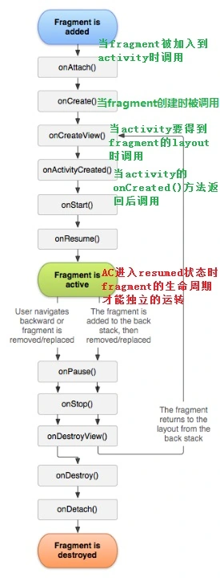

- Fragment介绍(可看做Activity中的一个模块)
  - 作用
  - FragmentPagerAdapter适配器
  - support.v4和android.app中的Fragment区别？
  - 生命周期
- 创建Fragment的两种方式
  - 动态：代码中加入 ViewGroup。
  - 静态：布局文件中使用标签`<fragment>`
- Fragment的栈管理
  - 在 commit 之前，调用 addToBackStack 方法，将事务添加后台栈
  - 当点返回时，系统从后台栈中弹出栈顶的事务，并回退
  - 用户还可通过调用 FragmentManager 的实例方法 popBackStack ，来 指明 需要回退的事务
- Fragment隐藏与显示
- 获取控件与对象
  - 从 Fragment 中获取控件
  - 从Activity中获取对象(动态Tag，静态XML)
- Activity与Fragment的传值
  - Activity传值到Fragment
  - Fragment传数据到Activity
- Fragment中使用Menu菜单
- Fragment设置动画效果
  - 设置系统默认的简单效果
  - 设置自定义的复杂动画效果

# 一、Fragment介绍

## (一) 作用

Fragment存在于Activity的ViewGroup中。

Fragment是activity的界面中的一部分，你可以合并多个fragment在一个单独的activity中建立多个UI面板，一个fragment必须总是嵌入在一个activity中，同时fragment的生命周期受activity而影响，

## (二) FragmentPagerAdapter适配器

它将每一个页面表示为一个 Fragment，并且每一个Fragment都将会保存到fragmentmanager当中。而且当用户没可能再次回到页面的时候，fragmentmanager才会将这个Fragment销毁.出于使用FragmentPagerAdapter 时，Fragment对象会一直存留在内存中，所以当有大量的显示页时，就不适合用FragmentPagerAdapter 了。

## (三) support.v4和android.app中的Fragment区别？

1. Fragment的所处包名不同。
2. Fragment所处的Activity不同（一个Activity，一个是FragmentActivity）
3. 获取FragmentManager方法不同（getFragmentManager，v4:getSupportFragmentManager）

## (四) 生命周期



- onDetach() 这个方法。
- onAttach —— 当fragment被加入到activity时调用（在这个方法中可以获得所在的activity）
- onCreate —— 状态初始化
- onCreateView —— 界面初始化调用，fragment在其中创建自己的layout(界面)
- onActivityCreated —— 初始化工作完成 当activity的onCreated()方法返回后调用此方法
- onStart —— 显示 onResume：获取焦点
- onPause —— 失去焦点 onStop：不可见
- onDestroyView —— 当fragment中的视图被移除的时候调用。
- onDestroy —— fragment被销毁
- onDetach —— 当fragment和activity分离的时候，调用

一旦activity进入resumed状态（也就是running状态），你就可以自由地添加和删除fragment  因此，只有当activity在resumed状态时，fragment的生命周期才能独立的运转，其它时候是依赖于activity的生命周期变化的。

# 二、创建Fragment的两种方式

## (一) onCreateView中返回的View是就Fragment显示的界面

```
public class FragmentClass extends Fragment {

    @Override
    //
    // 当activity要得到fragment的layout时调用
    public View onCreateView(LayoutInflater inflater, ViewGroup container,
                             Bundle savedInstanceState) {
        //可以直接用参数中的inflater对象

        //将布局文件转换成View对象
        View v = inflater.inflate(R.layout.fragment0, container, false);

        //onCreateView中返回的View是就Fragment显示的界面
        return v;
    }
}
```

## (二) 动态：在代码中把它加入到一个指定的 ViewGroup 中

`mFragmentTransaction` 是事务对象, `mFragmentTransaction.commit();`是提交事务

add(),replace() —— 把Fragment对象加入到Activity中去  remove()——  移除Activity中的fragment （使用commit提交的事务，都是在UI线程空闲时才会执行的）

```
add(int containerViewId, Fragment fragment);
```

containerViewId：ViewGroup的id

当使用相同的containerViewId调用多次add方法，传不同的Fragment对象时，可以使用

```
ts.show(fragment);
```

与

```
ts.hide(fragment)
```

来控制哪个Fragment对象被显示出来

```
replace(int containerViewId, Fragment fragment);
```

使用新的fragemtn对象替换之前的fragment对象，如果之前没有fragment对象，那么就直接加入

```
remove(fragment);
```

使用删除指定的fragment对象

```
btnLoad.setOnClickListener(new OnClickListener() {
    public void onClick(View v) {
        //1.获取FragmentManager对象
        FragmentManager manager = getFragmentManager();
        FragmentTransaction mFragmentTransaction = manager.beginTransaction();

        //2.开启事务
        FragmentTransaction ts=getFragmentManager().beginTransaction();

        //3.添加事务内容
        mFragmentTransaction.replace(R.id.ll_container_main, new Fragment0());

        //4.提交事务
        mFragmentTransaction.commit();
    }
});
```

## (三) 静态：Activity的布局文件中使用标签`<fragment>`

下面是Activity布局文件的一部分,com.fs.act.MyFragment0的对象就被加入到了 FrameLayout这个容器中了

```
public class FragmentClass extends Fragment {

    public View onCreateView(LayoutInflater inflater, ViewGroup container,
                             Bundle savedInstanceState) {
        //创建该Fragment需要显示的View视图，并返回
        View v = inflater.inflate(R.layout.fragment0, container, false);

        //onCreateView中返回的View是就Fragment显示的界面
        return v;
    }
}
```

```
<FrameLayout
    android:id="@+id/container"
    android:layout_width="match_parent"
    android:layout_height="match_parent"
    android:background="#ffffffff" >

    <fragment
        android:id="@+id/fragmen0"
        android:layout_width="match_parent"
        android:layout_height="match_parent" />

</FrameLayout>
```

Fragment嵌入Activity方式 : Fragment 添加到 Activity 中才能显示, 以下是将 Fragment 嵌入 Activity 的方式;

- 布局文件嵌入 : 在布局文件中 使用 `<Fragment />` 元素, 通过定义 android:name = "com.example.MyFragment" 属性指定 Fragment 类;
- 代码方式嵌入 : 调用 FragmentTransaction 对象的 add() 方法向 Activity 中添加 Fragmen

```
<fragment
    android:id="@+id/unread_list_frag"
    android:name="com.shunshiwei.yahei.fragment.noticeUnreadFragment"
    android:layout_width="match_parent"
    android:layout_height="match_parent"
    android:layout_marginTop="2dp" />
```

# 三、Fragment的栈管理

FragmentTransaction的 `addToBackStack(null);` 把事务加入到back栈中,这时按返回键时,可以看到之前的Fragment重新显示（回退之前的事务提交）

addToBackStack（null）:表示将该事务添加到后台栈，但是不为其配置名字。

addToBackStack（"ft1"）:表示将该事务添加到后台栈，名字为ft1。

点击返回键，默认从后台栈，弹出 栈顶 的事务进行回退。

如果使用 `popBackStack` ，回退栈，可以指明回退的事务的名字。

```
popBackStack(String, int);
```

参数1：要回退的事务名字

参数2：回退方式（0或者FragmentManager.POP_BACK_STACK_INCLUSIVE）

0：表示回退该事务之前的事务，不包括该事务

FragmentManager.POP_BACK_STACK_INCLUSIVE：表示回退该事务之前的事务，包括该事务

```
//创建FragmentManager
FragmentManager manager = getFragmentManager();

//启动事务
FragmentTransaction mFragmentTransaction = manager.beginTransaction();

//添加事务内容
mFragmentTransaction.replace(R.id.ll_container_main, new Fragment1());

mFragmentTransaction.addToBackStack("ft2");

//提交事务
mFragmentTransaction.commit();
}
});

//获取FragmentManager ,实现实例方法  必须指明
FragmentManager manager = getFragmentManager();

manager.popBackStack("ft1", 0);
```

# 四、Fragment隐藏与显示

调用FragmentTransaction的实例方法show和hide可以显示隐藏Fragment

```
public void onClick(View v) {
    //创建FragmentManager
    FragmentManager manager = getFragmentManager();

    //启动事务
    FragmentTransaction mFragmentTransaction = manager.beginTransaction();

    if(manager.findFragmentByTag("f0") == null) {
        //添加事务内容
        mFragmentTransaction.add(R.id.ll_container_main, f0, "f0");
    }

    mFragmentTransaction.show(f0);
    //显示事务内容
    mFragmentTransaction.hide(f1);
    //隐藏事务内容
    mFragmentTransaction.hide(f2);
    //隐藏事务内容

    //提交事务
    mFragmentTransaction.commit();
}
});
```

# 五、获取控件与对象

通过xml的静态方式添加的Fragment，用 FragmentManager实例方法findFragmentById的方法获取

通过事务方式动态添加的Fragment，用FragmentManager实例方法findFragmentByTag的方法获取

## (一) 从Fragment中获取控件

在Fragment的onCreateView方法中，我们需要创建View对象，并返回。

我们只需要调用View对象的findViewById方法，即可获得Fragment中的控件对象

```
public class Fragment0 extends Fragment{
    @Override
    public View onCreateView(LayoutInflater inflater, ViewGroup container,
                             Bundle savedInstanceState) {
        //创建该Fragment需要显示的View视图，并返回
        View v = inflater.inflate(R.layout.fragment0, container, false);
        return v;
    }
}
```

## (二) 从Activity中获取对象(动态Tag，静态XML)

### 1. 静态XML

```
//从Activity中获取Fragment对象：通过xml布局文件静态添加Fragment

//获取FragmentManager
FragmentManager manager = getFragmentManager();
Fragment0 frg0 = (Fragment0)manager.findFragmentById(R.id.frg_main);
```

### 2. 动态Tag

```
//添加Fragment  replace方法中第三个参数是Tag
FragmentManager manager = getFragmentManager();
FragmentTransaction mFragmentTransaction = manager.beginTransaction();
mFragmentTransaction.replace(R.id.ll_container_main, new Fragment0(), "frag0");
mFragmentTransaction.commit();

Button btn = (Button)findViewById(R.id.btn_invoke_main);
btn.setOnClickListener(new OnClickListener() {
    @Override
    public void onClick(View v) {
        //从Activity中获取Fragment对象：Fragment是通过动态方式添加到Activity中
        FragmentManager manager = getFragmentManager();
        Fragment0 frg0 = (Fragment0)manager.findFragmentByTag("frag0");
    }
});
```

# 六、Activity与Fragment的传值

## (一) Activity传值到Fragment

使用fragment的 `setArguments(Bundle b);` 方法可以把bundle从Activity传递到Fragment中。然后使用 `getArguments();` 方法可以从Fragment中将传递获取bundle获取出来

```
btn.setOnClickListener(new OnClickListener() {
    // MainActivity.java
    public void onClick(View v) {
        //将Fragment添加到Activity中，并传递数据
        FragmentManager manager = getFragmentManager();
        FragmentTransaction mFragmentTransaction = manager.beginTransaction();
        Fragment0 frg0 = new Fragment0();
        Bundle args = new Bundle();
        args.putString("key", "aaaaaaaaaaaaa");
        frg0.setArguments(args);
        mFragmentTransaction.replace(R.id.ll_container_main, frg0);
        mFragmentTransaction.commit();
    }
});

public class Fragment0 extends Fragment{
    Button btnFrg0;
    MainActivity activity;

    //把activity传过来在
    @Override
    public View onCreateView(LayoutInflater inflater, ViewGroup container,
                             Bundle savedInstanceState) {
        //创建该Fragment需要显示的View视图，并返回
        View v = inflater.inflate(R.layout.fragment0, container, false);
        activity = (MainActivity)getActivity();     //得到
        Bundle args = getArguments();
        return v;
    }
}
```

## (二) Fragment传数据到Activity

可以直接调用Activity的实例方法,或者使用Handler机制

方法一：在Fragment中调用Activity提供方法，将值传递到Activity。

方法二：将Handler创建在Activity中，然后，让Fragment使用Handler将消息传递到Activity中处理。

```
public class Fragment0 extends Fragment {
    Button btnFrg0;
    MainActivity activity;

    @Override
    public View onCreateView(LayoutInflater inflater, ViewGroup container,
                             Bundle savedInstanceState) {
        View v = inflater.inflate(R.layout.fragment0, container, false);
        activity = (MainActivity)getActivity();
        // activity要强转
        btnFrg0 = (Button)v.findViewById(R.id.btn_frag0);

        btnFrg0.setOnClickListener(new OnClickListener() {
            @Override
            public void onClick(View v) {
                //
                // 方法一：  activity.setButtonText("bbbb"); activity要强转
                Message msg = Message.obtain();

                //
                // 方法二：Handler
                msg.what = 100;
                msg.obj = "ccc";
                activity.mHandler.sendMessage(msg);
            }
        });

        return v;
    }
}

public class MainActivity extends Activity {
    public Button btn;

    public Handler mHandler = new Handler() {
        @Override
        public void handleMessage(Message msg) {
            super.handleMessage(msg);
            switch (msg.what) {
                case 100:
                    btn.setText((String) msg.obj);
                    break;
                default:
                    break;
            }
        }
    };

    //.......下面省略
```

# 七、Fragment中使用Menu菜单

可以为Fragment设置自己的Menu菜单。虽然Fragment是存在于Activity中，但是不会和Activity中的Menu菜单相互冲突。

步骤：

在onCreateContextMenu回调方法中，设置上下文菜单的显示样式，可以使用menu资源的内容来显示在onContextItemSelected回调方法中，设置菜单项被点击时的响应事件调用registerForContextMenu注册控件（当长按该控件时，onCreateContextMenu被回调，并显示上下文菜单）

注意：需要将super.onCreateContextMenu(menu, v, menuInfo);方法删除掉。

```
@Override
public boolean onCreateOptionsMenu(Menu menu) {
    // Inflate the menu; this adds items to the action bar if it is present.
    getMenuInflater().inflate(R.menu.main, menu);
    return true;
}

@Override
public boolean onContextItemSelected(MenuItem item) {
    switch(item.getItemId()) {
        case R.id.activity_item0:
            Toast.makeText(this, "select item0", 2000).show();
            break;
        case R.id.activity_item1:
            Toast.makeText(this, "select item1", 2000).show();
            break;
        case R.id.activity_item2:
            Toast.makeText(this, "select item2", 2000).show();
            break;
        default:
            break;
    }
    return super.onContextItemSelected(item);
}

@Override
public void onCreateContextMenu(ContextMenu menu, View v, ContextMenuInfo menuInfo) {
    menu.clear();

    //给上下文菜单设置选项
    getMenuInflater().inflate(R.menu.activity_context_menu, menu);

    super.onCreateContextMenu(menu, v, menuInfo);
}
```

# 八、Fragment设置动画效果

## (一) 设置系统默认的简单效果

```
public void onClick(View v) {
    FragmentManager manager = getFragmentManager();
    FragmentTransaction mFragmentTransaction = manager.beginTransaction();

    //设置播放系统动画，从小变大
    mFragmentTransaction.setTransition(FragmentTransaction.TRANSIT_FRAGMENT_OPEN);
}
});
```

## (二) 设置自定义的复杂动画效果

1)在res/animator目录中，创建动画配置文件res/animator/left_enter.xm

```
<set xmlns:android="http://schemas.android.com/apk/res/android" >

    <objectAnimator
        android:interpolator="@android:interpolator/decelerate_quint"
        android:valueFrom="-400"
        android:valueTo="0"
        android:valueType="floatType"
        android:propertyName="X"
        android:duration="10000" />

    <objectAnimator
        android:interpolator="@android:interpolator/decelerate_quint"
        android:valueFrom="90"
        android:valueTo="0"
        android:valueType="floatType"
        android:propertyName="rotation"
        android:duration="10000" />
</set>
```

```
btnExit.setOnClickListener(new OnClickListener() {
    @Override
    public void onClick(View v) {
        FragmentManager manager = getFragmentManager();
        FragmentTransaction mFragmentTransaction = manager.beginTransaction();

        //设置自定义动画，加速旋转退出
        mFragmentTransaction.setCustomAnimations(R.animator.left_enter, R.animator.right_exit);
        mFragmentTransaction.remove(f0);
        mFragmentTransaction.commit();
    }
});
```
