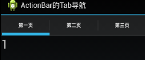
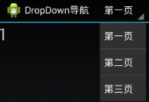
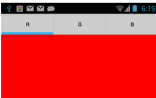
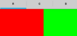
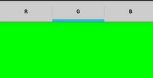
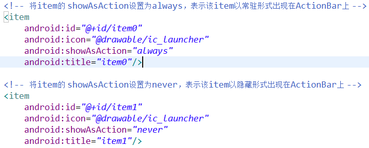
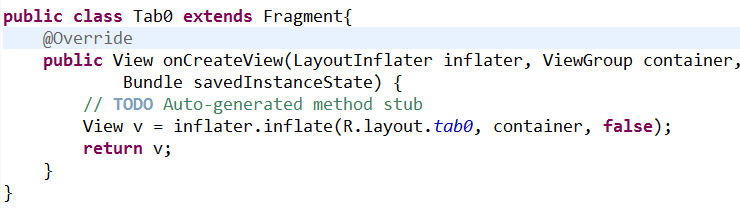
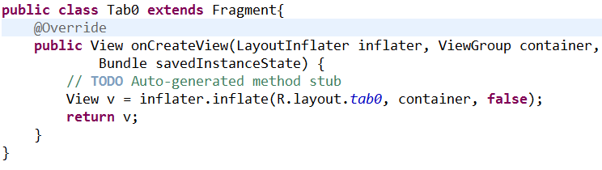

- ActionBar介绍
  1. 控件组成，用途
- ActionBar使用
  1. 隐藏与显示
  2. 显示选项菜单
  3. 导航
  4. 设置View控件
- 效果实现
  1. ActionBar + Fragmen 实现Tab导航
  2. ActionBar + Fragment 实现下拉导航
  3. ActionBar + Fragment + ViewPager 实现滑动效果











# 一、ActionBar介绍

ActionBar是android窗口应用的一个特征，它主要用于标识应用程序及用户所处的位置并提供相关操作及全局的导航。

主要用途：

1. 提供一个专门的空间来显示应用的标识并且标识用户所处的位置。 为不同的应用程序提供统一的导航模式。
2. ActionBar为Fragment的切换提供了内置的基于tab 的导航。此外它还提供了DropList的导航供选择使用。你可以在用户需要选择菜单时将应用中的动作放置在ActionBar上。
3. 对于比较重要的Action可以放置到ActionBar上常驻，而不太常用的放置到右边overflow menu上。

如果想关闭ActionBar可以通过 AndroidManifest.xml 中配置实现（该属性可以配置在每一个activity中，用来控制单个activity，也可以直接配置到application中，用来控制整个应用）

```
<application
    android:icon="@drawable/ic_launcher"
    android:label="@string/app_name"
    android:theme="@android:style/Theme.Holo.Light.NoActionBar"
>
```

# 二、ActionBar使用

## (一) 隐藏与显示

Activity有一个实例方法可以得到Activity关联的ActionBar对象：`ActionBar mActionBar = getActionBar();`

ActionBar的两个实现方法：

- `mActionBar.show()`：显示
- `mActionBar.hide()`：隐藏

## (二) 显示选项菜单


我们将菜单的xml布局文件设置该了menu对象，那么从menu对象中，就可以获取里面的MenuItem对象。  监听MenuItem的点击事件：onOptionsItemSelected方法中，可以设置每一个item被点击后的处理事件。通过itemId作为区分。

PS：

1. my_menu 指res/menu/my_menu.xml文件，即菜单文件
2. 菜单文件中的 `<item>` 中配置 `android:showAsAction` 属性的值决定了菜单是否被加入到ActionBar中显示 。showAsAction属性共有五个值，可以混合使用。
3. 每个item都必须设置 title 属性！



## (三) 导航

`actionBar.setDisplayHomeAsUpEnabled(true);`

调用了该方法后，程序title的图标变成可点击，并且在左边多出一个向左的箭头。可以用来返回指定界面（可自定义）。

实现导航：（导航item的id为android.R.id.home）

1. 将要启动的Activity设置为single_top启动模式（否则，该Activity会被重新创建）。
2. 启动intent添加FLAG `intent.addFlags(Intent.FLAG_ACTIVITY_CLEAR_TOP);` 此时会将要启动的Activity上面的其他Activity实例移除，并调用该Activity的onNewIntent方法


PS：你需要设置点击返回按钮的处理代码（比如希望实现返回功能）！

## (四) 设置View控件(比如添加图片)

在ActionBar的 item 中设置 `android:actionViewClass="android.widget.ImageView"` 属性，属性的值，可以设置为任何View的子类。  然后，我们可以在 onCreateOptionsMenu 方法中获取到该ActionView，  然后修改或者添加监听器。

获取 ActionView 的方法为：

```
menu.findItem(【item id】).getActionView()
```

```
public class MainActivity extends Activity {

    ActionBar mBar;

    EditText mEt;

    @Override
    protected void onCreate(Bundle savedInstanceState) {
        super.onCreate(savedInstanceState);
        setContentView(R.layout.activity_main);
        mBar = getActionBar();
        mBar.setDisplayHomeAsUpEnabled(true);
        // 程序title的图标变成可点击
    }

    public boolean onCreateOptionsMenu(Menu menu) {
        //创建菜单时候回调
        MenuInflater inflater = getMenuInflater();
        inflater .inflate(R.menu.my_action_bar, menu);
        //上面的等价于getMenuInflater().inflate(R.menu.my_action_bar, menu);
        MenuItem item = menu.findItem(R.id.item_edit_text);
        //获取装有EditText的item对象
        mEt = (EditText) item.getActionView();
        //获得Action View
        //从MenuItem对象中获取其中放置的View控件
        mEt.setWidth(100);
        mEt.setSingleLine();
        return true;
        //返回true显示 false不显示ActionBar
    }

    public boolean onOptionsItemSelected(MenuItem item) {
        //选中菜单项时候回调
        switch (item.getItemId()) {
            case R.id.item0:
                Toast.makeText(this, mEt.getText().toString(), 2000).show();
                break;
            case R.id.item1:
                Toast.makeText(this, "item1", 2000).show();
                break;
            case android.R.id.home:
                // 导航item的id为android.R.id.home
                Toast.makeText(this, "back", 2000).show();
                break;
            default:
                break;
        }
        return super.onOptionsItemSelected(item);
    }
}
```

# 三、效果实现

## (一) ActionBar + Fragmen 实现Tab导航

步骤：

1. 获取ActionBar对象
2. 设置ActionBar的导航模式为ActionBar.NAVIGATION_MODE_TABS
3. 创建Tab对象
4. 设置Tab对象的文本内容，点击的监听器，当点击某一个Tab时，切换Fragment
5. 将Tab对象添加到ActionBar中
6. 实现 TabListener 接口，复写其中回调方法

```
@Override
//当tab被选中时回调
public void onTabSelected(Tab tab, FragmentTransaction ft) {
    //这里红色的ft参数不能直接使用，会在运行中报错，因为之前系统已调用，所以需要重新获得对象
    FragmentTransaction mFt = getFragmentManager().beginTransaction();
    mFt.replace(R.id.ll_container_main, tabs.get(tab.getPosition()));
    mFt.commit();
    //当tab被选中时，重置Fragment
}

@Override
//Tab没有被选中时回调
public void onTabUnselected(Tab tab, FragmentTransaction ft) {
}

@Override
//Tab被重复选中时回调
public void onTabReselected(Tab tab, FragmentTransaction ft) {
    Log.i("SumLog", "onTabReselected tab index = " + tab.getPosition());
}
```

```
public class MainActivity extends Activity implements TabListener {

    ActionBar mActionBar;

    ArrayList<Fragment> tabs = new ArrayList<Fragment>();

    @Override
    protected void onCreate(Bundle savedInstanceState) {
        super.onCreate(savedInstanceState);
        setContentView(R.layout.activity_main);

        tabs.add(new Tab0());
        // tab0是另外一个class文件了，见图
        tabs.add(new Tab1());
        tabs.add(new Tab2());

        mActionBar = getActionBar();
        mActionBar.setNavigationMode(ActionBar.NAVIGATION_MODE_TABS);

        Tab tab0 = mActionBar.newTab();
        // tab是匿名抽象内部类，不能直接new创建对象
        tab0.setText("Tab0");
        tab0.setTabListener(this);
        mActionBar.addTab(tab0);

        Tab tab1 = mActionBar.newTab();
        tab1.setText("Tab1");
        tab1.setTabListener(this);
        mActionBar.addTab(tab1);

        Tab tab2 = mActionBar.newTab();
        tab2.setText("Tab2");
        tab2.setTabListener(this);
        mActionBar.addTab(tab2);
    }
}
```



```
// 下面代码见代码源文件
```

## (二) ActionBar + Fragment 实现下拉导航

步骤：

1. 获取ActionBar对象
2. 设置导航模式
3. ActionBar对象的Adapter以及监听器
4. 实现OnNavigationListener接口，复写方法onNavigationItemSelected

```
@Override
//当tab被选中时回调
public boolean onNavigationItemSelected(int itemPosition, long itemId) {
    //当tab被选中时，重置Fragment
    FragmentTransaction mFt = getFragmentManager().beginTransaction();
    mFt.replace(R.id.rl_container_main, tabs.get(itemPosition));
    mFt.commit();
    return true;
}
```

```
public class MainActivity extends Activity implements OnNavigationListener {

    ActionBar mBar;

    ArrayList<Fragment> tabs = new ArrayList<Fragment>();

    ArrayList<HashMap<String, String>> data = new ArrayList<HashMap<String, String>>();
    // 数据源

    @Override
    protected void onCreate(Bundle savedInstanceState) {
        super.onCreate(savedInstanceState);
        setContentView(R.layout.activity_main);

        tabs.add(new Tab0());
        // tab0是另外一个class文件了，见图
        tabs.add(new Tab1());
        tabs.add(new Tab2());

        mBar = getActionBar();
        mBar.setNavigationMode(ActionBar.NAVIGATION_MODE_LIST);

        HashMap<String, String> row0 = new HashMap<String, String>();
        row0.put("name", "Red");
        // 数据源
        data.add(row0);

        HashMap<String, String> row1 = new HashMap<String, String>();
        row1.put("name", "Green");
        data.add(row1);

        HashMap<String, String> row2 = new HashMap<String, String>();
        row2.put("name", "Blue");
        data.add(row2);

        //设置Adapter
        SimpleAdapter adapter = new SimpleAdapter(this,
                data,
                R.layout.item,
                new String[]{"name"},
                new int[]{R.id.tv_item});
        mBar.setListNavigationCallbacks(adapter, this);
    }
}
```



```
// 下面代码见代码源文件
```

## (三) ActionBar + Fragment + ViewPager 实现滑动效果

```
public class MainActivity extends FragmentActivity implements TabListener, OnPageChangeListener {

    ActionBar mBar;

    ViewPager vp;

    ArrayList<Fragment> pages = new ArrayList<Fragment>();

    @Override
    protected void onCreate(Bundle savedInstanceState) {
        super.onCreate(savedInstanceState);
        setContentView(R.layout.activity_main);

        //创建所有需要显示的Fragment
        pages.add(new FragmentRed());
        // FragmentRed是另外一个class文件了
        pages.add(new FragmentGreen());
        pages.add(new FragmentBlue());

        vp = (ViewPager)findViewById(R.id.vp_main);
        vp.setAdapter(new MyAdapter(getSupportFragmentManager()));
        //这里使用的是support.v4包中Fragment，和使用android.app中的Fragment不同
        vp.setOnPageChangeListener(this);

        mBar = getActionBar();
        //获取ActionBar
        mBar.setDisplayShowTitleEnabled(false);
        //不显示title
        mBar.setDisplayShowHomeEnabled(false);
        //不显示icon
        mBar.setNavigationMode(ActionBar.NAVIGATION_MODE_TABS);
        //设置当行模式
        //创建Tab对象，设置文本，监听器，并添加到ActionBar中
        Tab tab0 = mBar.newTab();
        tab0.setText("Red");
        tab0.setTabListener(this);
        mBar.addTab(tab0);

        //创建Tab对象，设置文本，监听器，并添加到ActionBar中
        Tab tab1 = mBar.newTab();
        tab1.setText("Green");
        tab1.setTabListener(this);
        mBar.addTab(tab1);

        //创建Tab对象，设置文本，监听器，并添加到ActionBar中
        Tab tab2 = mBar.newTab();
        tab2.setText("Blue");
        tab2.setTabListener(this);
        mBar.addTab(tab2);
    }

    @Override  //OnPageChangeListener接口复写方法，页面选中时回调
    public void onPageSelected(int arg0) {
        //当滑动ViewPage，某一页被选中时，切换ActionBar的导航状态
        mBar.setSelectedNavigationItem(arg0);
    }

    @Override
    //TabListener接口复写方法 Tab被选中时候回调
    public void onTabSelected(Tab tab, FragmentTransaction ft) {
        // 当Tab被选中时，切换ViewPager的显示页面
        vp.setCurrentItem(tab.getPosition());
    }

    class MyAdapter extends FragmentPagerAdapter {

        public MyAdapter(FragmentManager fm) {
            super(fm);
            //构造方法
        }

        @Override
        //返回需要显示到ViewPager上的Fragment对象
        public Fragment getItem(int arg0) {
            return pages.get(arg0);
        }

        @Override
        //ViewPager中需要显示的总页数
        public int getCount() {
            return pages.size();
        }
    }
}
```
