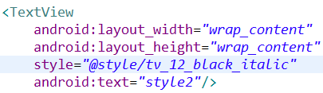
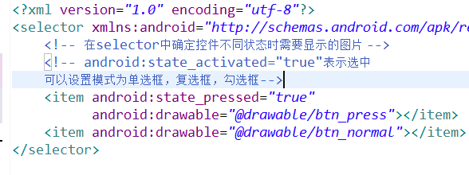
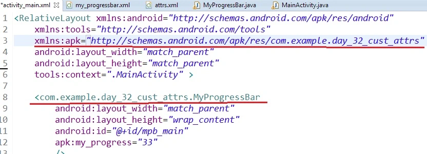
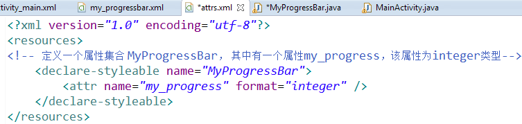

- 样式资源
  1. 样式定义
  2. 样式使用，样式继承
- Selector
  1. Selector （selector一般创建在drawable）
  2. Shape  可以定义圆角、渐变效果
  3. Selector自定义播放器
- 自定义属性（一般和自定义控件一起使用）
  1. 使用方法（2种）
  2. 布局文件配合自定控件使用
    1. 创建自定义属性
    2. 在xml中添加程序包的命名空间
    3. 在xml中为自定义控件设置自定义属性
    4. 在自定义控件中获取自定义属性的值，作为初始值

# 一、样式资源

## (一) 样式定义

Style资源文件，写在res的styles资源文件中。用来表示一组属性的设置

Themes（主题） 是一个包含一种或者多种格式化属性的集合，可以将其套用在应用程序中所有的活动当中或其中的某个活动。

可以将style设置给单个组件（设置给组件的style属性） 也可以将style设置给application的Theme属性或者application

以上3中情况，他们的作用域不同

## (二) 样式使用，样式继承



注意这里是用的 style：！

每个`<resources>`元素的子节点在编译时都被转换为一个应用程序资源对象，其可以通过`<style>` 元素的 name属性的值来引用。

通过在AndroidManifest.xml中的application或者 activity节点指定android:theme 属性即可指定预先定义好的主题

```
<activity android:name=".Main"
    android:theme
    =
    "@style/my_style
    "
    android:label="@string/app_name">
```

对于activity，也可以在Java中使用setTheme()方法，但需要在调用setContentView()、inflate()之前调用

res/values/styles.xml 中：

```
<!-- 自定义样式 style 2 -->

<style name="
    tv_12_black_italic
    ">

    <item name="
        android:textSize
        ">12sp</item>

    <item name="
        android:textColor
        ">#ff000000</item>

    <item name="
        android:textStyle
        ">italic</item>

</style>

<!-- 样式继承：使用parent属性继承样式，可以继承自定义，也可继承平台自带样式 -->

-->

<style name="
    tv_20_red_bold
    " parent="
    @style/tv_15_red_bold
    ">

    <item name="android:textSize">20sp</item>

</style>
```

另一种继承方式是使用自定义的样式作为前缀。只适用于继承自定义样式

```
<style name="CodeFont.Red">

    <item name="android:textColor">#FF0000</item>

</style>
```

# 二、Selector

可以使用selector动态的改变不同状态下组件的样式，例如：获得焦点、失去焦点、按下时等等 可以使用selector来达到这个目的

在drawable目录或者layout目录下，定义一个selector，然后在需要使用selector中的组件中使用android:background、android:textColor、listSelector（ListVIew中）等属性来调用

## (一) Selector




注意：

每个item对应一种状态 在定义selector的时候，根据不同目的，选择不同item属性.

例如，为了定义组件的背景，需要使用 android:drawable ，为了定义文本颜色等，需要使用 android:color

(这是属性用补全找不到，需要自己写)

statelist中第一个匹配当前状态的item会被使用。因此，如果第一个item没有任何状态特性的话，那么它将每次都被使用，这也是为什么默认的值必须总是在最后

## (二) Shape样式

在item中使用`<shape>`来定义组件的形状，将item的android:drawable属性设置为我们定义的shape资源（shape资源可以放在drawable目录中）

```
<shape xmlns:android="
    http://schemas.android.com/apk/res/android
    "
    android:shape
    ="rectangle">

    <gradient
        android:startColor="#FFFF0000"
        android:endColor="#80FF00FF"
        android:angle="45"/>

    <padding android:left="7dp"
        android:top="7dp"
        android:right="7dp"
        android:bottom="7dp" />

    <corners android:radius="8dp" />

</shape>
```

可以从api帮助文档的user guide->Resource types->Drawable找到shap的用法

## (三) Selector使用

普通button直接设置Selector即可，复选框CheckBox还需要修改style属性，需要先将selector装入一个style中，然后将该style设置给checkbox。

```
<style name="MyCheck" parent="@android:style/Widget.CompoundButton.CheckBox">

    <item name="android:button">@drawable/btn_play</item>

</style>

<Button
    android:id="@+id/btn_pre_controller"
    android:layout_width="wrap_content"
    android:layout_height="wrap_content"
    android:background="@drawable/btn_pre"
    />

<CheckBox
    android:id="@+id/cb_play_controller"
    android:layout_width="wrap_content"
    android:layout_height="wrap_content"
    style="@style/MyCheck"  <!--如果直接用selector则还会有小框 -->
    />

<Button
    android:id="@+id/btn_next_controller"
    android:layout_width="wrap_content"
    android:layout_height="wrap_content"
    android:background="@drawable/btn_next"
    />
```

# 三、自定义属性（一般和自定义控件一起使用）

## (一) 使用方法（2种）

通过XML文件配置的方式

通过Class类文件自定义组件

## (二) 布局文件配合自定控件使用

添加命名空间 ：xmlns:apk="http://schemas.android.com/apk/res/包名"





从自定义控件中构造方法的AttributeSet参数中获取自定义属性

```
public class MyProgressBar extends LinearLayout{

    //自定义控件

    ProgressBar pb;
    TextView tv;

    public MyProgressBar(Context context, AttributeSet attrs) {
        super(context, attrs);

        //第二个参数this表示父类容器，第三个表示时候添加到容器，false则要用addView添加

        View v = LayoutInflater.from(context).inflate(R.layout.my_progressbar, this, false);

        //从attrs中获取自定义属性，将自定义属性的值作为控件的初始值

        //找到所有属性中属于my_progressbar类型的属性，保存到typeArray中

        TypedArray typeArray = context.obtainStyledAttributes(attrs,R.styleable.MyProgressBar);

        int n = typeArray.getInteger(R.styleable.MyProgressBar_my_progress, 0);

        pb = (ProgressBar) v.findViewById(R.id.pb_my_pb);
        pb.setProgress(n);

        tv = (TextView)v.findViewById(R.id.tv_my_pb);
        tv.setText(n + "%");

        addView(v);
    }

    public void setProgress(int n) {
        //暴露出接口方便它人使用

        pb.setProgress(n);

        tv.setText(n + "%");
    }

}
```
