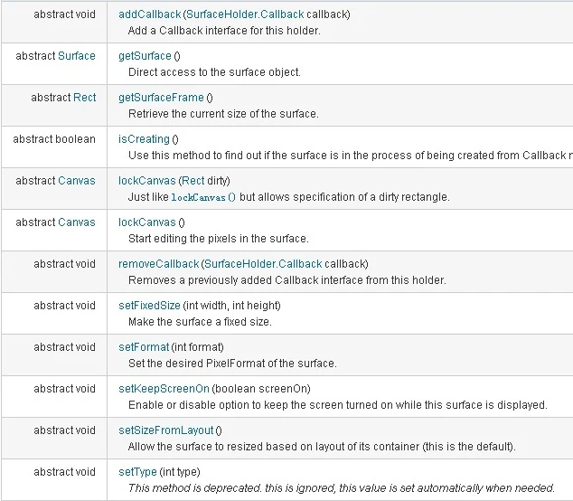

- SurfaceView定义
- SurfaceView、Surface、SurfaceHolder区别，关系？
- SurfaceHolder重要属性和注意事项
- 使用SurfaceView
- SurfaceView实现视频播放
- 双缓存与闪烁现象

# 一、SurfaceView定义

可以直接从内存或者DMA等硬件接口取得图像数据,是个非常重要的绘图容器它的特性是：可以在主线程之外的线程中向屏幕绘图上。这样可以避免画图任务繁重的时候造成主线程阻塞，从而提高了程序的反应速度。在游戏开发中多用到SurfaceView，游戏中的背景、人物、动画等等尽量在画布canvas中画出。

# 二、SurfaceView、Surface、SurfaceHolder区别

Surface：就是界面，可以理解为我们要显示的画面，不过知识先将它存储到内存中，完成后，才显示到屏幕中，也就是SurfaceView中。谷歌Api - 直接从raw缓冲区中读取数据到屏幕。

SurfaceHolder：Surface的控制器。操纵surface。处理它的Canvas上画的效果和动画。SurfaceHolder是一个抽象的接口，用来支持显示一个surface。它允许你控制这个surface的大小和格式，允许你编辑这个surface，并且监测这个surface的变化。这个接口的典型应用是通过SurfaceView类来实现的。

注意：一个SurfaceView只在SurfaceHolder.Callback.surfaceCreated() 和 SurfaceHolder.Callback.surfaceDestroyed()调用之间是可用的，其他时间是得不到它的Canvas对象的 （null）。

SurfaceView：(View)的继承类，这个视图里内嵌了一个专门用于绘制的Surface。你可以控制这个Surface的格式和尺寸。Surfaceview控制这个Surface的绘制位置。

## (一) 关系？

Surface是纵深排序(Z-ordered)的，这表明它总在自己所在窗口的后面。

Surfaceview提供了一个可见区域，只有在这个可见区域内 的surface部分内容才可见，可见区域外的部分不可见

通过SurfaceHolder接口访问这个surface，getHolder()方法可以得到这个接口。

```
surfaceHolder = surface.getHolder();
```

Surface的排版显示受到视图层级关系的影响，它的兄弟视图结点会在顶端显示。这意味者 surface的内容会被它的兄弟视图遮挡，这一特性可以用来放置遮盖物(overlays)如果surface上面 有透明控件，那么它的每次变化都会引起框架重新计算它和顶层控件的透明效果，这会影响性能。

Surfaceview变得可见时，surface被创建；surfaceview隐藏前，surface被销毁。这样能节省资源。

如果你要查看 surface被创建和销毁的时机，可以重载surfaceCreated(SurfaceHolder)和 surfaceDestroyed(SurfaceHolder)。

Surfaceview的核心在于提供了两个线程：UI线程和渲染线程。

1. 所有SurfaceView和SurfaceHolder.Callback的方法都应该在UI线程里调用，一般来说就是应用程序主线程。渲染线程所要访问的各种变量应该作同步处理。
2. 由于surface可能被销毁，它只在SurfaceHolder.Callback.surfaceCreated()和 SurfaceHolder.Callback.surfaceDestroyed()之间有效，所以要确保渲染线程访问的是合法有效的surface。

# 三、SurfaceHolder重要属性和注意事项



SurfaceHolder的setType()方法的参数：

- SURFACE_TYPE_NORMAL：用RAM缓存原生数据的普通Surface
- SURFACE_TYPE_HARDWARE：适用于DMA(Direct memory access )引擎和硬件加速的Surface
- SURFACE_TYPE_GPU：适用于GPU加速的Surface
- SURFACE_TYPE_PUSH_BUFFERS：表明该Surface不包含原生数据，Surface用到的数据由其他对象提供，在Camera图像预览中就使用该类型的Surface，有Camera 负责提供给预览Surface数据，这样图像预览会比较流畅。如果设置这种类型则就不能调用lockCanvas来获取Canvas对象了。

## (一) 注意

注意：

一个SurfaceView只在SurfaceHolder.Callback.surfaceCreated() 和 SurfaceHolder.Callback.surfaceDestroyed()调用之间是可用的，其他时间是得不到它的Canvas对象的 （null）。

```
// 给SurfaceView当前的持有者一个回调对象。
(1)、abstract void addCallback(SurfaceHolder.Callback callback);

// 锁定画布，一般在锁定后就可以通过其返回的画布对象Canvas，在其上面画图等操作了。
(2)、abstract Canvas lockCanvas();

// 锁定画布的某个区域进行画图等..因为画完图后，会调用下面的unlockCanvasAndPost来改变显示内容。
// 相对部分内存要求比较高的游戏来说，可以不用重画dirty外的其它区域的像素，可以提高速度。
(4)、abstract void unlockCanvasAndPost(Canvas canvas);

// 结束锁定画图，并提交改变。
(3)、abstract Canvas lockCanvas(Rect dirty);
```

# 四、使用SurfaceView

1. 继承SurfaceView并实现SurfaceHolder.Callback接口
2. SurfaceView.getHolder()获得SurfaceHolder对象
3. SurfaceHolder.addCallback(callback)添加回调函数
4. SurfaceHolder.lockCanvas()获得Canvas对象并锁定画布
5. Canvas绘画
6. SurfaceHolder.unlockCanvasAndPost(Canvas canvas)结束锁定画图，并提交改变，将图形显示。

PS：

1. 最好设置SurfaceHolder.addCallBack，重写里面的方法，然后在public void surfaceCreated(SurfaceHolder holder) 里面，在再SurfaceView中画图，防止SurfaceView还没有创建好，而导致的异常。
2. 在锁定画布区域进行绘制图形或者图像的代码，一般是开一个独立线程进行的，这个线程可以在surfaceCreate()方法中开启。

SurfaceHolder.Callback接口需要重写的方法

```
(1) public void surfaceChanged(SurfaceHolder holder,int format,int width,int height){}//在surface大小发生改变时调用
(2) public void surfaceCreated(SurfaceHolder holder){}    //在创建时调用，一般在这里调用画图的线程。
(3) public void surfaceDestroyed(SurfaceHolder holder) {}    //销毁时调用，一般在这里将画图的线程停止、释放。
```

```
public class ViewTest extends Activity {

    @Override
    public void onCreate(Bundle savedInstanceState) {
        super.onCreate(savedInstanceState);
        setContentView(new MyView(this));
    }

    //视图内部类
    class MyView extends SurfaceView implements SurfaceHolder.Callback {

        private SurfaceHolder holder;
        private MyThread myThread;

        public MyView(Context context) {
            super(context);
            // TODO Auto-generated constructor stub
            holder = this.getHolder();
            holder.addCallback(this);
            myThread = new MyThread(holder);//创建一个绘图线程
        }

        @Override
        public void surfaceChanged(SurfaceHolder holder, int format, int width, int height) {
            // TODO Auto-generated method stub
        }

        @Override
        public void surfaceCreated(SurfaceHolder holder) {
            // TODO Auto-generated method stub
            myThread.isRun = true;
            myThread.start();
        }

        @Override
        public void surfaceDestroyed(SurfaceHolder holder) {
            // TODO Auto-generated method stub
            myThread.isRun = false;
        }

    }

    //线程内部类
    class MyThread extends Thread {

        private SurfaceHolder holder;
        public boolean isRun ;
        public MyThread(SurfaceHolder holder) {
            this.holder = holder;
            isRun = true;
        }

        @Override
        public void run() {
            int count = 0;
            while(isRun) {
                Canvas c = null;
                try {
                    synchronized (holder){
                        c = holder.lockCanvas();//锁定画布，在锁定后就可以通过其返回的画布对象Canvas，在其上面画图等操作了。
                        c.drawColor(Color.BLACK);//设置画布背景颜色
                        Paint p = new Paint(); //创建画笔
                        p.setColor(Color.WHITE);
                        Rect r = new Rect(100, 50, 300, 250);
                        c.drawRect(r, p);
                        c.drawText("这是第"+(count++)+"秒", 100, 310, p);
                        Thread.sleep(1000);//睡眠时间为1秒
                    }
                } catch (Exception e) {
                    e.printStackTrace();
                } finally {
                    if(c != null) {
                        holder.unlockCanvasAndPost(c);//结束锁定画图，并提交改变。
                    }
                }
            }
        }

    }

}
```

# 五、SurfaceView实现视频播放

## (一) 使用MediaPlayer播放视频的步骤

http://blog.csdn.net/x605940745/article/details/18302111

demo -

http://www.cnblogs.com/devinzhang/archive/2012/02/03/2337576.html

1. 创建MediaPlyer的对象，并让他加载指定的视频文件。
2. 在界面布局文件中定义SurfaceView组件，或在程序中创建SurfaceView组件。并为SurfaceView的SurfaceHolder添加Callback监听器。
3. 调用MediaPlayer对象的setDisplay(Surfaceolder sh)将所播放的视频图像输出到指定的SurfaceView组件
4. 调用MediaPlayer对象的start()、stop()、和pause()方法控制视频的播放

PS:

```
必须在surface创建后才能初始化MediaPlayer,否则不会显示图像

开始播放前必须prepare();
```

# 六、双缓存与闪烁现象

双缓存-

http://blog.csdn.net/helixiuqqq/article/details/6932693

demo -

http://blog.csdn.net/imyfriend/article/details/8033823
