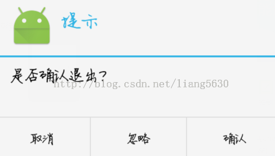
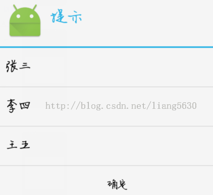
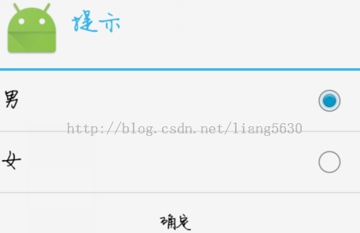
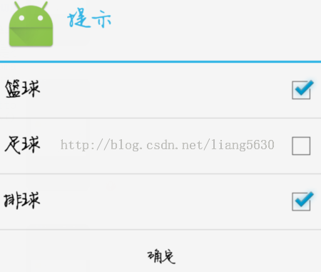

# 一、Dialog对话框种类

1. 一般对话框形式
2. 列表对话框形式
3. 单选按钮对话框
4. 多选按钮对话框
5. 自定义对话框

参数详细

- http://blog.csdn.net/airk000/article/details/38876483

一般用法

- http://blog.csdn.net/liang5630/article/details/44098899

# 二、一般对话框



注意：onClick的参数中有一个which，这个是什么意思呢？

这个which实际上代表的是一个唯一的int型数值。像上面的setPositiveButton中的which代表的是-1，setNegativeButton中的which代表的是-3，setNeutralButton中的which代表的是-2. 到了这里相信大家已经想到怎么简洁的写法了，只要写一个响应事件，用which参数去区分是那个按钮就可以了！

PS：

1. 在setIcon时，需要使用setTitle方法，否则icon不会显示
2. 如果同时调用setMessage 和 setItems(或者setSingleChoiceItems setMultiChoiceItems)函数会导致dialog没有显示内容
3. AlertDialog的构造方法全部是Protected的，所以不能直接通过new一个AlertDialog来创建出一个AlertDialog。

```
private void dialog1(){
    AlertDialog.Builder builder=new AlertDialog.Builder(this);  //先得到构造器
    builder.setTitle("提示"); //设置标题
    builder.setMessage("是否确认退出?"); //设置内容
    builder.setIcon(R.mipmap.ic_launcher);//设置图标，图片id即可
    builder.setPositiveButton("确定", new DialogInterface.OnClickListener() { //设置确定按钮
        @Override
        public void onClick(DialogInterface dialog, int which) {
            dialog.dismiss(); //关闭dialog
            Toast.makeText(MainActivity.this, "确认" + which, Toast.LENGTH_SHORT).show();
        }
    });
    builder.setNegativeButton("取消", new DialogInterface.OnClickListener() { //设置取消按钮
        @Override
        public void onClick(DialogInterface dialog, int which) {
            dialog.dismiss();
            Toast.makeText(MainActivity.this, "取消" + which, Toast.LENGTH_SHORT).show();
        }
    });

    builder.setNeutralButton("忽略", new DialogInterface.OnClickListener() {//设置忽略按钮
        @Override
        public void onClick(DialogInterface dialog, int which) {
            dialog.dismiss();
            Toast.makeText(MainActivity.this, "忽略" + which, Toast.LENGTH_SHORT).show();
        }
    });
    //参数都设置完成了，创建并显示出来
    builder.create().show();
}
```

## (一) 简洁写法

```
rivate void dialog1_1(){
    //先new出一个监听器，设置好监听
    DialogInterface.OnClickListener dialogOnclicListener=new DialogInterface.OnClickListener(){

        @Override
        public void onClick(DialogInterface dialog, int which) {
            switch(which){
                case Dialog.BUTTON_POSITIVE:
                    Toast.makeText(MainActivity.this, "确认" + which, Toast.LENGTH_SHORT).show();
                    break;
                case Dialog.BUTTON_NEGATIVE:
                    Toast.makeText(MainActivity.this, "取消" + which, Toast.LENGTH_SHORT).show();
                    break;
                case Dialog.BUTTON_NEUTRAL:
                    Toast.makeText(MainActivity.this, "忽略" + which, Toast.LENGTH_SHORT).show();
                    break;
            }
        }
    };
    //dialog参数设置
    AlertDialog.Builder builder=new AlertDialog.Builder(this);  //先得到构造器
    builder.setTitle("提示"); //设置标题
    builder.setMessage("是否确认退出?"); //设置内容
    builder.setIcon(R.mipmap.ic_launcher);//设置图标，图片id即可
    builder.setPositiveButton("确定",dialogOnclicListener);
    builder.setNegativeButton("取消", dialogOnclicListener);
    builder.setNeutralButton("忽略", dialogOnclicListener);
    builder.create().show();
}
```

# 三、列表对话框



列表对话框只需设置Items属性即可，这里的setItems中的Onclick中的which属性是items数组的下标注意不能在设置Message属性，否则只会显示Message，不会显示列表。

```
private void dialog2() {
    final String items[]={"张三","李四","王五"};
    //dialog参数设置
    AlertDialog.Builder builder=new AlertDialog.Builder(this);  //先得到构造器
    builder.setTitle("提示"); //设置标题
    //builder.setMessage("是否确认退出?"); //设置内容
    builder.setIcon(R.mipmap.ic_launcher); //设置图标，图片id即可
    //设置列表显示，注意设置了列表显示就不要设置builder.setMessage()了，否则列表不起作用。
    builder.setItems(items, new DialogInterface.OnClickListener() {
        @Override
        public void onClick(DialogInterface dialog, int which) {
            dialog.dismiss();
            Toast.makeText(MainActivity.this, items[which], Toast.LENGTH_SHORT).show();

        }
    });
    builder.setPositiveButton("确定", new DialogInterface.OnClickListener() {
        @Override
        public void onClick(DialogInterface dialog, int which) {
            dialog.dismiss();
            Toast.makeText(MainActivity.this, "确定", Toast.LENGTH_SHORT).show();
        }
    });
    builder.create().show();
}
```

# 四、单选按钮对话框



设置单选用setSingleChoiceItems，注意这里的参数：items是显示的文本，0表示默认选中是第一个，如图所示是默认选中“男”。

```
private void dialog3(){
    final String items[]={"男","女"};
    AlertDialog.Builder builder=new AlertDialog.Builder(this);  //先得到构造器
    builder.setTitle("提示"); //设置标题
    builder.setIcon(R.mipmap.ic_launcher); //设置图标，图片id即可
    builder.setSingleChoiceItems(items,0,new DialogInterface.OnClickListener() {
        @Override
        public void onClick(DialogInterface dialog, int which) {
            //dialog.dismiss();
            Toast.makeText(MainActivity.this, items[which], Toast.LENGTH_SHORT).show();
        }
    });
    builder.setPositiveButton("确定", new DialogInterface.OnClickListener() {
        @Override
        public void onClick(DialogInterface dialog, int which) {
            dialog.dismiss();
            Toast.makeText(MainActivity.this, "确定", Toast.LENGTH_SHORT).show();
        }
    });
    builder.create().show();
}
```

# 五、多选列表对话框



说明：setMultiChoiceItems中的参数：selected是默认的对应的选中状态。当你选择时，系统会自动帮你把selected中的值做相应改变，所以在确定按钮中可以得到所有的选择状态。其他和单选一样。

```
private void dialog4(){
    final String items[]={"篮球","足球","排球"};
    final boolean selected[]={true, false, true};
    AlertDialog.Builder builder=new AlertDialog.Builder(this);  //先得到构造器
    builder.setTitle("提示"); //设置标题
    builder.setIcon(R.mipmap.ic_launcher);//设置图标，图片id即可
    builder.setMultiChoiceItems(items,selected, new DialogInterface.OnMultiChoiceClickListener() {
        @Override
        public void onClick(DialogInterface dialog, int which, boolean isChecked) {
            // dialog.dismiss();
            Toast.makeText(MainActivity.this, items[which]+isChecked, Toast.LENGTH_SHORT).show();
        }
    });
    builder.setPositiveButton("确定",new DialogInterface.OnClickListener() {
        @Override
        public void onClick(DialogInterface dialog, int which) {
            dialog.dismiss();
            Toast.makeText(MainActivity.this, "确定", Toast.LENGTH_SHORT).show();
            //android会自动根据你选择的改变selected数组的值。
            for (int i=0;i<selected.length;i++){
                Log.e("hongliang", "" + selected[i]);
            }
        }
    });
    builder.create().show();
}
```

# 六、自定义Dialog对话框

开源项目 https://github.com/flavienlaurent/datetimepicker
