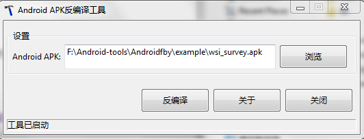
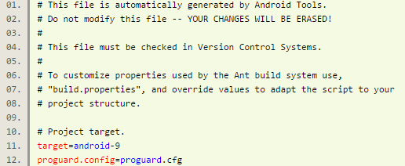
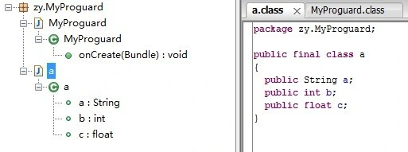

（注：反编译不是让各位开发者去对一个应用破解搞重装什么的，主要目的是为了促进开发者学习，借鉴好的代码，提升自我开发水平。）

# 一、反编译工具介绍

1. apktool：资源文件获取，可以提取出图片文件和布局文件进行使用查看
2. dex2jar：将apk反编译成Java源码（classes.dex转化成jar文件）
3. jd-gui：查看APK中classes.dex转化成出的jar文件，即源码文件

# 二、反编译流程

https://github.com/hehonghui/android-tech-frontier/blob/master/issue-38/Android%E9%80%86%E5%90%91%E5%B7%A5%E7%A8%8B.md

## (一) apk反编译得到程序的源代码、图片、XML配置、语言资源等文件

下载上述工具中的apktool，解压得到3个文件：aapt.exe，apktool.bat，apktool.jar ，将需要反编译的APK文件放到该目录下，

打开命令行界面（运行-CMD），定位到apktool文件夹，输入以下命令：apktool.bat d -f  test.apk  test

（命令中test.apk指的是要反编译的APK文件全名，test为反编译后资源文件存放的目录名称，即为：apktool.bat  d  -f  [apk文件 ]  [输出文件夹]）

说明获取成功，之后发现在文件夹下多了个test文件，点击便可以查看该应用的所有资源文件了。

如果你想将反编译完的文件重新打包成apk，那你可以：输入 `apktool.bat  b  test`（你编译出来文件夹）便可，效果如下：

之后在之前的test文件下便可以发现多了2个文件夹:

- build
- dist(里面存放着打包出来的APK文件)

## (二) Apk反编译得到Java源代码

下载上述工具中的dex2jar和jd-gui ，解压

将要反编译的APK后缀名改为.rar或则 .zip，并解压，得到其中的额classes.dex文件（它就是java文件编译再通过dx工具打包而成的），将获取到的classes.dex放到之前解压出来的工具dex2jar-0.0.9.15 文件夹内，

在命令行下定位到dex2jar.bat所在目录，输入dex2jar.bat  classes.dex，效果如下：

在改目录下会生成一个 `classes_dex2jar.jar` 的文件，然后打开工具jd-gui文件夹里的jd-gui.exe，之后用该工具打开之前生成的classes_dex2jar.jar文件，便可以看到源码了，效果如下：

被混淆过的效果图（类文件名称以及里面的方法名称都会以a,b,c....之类的样式命名）：

## (三) 图形化反编译apk（本人未使用过）

上述步骤一、二讲述了命令行反编译apk，现在提供一种图形化反编译工具：

Androidfby

首先，下载上述反编译工具包，打开Androidfby目录，双击Android反编译工具.exe，就可以浏览打开要反编译的apk

通过反编译，你可以获知该应用用到了什么第3方的库文件，它的代码是如何编写的等等。

然而，如果该APK进行了混淆处理，那么你看到的类文件名称以及里面的方法名称都会以a,b,c....之类的样式命名，所以你可以想找到你所想得知的界面代码可能会十分费劲，找到了代码可能看起来也会很费劲，可是一个大体的思路会获得，有了这个思路，你就可以自己去尝试了。

# 三、混淆

作为Android应用开发者，不得不面对一个尴尬的局面，就是自己辛辛苦苦开发的应用可以被别人很轻易的就反编译出来。

Google似乎也发现了这个问题，从SDK2.3开始我们可以看到在android-sdk-windows\tools\下面多了一个proguard文件夹

proguard是一个Java代码混淆的工具，通过proguard，别人即使反编译你的apk包，也只会看到一些让人很难看懂的代码，从而达到保护代码的作用。

让proguard.cfg起作用的做法很简单，就是在eclipse自动生成的default.properties文件中加上一句“proguard.config=proguard.cfg”就可以了

完整的default.properties文件应该如下：

大功告成，正常的编译签名后就可以防止代码被反编译了。反编译经过代码混淆的apk得到的代码应该类似于下面的效果，是很难看懂的：

如果您使用的是2.3之前的SDK版本也没关系，把上面的proguard.cfg文件复制一份放到项目中，然后进行相同的操作即可
