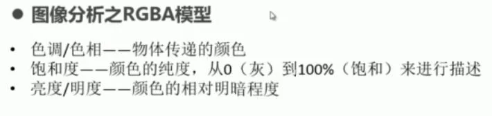
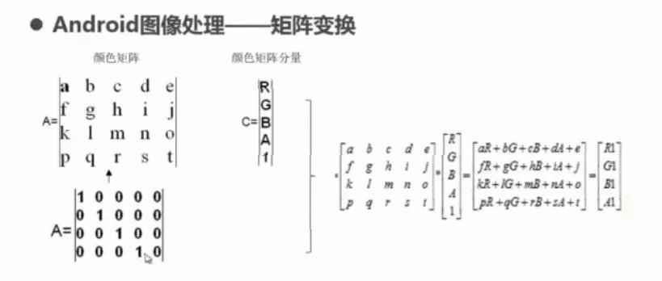
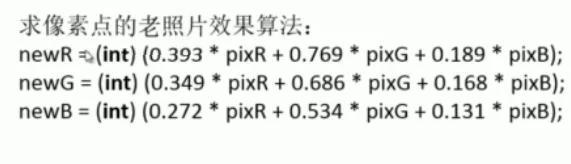
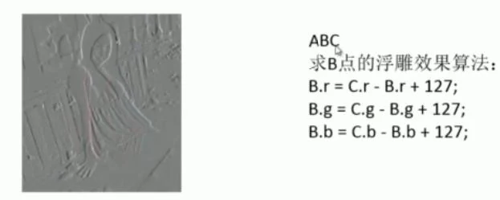

```
Bitmap bitmap=Bitmap.createBitmap(src.getWidth(), src.getHeight(),Config.ARGB_8888);
Paint paint=new Paint(Paint.ANTI_ALIAS_FLAG);
Canvas canvas=new Canvas(bitmap);

//设置颜色的色相
ColorMatrix hueMatrix=new ColorMatrix();
hueMatrix.setRotate(0, hue);
hueMatrix.setRotate(1, hue);
hueMatrix.setRotate(2, hue);

//设置饱和度
ColorMatrix saturationMatrix=new ColorMatrix();
saturationMatrix.setSaturation(saturation);

//设置亮度
ColorMatrix lumMatrix=new ColorMatrix();
lumMatrix.setScale(lum, lum, lum, 1);

//将色相，饱和度，亮度3个设置融合在一起
ColorMatrix matrix=new ColorMatrix();
matrix.postConcat(hueMatrix);
matrix.postConcat(saturationMatrix);
matrix.postConcat(lumMatrix);
paint.setColorFilter(new ColorMatrixColorFilter(matrix));
canvas.drawBitmap(src, 0, 0, paint);
```

图片中每个点的颜色都由A,R,G,B四个元素构成



```
paint.set(A);
```

A是个float类型的一维数组。通过画笔工具，可以把颜色矩阵设置到画笔当中。

最终画到图画上A,R,G,B的值是通过A*C之后的新矩阵中的ARGB值。

A*C的过程已在上面的set()方法中完成，我们要做的只是设置好这个A矩阵。





把图片的所有像素读取到一个一维整形数组中

```
coverBitmap.getPixels(piexs, 0, w, 0, 0, w, h);
```

```
/***
图片可以看作是一个二维的像素组成的
bitmap.getPixels(pixels, offset, stride, x, y, width, height);
pixels是接受图片像素点的数组，
offset表示从第几个像素点开始从图片中读取
stride表示每行读取几个像素
x ,y表示读取的第一个点的坐标
width，height表示要读取长宽
从一个整形值中分离出A,R,G,B值
Color.red(color);
Color.green(color);
Color.blue(color);
Color.alpha(color);
把A,R,G,B值合成一个整数像素信息
Color.argb(alpha, red, green, blue);
为一个bitmap从新设置像素点
bitmap.setPixels(pixels, offset, stride, x, y, width, height);
```
