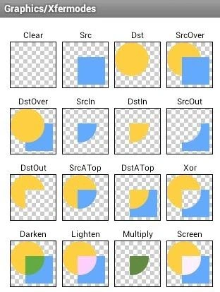

1.先创建一个空白的bitmap。Bitmap.create()函数

2.放到一个canvas中  new一个Canvas

3.先画的图片是DST

4.Paint设置xformode  ->mPaint.setXfermode(new PorterDuffXfermode(Mode.DST_OUT));

5.再画的bitmap是src，此时显示的图像是根据xformode设置来显示，设置参考下图

