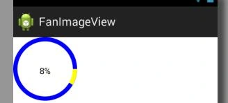

根据自己需求可以在添加一些属性方法，供外界调用。比如环的颜色，字体的大小。



```
public class fanImageView extends View {

    int centerX, centerY;
    Paint mPaint;
    int radius;
    int gap;
    int sweepAngle;

    public fanImageView(Context context, AttributeSet attrs, int defStyleAttr) {
        super(context, attrs, defStyleAttr);
        mPaint = new Paint();
        mPaint.setAntiAlias(true);
        mPaint.setDither(true);
        mPaint.setTextSize(20);
        mPaint.setColor(Color.BLUE);
        gap=10;
        sweepAngle=30;
    }

    public fanImageView(Context context, AttributeSet attrs) {
        this(context, attrs, 0);
    }

    public fanImageView(Context context) {
        this(context, null);
    }

    public void setGap(int gap) {
        this.gap = gap;
        invalidate();
    }

    public void setSweepAngle(int sweepAngle) {
        this.sweepAngle = sweepAngle;
        invalidate();
    }

    @Override
    protected void onMeasure(int widthMeasureSpec, int heightMeasureSpec) {
        // TODO Auto-generated method stub
        super.onMeasure(widthMeasureSpec, heightMeasureSpec);
        int w = MeasureSpec.getSize(widthMeasureSpec);
        int h = MeasureSpec.getSize(heightMeasureSpec);
        radius = Math.min(w, h) / 2;
        centerX = radius;
        centerY = radius;
        setMeasuredDimension(radius*2, radius*2);
        // measure(radius,radius);
    }

    @SuppressLint("DrawAllocation")
    @Override
    protected void onDraw(Canvas canvas) {
        // TODO Auto-generated method stub
        super.onDraw(canvas);
        mPaint.setColor(Color.BLUE);
        canvas.drawCircle(centerX, centerY, radius, mPaint);
        mPaint.setColor(Color.WHITE);
        canvas.drawCircle(centerX, centerY, radius - gap, mPaint);
        mPaint.setColor(Color.YELLOW);
        canvas.drawArc(new RectF(0, 0, radius*2, radius*2), 0, sweepAngle, true, mPaint);
        mPaint.setColor(Color.WHITE);
        canvas.drawArc(new RectF(gap, gap, radius*2 - gap, radius*2 - gap), 0, sweepAngle, true, mPaint);
        mPaint.setColor(Color.BLACK);
        String text=(sweepAngle*100/360)+"%";
        Rect rect=new Rect();
        mPaint.getTextBounds(text, 0,text.length(), rect);
        int x=(radius*2-rect.width())/2;
        int y=(radius*2-rect.height())/2+rect.height();
        canvas.drawText(text, x, y, mPaint);
    }

}
```
