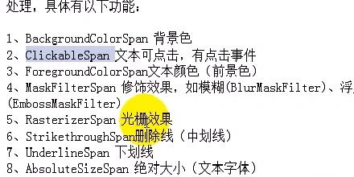

下面这个方法是可以给source字符串加上横杠，淘宝中显示过去的价格就是用这个方法。

```
public SpannableString getHenggangString(String source){

    SpannableString henggangString=new SpannableString(source);
    henggangString.setSpan(new StrikethroughSpan(){}, 0,source.length(), Spanned.SPAN_EXCLUSIVE_EXCLUSIVE);
    return henggangString;

}
```

在qq控件中，单击好友的名字就可以跳转到好友空间，

大概也是用到了下面这个技术

```
public  SpannableString getClickString(String source){

    SpannableString spannableString=new SpannableString(source);
    spannableString.setSpan(new ClickableSpan() {

        @Override
        public void onClick(View widget) {
            // TODO Auto-generated method stub
            Intent intent=new Intent(mainActivity.this,secondActivity.class);
            startActivity(intent);
        }

    }, 0, source.length(), Spanned.SPAN_EXCLUSIVE_EXCLUSIVE);
    return spannableString;

}
```

还有一个比较有意思的是，TextView也可以显示部分的html标签

这样也可以增加文本的效果。

```
public CharSequence getTextAndImageText(){

    CharSequence sequence="";
    String text="<font color='#0000cd'>机器人</>";
    String img="";
    sequence=Html.fromHtml(text+img, new ImageGetter() {

        @Override
        public Drawable getDrawable(String source) {
            // TODO Auto-generated method stub
            Drawable drawable=getResources().getDrawable(getDrawablesID(source));
            drawable.setBounds(0, 0, drawable.getIntrinsicWidth(), drawable.getIntrinsicHeight());
            return drawable;
        }

    }, null);
    return sequence;

}
```

qq中添加表情的用法

```
SpannableString spannableString=new SpannableString("robot");
ImageSpan span=new ImageSpan(BitmapFactory.decodeResource(getResources(), R.drawable.ic_launcher));
spannableString.setSpan(span, 0, 5,Spanned.SPAN_EXCLUSIVE_EXCLUSIVE);
inforEditText.append(spannableString);
```

经过上面的几个例子，这方富文本的用法是一个套路

显示创建SpannableString

然后设置各种Span

最后把这个Span设置到SpannableString中

下面列出常见的一些Span


