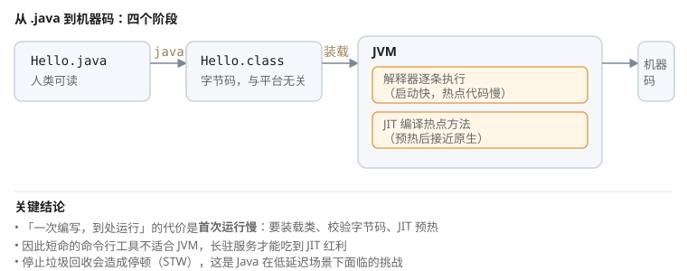

# 一、Java 的设计目标

Java 诞生时的目标可以概括为：**让一次编写的程序能在任何平台上运行，且不能因为程序员的一个笔误就让整个系统崩溃**。这两条目标直接决定了它的两个核心特征。

## (一) 一次编写，到处运行

Java 源文件经`javac` 编译后得到的不是**机器码**，而是与具体 CPU 无关的**字节码**（`.class` 文件）。字节码由虚拟机（JVM）解释执行或即时编译成本地机器码。

传统编译型语言（C、C++）编译出的是针对特定 CPU 指令集的机器码，换平台就要重新编译。Java 把这一步推迟到运行时，于是"平台相关"的部分被收敛到 JVM 实现里——只要目标平台有 JVM，字节码就能跑。



```text
源代码 .java  ──javac──>  字节码 .class  ──JVM──>  目标平台机器码
                        （与平台无关）      （在这里才落地）
```

## (二) 内存安全

在 C/C++ 中，数组越界会读写到别人的内存，野指针会破坏任意内存，程序可能当场崩溃或产生难以追踪的诡异行为。Java 把内存管理完全交给 JVM：

- 越界访问抛 `ArrayIndexOutOfBoundsException`，而不是踩坏内存
- 没有指针运算，取不到对象真实地址
- 垃圾回收器自动回收不再引用的对象

代价是**停止垃圾回收会造成停顿**（STW，Stop-The-World）。这正是 Java 在超低延迟场景下面临的挑战，也是虚拟线程与 ZGC 等技术试图解决的问题。

## (三) 字节码文件长什么样

```bash
javac Hello.java
javap -v Hello.class        # 反汇编查看字节码
```

```text
public class Hello {
    public static void main(String[] args) {
        System.out.println("Hello");
    }
}
```

```text
 0: getstatic     #2    // Field java/lang/System.out:Ljava/io/PrintStream;
 3: ldc           #3    // String Hello
 5: invokevirtual #4    // Method java/io/PrintStream.println:(Ljava/lang/String;)V
 8: return
```

可以看到字节码只有 4 条指令——这就是"解释执行"的含义。真实环境里JVM 会监测哪些方法被反复调用（热点），把它们编译成本地机器码，这个过程叫 **JIT（Just-In-Time）编译**。

## (四) JIT 与预热

```java
long start = System.nanoTime();
long sum = 0;
for (int i = 0; i < 10_000_000; i++) {
    sum += i;              // 前几千次慢，JIT 编译后变快
}
System.out.println((System.nanoTime() - start) / 1_000_000 + " ms");
```

这段代码的耗时会明显分两个阶段：解释执行阶段慢，热点方法被识别并编译后大幅提速。这就是 JVM 的**预热（warm-up）成本**。

实践含义：

- **短命命令行工具**用 JVM 不划算——启动、装载类、预热的开销超过计算本身。Java 更适合长驻进程。
- **服务容器**要关注预热：冷启动阶段的延迟明显高于稳定运行后，容器编排里可以配置慢启动或预热探针。

# 二、开发环境

## (一) JDK 与 JRE 的区别

| 组件 | 内容 | 说明 |
| --- | --- | --- |
| JRE | JVM + 类库 | 只有运行环境，不能编译 |
| JDK | JRE + 编译器（javac）+ 打包工具等 | 开发需要 JDK |

Java 11 之后官方不再单独分发 JRE，JDK 中可用 `jlink` 裁剪出只含所需模块的运行时镜像，体积能压到几十 MB。

```bash
java -version      # 查看运行时版本
javac -version    # 查看编译器版本
jshell            # 交互式 REPL，无需建项目就能试代码
```

两个版本号应当匹配。装 JDK 时若 `javac` 不可用，通常是 `PATH` 没配或只配了 JRE。

## (二) 编译目标版本

`java -version` 与 `javac -version` **可能不同**——前者是运行时、后者是编译器。JDK 9 之后可以直接指定编译目标：

```bash
javac --release 11 Main.java
```

`--release 11` 不只是"生成 Java 11 字节码"，还会**校验你只用了 Java 11 就存在的 API**。不写它，编译时能引用到高版本 API，运行时才抛 `NoSuchMethodError`——这类问题在编译期发现要省事得多。

## (三) 编码

Java 源码的默认编码依赖于运行环境的区域设置，这是跨机器协作时乱码的常见来源。JDK 18 起默认编码统一为 UTF-8，但更早的版本要显式指定：

```bash
javac -encoding UTF-8 Main.java
java -Dfile.encoding=UTF-8 Main
```

源文件、`.properties` 文件、数据库连接字符集三者要统一，否则同一处文字在不同环节可能出现不同的字节数，表现为"字符串截断成半个字"。

# 三、编译期与运行期

## (一) 编译期常量

```java
public static final int MAX = 100;
```

`final` 修饰的**基本类型**或 **String 字面量**会被编译器直接内联到使用处：

```java
int a = Demo.MAX;   // 编译后等价于 int a = 100;
```

这意味着：**改了编译值却不重新编译所有调用方，调用方里仍是旧值**。

```java
// 不适合当开关用
static final boolean DEBUG = false;
if (DEBUG) { log("..."); }    // javac 折叠为常量 false，class 文件里仍有这段字节码；JIT 才真正消掉
```

所以做功能开关要用**可变的静态字段**，或读配置：

```java
static boolean debug = false;   // 可运行期改变
if (debug) { log("..."); }
```

## (二) 运行期才确定的值

```java
static final int MAX = compute();          // 不是编译期常量
static final String S = new String("abc"); // 不是编译期常量
static final int[] ARR = {1, 2, 3};        // 引用不变，但数组内容可变
```

判断标准：能否被常量表达式折叠。引用类型即使 `final` 也通常不能被内联——JVM 必须保证拿到的是同一个对象，而对象是运行期创建的。

# 四、版本与 LTS

| 版本 | 类型 | 该版本**正式**引入的特性 |
| --- | --- | --- |
| Java 8 | LTS | Lambda、Stream、Optional、新日期时间 API、接口默认方法 |
| Java 11 | LTS | `String.isBlank`、JRE 不再随 JDK 分发、`jlink`、移除部分遗留 API |
| Java 14 | 正式 | switch 表达式（正式） |
| Java 15 | 正式 | 文本块 |
| Java 16 | 正式 | record 类、`instanceof` 模式匹配 |
| Java 17 | LTS | sealed 类、默认 UTF-8（JEP 400） |
| Java 21 | LTS | 虚拟线程、SequencedCollection、record 模式匹配（`when`） |
| Java 22 | 正式 | 隐式类与实例 main、未命名变量、`_` 作为 lambda 哑元 |

注意归属：`var` 是 **Java 10**（不是 11），所以不列在 LTS 行里——LTS 只代表"会被长期维护"，不代表该版本的**所有**特性都标着 LTS。要看某个特性属于哪一版，以 JEP 页面的"Release"字段为准。

非 LTS 版本只发布**六个月**，用于尝鲜；生产环境应当跟随 LTS。

虚拟线程值得单独留意：它让"一个请求一个线程"的传统写法在 Java 里变得可行，此前线程数量受限于平台栈大小（默认约 1 MB），而虚拟线程的栈在堆上按需分配。

# 五、编写代码前的约定

- **一个 `.java` 文件可以有多个类，但只能有一个 `public` 类**，且必须与文件名同名
- 包名全小写、类名大驼峰、方法与变量小驼峰、常量全大写加下划线
- 缩进用 4 空格，不混用 Tab 与空格
- 每个类一个文件（即使不public），便于检索

```java
package com.example.demo;   // 包声明，全小写，与目录结构一致

import java.util.List;     // 导入，通常在包声明之后

public class Main {         // public 类必须与文件名同名
    public static void main(String[] args) {
        int x = 0b1010;      // 二进制
        int y = 0xFF;        // 十六进制
        long z = 10_000_000L;// 下划线只提升可读性
    }
}
```

进制字面量与分隔符是提升可读性的零成本手段：`0x` 前缀是十六进制、`0b` 前缀是二进制、前导 `0` 是八进制。下划线只能**夹在数字之间**：`_1`、`1_`、`0x_FF`、`10_L` 都非法。

# 六、参考资料

- [Java 官方教程（Oracle）](https://docs.oracle.com/javase/tutorial/) — 语言各主题的入门说明，本章「运行机制」「开发环境」部分的主要依据
- [Java 语言规范 JLS（SE 22）](https://docs.oracle.com/javase/specs/jls/se22/html/index.html) — 「编译期与运行期」中常量表达式（Constant Expressions）的折叠规则出自第 15.29 节
- [Java SE 22 API 文档](https://docs.oracle.com/en/java/javase/22/docs/api/) — 类与方法签名的权威来源
- [dev.java](https://dev.java/learn/) — Oracle 的新式教程与版本特性说明，虚拟线程部分参考其「虚拟线程」专题
- [OpenJDK](https://openjdk.org/) — JDK 本身的源码与项目页，JIT 与字节码实现可从此查证
