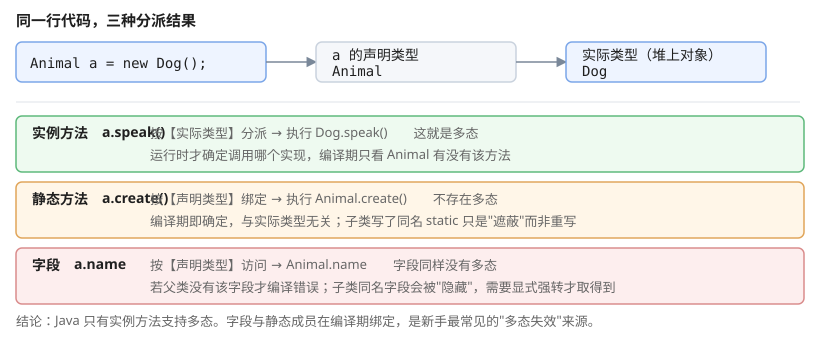

# 一、类与对象

Java 是**静态类型**语言：每个变量和表达式的类型在编译期确定，且声明后不可更改。

```java
Animal dog = new Dog();   // 左边是 Animal，右边实际是 Dog
```

赋值兼容是单向的——需要显式强转：

```java
Animal dog = new Dog();
Dog dog2 = (Dog) dog;     // 向下转型，必须先确认实际类型
if (dog instanceof Dog d) {   // Java 16+ 模式匹配
    System.out.println(d.breed());
}
```

`instanceof` 的**模式匹配写法**（Java 16+）把判断和强转合并成一步，既不会忘记转换，也不会转换到错误的类型。

# 二、方法与构造

## (一) 方法重载

重载发生在**同一个类内、方法名相同、参数列表不同**。返回值类型不参与重载判定：

```java
void show(int x) { }
void show(String s) { }
void show(int x, int y) { }
void show(double x) { }      // 合法重载：show(1) 仍按「最具体方法」选 show(int)
```

**参数列表相同、只有返回值不同不能构成重载**——因为调用方不写返回值类型，编译器无法判断调用哪个。

```java
show(1);        // 调用 show(int)
show(1, 2);     // 调用 show(int, int)
```

## (二) 构造方法

```java
public class Dog {
    private final String name;

    public Dog(String name) {
        this.name = name;      // this 指当前对象
    }
}
```

构造方法**没有返回类型**（连 `void` 都不能写），与类名同名。若一个类没定义任何构造方法，编译器会补一个**无参构造方法**；一旦自己定义了，编译器就不再补——这时 `new Person()` 会编译失败。

构造方法可以重载，也可以在 `this(...)` 调用中**委托**给另一个构造方法：

```java
public Dog() {
    this("未命名");       // 必须放在第一行
}
```

## (三) 重写与协变返回

```java
@Override
public String toString() { return "Dog(" + name + ")"; }
```

重写要求方法签名相同，返回类型要么相同、要么是**协变**（父类返回类型是子类类型）：

```java
class Animal {}
class Dog extends Animal {}
class Zoo { Animal get() { return new Animal(); } }
class DogZoo extends Zoo {
    @Override Dog get() { return new Dog(); }   // 合法：Dog 是 Animal 的子类型
}
```

# 三、继承与多态

## (一) 继承的局限

Java 类**只支持单继承**（一个类最多一个父类），但可以**多实现**接口。这是接口存在的根本原因。

```java
class Dog extends Animal implements Comparable<Dog>, Cloneable { }
```

`Object` 是所有类的根类，它提供的方法会成为每个类的公共 API：`toString`、`equals`、`hashCode`、`getClass`、`clone`、`finalize`、`wait`/`notify`/`notifyAll`。

## (二) 多态与向上转型

多态指**父类引用指向子类对象**，运行时按实际类型调用重写方法：

```java
Animal a = new Dog();
a.speak();          // 实际执行 Dog.speak()，而不是 Animal.speak()
```

静态方法**不存在多态**——编译期按声明类型绑定：

```java
Animal a = new Dog();
a.staticMethod();   // 调用 Animal.staticMethod()
```

字段也**没有多态**：`a.name` 访问的是 `Animal.name`（若父类有该字段），不是 `Dog.name`。这与方法的分派规则不同，容易被忽略。



三个要点：实例方法按**实际类型**分派；静态方法按**声明类型**分派；字段按**声明类型**访问。

# 四、抽象类与接口

## (一) abstract 与接口的本质差别

```java
abstract class Animal {
    protected String name;
    public abstract void speak();      // 抽象方法
}

interface Pet {
    void speak();                       // 接口方法默认抽象（Java 8 前需写 public abstract）
    default void greet() { }            // 默认方法
}
```

| 特性 | 抽象类 | 接口 |
| --- | --- | --- |
| 实例化 | 不能 | 不能 |
| 继承 | 单继承 | 多实现 |
| 字段 | 可有任意字段 | 只能是 `public static final` 常量 |
| 构造方法 | 有 | **没有** |
| 默认方法 | — | 有（Java 8+） |

Java 8 起接口可以有 `default` 方法和 `static` 方法，这让接口在某些场景下可以替代抽象类——但**接口不能有状态**，需要共享可变数据时仍要用抽象类。

## (二) 默认方法冲突

类优先于接口：若一个类同时继承抽象类方法与接口默认方法，类的方法生效。

两个接口提供同名默认方法时，编译错误，必须显式指定：

```java
interface A { default void hello() { System.out.print("A"); } }
interface B { default void hello() { System.out.print("B"); } }

class C implements A, B {
    @Override
    public void hello() {
        A.super.hello();     // ★必须显式指定，否则编译错误
    }
}
```

# 五、静态与实例成员

```java
class Counter {
    static int total = 0;       // 类属性，全类共享一份
    int count = 0;              // 实例属性，每个对象一份

    static void reset() { total = 0; }
    void inc() {
        count++;               // 隐式 this.count
        total++;               // 隐式 Counter.total
    }
}
```

静态成员**不能直接访问实例成员**：

```java
static void show() {
    // System.out.println(count);   // 编译错误：count 是实例字段
}
```

单例模式通常用静态成员实现：

```java
public class Config {
    private static Config instance;
    private Config() { }                     // 私有构造阻止外部 new

    public static Config getInstance() {
        if (instance == null) {
            instance = new Config();
        }
        return instance;
    }
}
```

注意这个实现**在多线程下不安全**——两个线程可能同时通过 `instance == null` 检查。正确写法见《JavaNotes14 : 多线程》里的双重检查锁定。

# 六、equals 与 hashCode

这是最容易出错的一对方法，必须一起重写。

```java
@Override
public boolean equals(Object o) {
    if (this == o) return true;
    if (o == null || getClass() != o.getClass()) return false;
    Dog dog = (Dog) o;
    return Objects.equals(name, dog.name);
}

@Override
public int hashCode() {
    return Objects.hash(name);
}
```

契约：

1. `equals` 为 true 时，两对象的 `hashCode` **必须相等**
2. 相同 `hashCode` **不保证** `equals` 为 true（哈希冲突是允许的）
3. 违反契约会让 `HashMap`、`HashSet` 出现查不到、找不到的问题

**只重写 `equals` 不重写 `hashCode`** 是最常见的错误——对象放进 `HashSet` 后就再也 `contains` 不到自己。

# 七、包装类型

八个基本类型各有对应的包装类，用于泛型、集合等引用类型场景。

**基本类型的默认值**由 JVM 保证；**包装类型是引用，所以默认值一律是 `null`**——这一栏很容易记混：

| 基本类型 | 包装类 | 基本类型默认值 | 包装类默认值 |
| --- | --- | --- | --- |
| `int` | `Integer` | `0` | `null` |
| `long` | `Long` | `0L` | `null` |
| `double` | `Double` | `0.0` | `null` |
| `boolean` | `Boolean` | `false` | `null` |
| `char` | `Character` | `'\u0000'` | `null` |

## (一) 缓存与相等

```java
Integer a = 127, b = 127;
System.out.println(a == b);        // true（缓存范围内）

Integer c = 128, d = 128;
System.out.println(c == d);        // false（超出缓存）
```

`Integer.valueOf` 会缓存 **-128 ~ 127** 的实例，所以小整数用 `==` 比较恰好为 true，但这**依赖缓存实现**，跨 JVM 不保证。**永远用 `equals` 或拆箱比较**。

## (二) 自动装箱与拆箱

```java
int n = 5;
Integer boxed = n;      // 装箱
int unboxed = boxed;    // 拆箱
```

装箱在需要对象的地方自动发生，代价是创建对象（值超出缓存时）。在高循环次数的代码里手工避免装箱能减少对象分配。

## (三) 空指针陷阱

```java
int a = 5;
Integer b = null;
// int c = a + b;       // 运行时 NullPointerException：b 自动拆箱为 null
```

拆箱 null 会抛 `NullPointerException`，这是集合遍历里非常隐蔽的崩溃来源。

# 八、内部类

```java
public class Outer {
    private int x = 1;

    class Inner {              // 内部类：持有外部类引用
        void show() { System.out.println(x); }
    }

    static class StaticNested {   // 静态嵌套类：不持有外部类引用
    }

    void method() {
        Runnable r = new Runnable() {     // 匿名类
            @Override public void run() { System.out.println(x); }
        };
    }
}
```

| 类型 | 是否持有外部类引用 |
| --- | --- |
| 成员内部类 `class` | 是 |
| 静态嵌套类 `static class` | 否 |
| 局部类 | 是 |
| 匿名类 | 是 |

需要持有外部状态用成员内部类/匿名类；只是把一段逻辑封装成类型用静态嵌套类。

# 九、参考资料

- [Java 官方教程：面向对象](https://docs.oracle.com/javase/tutorial/java/language_basics/objects.html) — 类、对象、继承的官方说明
- [Java 语言规范 JLS（SE 22）](https://docs.oracle.com/javase/specs/jls/se22/html/index.html) — 第 8 章「Types and Inheritance」、第 15.20.2 节 `instanceof` 的模式匹配形式
- [Java SE 22 API 文档](https://docs.oracle.com/en/java/javase/22/docs/api/) — `Object` 的公共实例方法、`Integer` 缓存范围（`IntegerCache`）的文档说明
- [dev.java](https://dev.java/learn/) — record 类、sealed 类等现代 OOP 特性的官方教程
