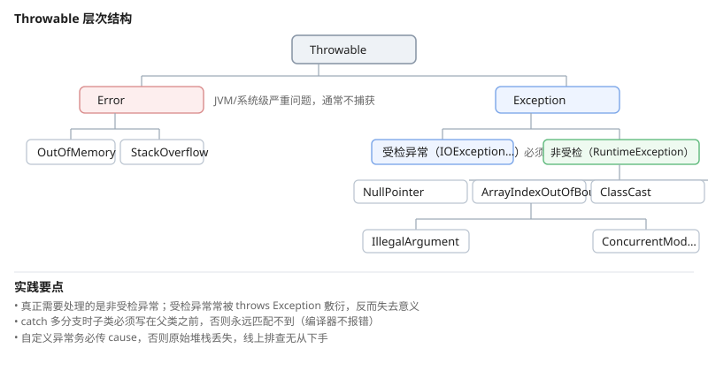

# 一、异常层次结构

Java 所有异常都继承自 `Throwable`，分两大类：



**`Error`** 表示 JVM 或系统层面的严重问题，通常**不应捕获**：`OutOfMemoryError`、`StackOverflowError`。捕获它们往往掩盖真正的问题。

**`Exception`** 分为两类：

| 类型 | 说明 | 处理方式 |
| --- | --- | --- |
| 受检异常 `Exception` | 编译期可检出 | 必须捕获或声明抛出 |
| 非受检异常 `RuntimeException` | 运行时才暴露 | 可处理，但通常不必 |

`RuntimeException` 及其子类包括：`NullPointerException`、`ArrayIndexOutOfBoundsException`、`ClassCastException`、`IllegalArgumentException`、`ArithmeticException`、`ConcurrentModificationException`。

## (一) 为什么受检异常是有争议的设计

受检异常强制调用方处理，即使调用方根本无力处理。典型反例：

```java
// 调用方只想把文件内容读出来，却被迫处理与业务无关的 IOException
String content = Files.readString(path);
```

实践中大量代码用 `throws Exception` 敷衍：

```java
public void doSomething() throws Exception { }   // 等于没声明
```

这正是 Java 的异常机制被诟病的原因。Spring、Hibernate 等主流框架普遍把受检异常包装成非受检异常，正是为了绕开这一点。

# 二、捕获与抛出

## (一) 多重 catch 与顺序

```java
try {
    readFile(path);
} catch (FileNotFoundException e) {
    // 必须放在 IOException 之前：子类在前
    log.warn("文件不存在: {}", path);
} catch (IOException e) {
    log.error("读取失败", e);
} catch (Exception e) {
    log.error("未知错误", e);
}
```

**catch 块按书写顺序匹配，命中第一个就停止**，所以子类异常必须写在父类之前——顺序反了子类分支永远进不去，且编译器不会报错。

## (二) 正确保留异常信息

```java
// 反例：吞掉异常
catch (Exception e) { }
catch (Exception e) { return null; }

// 正解：保留原始异常
catch (Exception e) {
    log.error("查询用户失败, id={}", id, e);      // 传 e 而非 e.getMessage()
    throw new BizException("查询用户失败, id=" + id, e);
}
```

## (三) 自定义异常

需要区分「哪一类失败」时，才值得自定义异常——比如让调用方一眼看出是**业务失败**（下单失败、余额不足）还是**系统故障**（数据库连不上）。

### 继承哪个父类

```java
// 业务异常：调用方无法通过重试解决 → 继承 RuntimeException（非受检）
public class BizException extends RuntimeException {
    public BizException(String msg) { super(msg); }

    // ★每个构造器都提供接收 cause 的版本，强制把原始异常传下去
    public BizException(String msg, Throwable cause) { super(msg, cause); }
}

// 系统异常：调用方能通过重试/降级解决 → 继承 Exception（受检，强制处理）
public class InfraException extends Exception {
    public InfraException(String msg, Throwable cause) { super(msg, cause); }
}
```

**`cause` 是自定义异常的生命线**。只写 `super(msg)` 不传 `cause`，原始堆栈就断了——线上排查时只能看到 `BizException: 查询用户失败`，看不到底下的 `SQLException`，等于把线索扔了。

```java
// 反例：丢失 cause
public BizException(String msg) { super(msg); }
throw new BizException("查询失败");          // 底层异常永远看不到

// 正例
public BizException(String msg, Throwable cause) { super(msg, cause); }
throw new BizException("查询失败", e);        // getCause() 能一路挖到底
```

### 命名与职责

| 做法 | 说明 |
| --- | --- |
| 命名带 `Exception` 后缀 | `BizException`、`OrderNotFoundException`，符合通用约定 |
| 按业务模块分包 | `com.example.order.exception.OrderException`，不要全扔一个包 |
| 一个类只表达一类失败 | 别把"下单失败"和"退款失败"混进同一个异常类 |
| 需要携带额外信息时加字段 | 如 `errorCode`，序列化与日志才有意义 |

**不要为每个错误码都建一个异常类**——那会迅速膨胀成上百个类，多数只差一个字符串。真正的分界线是：**调用方是否需要用不同的方式处理它**。

## (四) 不要用异常控制正常流程

```java
// 反例：用异常做分支判断，频繁抛栈很慢
try {
    list.get(index);
} catch (IndexOutOfBoundsException e) {
    return null;
}

// 正解：先判断
return (index >= 0 && index < list.size()) ? list.get(index) : null;
```

# 三、try-with-resources

手动 `finally` 关闭资源有两条问题：**代码冗长**，以及**异常掩盖**——`close()` 抛出的异常会覆盖 `try` 块里已经抛出的异常。

```java
// 传统写法：close 的异常会盖掉 try 的异常
BufferedReader reader = null;
try {
    reader = new BufferedReader(new FileReader(path));
    return reader.readLine();
} finally {
    if (reader != null) reader.close();
}
```

`try-with-resources`（Java 7+）自动关闭，且**保留被抑制的异常**：

```java
try (BufferedReader reader = new BufferedReader(new FileReader(path));
     BufferedWriter writer = new BufferedWriter(new FileWriter(out))) {
    String line;
    while ((line = reader.readLine()) != null) {
        writer.write(line);
    }
}
```

资源按**声明的逆序**关闭。实现上编译器生成的代码会把 `close()` 抛出的异常挂到主异常的 `suppressed` 列表，而不是覆盖它。

```java
try (Res r = new Res()) {
    throw new IllegalStateException("主异常");
} catch (IllegalStateException e) {
    for (Throwable s : e.getSuppressed()) {
        System.out.println(s);     // close() 的异常在这里
    }
}
```

# 四、try 块中的返回值

这是一个真实的坑：

```java
int read() {
    try {
        return 1;
    } finally {
        return 2;      // ★永远返回 2，try 的返回值被丢弃
    }
}
```

`finally` 里的 `return` 会**覆盖** `try`（或 catch）的返回值，编译器只会给出警告。正确写法是在 `finally` 里做清理而不返回值：

```java
int read() {
    try {
        return 1;
    } finally {
        cleanup();     // 不 return，异常自然向外传播
    }
}
```

同理，`try` 里 `return` 会**先求值并保存**返回值，再执行 `finally`，最后返回保存的值。

# 五、断言

断言用于调试期的内部一致性检查，**默认关闭**，需 `-ea` 开启：

```java
assert index >= 0 : "index 必须非负";
```

```bash
java -ea Main
```

副作用**不能放在断言里**——开启时执行、不开启时整句被跳过，会导致行为不一致：

```java
// 反例：关闭断言时 list 不会被修改
assert list.remove(0);
```

# 六、日志

## (一) 选型

| 框架 | 说明 |
| --- | --- |
| `java.util.logging` | JDK 内置，功能弱，实践中少用 |
| Log4j | 经典，功能全 |
| **SLF4J + Logback** | **推荐**。SLF4J 是门面，Logback 是实现 |

```xml
<dependency>
    <groupId>org.slf4j</groupId>
    <artifactId>slf4j-api</artifactId>
    <version>2.0.13</version>
</dependency>
<dependency>
    <groupId>ch.qos.logback</groupId>
    <artifactId>logback-classic</artifactId>
    <version>1.5.6</version>
</dependency>
```

用 SLF4J 门面的好处是，日志实现可以随时替换（改依赖即可，代码不动）。

## (二) 占位符写法

```java
// 推荐：{} 占位符，不做字符串拼接
log.info("用户 {} 下单 {} 件，金额 {}", userId, count, amount);

// 不推荐：即使日志级别关闭，字符串拼接也已执行
log.debug("用户 " + userId + " 下单 " + count + " 件");
```

## (三) 异常记录

```java
log.error("查询失败, id=" + id, e);       // 最后一个参数为 Throwable 时打印完整堆栈
log.error("查询失败, id=" + id + ", " + e.getMessage());   // 只得到一行信息，堆栈丢失
```

`e.getMessage()` 通常只有一句描述，**不含堆栈**——排查线上问题几乎无法使用。

# 七、参考资料

- [Java 官方教程：异常处理](https://docs.oracle.com/javase/tutorial/java/exceptions/index.html) — 异常层次、捕获与自定义异常的官方说明
- [Java 语言规范 JLS（SE 22）](https://docs.oracle.com/javase/specs/jls/se22/html/index.html) — 第 14 章「Blocks, Statements, and Patterns」中 try/catch/finally 的完整语义，含异常匹配规则
- [Java SE 22 API 文档](https://docs.oracle.com/en/java/javase/22/docs/api/) — `Throwable` 的 `getSuppressed()`、`PrintWriter` 的 autoCloseable 契约
- [dev.java](https://dev.java/learn/) — Java 官方教程站点
