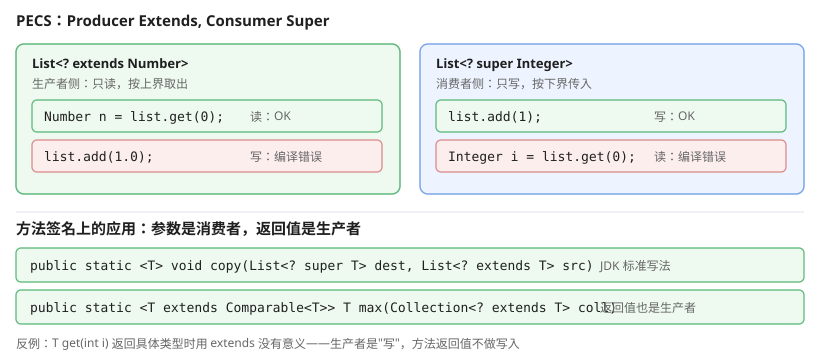

# 一、泛型的动机

没有泛型时，集合里只能放 `Object`，取出时必须强转：

```java
List list = new ArrayList();
list.add("hello");

String s = (String) list.get(0);     // 编译器不检查，错了要到运行期才炸
```

加了泛型后，**编译期就能检查类型**：

```java
List<String> list = new ArrayList<>();
list.add("hello");
// list.add(123);        // 编译错误：int 不能转成 String

String s = list.get(0);             // 无需强转
```

# 二、基本用法

## (一) 声明与使用

```java
class Pair<A, B> {
    private A first;
    private B second;

    public Pair(A first, B second) {
        this.first = first;
        this.second = second;
    }

    public A getFirst()  { return first; }
    public B getSecond() { return second; }

    public static <A, B> Pair<A, B> of(A a, B b) {
        return new Pair<>(a, b);
    }
}

Pair<String, Integer> p = Pair.of("age", 30);
String name = p.getFirst();     // String
int age = p.getSecond();        // Integer → int 自动拆箱
```

类型参数命名惯例：`<T>`、`<E>`（元素）、`<K, V>`（键值）、`<R>`（返回）。

## (二) 菱形推断

```java
List<String> a = new ArrayList<>();      // 7+，可推断
Map<String, List<Integer>> m = new HashMap<>();
```

## (三) 泛型方法

```java
public static <T> T firstNonNull(List<T> list, T fallback) {
    return list.isEmpty() ? fallback : list.get(0);
}
```

调用时通常**不需要显式指定类型参数**：

```java
String s = firstNonNull(names, "default");
```

## (四) 泛型不能用于基本类型

```java
// List<int> wrong = new ArrayList<>();     // 编译错误
List<Integer> ok = new ArrayList<>();       // 用包装类
```

原因是**类型擦除**：`int` 与 `Integer` 在字节码层面无法区分（都存在引用语义里）。

# 三、通配符

## (一) 无界

```java
List<?> list = new ArrayList<String>();
Object o = list.get(0);       // 只能读成 Object

// list.add("x");            // 编译错误：类型未知，不能写入
```

## (二) 上界 extends（协变读取）

```java
List<? extends Number> list = new ArrayList<Integer>();
Number n = list.get(0);      // 可以按上界读取
// list.add(1.0);           // 编译错误：不确定接收什么类型
```

**只读不写**。适合"生产者"场景——`Collections.max(Collection<? extends T>)` 就用了这个。

## (三) 下界 super（逆变写入）

```java
List<? super Integer> list = new ArrayList<Number>();
list.add(1);                // 可以写
// Integer i = list.get(0); // 编译错误：实际元素是 Number

Number n = list.get(0);     // 只能按 Object 或下界读取
```

**只写不读**。适合"消费者"场景——`Collections.copy(List<? super T> dest, List<? extends T> src)`。



**PECS** 是记忆口诀：**Producer Extends, Consumer Super**。

判断某个 `Collection` 参数该用哪个通配符，先看这个参数在方法里**干什么**：

| 参数的用途 | 例子 | 该用 |
| --- | --- | --- |
| **提供**元素来源（被读取） | `addAll`、`copy` 的 `src` | `? extends T` |
| **消费**元素（被写入/删除） | `containsAll`、`removeAll`、`clear` | `? super T` |
| **两边都要** | `equals`、`contains` | 只能裸 `Collection` |

所以 `addAll(Collection<? extends T> c)` 用 extends 是因为它是**生产者**；而 `containsAll(Collection<? super T> c)` 用 super 是因为它是**消费者**。返回值一侧同理是生产者，但 `T get()` 返回的是具体元素、根本不需要通配符。

# 四、类型擦除

Java 的泛型是**编译期特性**：编译器做类型检查后，把类型参数替换成原始类型并擦除。

```java
List<String> a = new ArrayList<>();
// 编译后等价于
List a = new ArrayList();
```

## (一) 三个直接后果

**1. 基本类型无法作为类型参数**（编译期就禁止）。

**2. 静态字段不能用类的类型参数**：

```java
class Box<T> {
    // static T value;      // 编译错误：T 在运行期不存在
    static final int COUNT = 0;   // 静态字段不能用 T，但类型本身不受限
}
```

**3. 不能 `instanceof` 判断具体类型参数**：

```java
Object o = list.get(0);
if (o instanceof List<String>) { }    // 编译错误：不可对参数化类型做 instanceof
if (o instanceof List<?>) { }         // 可以：通配符的擦除是 List
```

# 五、堆污染与原始类型

```java
public static void main(String[] args) {
    List<String> list = new ArrayList<>();
    raw(list);                 // 传入 Object 参数，泛型信息全丢
    list.add(1);               // ★编译通过，但运行期抛 ClassCastException
}

static void raw(List list) { list.add(123); }
```

编译器只做检查，**不做运行期验证**，所以错误延后到读取时才暴露。生产代码应避免使用原始类型。

# 六、泛型与反射

反射读到的类型信息是**擦除后的**：

```java
Method m = Box.class.getMethod("set", Object.class);   // 不是 set(T)
Field f = Box.class.getDeclaredField("value");
System.out.println(f.getType());      // 输出 Object，不是 T
```

想读到真实类型参数必须读**签名属性**：

```java
Type t = Box.class.getGenericSuperclass();
```

# 七、泛型与数组

泛型数组不能直接创建，因为**运行时类型无法确定**（擦除）：

```java
// T[] arr = new T[10];            // 编译错误

@SuppressWarnings("unchecked")
T[] arr = (T[]) new Object[10];     // 能编译，但存元素时可能 ArrayStoreException
```

安全的做法是用 `List<T>` 代替数组。

# 八、PECS 与通配符的取舍

```java
public void printAll(List<? extends Number> list) {
    for (Number n : list) { System.out.println(n); }
}

public void fillWith(List<? super Integer> list) {
    for (int i = 0; i < 5; i++) list.add(i);
}

public static <T> void copy(List<? super T> dest, List<? extends T> src) {
    for (T t : src) dest.add(t);
}
```

这三行签名本身就是最好的泛型教材：**参数用 super、返回值用 extends**。

# 九、参考资料

- [Java 官方教程：泛型](https://docs.oracle.com/javase/tutorial/java/generics/index.html) — 泛型的动机、通配符与泛型方法的官方说明
- [Java 语言规范 JLS（SE 22）](https://docs.oracle.com/javase/specs/jls/se22/html/index.html) — 第 4.5 节「泛型类与接口（Generic Classes and Interfaces）」、第 15.12 节「方法签名与泛型」、第 4.10.2 节「类型擦除（Type Erasure）」是本章的核心依据
- [Java SE 22 API 文档](https://docs.oracle.com/en/java/javase/22/docs/api/) — `java.lang.reflect.Type`、`ParameterizedType` 的读取方法
