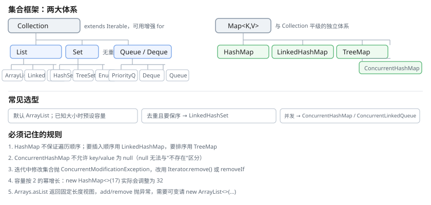

# 一、集合体系

Java 集合分两大体系：`Collection` 与 `Map`。**`Collection` 继承 `Iterable`**（因此能直接用增强 for），**`Map` 不继承 `Iterable`**——遍历它要走 `entrySet()`、`keySet()`、`values()` 或 `forEach()`。



| 接口 | 语义 | 常见实现 |
| --- | --- | --- |
| `List` | 有序、可重复、按索引访问 | `ArrayList`、`LinkedList`、`CopyOnWriteArrayList` |
| `Set` | 无重复 | `HashSet`、`LinkedHashSet`、`TreeSet`、`EnumSet` |
| `Queue`/`Deque` | 队列、双端队列 | `PriorityQueue`、`ArrayDeque` |
| `Map` | 键值对 | `HashMap`、`LinkedHashMap`、`TreeMap`、`ConcurrentHashMap` |

# 二、List

## (一) ArrayList

底层是**数组**，因此：

- 按索引访问 `get(i)` 是 **O(1)**
- 尾部增删摊还 **O(1)**，中间增删需要搬移元素 **O(n)**
- **扩容机制**：默认容量 10，超过后按 1.5 倍增长（`oldCap + (oldCap >> 1)`）

```java
List<String> list = new ArrayList<>();      // Java 8+ 初始是共享空数组，首次 add 才按默认容量 10 分配
List<String> pre = new ArrayList<>(1000);   // 已知大小时预设容量，省去多次扩容
```

预设在**已知元素数量**时能显著减少搬移。

## (二) LinkedList

底层是**双向链表**：

- 任意位置增删是 **O(1)**（前提是已持有该位置的节点）
- 按索引访问是 **O(n)**——必须从头遍历

理论上 LinkedList 增删更快，但实际开发中 ArrayList 几乎总是更快：因为 LinkedList 的"定位到第 i 个"本身就是 O(n)，而 ArrayList 的搬移是**内存顺序拷贝**，CPU 缓存友好。

**结论：绝大多数场景用 `ArrayList`。**

## (三) 选型依据

| 需求 | 选择 |
| --- | --- |
| 频繁按索引读写 | `ArrayList` |
| 主要在尾部增删 | `ArrayDeque`（比 LinkedList 快） |
| 需要栈 | `ArrayDeque` |
| 需要队列 / 双端队列 | `ArrayDeque` |
| 多线程下读多写少 | `CopyOnWriteArrayList` |
| 多线程并发写入 | `ConcurrentLinkedQueue` |

# 三、Set

| 实现 | 顺序 | 底层 |
| --- | --- | --- |
| `HashSet` | 无序 | `HashMap` |
| `LinkedHashSet` | **插入顺序** | `HashMap` + 双向链表 |
| `TreeSet` | **排序** | 红黑树（`TreeMap`） |
| `EnumSet` | 枚举声明顺序 | 位向量，极省内存 |

需要"去重 + 保持插入顺序"用 `LinkedHashSet`，这是常被忽略的需求。

# 四、Map

## (一) HashMap 的结构

Java 8 起 `HashMap` 由**数组 + 链表 + 红黑树**组成：

1. `hash(key)` 经扰动后定位桶
2. 桶为空直接放入；否则比较 hash 与 `equals`
3. 桶内是链表；**链表长度 ≥ 8 且数组长度 ≥ 64** 时转为红黑树

树化的目的是防止**哈希碰撞攻击**——构造大量碰撞键会让链表退化为 O(n) 查找。

## (二) 树化与退化阈值

| 参数 | 默认 | 作用 |
| --- | --- | --- |
| `TREEIFY_THRESHOLD` | 8 | 链表长度达到此值才树化 |
| `UNTREEIFY_THRESHOLD` | 6 | 红黑树元素减少到此值退化为链表 |
| `MIN_TREEIFY_CAPACITY` | 64 | 数组长度小于此值时**不树化**，只扩容 |

## (三) 为什么容量总是 2 的幂

```java
static int hash(int h) {
    h ^= (h >>> 16);                       // 扰动，高位混入低位
    return h & (length - 1);               // 对非负数等价于 h % length，但快得多
}
```

容量为 2 的幂时，`length - 1` 全是二进制 1，取模退化为位与。**初始容量会被调整到 2 的幂**：

```java
new HashMap<>(17);      // 实际容量被调整为 32
```

## (四) 遍历顺序

`HashMap` **不保证顺序**，它的顺序由哈希值与桶位置决定。需要按插入顺序用 `LinkedHashMap`，按 key 排序用 `TreeMap`。

# 五、equals 与 hashCode 契约

这是集合使用的核心前提：

1. `equals` 为 true 时，`hashCode` **必须相等**
2. `hashCode` 相等**不保证** `equals` 为 true（哈希冲突合法）
3. 违反契约会让 `HashSet`/`HashMap` 查不到本该存在的元素

```java
@Override
public boolean equals(Object o) {
    if (this == o) return true;
    if (!(o instanceof User)) return false;
    return Objects.equals(id, ((User) o).id);
}

@Override
public int hashCode() {
    return Objects.hash(id);
}
```

**只重写 `equals` 不重写 `hashCode`** 是最常见的错误：对象放进 `HashSet` 后 `contains` 永远返回 false。

# 六、迭代器与并发修改

在增强 for 里增删集合会抛 `ConcurrentModificationException`——迭代器用 `modCount` 检测结构性修改。

```java
List<String> list = new ArrayList<>(List.of("a", "b", "c"));

// 反例：增强 for 里增删集合
for (String s : list) {
    if (s.equals("b")) list.add("x");         // ConcurrentModificationException
}
```

**注意一个常见误解**：删除**单个中间元素**时往往**不会**抛 `ConcurrentModificationException`——删掉 `"b"` 后 `size` 变 2，而迭代器的 `cursor` 正好也是 2，`hasNext()` 返回 false，循环直接结束。只有删首元素、连续删多个、或在增强 for 里 `add`，才会真正走到 `next()` 里的 `modCount` 检查并抛出。**但这属于「碰巧没炸」，不能依赖**——所以正解仍然是迭代器或 `removeIf`：

```java
// 正解一：迭代器
Iterator<String> it = list.iterator();
while (it.hasNext()) {
    if (it.next().equals("b")) it.remove();
}

// 正解二：removeIf
list.removeIf(s -> s.equals("b"));
```

# 七、Collections 工具类

```java
Collections.sort(list);
Collections.sort(list, Comparator.reverseOrder());      // 降序
Collections.reverse(list);
Collections.shuffle(list);                              // 洗牌
Collections.unmodifiableList(list);                    // 不可变视图（但原list 改了视图也变）
Collections.emptyList();                               // 共享的空实例，节省内存
Collections.singletonList("x");
Collections.nCopies(1000, "x");                        // 1000 个相同引用的列表
Collections.frequency(list, "a");                      // 出现次数
```

`unmodifiableList` 返回的是**视图**，原列表改动会反映到视图上。要真正独立，用 `new ArrayList<>(...)`。

# 八、常见坑

| 坑 | 说明 |
| --- | --- |
| `Arrays.asList` 返回固定长度 | `add`/`remove` 抛异常，需要可变就包一层 `new ArrayList<>()` |
| `keySet` / `values` 的增删 | 两个视图都支持 `remove()`（删掉匹配的条目），但都不支持 `add`——`add` 抛 `UnsupportedOperationException` |
| `ConcurrentHashMap` 不允许 null | key 和 value 都不能为 null |
| `TreeMap` 的 key 必须可比较 | 自定义类要实现 `Comparable` |
| 遍历时修改集合 | 用 `Iterator.remove()` 或 `removeIf` |

# 九、参考资料

- [Java 官方教程：集合](https://docs.oracle.com/javase/tutorial/collections/index.html) — 集合体系与各接口用法的官方说明
- [Java SE 22 API 文档](https://docs.oracle.com/en/java/javase/22/docs/api/) — `HashMap`、`Collections`、`Objects` 的完整契约
- [OpenJDK](https://openjdk.org/) — `HashMap`、`ConcurrentHashMap` 的实现源码，红黑树转换逻辑可从此查证
