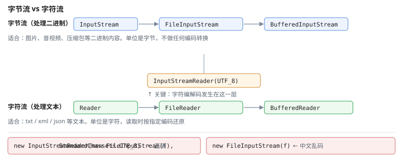

# 一、流体系

Java 的 IO 分两大类，区别在于**读写的单位**与**是否做字符编解码**。



| 类别 | 单位 | 适用 | 主要类 |
| --- | --- | --- | --- |
| 字节流 | 字节 | 二进制文件、图片、音视频 | `InputStream` / `OutputStream` |
| 字符流 | 字符（UTF-16 等） | 文本文件 | `Reader` / `Writer` |

**读取文本必须用字符流**，否则中文字节序列会变成乱码：

```java
// 反例：按字节读文本，中文乱码
try (InputStream in = new FileInputStream("a.txt")) { }

// 正例
try (Reader r = new InputStreamReader(new FileInputStream("a.txt"), StandardCharsets.UTF_8)) { }
```

# 二、File 与 Path

## (一) 老 API：File

```java
File f = new File("C:/data/a.txt");
f.exists();  f.isDirectory();  f.length();
f.mkdir();   f.mkdirs();   f.createNewFile();
f.getName(); f.getParent(); f.getAbsolutePath();
File[] list = f.listFiles();
```

`File` 的问题：**名字叫 File 却不能读写文件**，且路径用 `\` 分隔、跨平台差。IO 出现后已被强烈不推荐。

## (二) 新 API：Path

```java
Path p = Paths.get("C:/data/a.txt");
Path p2 = Path.of("C:/data/a.txt");          // Java 11+ 工厂方法

p.getFileName();      // a.txt
p.getParent();        // C:/data
p.getRoot();          // C:/
Files.exists(p);
Files.size(p);
Files.isDirectory(p);
Files.list(dir);      // 返回 Stream<Path>
Files.walk(dir);      // 递归遍历，返回 Stream<Path>
```

`Path` 只是一条**路径描述**，真正操作由 `Files` 的静态方法完成。这个分工比 `File` 清晰得多。

# 三、缓冲流

直接对磁盘逐字节读写效率很低，每个字节都触发一次系统调用。

```java
// 低效：每次 read 都要访问磁盘
try (InputStream in = new FileInputStream("big.txt")) {
    int b;
    while ((b = in.read()) != -1) { /* … */ }
}

// 高效：带缓冲区，批量读写
try (BufferedReader r = new BufferedReader(
        new InputStreamReader(new FileInputStream("big.txt"), StandardCharsets.UTF_8))) {
    String line;
    while ((line = r.readLine()) != null) { /* … */ }
}
```

装饰器模式的标准套娃顺序永远是：**最内层是文件流，最外层是装饰器**。

# 四、NIO

Java 4 引入的 `java.nio`，核心是**通道（Channel）+ 缓冲区（Buffer）**的数据模型：数据不再由流"推动"，而是在通道与缓冲区之间按需搬运。

## (一) ByteBuffer

```java
try (FileChannel ch = FileChannel.open(Path.of("a.bin"),
        StandardOpenOption.READ, StandardOpenOption.WRITE)) {

    ByteBuffer buf = ByteBuffer.allocate(1024);
    int n = ch.read(buf);           // 通道 → 缓冲区
    buf.flip();                     // ★ 切换到读模式
    while (buf.hasRemaining()) {
        byte b = buf.get();
    }
    buf.clear();                    // 切回写模式
}
```

**`flip()` 是最常见的错误来源**，它做两件事：

| 调用前（写模式） | `flip()` 后（读模式） |
| --- | --- |
| `position` = 已写入字节数 | `position` = 0 |
| `limit` = 容量 | `limit` = 原来 position 的值 |

忘记 `flip()` 就会读到一堆 0。

## (二) 三种 Buffer

| 类型 | 特性 |
| --- | --- |
| `HeapByteBuffer` | 分配在堆上，Channel **可以**直接读写；只是写入时会经由一块临时的直接缓冲中转，多一次拷贝 |
| `DirectByteBuffer` | 分配在堆外，省掉这次拷贝，适合长期复用的 IO 通道 |
| `MappedByteBuffer` | 内存映射文件，适合大文件随机访问 |

## (三) Files 工具类

```java
Files.readString(path);                         // 一次读完
Files.writeString(path, text);
Files.readAllLines(path);
Files.copy(src, dst, StandardCopyOption.REPLACE_EXISTING);
Files.move(src, dst);
Files.deleteIfExists(path);
Files.lines(path);                              // 返回 Stream<String>
```

`Files.lines` 与 `Files.list` 返回的流**持有打开的文件句柄**，必须用 try-with-resources 关闭，否则 Windows 上文件删不掉：

```java
try (Stream<String> lines = Files.lines(path)) {
    lines.forEach(System.out::println);
}
```

# 五、序列化

Java 原生序列化把对象转成字节流，接口是 `Serializable`：

```java
class User implements Serializable {
    private static final long serialVersionUID = 1L;    // 强烈建议显式声明
    private String name;
}

try (ObjectOutputStream oos = new ObjectOutputStream(
        new FileOutputStream("u.bin"))) {
    oos.writeObject(user);
}
```

## (一) 三个坑

1. **`serialVersionUID` 不写会随机生成**，类一改动就反序列化失败
2. `transient` 字段不参与序列化，反序列化后是默认值
3. **不推荐用于新代码**——它与类结构强耦合、跨版本极脆弱，且存在反序列化漏洞（JDK 7u21 之前的 gadget 链问题）

## (二) 现代替代方案

| 场景 | 推荐 |
| --- | --- |
| 结构化对象持久化 | **JSON**（Jackson / Gson） |
| 跨语言、需读 | JSON 或 Protobuf |
| 仅限 Java 内、需要高性能 | Kryo、Protobuf |
| 配置对象 | 直接用 properties / YAML |

# 六、try-with-resources

任何实现 `Closeable`/`AutoCloseable` 的资源都应当用它关闭：

```java
try (BufferedReader r = new BufferedReader(new FileReader("a.txt"));
     PrintWriter w = new PrintWriter("b.txt")) {
    String line;
    while ((line = r.readLine()) != null) {
        w.println(line);
    }
} catch (IOException e) {
    log.error("读写失败", e);
}
```

相比 `finally` 手动关闭，它有三个优势：代码短、不会遗漏、`close()` 抛出的异常会被**挂到主异常的 suppressed 列表**而不是覆盖它。

# 七、参考资料

- [Java 官方教程：IO](https://docs.oracle.com/javase/tutorial/io/index.html) — 流、`Path`、NIO、序列化的官方说明
- [Java SE 22 API 文档](https://docs.oracle.com/en/java/javase/22/docs/api/) — `Files`、`ByteBuffer`、`ObjectOutputStream` 的完整契约
- [OpenJDK](https://openjdk.org/) — NIO 与序列化的实现源码
