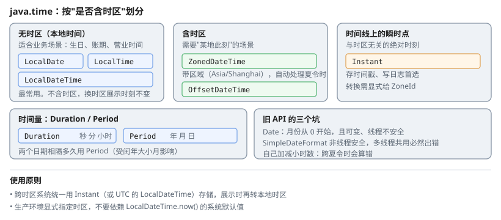

# 一、为什么抛弃 Date

Java 8 之前的 `Date` / `Calendar` 设计有多个根本缺陷：

1. **月份从 0 开始**——`Date` 的废弃方法 `getMonth()`/`setMonth()` 用 0~11 表示 1~12 月（`Calendar.JANUARY` 也是 0），写错不报错。`new Date(long)` 本身只接受 epoch 毫秒，没有"月"这个入参
2. **可变**——`Date` 对象能被任意修改，传给方法后可能被调用方改掉
3. **线程不安全**——`SimpleDateFormat` 多线程共用必然出错
4. **概念混乱**——一个 `Date` 同时表示日期、时刻、历法系统

`java.time`（JSR-310）的每个类都**不可变**且**线程安全**，把「日期」「时刻」「时区」「瞬时」拆成了独立概念。

# 二、核心类型



| 类型 | 表示 | 时区 | 典型用途 |
| --- | --- | --- | --- |
| `LocalDate` | 日期 | 无 | 生日、账期 |
| `LocalTime` | 时刻 | 无 | 营业时间 |
| `LocalDateTime` | 日期 + 时刻 | 无 | 业务时间、**最常用** |
| `ZonedDateTime` | 日期时刻 + **区域** | 有 | 需要城市时区的场景 |
| `OffsetDateTime` | 日期时刻 + **偏移** | 有 | 仅需 ±08:00 这种固定偏移 |
| `Instant` | 时间线上的**瞬时点** | UTC | 存时间戳、日志 |
| `Duration` | 时间**量** | — | 30 秒、2 小时 |
| `Period` | 日期**量** | — | 3 年 2 月 |

## (一) LocalDateTime 常用操作

```java
LocalDateTime now = LocalDateTime.now();

now.getYear();                    // 2026
now.plusDays(1);
now.minusMonths(3);
now.with(DayOfWeek.MONDAY);       // 跳到下周一
now.withYear(2027).withMonth(3).withDayOfMonth(1);

LocalDateTime.of(2026, 10, 13, 9, 30, 0);
LocalDateTime.parse("2026-10-13T09:30:00");

// 格式化为字符串
now.format(DateTimeFormatter.ofPattern("yyyy-MM-dd HH:mm:ss"));
```

## (二) LocalDate

```java
LocalDate today = LocalDate.now();
today.plusYears(1).isLeapYear();
today.getDayOfWeek();             // MONDAY
today.getDayOfYear();             // 第几天

LocalDate.of(2026, 10, 13);
LocalDate.parse("2026-10-13");

LocalDate.ofEpochDay(20700);
today.toEpochDay();

// 计算两个日期间隔
long days = ChronoUnit.DAYS.between(start, end);
long months = ChronoUnit.MONTHS.between(start, end);
```

**日期差用 `ChronoUnit.DAYS`，不要用 `(end.toEpochDay() - start.toEpochDay())`**。epoch 毫秒/天与时区无关，本身不会被夏令时算错；真正的问题是它给的是「UTC 天 / 秒数」而非**日历天数**——夏令时切换那天只有 23 或 25 小时，很容易和业务口径的"几天"差 1。

## (三) Instant 与时间戳

```java
Instant now = Instant.now();
now.getEpochSecond();             // 秒级时间戳
now.toEpochMilli();                // 毫秒级

Instant.ofEpochMilli(1760000000000L);
Instant.parse("2026-10-13T01:30:00Z");

// 与 LocalDateTime 互转
LocalDateTime.ofInstant(now, ZoneId.systemDefault());
ZonedDateTime.ofInstant(now, ZoneId.of("Asia/Shanghai"));
```

**`Instant` 不含时区信息**，只是时间线上的一个点。转成本地时间必须显式给 `ZoneId`。

## (四) Duration 与 Period

```java
Duration d = Duration.ofDays(1).plusHours(2).plusMinutes(30);
d.toMinutes(); d.toMillis(); d.getSeconds();

Duration.between(start, end);     // 时间量

Period p = Period.ofYears(1).plusMonths(2).plusDays(3);
p.toTotalMonths();                // 14
Period.between(start, end);       // 日历量
```

**区别**：两个日期相隔多久用 `Period`（受闰年、大小月影响），两个时刻相隔多久用 `Duration`（纯纳秒运算）。

# 三、时区与夏令时

## (一) 为什么不能自己加减时区

```java
// 反例：中国没有夏令时，但美国有。若用固定偏移处理，
// 跨夏令时切换点就会出现 1 小时的偏差。
LocalDateTime.now().plusHours(-8);
```

正确做法是交给时区规则：

```java
ZonedDateTime shanghai = ZonedDateTime.now(ZoneId.of("Asia/Shanghai"));
ZonedDateTime newYork  = ZonedDateTime.now(ZoneId.of("America/New_York"));

// 要比较两地的时差，必须直接对 ZonedDateTime 求差——Duration.between 会走时区规则
Duration offsetDiff = Duration.between(shanghai, newYork);
long hours = offsetDiff.toHours();       // -12 或 -13，随夏令时自动变化
```

**别写成 `Duration.between(shanghai.toInstant(), newYork.toInstant())`**：`Instant` 是时间线上的同一瞬间，两地的 `now()` 转换后几乎相等，求差结果是几毫秒、`toHours()` 为 0。时差是**墙上钟点**的差，不是时间线的差。

## (二) 系统默认时区不可控

```java
LocalDateTime.now();       // 依赖 JVM 默认时区，部署到服务器可能不是东八区
```

**生产环境应显式指定时区**，不要依赖系统默认：

```java
LocalDateTime.now(ZoneId.of("Asia/Shanghai"));
```

或启动时固定：

```bash
java -Duser.timezone=Asia/Shanghai -jar app.jar
```

## (三) 数据库时间戳

| 数据库类型 | 对应 Java 类型 |
| --- | --- |
| `TIMESTAMP` | `Instant`（推荐）或 `LocalDateTime` |
| `DATE` | `LocalDate` |
| `TIME` | `LocalTime` |

跨时区系统应当**统一用 UTC 存储**，展示时再转本地时区：

```java
Instant created = ...;                                   // 存
LocalDateTime local = created.atZone(ZoneId.of("Asia/Shanghai")).toLocalDateTime();
```

# 四、格式化

```java
DateTimeFormatter f = DateTimeFormatter.ofPattern("yyyy-MM-dd HH:mm:ss");
String s = LocalDateTime.now().format(f);
LocalDateTime t = LocalDateTime.parse("2026-10-13 09:30:00", f);
```

常用模式字母：

| 字母 | 含义 |
| --- | --- |
| `yyyy` / `yy` | 年（四位 / 两位） |
| `MM` / `mm` | 月 / 分（**大小写含义不同**） |
| `dd` | 日 |
| `HH` / `hh` | 24 小时制 / 12 小时制 |
| `SSS` | 毫秒 |
| `a` | AM/PM |

**`MM`（月）与 `mm`（分）的大小写是最常见的错误**——写反了不会报错，只会输出错误的值。`DateTimeFormatter` 是**线程安全**的，可以声明成静态常量复用；`SimpleDateFormat` 不行。

# 五、日期比较

```java
LocalDate a = LocalDate.of(2026, 10, 13);
LocalDate b = LocalDate.of(2026, 10, 20);

a.isBefore(b);      // true
a.isAfter(b);       // false
a.isEqual(b);       // false
a.compareTo(b);     // 负数
```

因为这些类型不可变，`==` 比较与 `equals` 效果相同，但**推荐用 `isEqual`**，语义更明确。

# 六、参考资料

- [Java 官方教程：日期时间](https://docs.oracle.com/javase/tutorial/datetime/index.html) — `java.time` 各类型的官方说明
- [Java SE 22 API 文档](https://docs.oracle.com/en/java/javase/22/docs/api/) — `java.time` 包的完整 API，`Duration`/`Period` 的契约见其 Javadoc
- [JSR-310: Date and Time API](https://openjdk.org/) — API 设计背景与旧 API 的问题分析
