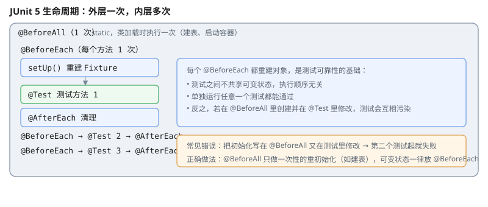

# 一、为什么需要单元测试

单元测试的对象是**最小的可测单元**（通常是一个方法），特点是快、无外部依赖、可重复。收益不只是"发现 bug"：

- 改代码时提供**安全网**，敢重构
- 文档作用——测试用例说明了代码的预期行为
- **强制暴露设计问题**：写不出测试的代码，通常是职责不清的代码

# 二、JUnit 5 基础

```java
import org.junit.jupiter.api.Test;
import static org.junit.jupiter.api.Assertions.*;

class CalculatorTest {

    @Test
    void 加法正常() {
        assertEquals(5, 2 + 3);
    }
}
```

JUnit 5 相比 JUnit 4 的改进：

| 特性 | 说明 |
| --- | --- |
| 包名 | `org.junit.jupiter.api` |
| 测试类与方法 | **都不需要 `public`** |
| 断言 | 静态导入 `Assertions.*`，可读性更好 |
| 生命周期 | `@BeforeEach` / `@AfterEach`（每方法） |

## (一) 常用断言

```java
assertEquals(expected, actual);
assertEquals(3.0, result, 0.001);              // 浮点必须给 delta
assertNotEquals(a, b);
assertTrue(condition);
assertFalse(condition);
assertNull(obj);
assertNotNull(obj);
assertSame(a, b);            // 同一引用
assertNotSame(a, b);
assertArrayEquals(new int[]{1,2}, arr);
assertIterableEquals(List.of(1,2), list);
assertThrows(IllegalArgumentException.class, () -> obj.divide(0));
```

## (二) 断言消息

```java
assertEquals(expected, actual, "折扣计算错误");
assertEquals(expected, actual, () -> "折扣计算错误, 订单=" + order);
```

传 `Supplier`（第二种形式）可以避免消息字符串在测试通过时也被构造。

## (三) 浮点比较

```java
assertEquals(0.3, 0.1 + 0.2);                  // ★失败：二进制浮点误差
assertEquals(0.3, 0.1 + 0.2, 1e-9);            // 必须给容差
```

# 三、生命周期与 Fixture



| 注解 | 执行次数 | 时机 |
| --- | --- | --- |
| `@BeforeAll` | **一次** | 整个测试类前，需 `static` |
| `@BeforeEach` | **每个测试方法前** | 常用于准备 Fixture |
| `@Test` | — | 测试本身 |
| `@AfterEach` | 每个方法后 | 清理 |
| `@AfterAll` | 一次 | 整个测试类后，需 `static` |
| `@Disabled` | — | 跳过该测试 |

```java
class UserServiceTest {

    private UserRepository repo;
    private UserService service;

    @BeforeEach                                   // 每个测试前重建，保证互不干扰
    void setUp() {
        repo = new InMemoryUserRepository();
        service = new UserService(repo);
    }

    @Test
    void 创建用户() {
        service.create("Alice");
        assertEquals(1, repo.count());
    }
}
```

**每个测试都用全新状态**（`@BeforeEach` 重建）是测试可靠性的基础。测试之间共享可变状态会导致执行顺序依赖，单独跑某个测试就失败。

# 四、异常测试

```java
@Test
void 除数为零应抛异常() {
    assertThrows(ArithmeticException.class, () -> calc.divide(1, 0));
}
```

检查异常消息：

```java
ArithmeticException e = assertThrows(ArithmeticException.class,
        () -> calc.divide(1, 0));
assertEquals("除数不能为 0", e.getMessage());
```

**不需要** `expected` 属性——`assertThrows` 是断言的一部分，异常没抛出测试就会失败。

# 五、条件测试

```java
@Test
@EnabledOnOs(OS.LINUX)
void 只在Linux跑() { }

@Test
@Disabled("等待 #123 修复")
void 暂不可用() { }

@Test
@EnabledIf("自定义判断")
void 条件判断() { }
```

`@Disabled` 是遗留代码的常用标记，但堆积多了就成了"测试黑洞"——应当写明原因并关联工单号。

# 六、参数化测试

同一个测试逻辑跑多组输入时用参数化，比写 N 个重复方法好得多：

```java
@ParameterizedTest
@ValueSource(strings = {"hello", "world"})
void 长度不为零(String s) {
    assertTrue(s.length() > 0);
}

@ParameterizedTest
@CsvSource({
    "2, 3, 5",
    "10, 20, 30"
})
void 加法正确(int a, int b, int expected) {
    assertEquals(expected, a + b);
}

@ParameterizedTest
@MethodSource("边界值")
void 边界处理(int a, int b) {
    assertDoesNotThrow(() -> calc.divide(a, b));
}

static Stream<Arguments> 边界值() {
    return Stream.of(Arguments.of(1, 1), Arguments.of(0, 1), Arguments.of(-1, 1));
}
```

来源注解：`@ValueSource`、`@CsvSource`、`@MethodSource`、`@EnumSource`、`@NullSource`、`@EmptySource`。

# 七、测试设计原则

## (一) 一个测试只测一件事

```java
// 反例：一个测试断言三件事，失败时不知道是哪件坏了
@Test
void 用户操作() {
    user.setName("A");
    assertEquals("A", user.getName());
    assertEquals(1, repo.count());
    assertTrue(service.isValid(user));
}

// 正例：拆成三个
```

## (二) 命名要说清测什么

```java
// 反例：看不出断言什么
@Test void test1() { }

// 正例
@Test void 注册重复手机号应抛异常() { }
@Test void 未登录用户访问应返回401() { }
```

## (三) 断言业务结果，不测实现细节

不要断言"调用了某个私有方法"或"字段值等于某中间状态"——这会让重构无法进行。断言**外部可观察的行为**（返回值、抛出的异常、持久化的结果）。

## (四) 避免不稳定测试

| 不稳定来源 | 对策 |
| --- | --- |
| 依赖当前时间 | 注入 `Clock`，测试传入固定值 |
| 依赖网络 | Mock 或用本地 stub |
| 依赖执行顺序 | 每个测试独立 Fixture |
| 依赖并发调度 | 用确定性的同步点替代 `sleep` |

`Thread.sleep` 是测试不稳定的头号来源。

# 八、常用依赖

```xml
<dependency>
    <groupId>org.junit.jupiter</groupId>
    <artifactId>junit-jupiter</artifactId>
    <version>5.10.2</version>
    <scope>test</scope>
</dependency>
<dependency>
    <groupId>org.mockito</groupId>
    <artifactId>mockito-core</artifactId>
    <version>5.11.0</version>
    <scope>test</scope>
</dependency>
```

# 九、参考资料

- [Java 官方教程](https://docs.oracle.com/javase/tutorial/) — 语言与库各主题的官方说明
- [JUnit 5 用户指南](https://junit.org/junit5/docs/current/user-guide/) — 生命周期、断言、参数化测试的完整文档
- [Java SE 22 API 文档](https://docs.oracle.com/en/java/javase/22/docs/api/) — 被测 API 的契约
