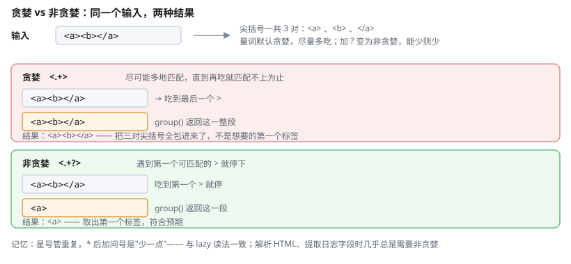

# 一、基本用法

Java 正则的核心是两个类：`Pattern`（编译好的模式）与 `Matcher`（匹配结果）。

```java
String input = "订单号 A12345 已发货";

Pattern p = Pattern.compile("订单号\\s+(\\w+)");
Matcher m = p.matcher(input);

if (m.find()) {
    System.out.println(m.group());      // 整段匹配
    System.out.println(m.group(1));     // 第 1 个捕获组
}
```

**`Pattern` 应当复用**：它的编译有一定开销，重复创建模式在循环里是常见的性能问题。

```java
// 反例：每次调用都重新编译
boolean check(String s) {
    return Pattern.compile("\\d+").matcher(s).matches();
}

// 正例：提到静态字段
private static final Pattern DIGITS = Pattern.compile("\\d+");
boolean check(String s) {
    return DIGITS.matcher(s).matches();
}
```

# 二、三个常用方法

| 方法 | 含义 |
| --- | --- |
| `matches()` | **整串**必须匹配 |
| `find()` | 查找**任意位置**的匹配 |
| `lookingAt()` | 从**开头**匹配 |

```java
Pattern.compile("abc").matcher("abc").matches();     // true
Pattern.compile("abc").matcher("abcd").matches();    // false —— 整串匹配
Pattern.compile("abc").matcher("abcd").find();        // true  —— 找到即算
Pattern.compile("abc").matcher("abcd").lookingAt();  // true  —— 从开头
```

这个区别很容易出错：验证"是否纯数字"要用 `matches()`，用 `find()` 会把 `"12abc34"` 判为合法。

# 三、核心语法

| 类别 | 写法 | 说明 |
| --- | --- | --- |
| 任意字符 | `.` | 不含换行 |
| 转义 | `\.` `\\` | 正则里的 `\` 要写两次 |
| 数字 | `\d` | `[0-9]` |
| 非数字 | `\D` | |
| 单词字符 | `\w` | `[a-zA-Z0-9_]` |
| 空白 | `\s` | 含空格、制表、换行 |
| 单词边界 | `\b` | |
| 重复 0+ | `*` | 贪婪 |
| 重复 1+ | `+` | 贪婪 |
| 重复 0/1 | `?` | |
| 精确次数 | `{3}` | |
| 范围次数 | `{2,5}` | |
| 任一 | `[abc]` | |
| 排除 | `[^abc]` | |
| 或 | `\|` | 需转义 |
| 分组 | `(…)` | 捕获 |
| 非捕获分组 | `(?:…)` | 不占用编号 |
| 行首 / 行尾 | `^` `$` | |

## (一) 必须转义的字符

正则中的元字符（`.` `\` `+` `*` `?` `(` `)` `[` `]` `{` `}` `^` `$` `|`）如果要匹配字面量，必须加 `\`。

```java
Pattern.compile("3\\.14");       // 匹配 3.14
Pattern.compile("\\d+\\.\\d+");   // 匹配浮点数
Pattern.quote("3.14");           // 或者直接转义整个字符串
```

# 四、贪婪与非贪婪



`*`、`+`、`?`、`{n,m}` 默认是**贪婪**的，会尽可能多匹配。加 `?` 变为**非贪婪**。

```java
Matcher greedy = Pattern.compile("<.+>").matcher("<a><b></a>");
greedy.find();
// 贪婪：     <a><b></a>
System.out.println(greedy.group());

Matcher lazy = Pattern.compile("<.+?>").matcher("<a><b></a>");
lazy.find();
// 非贪婪：   <a>
System.out.println(lazy.group());
```

注意 `Matcher.group()` 必须在 `find()`/`matches()` 之后调用，否则抛 `IllegalStateException`——刚 `new` 出来的 Matcher 还没有匹配结果。

匹配 HTML 或日志行时通常需要非贪婪，否则会匹配过多内容。

# 五、分组与捕获

```java
String date = "2026-10-13";
Pattern p = Pattern.compile("(\\d{4})-(\\d{2})-(\\d{2})");
Matcher m = p.matcher(date);

if (m.matches()) {
    String year  = m.group(1);       // 2026
    String month = m.group(2);       // 10
    String day   = m.group(3);       // 13
}
```

`group(0)` 是整段匹配。组号从 1 开始。

## (一) 命名分组

```java
Pattern p = Pattern.compile("(?<year>\\d{4})-(?<month>\\d{2})-(?<day>\\d{2})");
Matcher m = p.matcher("2026-10-13");

m.matches();
System.out.println(m.group("year"));     // 2026
```

命名组让代码可读性显著提升，尤其分组较多时。

## (二) 查找所有匹配

```java
Pattern p = Pattern.compile("\\d+");
Matcher m = p.matcher("a1 b22 c333");

while (m.find()) {
    System.out.println(m.group());      // 1 / 22 / 333
}

// 或用流
Pattern.compile("\\d+").matcher("a1 b22 c333")
        .results().forEach(r -> System.out.println(r.group()));
```

## (三) 获取匹配的起止位置

```java
m.start();      // 整个匹配的起始索引
m.end();        // 结束索引（不含）
m.start(1);     // 第 1 组的起始
```

# 六、替换

```java
Pattern p = Pattern.compile("(\\d{4})-(\\d{2})-(\\d{2})");

// 全部替换
String s = p.matcher("2026-10-13").replaceAll("$3/$2/$1");     // 13/10/2026

// 第一个
String s1 = p.matcher("2026-10-13 和 2027-01-02").replaceFirst("$1年$2月");

// 替换函数（可编程逻辑）
String s2 = Pattern.compile("\\d+").matcher("a1 b22")
        .replaceAll(mr -> String.valueOf(Integer.parseInt(mr.group()) * 2));
// a2 b44
```

`$1`、`$2` 引用捕获组，`${name}` 引用命名组。

# 七、断言与环视

| 语法 | 含义 |
| --- | --- |
| `(?=…)` | 正向断言：**右边**必须匹配 |
| `(?!…)` | 负向断言：右边**不能**匹配 |
| `(?<=…)` | 后向断言：左边**必须**匹配 |
| `(?<!…)` | 后向断言：左边**不能**匹配 |

```java
// 密码：6-20 位，必须含字母和数字
Pattern.compile("^(?=.*[a-zA-Z])(?=.*\\d)[a-zA-Z\\d]{6,20}$");

// 匹配后面不再跟 "12" 的数字串
Pattern.compile("\\d+(?!\\d*12)");
```

注意 `\d+(?!12)` 几乎永远不会失败：贪婪的 `\d+` 已经把所有连续数字吃光，后面必然是非数字，断言恒成立。要表达"后面不再跟 12"，得写成 `(?!\d*12)`（断言里要带上 `\d*`，否则约束不到目标）。

环视**不消耗字符**，这是它与普通分组的本质区别。

# 八、常见陷阱

## (一) 灾难性回溯

嵌套量词遇到长输入会导致指数级耗时：

```java
// 反例：(a+)+ 在 "aaaaaaaaaaaaaaaaaaaaaaaaaaX" 上会卡死
Pattern.compile("(a+)+b");

// 正解：改写为等价但不回溯的形式
Pattern.compile("a+b");
```

同理 `.*.*.*`、`(\w+\s?)*` 都是危险写法。**避免嵌套量词，用具体字符类替代 `.*`**。

## (二) 转义层级

```java
Pattern.compile("\\d+");     // Java 字符串 \d+ → 正则 \d+
Pattern.compile("^[\\w.]+@[\\w.]+$");  // 邮箱
```

写正则时先把**目标字符串**（`"\\d+"`）与**正则本身**（`\d+`）分清楚，正则里的 `\d` 在 Java 字符串里必须写成 `\\d`。

## (三) 邮箱正则不可能完备

严格的邮箱校验非常复杂，实际开发中建议：

- 简单校验用宽松正则 + 发送验证邮件兜底
- 不要用一个大正则试图覆盖 RFC 5322 的全部合法形式

# 九、参考资料

- [Java 官方教程：正则表达式](https://docs.oracle.com/javase/tutorial/regex/index.html) — `Pattern`/`Matcher` 用法与语法规则的官方说明
- [Java SE 22 API 文档](https://docs.oracle.com/en/java/javase/22/docs/api/) — `java.util.regex` 包的完整 API，含各类断言的语义
- [OpenJDK](https://openjdk.org/) — `Pattern` 的实现源码，回溯算法可从此查证
