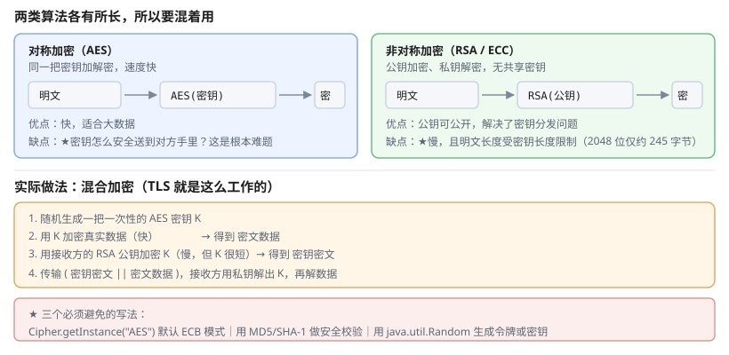

# 一、先分清三件事

很多安全问题源于概念混淆，先把三者分清：

| 类别 | 作用 | 可逆 | 用途 |
| --- | --- | --- | --- |
| **编码**（Base64、URL 编码） | 换个表示形式 | 可逆 | 传输二进制、URL 传参 |
| **摘要**（MD5、SHA） | 生成固定长度指纹 | **不可逆** | 校验完整性、去重 |
| **加密**（AES、RSA） | 用密钥恢复明文 | 可逆 | 机密性保护 |

**Base64 不是加密**——它没有任何密钥，任何人都能还原。它的唯一作用是让二进制数据能安全地穿过只允许文本的通道。

```java
// Base64 只是编码，一眼就能还原
Base64.getEncoder().encodeToString("hello".getBytes());     // aGVsbG8=
```

# 二、摘要

## (一) 用法

```java
import java.security.MessageDigest;

MessageDigest md = MessageDigest.getInstance("SHA-256");
byte[] hash = md.digest(data);
String hex = HexFormat.of().formatHex(hash);
```

Java 9+ 的 `HexFormat` 让十六进制转换更简洁；旧写法通常是手写查表循环。

## (二) 算法对比

| 算法 | 输出长度 | 状态 | 说明 |
| --- | --- | --- | --- |
| MD5 | 128 bit | **已不可用** | 可构造碰撞 |
| SHA-1 | 160 bit | **已弃用** | 已实现实际碰撞攻击 |
| SHA-256 | 256 bit | 推荐 | 通用选择 |
| SHA-512 | 512 bit | 推荐 | 更慢，更安全余量 |

**MD5 和 SHA-1 不再具有抗碰撞性**——攻击者可以构造出内容不同但摘要相同的两个文件。这意味着用它们做"文件完整性校验"或"签名"都不再可靠。

```java
// 不要用
MessageDigest.getInstance("MD5");
// 用
MessageDigest.getInstance("SHA-256");
```

## (三) 常见误用

**误用一：把摘要当密码哈希。**

摘要速度快（每秒上亿次），这正是密码哈希**不能**用它的原因——攻击者可以穷举所有常见密码。

**误用二：用摘要判断两个文件是否相同。** 应当直接比较文件字节，摘要只是"很可能相同"的近似。

**误用三：以为摘要能解密。** 摘要是单向的。

# 三、加密

## (一) 对称加密

同一把密钥既加密又解密。AES 是标准选择，密钥长度用 **256 位**。



```java
import javax.crypto.Cipher;
import javax.crypto.spec.IvParameterSpec;
import javax.crypto.spec.SecretKeySpec;
import java.security.SecureRandom;
import java.util.Arrays;
import java.util.Base64;

public class AesUtil {

    private static final String ALGO = "AES";
    private static final int IV_LEN = 16;

    public static String encrypt(String plain, String key) throws Exception {
        byte[] keyBytes = key.getBytes(java.nio.charset.StandardCharsets.UTF_8);

        // 随机 IV：相同明文每次加密结果不同，防止攻击者比对密文推断
        byte[] iv = new byte[IV_LEN];
        new SecureRandom().nextBytes(iv);

        Cipher cipher = Cipher.getInstance("AES/CBC/PKCS5Padding");
        cipher.init(Cipher.ENCRYPT_MODE, new SecretKeySpec(keyBytes, ALGO),
                new IvParameterSpec(iv));

        byte[] encrypted = cipher.doFinal(plain.getBytes("UTF-8"));

        // 把 IV 和密文拼在一起，解密时需要用到 IV
        byte[] result = new byte[iv.length + encrypted.length];
        System.arraycopy(iv, 0, result, 0, iv.length);
        System.arraycopy(encrypted, 0, result, iv.length, encrypted.length);
        return Base64.getEncoder().encodeToString(result);
    }

    public static String decrypt(String cipherText, String key) throws Exception {
        byte[] all = Base64.getDecoder().decode(cipherText);
        byte[] iv = Arrays.copyOfRange(all, 0, IV_LEN);
        byte[] encrypted = Arrays.copyOfRange(all, IV_LEN, all.length);

        Cipher cipher = Cipher.getInstance("AES/CBC/PKCS5Padding");
        cipher.init(Cipher.DECRYPT_MODE, new SecretKeySpec(key.getBytes("UTF-8"), ALGO),
                new IvParameterSpec(iv));
        return new String(cipher.doFinal(encrypted), "UTF-8");
    }
}
```

三个关键点：

1. **必须指定 IV，且每次随机**——固定 IV 会让相同明文产生相同密文，泄露模式信息
2. **必须指定完整算法串**——`AES` 默认 `ECB` 模式，`AES/CBC/PKCS5Padding` 才是正确写法
3. **ECB 模式不要用**——相同明文块产生相同密文块，密文的结构直接暴露明文结构

```java
// 危险：ECB 模式
Cipher.getInstance("AES");
```

## (二) 非对称加密

公钥加密、私钥解密。用于交换密钥或做数字签名，常见算法 RSA、ECC。

```java
KeyPairGenerator gen = KeyPairGenerator.getInstance("RSA");
gen.initialize(2048);
KeyPair pair = gen.generateKeyPair();

Cipher cipher = Cipher.getInstance("RSA/ECB/OAEPWithSHA-256AndMGF1Padding");
cipher.init(Cipher.ENCRYPT_MODE, pair.getPublic());
byte[] encrypted = cipher.doFinal(secret.getBytes("UTF-8"));

cipher.init(Cipher.DECRYPT_MODE, pair.getPrivate());
byte[] decrypted = cipher.doFinal(encrypted);
```

RSA 密钥长度至少 **2048 位**（低于此已不安全），且**不能用于加密大数据**——公钥密码体制的运算开销大，且明文长度上限受填充方式影响：2048 位密钥在 **PKCS#1 v1.5** 下最多约 **245 字节**，用上面那段 **OAEP-SHA-256** 时只有 **190 字节**（开销 = 2×32+2）。

## (三) 混合加密的实践

真实系统几乎都用混合方案：

1. 生成**一次性对称密钥**（AES）
2. 用 AES 加密实际数据
3. 用接收方的 **RSA 公钥加密那把 AES 密钥**
4. 传输 `(RSA 加密的密钥 || AES 加密的数据)`

这样既获得了对称加密的速度，又解决了密钥分发问题。

# 四、密码存储

**密码绝不能可逆加密**——`MessageDigest` 的加盐实现也已不推荐。正确做法是**自适应哈希**：

```java
// Spring Security 的 BCrypt 示例
public static String hash(String rawPassword) {
    BCryptPasswordEncoder encoder = new BCryptPasswordEncoder(12);
    return encoder.encode(rawPassword);
}

public static boolean matches(String raw, String encoded) {
    return BCryptPasswordEncoder.matches(raw, encoded);
}
```

| 算法 | 特点 |
| --- | --- |
| **BCrypt** | **首选**，可调 cost，自带随机盐 |
| Argon2 | **当前最佳**，需额外依赖 |
| PBKDF2 | JDK 内置，可用但参数调优依赖经验 |
| SCrypt | 需额外依赖 |

BCrypt 的 `cost=12` 表示内部做 2^12 次迭代，存储时盐和参数一起保存，因此每次校验都能得到相同结果。

```java
// MD5 + 固定盐：绝对不要这么写
MessageDigest md = MessageDigest.getInstance("MD5");
String hashed = toHex(md.digest(("password" + "salt").getBytes()));
```

这个写法有三个致命问题：MD5 太快（可穷举）、固定盐（彩虹表可复用）、无迭代（一次就算完）。

# 五、随机数

`java.util.Random` 是**线性同余发生器**，输出可预测；`java.security.SecureRandom` 基于密码学安全的算法池。

```java
Random weak = new Random();                  // 不要用于安全场景
SecureRandom strong = new SecureRandom();     // 令牌、密钥、会话 ID

byte[] token = new byte[32];                  // 256 位
strong.nextBytes(token);
String hex = HexFormat.of().formatHex(token);
```

以下场景**必须**用 `SecureRandom`：

- 生成会话 ID、CSRF token、密码重置链接
- 生成密钥、盐、nonce、IV
- 生成"忘记密码"验证码

用 `Random` 生成重置 token 是真实的安全事故来源——攻击者可根据少量输出推算出序列。

# 六、TLS 与证书

Java 的 TLS 能力封装在 `SSLSocket` / `HttpsURLConnection` 中，通常不需要直接使用。

```java
// HTTPS 请求（默认已校验证书）
URL url = new URL("https://example.com/api");
HttpsURLConnection conn = (HttpsURLConnection) url.openConnection();
conn.setRequestMethod("GET");
conn.setConnectTimeout(5000);
conn.setReadTimeout(5000);
```

**关键点：不要写"信任所有证书"的代码。**

```java
// 反例：关闭证书校验，中间人攻击直接绕过 TLS
TrustManager[] trustAll = new TrustManager[] {
    new X509TrustManager() {
        public void checkClientTrusted(X509Certificate[] c, String a) { }
        public void checkServerTrusted(X509Certificate[] c, String a) { }
        public X509Certificate[] getAcceptedIssuers() { return new X509Certificate[0]; }
    }
};
SSLContext sc = SSLContext.getInstance("TLS");
sc.init(null, trustAll, new SecureRandom());
```

有些开发环境为了"解决自签名证书报错"会这么写，结果把整个连接变成明文等价物。正确做法是把开发环境的自签名证书导入**信任库**，而不是禁用校验。

## (一) 消息摘要与签名

摘要只能证明"内容没变"，不能证明"是谁发的"。**数字签名**用私钥对摘要签名，公钥验证，才能同时保证完整性与身份：

```java
Signature sig = Signature.getInstance("SHA256withRSA");
sig.initSign(privateKey);
sig.update(content);
byte[] signature = sig.sign();

sig.initVerify(publicKey);
sig.update(content);
boolean ok = sig.verify(signature);
```

# 七、常见误区

| 误区 | 后果 |
| --- | --- |
| 用 MD5/SHA-1 做安全校验 | 碰撞可构造，校验形同虚设 |
| 用 Base64 当加密 | 无任何保护 |
| AES 用默认 `AES`（ECB） | 相同明文同一密文，泄露结构 |
| 用 `Random` 生成 token | 可预测，token 可被推算 |
| 密码用 MD5 存储 | 毫秒级穷举全部常见密码 |
| 关闭 TLS 证书校验 | TLS 形同虚设，中间人可读写全部数据 |
| 硬编码密钥在源码里 | 泄露即全部失守 |

# 八、参考资料

- [Java SE 22 API 文档](https://docs.oracle.com/en/java/javase/22/docs/api/) — `javax.crypto` 与 `java.security` 包的完整 API，含 `Cipher`、`MessageDigest`、`SecureRandom` 的契约
- [OWASP 密码存储速查表](https://cheatsheetseries.owasp.org/cheatsheets/Password_Storage_Cheat_Sheet.html) — 密码哈希的算法推荐与参数配置
- [Java 官方教程：安全](https://docs.oracle.com/javase/tutorial/security/index.html) — Java 安全体系（JAAS、加密、SSL）的官方说明
