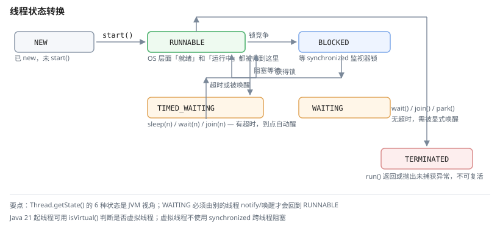
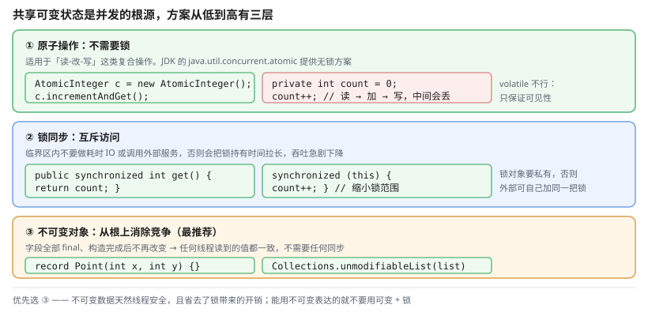
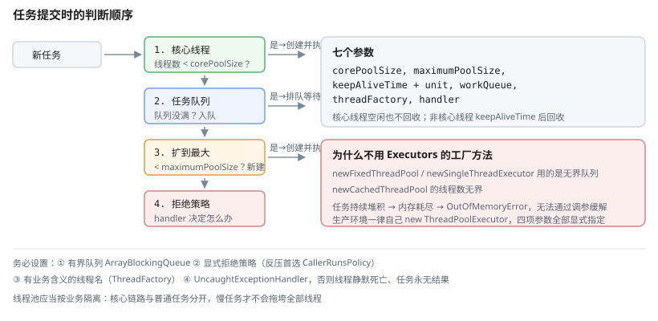

# 一、线程与进程

- **进程**：正在运行的程序，是**资源分配**的基本单位（拥有独立的内存空间）
- **线程**：进程内的执行单元，是**CPU 调度**的基本单位（共享进程的堆和文件）

一个 JVM 就是一个进程，它内部有多个线程共享堆内存。

```java
public class Main {
    public static void main(String[] args) {
        System.out.println("PID: " + ProcessHandle.current().pid());
        Thread.getAllStackTraces().keySet().forEach(t ->
            System.out.println(t.getName() + " " + t.getState()));
    }
}
```

JVM 启动后至少有这些线程：`main`、`GC`（垃圾回收）、`JIT Compiler`、`Finalizer`、`Signal Dispatcher`。

# 二、线程状态

Java 线程在生命周期中有六种状态，转换关系如下。



| 状态 | 含义 |
| --- | --- |
| `NEW` | 已创建但未调用 `start()` |
| `RUNNABLE` | 正在 JVM 中执行（**包含 OS 层面的就绪与运行中**） |
| `BLOCKED` | 等待获取监视器锁（`synchronized` 竞争） |
| `WAITING` | 无限期等待其他线程（`wait()`、`join()`、`park()`） |
| `TIMED_WAITING` | 有超时等待（`sleep(n)`、`wait(n)`、`join(n)`） |
| `TERMINATED` | 执行完毕 |

注意 Java 把「就绪」和「运行中」都归入 `RUNNABLE`，因为这个状态由 JVM 视角而非 OS 视角定义。

# 三、创建线程

## (一) 实现 Runnable

```java
class Task implements Runnable {
    @Override
    public void run() { System.out.println(Thread.currentThread().getName()); }
}

new Thread(new Task()).start();
```

## (二) 继承 Thread

```java
class MyThread extends Thread {
    @Override
    public void run() { }
}
new MyThread().start();
```

**推荐用 `Runnable`**：`Thread` 继承后无法再继承别的类，而 `Runnable` 没有这个限制；两者都能复用同一段逻辑。

## (三) Callable 与 Future

`Runnable.run()` 没有返回值也不能抛受检异常，`Callable` 补上了这两点：

```java
ExecutorService pool = Executors.newFixedThreadPool(2);
Future<Integer> future = pool.submit(() -> {
    Thread.sleep(100);
    return 42;
});

Integer result = future.get();          // 阻塞等待
pool.shutdown();
```

`future.get()` 会**阻塞**，若任务抛异常则抛 `ExecutionException`，真实原因在 `getCause()` 里。

# 四、线程安全

## (一) 竞态条件

```java
// 危险：count++ 不是原子操作
static int count = 0;
static void increment() { count++; }

// 1000 个线程各执行 1000 次，最终 count 远小于 1000000
```

`count++` 编译成三条字节码：**读 → 加 → 写**。多线程下"读"和"写"之间的窗口会被其他线程插入，导致丢失更新。



## (二) synchronized

```java
public class Counter {
    private int count;

    public synchronized void increment() { count++; }

    public synchronized int get() { return count; }
}
```

`synchronized` 方法锁的是 `this`；静态方法锁的是**类对象**：

```java
public static synchronized void staticInc() { }   // 锁 Counter.class
```

同步代码块可以缩小锁范围，提高并发度：

```java
public void add(String key, String value) {
    synchronized (this) {          // 判断与写入必须在同一个临界区
        if (!map.containsKey(key)) return;
        map.put(key, value);
    }
}
```

**不能把判断挪到锁外面**做"优化"：锁外的 `containsKey` 与锁内的 `put` 之间没有任何互斥保护，既挡不住并发写导致的 `HashMap` 死循环，也留有 TOCTOU 窗口（判断为 true 后 key 可能已被别的线程移除）。

如果 `map` 本身是 `ConcurrentHashMap`，就别用 `synchronized`，直接用它的原子方法：

```java
map.computeIfPresent(key, (k, old) -> value);     // 判断与写入一体，无竞态
```

**锁对象要私有**，否则外部能拿到同一个锁对象自己加锁，制造死锁：

```java
// 反例：锁是 public 的
public final Object lock = new Object();

// 正例：私有锁对象
private final Object lock = new Object();
```

## (三) ReentrantLock

`synchronized` 是 JVM 内置的，`ReentrantLock` 是 JDK 提供的，功能更强：

```java
private final ReentrantLock lock = new ReentrantLock();
private final Condition condition = lock.newCondition();

public void produce() {
    lock.lock();
    try {
        while (queue.size() == 10) {         // ★用 while 不用 if
            condition.await();
        }
        queue.add("item");
        condition.signalAll();               // 唤醒消费者
    } finally {
        lock.unlock();                        // ★必须放 finally
    }
}
```

| 能力 | `synchronized` | `ReentrantLock` |
| --- | --- | --- |
| 语法 | 关键字，自动释放 | `lock()` / `unlock()`，需 `finally` |
| 响应中断 | 不可 | `lockInterruptibly()` 可 |
| 超时获取 | 不可 | `tryLock(timeout)` 可 |
| 公平锁 | 不可 | 可传 `new ReentrantLock(true)` |
| 多个条件变量 | 不可 | 可创建多个 `Condition` |

**`synchronized` 出错时 JVM 一定释放锁；`ReentrantLock` 忘记 `unlock()` 会永久死锁**——所以永远把 `unlock()` 放 `finally`。

## (四) volatile

`volatile` 保证**可见性**和**禁止重排序**，但**不保证原子性**：

```java
private volatile boolean running = true;     // ✔ 可见性
// private volatile int count = 0;           // ✘ count++ 仍然不安全
```

它适用于"一个线程改、多个线程读"的场景，如状态标志位。

## (五) 原子类

```java
AtomicInteger counter = new AtomicInteger();
counter.incrementAndGet();          // 原子自增
counter.compareAndSet(0, 1);        // CAS
counter.addAndGet(10);

LongAdder count = new LongAdder();  // 高并发下比 AtomicLong 快得多
count.increment();
```

CAS（比较并交换）用「比较值是否仍是我读到的那个」来避免丢失更新，失败就重试。但**高竞争下自旋会浪费 CPU**，所以 JDK 提供了 `LongAdder`（分段累加）来分散竞争。

## (六) 线程安全集合

| 需求 | 容器 |
| --- | --- |
| 并发写 Map | `ConcurrentHashMap` |
| 并发队列 | `ConcurrentLinkedQueue`（非阻塞）、`BlockingQueue` |
| 读多写少的 List | `CopyOnWriteArrayList` |
| 计数器 | `LongAdder` |
| 双重检查单例 | 静态内部类 Holder |

```java
ConcurrentHashMap<String, AtomicInteger> counts = new ConcurrentHashMap<>();
counts.computeIfAbsent("key", k -> new AtomicInteger()).incrementAndGet();
```

# 五、线程池

## (一) 为什么不用 Executors

`Executors.newFixedThreadPool` 等工厂方法创建的是**无界队列**，任务堆积会导致 `OutOfMemoryError`：

```java
// 危险：队列无界
Executors.newFixedThreadPool(10);
Executors.newSingleThreadExecutor();
Executors.newCachedThreadPool();          // 线程数无界

// 推荐：自己 new，显式指定全部参数
ThreadPoolExecutor pool = new ThreadPoolExecutor(
        4,                                  // corePoolSize
        8,                                  // maximumPoolSize
        60, TimeUnit.SECONDS,               // keepAliveTime + unit
        new ArrayBlockingQueue<>(1000),      // 有界队列
        new ThreadFactoryBuilder().build(),  // 线程工厂：一定要起业务名
        new ThreadPoolExecutor.AbortPolicy() // 拒绝策略
);
```

上面用 Guava 的 `ThreadFactoryBuilder` 起名；不引 Guava 就手写一个 `ThreadFactory`，**不要用默认工厂**（默认线程名全是 `pool-1-thread-1`，出问题时无从排查）。

## (二) 七个参数



| 参数 | 含义 |
| --- | --- |
| `corePoolSize` | 核心线程数，空闲也不回收 |
| `maximumPoolSize` | 最大线程数 |
| `keepAliveTime` + `unit` | 非核心线程空闲存活时间 |
| `workQueue` | 任务队列 |
| `threadFactory` | 线程命名与守护属性 |
| `handler` | 拒绝策略 |

任务提交时的判断顺序是：**核心线程 → 队列 → 扩到最大线程 → 拒绝**。

```java
// 默认四种拒绝策略
new ThreadPoolExecutor.AbortPolicy();        // 抛 RejectedExecutionException（默认）
new ThreadPoolExecutor.CallerRunsPolicy();   // 调用者线程自己执行，反压
new ThreadPoolExecutor.DiscardPolicy();      // 静默丢弃
new ThreadPoolExecutor.DiscardOldestPolicy();// 丢弃队首
```

## (三) 线程工厂

给线程起名能极大提升排查效率，栈里全是 `pool-1-thread-1` 是很痛苦的事：

```java
ThreadFactory factory = r -> {
    Thread t = new Thread(r, "biz-handler-" + COUNTER.incrementAndGet());
    t.setDaemon(false);
    t.setUncaughtExceptionHandler(
        (thread, e) -> log.error("线程 {} 未捕获异常", thread.getName(), e));
    return t;
};
```

**未捕获异常处理必须显式设置**，否则线程静默死亡，任务再也没有结果。

# 六、并发工具类

## (一) CountDownLatch

一个或多个线程等待其他线程完成：

```java
CountDownLatch latch = new CountDownLatch(3);

for (int i = 0; i < 3; i++) {
    pool.submit(() -> {
        try { doWork(); }
        finally { latch.countDown(); }        // ★必须在 finally
    });
}

latch.await();      // 阻塞直到计数归零
latch.await(5, TimeUnit.SECONDS);
```

典型场景：并行查询三个数据源，汇总后再往下走。

## (二) CyclicBarrier

多个线程互相等待，全部到达才继续——与 `CountDownLatch` 相反：

```java
CyclicBarrier barrier = new CyclicBarrier(3, () -> log.info("三人到齐"));

for (int i = 0; i < 3; i++) {
    pool.submit(() -> {
        barrier.await();          // 等待其他人
        return "结果";
    });
}
```

| 特性 | `CountDownLatch` | `CyclicBarrier` |
| --- | --- | --- |
| 方向 | 一个等多个 | 多个等一个齐 |
| 能否重复用 | 不能（一次性） | 能（`reset()` 可重来） |
| 有无回调 | 无 | `barrierAction` |

## (三) Semaphore

限制同时访问某个资源的线程数：

```java
Semaphore semaphore = new Semaphore(10);        // 10 个许可

semaphore.acquire();
try {
    callLimitedApi();
} finally {
    semaphore.release();                        // ★必须释放
}
```

对比线程池：线程池限制的是**任务数**，信号量限制的是**并发访问数**。

## (四) 其他

```java
// 读写锁：读多写少时性能远好于 synchronized
ReentrantReadWriteLock rw = new ReentrantReadWriteLock();
rw.readLock().lock();      // 多个读线程可同时持有
rw.writeLock().lock();     // 排他

// 阻塞队列：生产者消费者
BlockingQueue<Task> queue = new LinkedBlockingQueue<>(100);
queue.put(task);           // 满则阻塞
queue.take();              // 空则阻塞
queue.poll(1, TimeUnit.SECONDS);
```

# 七、CompletableFuture

`Future` 的问题：**只能阻塞式 `get()`**，无法编排。`CompletableFuture` 支持链式组合：

```java
CompletableFuture<String> f = CompletableFuture
        .supplyAsync(() -> userService.find(id))              // CompletableFuture<User>
        .thenApply(User::getName)                            // → CompletableFuture<String>
        .thenCombine(orderService.find(id), UO::describe)     // 合并两个结果
        .exceptionally(e -> "降级数据");                      // 异常兜底

String name = f.get();
```

常用方法：

| 方法 | 用途 |
| --- | --- |
| `supplyAsync` / `runAsync` | 提交异步任务 |
| `thenApply` / `thenAccept` | 串行转换 |
| `thenCompose` | 串行，且返回 `CompletableFuture`（扁平化） |
| `thenCombine` / `thenAcceptBoth` | 合并两个**已完成**的 future |
| `allOf` / `anyOf` | 等待全部 / 任一完成 |
| `exceptionally` / `handle` / `whenComplete` | 异常处理 |

```java
// 并行查询三个数据源再汇总
// pool 是前文创建的业务线程池，务必显式传入，别用公共池
CompletableFuture<String> name = CompletableFuture.supplyAsync(() -> userRepo.findName(id), pool);
CompletableFuture<Integer> level = CompletableFuture.supplyAsync(() -> userRepo.findLevel(id), pool);
CompletableFuture<String> city = CompletableFuture.supplyAsync(() -> geoRepo.findCity(id), pool);

CompletableFuture.allOf(name, level, city).join();
String desc = name.join() + "/" + level.join() + "/" + city.join();
```

**注意**：不传 `Executor` 时使用公共的 `ForkJoinPool.commonPool()`，其并行度为 `CPU核数 - 1`。任务阻塞（IO 等待）时公共池会被占满，需要自己传线程池。

# 八、虚拟线程

Java 21 正式引入**虚拟线程**（预览特性在 19、20），它改变了并发编程的成本结构。

```java
Thread vt = Thread.ofVirtual().name("vt-1").start(() -> {
    System.out.println(Thread.currentThread());   // Thread[#21,vt-1,/runnable,ForkJoinPool-1-worker-1]
});
```

特点：

| 特性 | 平台线程 | 虚拟线程 |
| --- | --- | --- |
| 创建成本 | 高（约 1 MB 栈） | **低（几百字节）** |
| 数量级 | 数千 | **数十万** |
| 调度 | OS 线程 | JVM 调度器，载体是平台线程 |
| 池化 | 必需 | **不推荐池化** |

```java
// 正确：不要池化，每条逻辑一个虚拟线程
try (ExecutorService executor = Executors.newVirtualThreadPerTaskExecutor()) {
    for (int i = 0; i < 100_000; i++) {
        executor.submit(() -> handleRequest(i));
    }
}
```

**什么该池化变了**：连接池、数据库连接池**仍然必需**（它们限制的是外部资源）；而线程池不再需要，因为虚拟线程创建太廉价。

**不要在虚拟线程里用 `synchronized` 做跨线程阻塞**——在 Java 21–23 上它会 pin 住载体线程，影响并发度（**JDK 24 起 JEP 491 已基本消除 pinning**，但为兼容旧代码仍建议避开）。跨线程传递用 `ReentrantLock`：

```java
// 不好：可能 pin 住载体线程
synchronized (this) { blockingIo(); }

// 好：用 Lock
private final ReentrantLock lock = new ReentrantLock();
lock.lock();
try { blockingIo(); }
finally { lock.unlock(); }
```

# 九、实践清单

1. **不用 `Thread.stop()`、`suspend()`**——它们会破坏对象状态，自 1.2 起废弃，JDK 20 起已改为无条件抛 `UnsupportedOperationException`
2. **线程池必须命名、必须设拒绝策略、必须设有界队列**
3. **锁的释放放 `finally`**
4. **优先用并发工具类**，不要自己拿 `synchronized` 包所有逻辑
5. **别用 `Thread.sleep` 做线程间同步**——它是"猜测"式的等待，应换成 `CountDownLatch` 等
6. **线程池隔离**：核心链路与普通任务用不同的线程池，避免慢任务拖垮全部

# 十、参考资料

- [Java SE 22 API 文档](https://docs.oracle.com/en/java/javase/22/docs/api/) — `java.util.concurrent` 包的完整 API，含线程池七参数与各种锁的契约
- [Java 官方教程：并发](https://docs.oracle.com/javase/tutorial/essential/concurrency/index.html) — 并发机制、原子变量与锁的官方说明
- [dev.java：虚拟线程](https://dev.java/learn/) — 虚拟线程的官方教程与最佳实践
