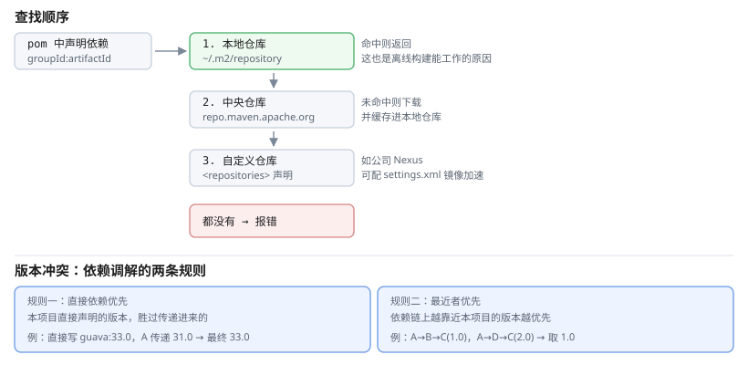
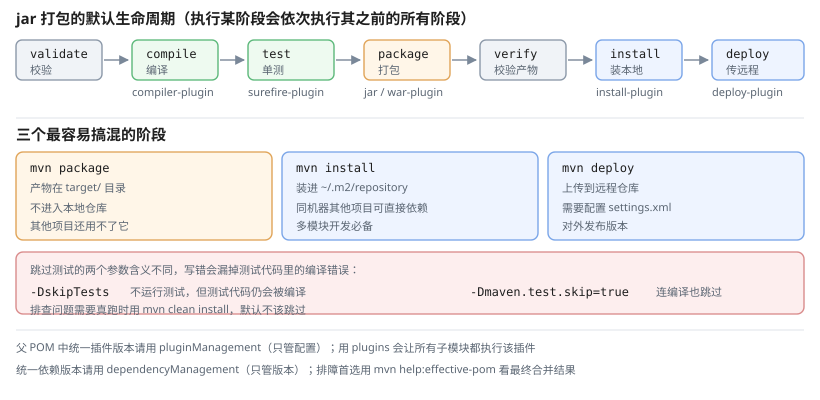

# 一、Maven 解决什么问题

手工管理依赖的问题：每个项目都要放一堆 jar、版本升级要逐个改、缺依赖时不知道该找哪个 jar。

Maven 的做法是**声明式**的——你在 `pom.xml` 里说明"我需要什么"，Maven 负责下载、传递依赖、处理版本冲突。

# 二、坐标与仓库

## (一) 坐标

每个构件由三个字段唯一标识：

```xml
<groupId>com.example</groupId>       <!-- 组织，通常是域名反写 -->
<artifactId>demo-service</artifactId> <!-- 模块名 -->
<version>1.0.0</version>              <!-- 版本 -->
```

简写形式：

```xml
<dependency>
    <groupId>org.slf4j</groupId>
    <artifactId>slf4j-api</artifactId>
    <version>2.0.13</version>
</dependency>
```

## (二) 仓库查找顺序



1. **本地仓库**（默认 `~/.m2/repository`）
2. **中央仓库**（`https://repo.maven.apache.org/maven2/`）
3. **`pom.xml` 中 `<repositories>` 声明的远程仓库**

下载的构件缓存在本地仓库，因此**离线也能构建**（前提是依赖已缓存）。

```bash
mvn dependency:tree        # 查看依赖树
```

# 三、pom.xml 结构

```xml
<?xml version="1.0" encoding="UTF-8"?>
<project xmlns="http://maven.apache.org/POM/4.0.0"
         xmlns:xsi="http://www.w3.org/2001/XMLSchema-instance"
         xsi:schemaLocation="http://maven.apache.org/POM/4.0.0
                             http://maven.apache.org/xsd/maven-4.0.0.xsd">

    <modelVersion>4.0.0</modelVersion>

    <groupId>com.example</groupId>
    <artifactId>demo</artifactId>
    <version>1.0.0</version>
    <packaging>jar</packaging>          <!-- jar / war / pom -->

    <properties>
        <maven.compiler.release>17</maven.compiler.release>
        <project.build.sourceEncoding>UTF-8</project.build.sourceEncoding>
        <slf4j.version>2.0.13</slf4j.version>
    </properties>

    <dependencies>
        <dependency>
            <groupId>org.slf4j</groupId>
            <artifactId>slf4j-api</artifactId>
            <version>${slf4j.version}</version>
        </dependency>
    </dependencies>

    <build>
        <plugins>
            <plugin>
                <groupId>org.apache.maven.plugins</groupId>
                <artifactId>maven-compiler-plugin</artifactId>
                <version>3.13.0</version>
                <!-- release 由上面的 maven.compiler.release 属性统一控制，此处不再重复 -->
            </plugin>
        </plugins>
    </build>
</project>
```

## (一) packaging 的含义

| 值 | 产物 | 说明 |
| --- | --- | --- |
| `jar` | `.jar` | 默认 |
| `war` | `.war` | Web 应用，需容器部署 |
| `pom` | 无 | 父 POM / 聚合工程 |

# 四、依赖管理

## (一) scope

```xml
<dependency>
    <groupId>junit</groupId>
    <artifactId>junit</artifactId>
    <version>4.13.2</version>
    <scope>test</scope>            <!-- 只在测试期可用，不会打进发布产物 -->
</dependency>
```

| scope | 编译 | 测试 | 运行 | 传递 |
| --- | --- | --- | --- | --- |
| `compile` | ✔ | ✔ | ✔ | ✔ |
| `provided` | ✔ | ✔ | — | ✘ |
| `runtime` | — | ✔ | ✔ | ✔ |
| `test` | — | ✔ | — | ✘ |
| `import` | 导入到 `dependencyManagement` | | | |

`provided` 常用于 Servlet API（由容器提供），`test` 用于测试框架，`import` 用于导入 BOM。

## (二) 传递依赖

A 依赖 B，B 依赖 C，那么声明 A 时 C 也会被引入。

```bash
mvn dependency:tree        # 查看完整的传递依赖链
mvn dependency:analyze     # 分析「声明未使用」与「使用未声明」
```

**注意**：`dependency:analyze` 报出的 "Used undeclared" 依赖不该随手添加——它可能只是编译期需要（如注解处理器），删掉反而构建失败。

## (三) 冲突解决：依赖调解

依赖调解的规则，按优先级：

1. **直接依赖优先**——项目里直接声明的版本，胜过传递来的
2. **最近者优先**——依赖链上越靠近本项目的版本越优先

两条规则冲突时第一条胜出。例如本项目声明 `guava:33.0`，A 依赖 `guava:31.0`，B 依赖 `guava:32.0`，最终用 **33.0**。

### dependencyManagement

**只声明版本，不引入依赖**——用于统一管理版本：

```xml
<dependencyManagement>
    <dependencies>
        <dependency>
            <groupId>com.google.guava</groupId>
            <artifactId>guava</artifactId>
            <version>33.0.0-jre</version>
        </dependency>
        <dependency>
            <groupId>org.slf4j</groupId>
            <artifactId>slf4j-api</artifactId>
            <version>${slf4j.version}</version>
        </dependency>
    </dependencies>
</dependencyManagement>
```

子模块写 `<dependency>` 时可以不写 `<version>`，版本从 `dependencyManagement` 取。**这才是版本统一管理的正解**——把所有版本声明放在一处，子模块只管用。

## (四) exclusions

排除不想引入的传递依赖——常见于解决日志冲突：

```xml
<dependency>
    <groupId>org.springframework.boot</groupId>
    <artifactId>spring-boot-starter-web</artifactId>
    <exclusions>
        <exclusion>
            <groupId>commons-logging</groupId>    <!-- 与 slf4j 冲突 -->
            <artifactId>commons-logging</artifactId>
        </exclusion>
    </exclusions>
</dependency>
```

## (五) BOM

`import` 方式引入一整组统一的版本：

```xml
<dependency>
    <groupId>org.junit</groupId>
    <artifactId>junit-bom</artifactId>
    <version>5.10.2</version>
    <type>pom</type>
    <scope>import</scope>
</dependency>
```

# 五、生命周期与插件

Maven 把构建过程划分为固定的**生命周期**阶段，每个阶段绑定若干插件目标。



默认生命周期（`jar` 打包）：

| 阶段 | 作用 | 常见插件 |
| --- | --- | --- |
| `validate` | 校验项目定义 | — |
| `compile` | 编译源码 | `maven-compiler-plugin` |
| `test` | 跑单元测试 | `maven-surefire-plugin` |
| `package` | 打包成 jar/war | `maven-jar-plugin` / `maven-war-plugin` |
| `verify` | 检查打包产物 | — |
| `install` | 装到**本地仓库** | `maven-install-plugin` |
| `deploy` | 部署到**远程仓库** | `maven-deploy-plugin` |

**关键区别**：`mvn package` 只打包到 `target/`，`mvn install` 会装进 `~/.m2/repository` 供其他项目使用。多模块项目中最后一个模块要发布时必须 `install`。

## (一) 常用命令

```bash
mvn clean package            # 清理 + 打包（最常用）
mvn -DskipTests package      # 跳过测试（注意是跳过运行，仍会编译测试代码）
mvn -Dmaven.test.skip=true package   # 连测试代码都不编译
mvn clean install -P prod   # 带 profile 构建
mvn help:effective-pom      # 看合并了父 POM 后的最终配置（排查问题必备）
mvn dependency:tree -Dverbose
mvn -U clean install        # -U 强制检查更新
```

# 六、多模块工程

父 POM 统一管理版本与插件，子模块只写业务：

```
parent/
├── pom.xml            packaging=pom
├── common/
│   ├── pom.xml        packaging=jar
│   └── src/
└── service/
    ├── pom.xml
    └── src/
```

父 POM：

```xml
<packaging>pom</packaging>
<modules>
    <module>common</module>
    <module>service</module>
</modules>

<dependencyManagement>
    <dependencies>
        <!-- 所有子模块共享的版本声明 -->
    </dependencies>
</dependencyManagement>

<build>
    <pluginManagement>
        <plugins>
            <plugin>
                <groupId>org.apache.maven.plugins</groupId>
                <artifactId>maven-compiler-plugin</artifactId>
                <version>3.13.0</version>
            </plugin>
        </plugins>
    </pluginManagement>
</build>
```

子模块：

```xml
<parent>
    <groupId>com.example</groupId>
    <artifactId>parent</artifactId>
    <version>1.0.0</version>
</parent>
<artifactId>service</artifactId>

<dependencies>
    <dependency>
        <groupId>com.example</groupId>
        <artifactId>common</artifactId>
        <!-- 不写 version，从父 POM 的 dependencyManagement 取 -->
    </dependency>
</dependencies>
```

## (一) pluginManagement 与 dependencies 的区别

| 标签 | 作用 |
| --- | --- |
| `dependencyManagement` | **只管版本**，不引入依赖 |
| `plugins` | 引入插件并生效 |
| `pluginManagement` | **只管插件版本与配置**，不引入插件 |

这是最常见的混淆点：父 POM 里若用 `plugins` 而非 `pluginManagement`，所有子模块都会执行该插件。

# 七、常见问题排查

| 现象 | 排查手段 |
| --- | --- |
| 依赖版本不对 | `mvn dependency:tree -Dverbose` 看冲突来源 |
| 配置不生效 | `mvn help:effective-pom` 看最终合并结果 |
| 构建太慢 | 首次构建要下依赖，用 `mvn -T 1C clean package` 并行构建 |
| 找不到类 | 确认 scope 正确（`test` 依赖不进运行时） |
| 相同类冲突 | `mvn dependency:tree \| grep 目标类` 找到多个来源 |

# 八、Maven 与 Gradle

| 维度 | Maven | Gradle |
| --- | --- | --- |
| 配置方式 | XML 声明 | Kotlin/Groovy DSL（编程语言） |
| 构建逻辑 | 固定生命周期 | 任意任务图 |
| 增量构建 | 支持有限 | **原生支持**，更快 |
| 学习成本 | 低，结构固定 | 较高，灵活但易写乱 |
| 配置缓存 | 弱 | 强 |

Maven 的优势在于**约定优于配置**：目录结构固定，几乎不用自己配置。新项目（尤其无 Kotlin DSL 历史包袱时）选 Maven 更稳；Gradle 适合需要复杂定制的大型项目。

# 九、参考资料

- [Maven 官方文档](https://maven.apache.org/guides/index.html) — POM 参考、生命周期、依赖机制的官方说明
- [Maven 依赖机制](https://maven.apache.org/guides/introduction/introduction-to-dependency-mechanism.html) — 传递依赖、依赖调解、作用域的完整规则
- [Maven 坐标与仓库](https://maven.apache.org/guides/introduction/introduction-to-repositories.html) — 仓库查找顺序与镜像配置
