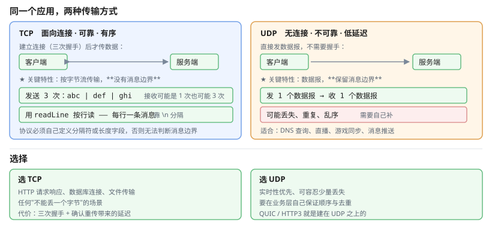

# 一、网络分层与两个协议

Java 的网络编程最终都落到两种传输协议上：

| 特性 | TCP | UDP |
| --- | --- | --- |
| 连接 | **面向连接**（三次握手） | 无连接 |
| 可靠性 | 可靠（确认、重传、排序） | **不可靠**，可能丢包乱序 |
| 顺序 | 保证 | 不保证 |
| 报文边界 | **字节流**，无边界 | **数据报**，保留边界 |
| 性能 | 有开销 | 快，延迟低 |
| 典型用途 | HTTP、数据库、文件传输 | DNS、直播、游戏、消息推送 |

**「字节流没有边界」是 TCP 编程最大的坑**：发送端分三次发 `abc`、`def`、`ghi`，接收端 `read()` 得到的可能是 `abcdefghi`，也可能是 `abcdef`、`ghi`，**完全不可预测**。所以协议必须自己定义分隔符或长度字段。

```java
// 错误：假设一次 read 能拿到一条完整消息
InputStream in = socket.getInputStream();
byte[] buf = new byte[1024];
int n = in.read(buf);
process(new String(buf, 0, n));    // ★可能只读到半条

// 正确：按分隔符累积，直到读到完整消息
BufferedReader reader = new BufferedReader(new InputStreamReader(in, UTF_8));
String line;
while ((line = reader.readLine()) != null) {
    process(line);                 // 一行一条消息
}
```



# 二、Socket 编程

## (一) 关键类

| 类 | 作用 |
| --- | --- |
| `Socket` | TCP 客户端 |
| `ServerSocket` | TCP 服务端，监听端口 |
| `DatagramSocket` | UDP 收发 |
| `DatagramPacket` | UDP 数据报 |
| `InetAddress` | IP 地址封装 |

## (二) 服务端

```java
// try-with-resources 的资源变量作用域仅限 try 块内，finally 里访问不到
try (ServerSocket server = new ServerSocket(8080)) {          // 绑定端口
    while (!server.isClosed()) {
        try (Socket client = server.accept()) {               // 阻塞等待连接
            client.setSoTimeout(30_000);                      // 读超时，防死等

            try (InputStream in = client.getInputStream();
                 OutputStream out = client.getOutputStream()) {

                BufferedReader reader = new BufferedReader(new InputStreamReader(in, UTF_8));
                PrintWriter writer = new PrintWriter(new OutputStreamWriter(out, UTF_8), true);

                String line = reader.readLine();
                writer.println(echo(line));
            }
        }
    }
}   // 关闭由 try-with-resources 自动完成，不再需要 finally
```

**必须设置 `setSoTimeout`**：否则客户端建立连接后不发数据，服务端线程会永久阻塞，一个连接就能耗尽整个线程池。

## (三) 客户端

```java
try (Socket socket = new Socket()) {
    socket.connect(new InetSocketAddress("example.com", 80), 5000);   // 连接超时
    socket.setSoTimeout(30_000);

    try (OutputStream out = socket.getOutputStream()) {
        out.write("GET / HTTP/1.1\r\nHost: example.com\r\n\r\n"
                .getBytes(StandardCharsets.UTF_8));
        out.flush();
    }
} catch (IOException e) {
    log.error("连接失败", e);
}
```

## (四) UDP

```java
// 发送
try (DatagramSocket socket = new DatagramSocket()) {
    byte[] data = "hello".getBytes(UTF_8);
    socket.send(new DatagramPacket(data, data.length,
            InetAddress.getByName("example.com"), 9999));
}

// 接收
try (DatagramSocket socket = new DatagramSocket(9999)) {
    byte[] buf = new byte[1024];
    DatagramPacket packet = new DatagramPacket(buf, buf.length);
    socket.receive(packet);                     // 阻塞
    String msg = new String(packet.getData(), 0, packet.getLength(), UTF_8);
}
```

## (五) 多线程处理连接

每来一个连接开一个线程是简单但不可扩展的做法：

```java
// 简单但每个连接占一个 OS 线程，连接数上千就撑不住
new Thread(() -> handle(socket)).start();

// 生产做法：固定线程池 + 连接处理任务
ExecutorService pool = Executors.newFixedThreadPool(50);
while (true) {
    Socket client = server.accept();
    pool.submit(() -> {
        try (client) { handle(client); }
        catch (IOException e) { log.error("处理连接失败", e); }
    });
}
```

# 三、HTTP 客户端

## (一) HttpClient

Java 11+ 提供了 `java.net.http.HttpClient`，它**支持 HTTP/2**并可复用连接池：

```java
HttpClient client = HttpClient.newBuilder()
        .version(HttpClient.Version.HTTP_2)
        .connectTimeout(Duration.ofSeconds(5))
        .followRedirects(HttpClient.Redirect.NORMAL)
        .build();

HttpRequest request = HttpRequest.newBuilder()
        .uri(URI.create("https://example.com/api/users"))
        .timeout(Duration.ofSeconds(10))
        .header("Content-Type", "application/json")
        .GET()
        .build();

HttpResponse<String> response = client.send(request, BodyHandlers.ofString());
System.out.println(response.statusCode());
System.out.println(response.body());
```

异步版本：

```java
CompletableFuture<HttpResponse<String>> future =
        client.sendAsync(request, BodyHandlers.ofString());
future.thenAccept(r -> log.info("状态 {}", r.statusCode()));
```

## (二) 老 API

```java
HttpURLConnection conn = (HttpURLConnection) new URL(url).openConnection();
conn.setRequestMethod("POST");
conn.setConnectTimeout(5000);
conn.setReadTimeout(10000);
conn.setRequestProperty("Content-Type", "application/json");
conn.setDoOutput(true);

try (OutputStream out = conn.getOutputStream()) {
    out.write(body.getBytes(UTF_8));
}

int code = conn.getResponseCode();
// code >= 400 时 getInputStream 会抛 IOException，要读 getErrorStream()
InputStream stream = code < 400 ? conn.getInputStream() : conn.getErrorStream();
String response = stream == null ? "" : new String(stream.readAllBytes(), UTF_8);
// stream 不为 null 时记得 close()
```

**注意 `getErrorStream`**：这是老 API 最常见的坑——4xx/5xx 时 `getInputStream()` 直接抛异常，错误信息要换用 `getErrorStream()` 才拿得到。而 **`getErrorStream()` 本身可能返回 `null`**（服务端没返回错误体时），所以不能无脑丢进 try-with-resources——对 `null` 调 `close()` 会抛 `NullPointerException`。

## (三) 调用第三方 API 的实践要点

```java
public class ApiClient {

    private static final HttpClient CLIENT = HttpClient.newBuilder()
            .connectTimeout(Duration.ofSeconds(5))
            .build();

    public static String get(String url, Map<String, String> headers) throws Exception {
        HttpRequest.Builder builder = HttpRequest.newBuilder()
                .uri(URI.create(url))
                .timeout(Duration.ofSeconds(15))
                .GET();
        headers.forEach(builder::header);

        HttpResponse<String> resp = CLIENT.send(builder.build(), BodyHandlers.ofString());
        if (resp.statusCode() / 100 != 2) {
            throw new ApiException("调用失败: " + resp.statusCode(), resp.body());
        }
        return resp.body();
    }
}
```

要点清单：

1. **`HttpClient` 复用**（做成静态），每次 new 会丢失连接池
2. **两个超时都要设**——连接超时和读超时缺一不可
3. **区分业务状态码**，别把异常吞掉
4. **加重试与退避**——只对 5xx 和网络错误重试，不要重试 4xx
5. **加熔断**——下游挂掉时快速失败，不要把线程池耗尽

# 四、JSON over HTTP 的常见约定

```java
record UserRequest(String name, String email, int age) { }
record ApiResponse<T>(int code, String message, T data) { }

// POST
String body = objectMapper.writeValueAsString(new UserRequest("Alice", "a@b.com", 30));
HttpRequest request = HttpRequest.newBuilder()
        .uri(URI.create("https://api.example.com/users"))
        .header("Content-Type", "application/json")
        .header("Authorization", "Bearer " + token)
        .POST(HttpRequest.BodyPublishers.ofString(body))
        .build();

HttpResponse<String> resp = client.send(request, BodyHandlers.ofString());
ApiResponse<UserRequest> result =
        objectMapper.readValue(resp.body(), new TypeReference<>() {});
```

**必须设置 `Content-Type: application/json`**，否则服务端可能按表单解析而报 415。

# 五、文件上传与下载

```java
// 下载：BodyHandlers.ofFile 直接落盘
HttpResponse<Path> resp = client.send(request, BodyHandlers.ofFile(Paths.get("a.zip")));

// 上传：ofFile 从文件读
HttpRequest upload = HttpRequest.newBuilder()
        .uri(URI.create("https://api.example.com/upload"))
        .header("Content-Type", "multipart/form-data; boundary=----X")
        .POST(HttpRequest.BodyPublishers.ofFile(Path.of("a.zip")))
        .build();
```

复杂表单（多文件 + 字段）用第三方库或手写 `multipart/form-data` 报文边界——注意边界字符串前后要有 `--`，且不能出现在内容里。

# 六、网络安全要点

```java
// 1. 证书校验：不要关
// 反例（绝对不要这样写）：
// TrustManager[] trustAll = ...   关闭校验等于关闭 TLS

// 2. 敏感信息不要放 URL query
// GET /api/pay?cardNo=123456  → 会进服务器日志、浏览器历史、代理缓存

// 3. 请求签名防重放
String nonce = UUID.randomUUID().toString();      // 或 SecureRandom
long ts = System.currentTimeMillis();
String sign = hmac(secret, appId + nonce + ts + body);
headers.put("X-Nonce", nonce);
headers.put("X-Timestamp", String.valueOf(ts));
headers.put("X-Sign", sign);
```

签名类接口应当让服务端校验**时间戳有效期**（防重放）和 **nonce 去重**。

# 七、资源管理与常见坑

| 坑 | 说明 |
| --- | --- |
| 不设 `soTimeout` | 恶意/异常客户端能让线程永久阻塞 |
| 不关连接 | 连接池耗尽，最终无法建立新连接 |
| `HttpURLConnection` 4xx 读 `getInputStream` | 抛异常，要改用 `getErrorStream` |
| 每次 new `HttpClient` | 连接池失效，性能崩塌 |
| 响应体不关闭 | 底层连接无法归还连接池 |
| 不区分 4xx 与 5xx 重试 | 4xx 是客户端问题，重试没有意义 |

# 八、参考资料

- [Java SE 22 API 文档](https://docs.oracle.com/en/java/javase/22/docs/api/) — `java.net.http`、`java.net.Socket`、`DatagramSocket` 的完整契约
- [Java 官方教程：网络](https://docs.oracle.com/javase/tutorial/networking/index.html) — Socket、URL 连接、HTTP 的官方说明
- [Java 官方教程：URL 连接](https://docs.oracle.com/javase/tutorial/networking/readingWriting.html) — `HttpURLConnection` 用法与异常处理细节
