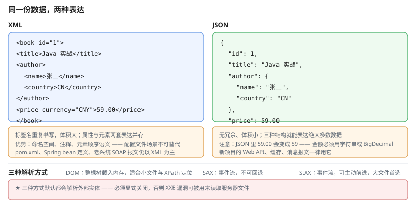

# 一、XML 与 JSON 怎么选

| 维度 | XML | JSON |
| --- | --- | --- |
| 表达力 | 强：标签、属性、命名空间 | 弱：只有对象 / 数组 / 标量 |
| 可读性 | 一般，冗长 | 好，紧凑 |
| 体积 | 大 | 小 |
| 解析性能 | 较慢 | 快 |
| 生态 | 成熟稳定 | 更主流 |
| 典型用途 | 配置、文档、SOAP、企业间报文 | Web API、缓存、消息队列、日志 |

**新项目默认用 JSON**。XML 主要在两类场景保留：一是与老系统对接（大量 SOAP / 遗留 XML），二是需要注释、命名空间、元素顺序语义的配置文件（如 Maven 的 `pom.xml`、Spring 的 bean 定义）。



# 二、XML 解析

Java 有三种解析方式，区别在于**内存占用**与**编程模型**：

| 方式 | 模型 | 内存 | 适合 |
| --- | --- | --- | --- |
| **DOM** | 整棵树载入内存 | 高 | 小文件、需要随机访问 |
| **SAX** | 事件流，逐个回调 | 低 | 大文件、只顺序读取 |
| **StAX** | 事件流，可主动 `next()` | 低 | 大文件、需要控制节奏 |

## (一) DOM

```java
DocumentBuilderFactory factory = DocumentBuilderFactory.newInstance();

// ★必须关闭外部实体，否则存在 XXE 漏洞
factory.setFeature("http://apache.org/xml/features/disallow-doctype-decl", true);
factory.setFeature("http://xml.org/sax/features/external-general-entities", false);
factory.setFeature("http://xml.org/sax/features/external-parameter-entities", false);
factory.setXIncludeAware(false);
factory.setExpandEntityReferences(false);

Document doc = factory.newDocumentBuilder().parse(new File("data.xml"));

Element root = doc.getDocumentElement();
root.getAttribute("version");
root.getElementsByTagName("item").item(0).getTextContent();
```

DOM 的优势是可以**用 XPath 精确定位**：

```java
XPath xpath = XPathFactory.newInstance().newXPath();
NodeList nodes = (NodeList) xpath.evaluate(
        "//book[price<50]/title", doc, XPathConstants.NODESET);
```

## (二) SAX

推模型，读到节点就回调：

```java
class BookHandler extends DefaultHandler {
    private StringBuilder text = new StringBuilder();
    private boolean inTitle;

    @Override
    public void startElement(String uri, String local, String qName, Attributes attrs) {
        if ("title".equals(qName)) { inTitle = true; text.setLength(0); }
    }

    @Override
    public void characters(char[] ch, int start, int length) {
        if (inTitle) { text.append(ch, start, length); }
    }

    @Override
    public void endElement(String uri, String local, String qName) {
        if ("title".equals(qName)) {
            System.out.println("书名: " + text);
            inTitle = false;
        }
    }
}

SAXParserFactory.newInstance().newSAXParser()
        .parse(new File("data.xml"), new BookHandler());
```

SAX 的问题是**只能顺序前进**，想回头看某个元素做不到，需要自己缓存。

## (三) StAX

流式但可主动控制，通常是三者中最实用的：

```java
XMLInputFactory factory = XMLInputFactory.newInstance();
factory.setProperty(XMLInputFactory.SUPPORT_DTD, false);
factory.setProperty(XMLInputFactory.IS_SUPPORTING_EXTERNAL_ENTITIES, false);

XMLStreamReader reader = factory.createXMLStreamReader(new FileInputStream("data.xml"));
while (reader.hasNext()) {
    if (reader.next() == XMLStreamConstants.START_ELEMENT
            && "title".equals(reader.getLocalName())) {
        System.out.println(reader.getElementText());
    }
}
reader.close();
```

## (四) XXE 防护

**这是 XML 解析最严重的安全问题**：默认配置下，解析器会读取文档中声明的外部实体，攻击者借此读取服务器文件或发起内网请求（SSRF）。

```java
// 最简防护：只要禁止 DOCTYPE 声明，XXE 就无从下手
DocumentBuilderFactory factory = DocumentBuilderFactory.newInstance();
factory.setFeature("http://apache.org/xml/features/disallow-doctype-decl", true);

// 恶意 XML：
// <!DOCTYPE foo [ <!ENTITY xxe SYSTEM "file:///etc/passwd"> ]>
// <root>&xxe;</root>
```

只要禁止 DOCTYPE 声明，XXE 就无从下手。

## (五) JAXB

把 XML 直接映射成对象（Java 8 内置，Java 11+ 需单独加依赖）：

```java
@XmlRootElement(name = "book")
public class Book {
    @XmlAttribute
    private String id;

    @XmlElement
    private String title;

    @XmlElement
    private double price;
    // getter / setter
}

JAXBContext context = JAXBContext.newInstance(Book.class);
Unmarshaller unmarshaller = context.createUnmarshaller();
Book book = (Book) unmarshaller.unmarshal(new File("book.xml"));
```

# 三、JSON 解析

Java 标准库**没有 JSON API**，需用第三方库。**Jackson 是事实标准**。

## (一) 基本用法

```java
ObjectMapper mapper = new ObjectMapper();

// 序列化
String json = mapper.writeValueAsString(new User("Alice", 30));

// 反序列化
User user = mapper.readValue(json, User.class);

// 泛型集合
List<User> users = mapper.readValue(jsonArray, new TypeReference<List<User>>() {});
Map<String, User> map = mapper.readValue(json, new TypeReference<>() {});
```

**`ObjectMapper` 应复用**（做成静态字段），它内部有缓存且线程安全，每次 new 会丢失缓存并增加开销。

## (二) 与 Java 对象互转

```java
public class User {
    public String userName;              // 公共字段也能序列化
    private String email;

    @JsonProperty("user_name")          // 改字段名
    private String name;

    @JsonIgnore                            // 忽略该字段
    private String password;

    @JsonFormat(pattern = "yyyy-MM-dd HH:mm:ss", timezone = "GMT+8")
    private LocalDateTime createdAt;

    @JsonInclude(JsonInclude.Include.NON_NULL)   // 不输出 null
    private String remark;

    public String getEmail() { return email; }
}
```

**`password` 一定要 `@JsonIgnore`**，否则会被日志、接口响应、监控上报泄露。

## (三) 未知字段与反序列化安全

```java
mapper.configure(DeserializationFeature.FAIL_ON_UNKNOWN_PROPERTIES, false);
```

默认 Jackson 遇到未知字段会抛异常。设为 `false` 后可容忍服务端新增字段，接口向前兼容。

## (四) 多态序列化

```java
// 父类
@JsonTypeInfo(use = JsonTypeInfo.Id.NAME, include = JsonTypeInfo.As.PROPERTY, property = "type")
@JsonSubTypes({
    @JsonSubTypes.Type(value = Cat.class, name = "cat"),
    @JsonSubTypes.Type(value = Dog.class, name = "dog")
})
public abstract class Animal { }
```

序列化结果：

```json
{ "type": "cat", "name": "旺财" }
```

不带 `@JsonTypeInfo` 的话，反序列化到 `Animal` 这样的抽象类型时 Jackson 无法确定要实例化哪个子类，会直接抛 `InvalidDefinitionException`（而不是"悄悄构造出父类、子类字段丢失"）。

## (五) 自定义序列化

```java
public class MoneySerializer extends JsonSerializer<BigDecimal> {
    @Override
    public void serialize(BigDecimal value, JsonGenerator gen, SerializerProvider s)
            throws IOException {
        gen.writeString(value.setScale(2, RoundingMode.HALF_UP).toPlainString());
    }
}

public class MoneyDeserializer extends JsonDeserializer<BigDecimal> {
    @Override
    public BigDecimal deserialize(JsonParser p, DeserializationContext ctx)
            throws IOException {
        return new BigDecimal(p.getText()).setScale(2, RoundingMode.HALF_UP);
    }
}

@JsonSerialize(using = MoneySerializer.class)
@JsonDeserialize(using = MoneyDeserializer.class)
private BigDecimal amount;
```

## (六) 金额必须用 BigDecimal

```java
// 反例：金额用 double，0.1 + 0.2 != 0.3
private double amount;

// 反例：金额用 float 更糟
private float amount;

// 正解
private BigDecimal amount = new BigDecimal("0.30");   // ★必须用字符串构造
```

`new BigDecimal(0.1)` 会把 double 的二进制误差**固化**进去。JSON 解析金额务必配置 `USE_BIG_DECIMAL_FOR_FLOATS`。

```java
mapper.enable(DeserializationFeature.USE_BIG_DECIMAL_FOR_FLOATS);
```

## (七) Java 8+ 的日期处理

```java
mapper.registerModule(new JavaTimeModule());
mapper.disable(SerializationFeature.WRITE_DATES_AS_TIMESTAMPS);
mapper.setDateFormat(new StdDateFormat());        // ISO-8601
```

不注册 `JavaTimeModule` 的话，Jackson 会把 `LocalDateTime` 当成普通 bean，序列化成**含字段名的对象**（`{"year":2026,"monthValue":10,"dayOfMonth":13,...}`）——可读性极差，还泄露了内部结构。

# 四、常见陷阱

| 陷阱 | 后果 | 正解 |
| --- | --- | --- |
| XML 未防 XXE | 服务器文件被读取 | `disallow-doctype-decl` |
| Jackson 用 `double` 存金额 | 对账差一分钱 | `BigDecimal` + 字符串构造 |
| 忘记 `@JsonIgnore` 密码 | 凭据泄露 | 标注忽略 |
| 每次 new `ObjectMapper` | 缓存失效、性能下降 | 静态复用 |
| 未注册 `JavaTimeModule` | 时间被序列化成含字段名的对象 | 注册模块 |
| `double` 存大整数 ID | 超过 2^53 的末位丢失 | 用 `long` 或 `String` |
| 字符串拼接拼 JSON | 转义错误、手工引号易漏 | 用序列化器 |
| XML 未指定编码 | 中文乱码 | `new String(bytes, UTF_8)` |

## (一) 大整数精度

```json
{ "id": 9007199254740993 }
```

这个数超过了 `double` 能精确表示的范围（2^53 ≈ 9.007×10^15）。**精度丢失的前提是目标类型是浮点**：

```java
// 反例：字段声明成 double，末位被抹掉
class Order { public double id; }        // 得到 9.007199254740992E15

// 正解：用 long 或 String
class Order2 { public long id; }          // 9007199254740993，一位不丢
class Order3 { public String id; }        // 字符串原样保留
```

顺带澄清一个常见误解：用 `Map<String, Object>`（无类型）反序列化时，Jackson 会按 `Integer → Long → BigInteger` 逐级尝试，**大整数不会丢精度**；会丢的是**浮点字段**。雪花 ID 这类场景的真正风险在于字段被声明成了 `double`/`Double`。

# 五、参考资料

- [Java SE 22 API 文档](https://docs.oracle.com/en/java/javase/22/docs/api/) — `javax.xml.parsers`、`java.io` 等的完整契约；注意标准库不含 JSON API
- [Java 官方教程：XML 处理](https://docs.oracle.com/javase/tutorial/xml/) — DOM、SAX、StAX、XSLT 的官方说明
- [Jackson 官方文档](https://github.com/FasterXML/jackson-databind) — 注解用法、多态序列化、模块配置的参考
- [OWASP：XML 外部实体防护](https://cheatsheetseries.owasp.org/cheatsheets/XML_External_Entity_Prevention_Cheat_Sheet.html) — XXE 的成因与各语言防护配置
