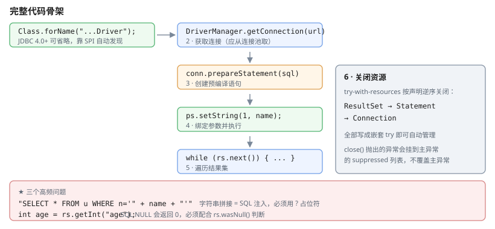
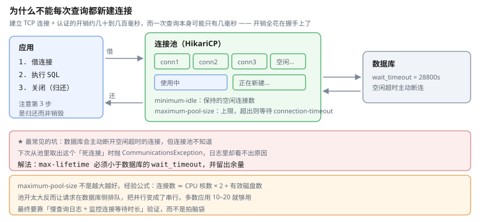
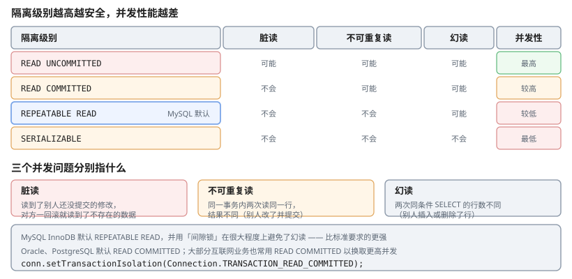

# 一、JDBC 是什么

JDBC（Java Database Connectivity）是 Java 访问关系型数据库的**标准 API**，它本身不实现任何数据库功能，而是通过 JDBC 驱动把调用转成数据库方言。

```text
应用代码 → JDBC API → JDBC 驱动（jar）→ 数据库
```

各数据库厂商提供自己的驱动 jar，加进 classpath 即可，这是「写一次、跑在任何库上」的基础。

# 二、六步流程



```java
// 1. 加载驱动（JDBC 4.0+ 可省略，会用 SPI 自动发现）
Class.forName("com.mysql.cj.jdbc.Driver");

// 2. 获取连接
String url = "jdbc:mysql://localhost:3306/demo"
           + "?useSSL=true&characterEncoding=UTF-8&serverTimezone=Asia/Shanghai";
try (Connection conn = DriverManager.getConnection(url, "root", "password")) {

    // 3. 创建语句
    try (PreparedStatement ps = conn.prepareStatement(
            "SELECT id, name, age FROM users WHERE age > ?")) {

        // 4. 设置参数并执行
        ps.setInt(1, 18);
        try (ResultSet rs = ps.executeQuery()) {

            // 5. 处理结果
            while (rs.next()) {
                User u = new User(rs.getInt("id"), rs.getString("name"), rs.getInt("age"));
                System.out.println(u);
            }
        }
    }
}   // 6. try-with-resources 自动关闭
```

## (一) URL 格式

```
jdbc:mysql://localhost:3306/demo?useSSL=true&characterEncoding=UTF-8
  ↑协议  ↑数据库类型 ↑主机 : 端口 / 数据库名  ↑参数
```

关键参数：`useSSL`（是否加密传输）、`characterEncoding`（**不设会导致中文乱码**）、`serverTimezone`（**不设会报时区异常**）、`allowPublicKeyRetrieval`（MySQL 8 认证相关）。

## (二) 结果集读取的坑

```java
rs.getInt("age");        // 按列名
rs.getInt(3);            // 按列序号（1 开始）

int age = rs.getInt("age");
boolean isNull = rs.wasNull();      // ★getXxx 对 NULL 返回 0，不是抛异常
```

**`getInt` 遇到 SQL `NULL` 返回 0**，必须用 `rs.wasNull()` 判断，否则"年龄未知"和"年龄为 0"无法区分。

# 三、连接池

## (一) 为什么需要

数据库建立 TCP 连接 + 认证的开销约在**几十到几百毫秒**，而查询本身可能只有几毫秒。每次查询都新建连接的代价远大于查询本身。

连接池的思路是：**预先建立一批连接，用完归还，而不是关闭**。



## (二) HikariCP 配置

HikariCP 是目前性能最好的连接池（Spring Boot 默认）。

```yaml
spring:
  datasource:
    url: jdbc:mysql://localhost:3306/demo?useSSL=true&characterEncoding=UTF-8
    username: root
    password: ${DB_PASSWORD}
    driver-class-name: com.mysql.cj.jdbc.Driver
    hikari:
      minimum-idle: 10             # 最小空闲连接
      maximum-pool-size: 20        # 最大连接
      connection-timeout: 30000    # 获取连接的等待超时（ms）
      idle-timeout: 600000         # 空闲连接存活时间（ms）
      max-lifetime: 1800000        # 连接最大存活时间（ms），应小于数据库的 wait_timeout
      connection-test-query: SELECT 1
```

**`maximum-pool-size` 不是越大越好**。经验公式：

```text
连接数 ≈ CPU 核数 × 2 + 有效磁盘数
```

数据库能同时处理的连接数有限，池开太大反而导致请求排队。多数应用的 10–20 就够用。

## (三) `max-lifetime` 的坑

数据库（尤其 MySQL）会主动断开空闲超过 `wait_timeout` 的连接，但**连接池不知道**，下次从池里取出这个"死连接"时就会抛 `CommunicationsException`。

```text
max-lifetime 必须 < 数据库的 wait_timeout
```

留出余量（MySQL 默认 `wait_timeout` 是 28800 秒，池的 `max-lifetime` 设 1800000 ms = 30 分钟是安全的）。

# 四、SQL 注入与 PreparedStatement

## (一) 原理

```java
// 危险：字符串拼接
String sql = "SELECT * FROM users WHERE name = '" + name + "'";
```

当 `name` 为 `' OR '1'='1` 时，SQL 变成：

```sql
SELECT * FROM users WHERE name = '' OR '1'='1'
```

条件恒真，返回全部数据。

## (二) 正确做法

```java
String sql = "SELECT id, name FROM users WHERE name = ? AND age > ?";
try (PreparedStatement ps = conn.prepareStatement(sql)) {
    ps.setString(1, name);
    ps.setInt(2, 18);
    try (ResultSet rs = ps.executeQuery()) { /* … */ }
}
```

`PreparedStatement` 有两个层面的好处：

1. **安全**——参数以值的形式传递，不参与 SQL 语法解析，无法改变语句结构
2. **性能**——SQL 文本被预编译，执行计划可复用，批量插入时提升明显

## (三) 批处理

```java
String sql = "INSERT INTO users (name, age) VALUES (?, ?)";
try (PreparedStatement ps = conn.prepareStatement(sql)) {
    for (User u : users) {
        ps.setString(1, u.getName());
        ps.setInt(2, u.getAge());
        ps.addBatch();
    }
    int[] results = ps.executeBatch();      // 一次发送
}
```

逐条 `executeUpdate()` 与 `executeBatch()` 的差距通常在**十倍以上**。

## (四) 参数设置与类型

```java
ps.setString(1, "Alice");
ps.setInt(1, 30);
ps.setNull(1, Types.INTEGER);
ps.setObject(1, uuid);                    // 通用
ps.setBigDecimal(1, new BigDecimal("59.00"));

ps.clearParameters();                     // 清空参数（复用同一个 ps 时）
```

**`wasNull()` 必须紧跟在 `getXxx()` 后面**，中间任何一次取数都会让判断失效：

```java
int age = rs.getInt("age");
boolean ageIsNull = rs.wasNull();     // ★紧接着调用才有效

rs.getString("name");                 // ← 插在中间后，上面的结果就作废了
boolean stillNull = rs.wasNull();     // 这是在判断 name，不是 age
```

顺带澄清一个常见误解：**`setXxx(i, null)` 按 JDBC 规范就是写入 SQL NULL**（`setString(i, null)` 等价于 `setNull(i, Types.VARCHAR)`），不会把字符串 `"null"` 存进去。真正要小心的是业务代码里传了字符串字面量 `"null"`。

# 五、事务

## (一) 手动控制

```java
conn.setAutoCommit(false);            // 关闭自动提交

try {
    // 多条操作
    ps1.executeUpdate();
    ps2.executeUpdate();
    conn.commit();                    // 全部成功才提交
} catch (SQLException | RuntimeException e) {   // ★运行时异常也必须回滚
    conn.rollback();
    throw e;
} finally {
    conn.setAutoCommit(true);
}
```

**为什么连 `RuntimeException` 都要 catch**：若只捕 `SQLException`，业务代码抛出的 `NullPointerException` 会跳过 `rollback()`，而 `finally` 里的 `setAutoCommit(true)` 会让驱动把**未提交的事务直接提交**——半成品数据落库。

## (二) 隔离级别

SQL 标准定义了四种隔离级别，隔离性越高越安全，但并发性能越差。



| 级别 | 脏读 | 不可重复读 | 幻读 |
| --- | --- | --- | --- |
| `READ UNCOMMITTED` | ✔ 可能 | ✔ 可能 | ✔ 可能 |
| `READ COMMITTED` | ✘ | ✔ 可能 | ✔ 可能 |
| `REPEATABLE READ` | ✘ | ✘ | ✔ 可能 |
| `SERIALIZABLE` | ✘ | ✘ | ✘ |

三个并发问题的含义：

- **脏读**：读到了别的**还没提交**的修改，事务一回滚就读到了不存在的数据
- **不可重复读**：同一事务内两次读同一行，结果不同（别人提交了修改）
- **幻读**：同一事务内两次 `SELECT ... WHERE` 条件查询，行数不同（别人插入/删除了行）

MySQL InnoDB 默认 `REPEATABLE READ`，**并且用间隙锁在很大程度上避免了幻读**——这也是为什么 MySQL 的默认隔离级别比标准要求更强。Oracle、PostgreSQL 默认 `READ COMMITTED`。

```java
conn.setTransactionIsolation(Connection.TRANSACTION_READ_COMMITTED);
```

## (三) 生产要求

```java
// ★ 隔离级别必须先设：setTransactionIsolation 只对【后续】事务生效
conn.setTransactionIsolation(Connection.TRANSACTION_READ_COMMITTED);
conn.setAutoCommit(false);

try {
    doBusiness(conn);
    conn.commit();
} catch (SQLException | RuntimeException e) {
    try { conn.rollback(); }
    catch (SQLException re) { e.addSuppressed(re); }   // 回滚失败也要留痕
    throw e;
}
```

三个要点：异常必须回滚（包括**运行时异常**，不只是 `SQLException`）；隔离级别要在**开启事务之前**设置（`setAutoCommit(false)` 一执行事务就开了，再设只对下一个事务生效）；回滚失败时的异常不要吞掉。

# 六、生成键与批量插入回填

需要拿到数据库自增主键时：

```java
String sql = "INSERT INTO users (name, age) VALUES (?, ?)";
try (PreparedStatement ps = conn.prepareStatement(sql, Statement.RETURN_GENERATED_KEYS)) {
    ps.setString(1, "Alice");
    ps.setInt(2, 30);
    ps.executeUpdate();

    try (ResultSet keys = ps.getGeneratedKeys()) {
        if (keys.next()) {
            long newId = keys.getLong(1);
        }
    }
}
```

## (一) 批量插入回填的两种方式

**方式一：逐条插入再回填**——简单但慢。

**方式二：批量插入后按条件查回**：

```java
String sql = "INSERT INTO users (name, age) VALUES (?, ?)";
try (PreparedStatement ps = conn.prepareStatement(sql, Statement.RETURN_GENERATED_KEYS)) {
    for (User u : users) {
        ps.setString(1, u.getName());
        ps.setInt(2, u.getAge());
        ps.addBatch();
    }
    ps.executeBatch();

    // keys.getInt() 是数据库生成的自增主键，不是列表下标 —— 必须用独立的计数器配对
    int i = 0;
    try (ResultSet keys = ps.getGeneratedKeys()) {
        while (keys.next()) {
            users.get(i++).setId(keys.getLong(1));   // ★按 addBatch 的顺序配对
        }
    }
}
```

注意 `addBatch` 的顺序必须与 `getGeneratedKeys` 的返回顺序一致——**不是所有驱动都保证这点**，实际项目里更稳妥的做法是用业务唯一键回查：

```java
// 更稳：批量插入后按业务唯一键一次性回查
Map<String, Long> idByBizNo = new HashMap<>();
for (User u : users) {
    idByBizNo.put(u.getBizNo(), repo.findIdByBizNo(u.getBizNo()));
}
```

# 七、其他要点

## (一) 元数据

```java
DatabaseMetaData meta = conn.getMetaData();
meta.getDatabaseProductName();        // "MySQL"
meta.getDatabaseProductVersion();
meta.getDriverVersion();

ResultSet tables = meta.getTables(null, null, "%", null);
```

## (二) 大字段与大查询

```java
// 大字段不要用 ResultSet 一次读完
ps.setFetchSize(500);                       // 分批抓取
ps.setFetchMode(ResultSet.FETCH_FORWARD);

// 只查需要的列，不要 SELECT *
```

## (三) 资源关闭顺序

`ResultSet` → `Statement` → `Connection`，从内到外：

```java
try (Connection conn = ...) {
    try (PreparedStatement ps = ...) {
        try (ResultSet rs = ...) {
            // 使用
        }
    }
}
```

try-with-resources 会自动按**声明的逆序**关闭。

# 八、JDBC 与 ORM 之间

JDBC 是所有 ORM 的基础——MyBatis、Hibernate、JPA 最终都生成 JDBC 代码。理解 JDBC 才能看懂 ORM 的：

- 为什么有「N+1 查询」问题（一条关联查询被拆成多次）
- 为什么要有**一级缓存**（Hibernate Session）与**二级缓存**
- 为什么批量插入要用 `addBatch`（底层还是 JDBC 批处理）
- 事务边界为什么由框架控制

**建议**：新项目直接用 JPA / MyBatis-Plus，但必须能手写一段原生 JDBC 排查问题——连接问题、慢查询定位、ORM 生成的 SQL，这些最终都要回到这一层。

# 九、参考资料

- [Java SE 22 API 文档](https://docs.oracle.com/en/java/javase/22/docs/api/) — `java.sql` 包的完整 API，含 `Connection`、`PreparedStatement`、`TransactionIsolation` 的契约
- [Java 官方教程：JDBC](https://docs.oracle.com/javase/tutorial/jdbc/) — 数据库连接、语句与结果集处理的官方说明
- [MySQL 事务隔离级别](https://dev.mysql.com/doc/refman/8.0/en/transaction-isolation-levels.html) — InnoDB 隔离级别与间隙锁的官方说明
