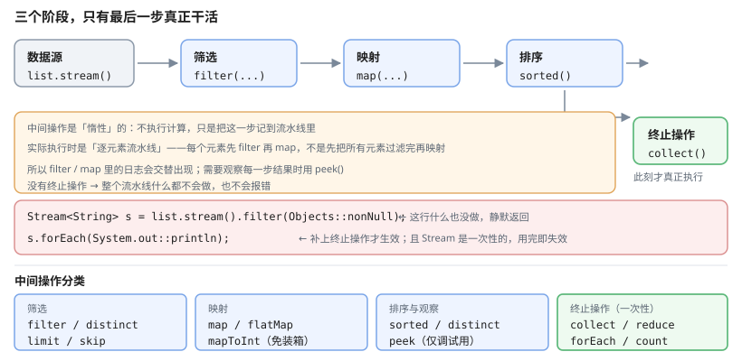

# 一、Lambda 表达式

Lambda 是**函数式接口**（只有一个抽象方法的接口）的实例化写法：

```java
Comparator<String> c = (a, b) -> a.compareTo(b);
Runnable r = () -> System.out.println("hi");
Function<String, Integer> f = s -> s.length();
BiFunction<String, String, String> g = (a, b) -> a + b;
```

`(a, b) ->` 是**参数列表**，`->` 后是**表达式体**。参数类型可省略（编译器推断），单参数时括号可省略。

## (一) 函数式接口

JDK 内置四个核心接口在 `java.util.function` 下：

| 接口 | 签名 | 用途 |
| --- | --- | --- |
| `Function<T, R>` | `R apply(T)` | 转换 |
| `Consumer<T>` | `void accept(T)` | 消费 |
| `Supplier<T>` | `T get()` | 生产 |
| `Predicate<T>` | `boolean test(T)` | 判断 |

派生接口：

```java
UnaryOperator<T>  extends Function<T, T>          // 一元运算
BinaryOperator<T> extends BiFunction<T, T, T>     // 二元运算
```

## (二) 方法引用

方法引用是 Lambda 的紧凑写法，四种形式：

```java
// 1. 静态方法
Function<String, Integer> f1 = Integer::parseInt;

// 2. 特定对象的实例方法
Function<String, Integer> f2 = "hello"::length;

// 3. 任意对象的实例方法（第一个参数作为接收者）
Function<String, Integer> f3 = String::length;

// 4. 构造器引用
Supplier<ArrayList<String>> s = ArrayList::new;                       // 无参构造
Function<Integer, List<String>> f4 = ArrayList::new;                 // 带参构造（initialCapacity）
Function<Integer, List<String>> f5 = ArrayList::new;
```

第三种最容易看错：

```java
list.forEach(String::length);      // 等价于 s -> s.length()
list.forEach(s -> s.length());
```

# 二、Optional

`Optional<T>` 用来表达"**可能没有值**"，避免到处 `null` 检查。

```java
Optional<String> name = Optional.of("Alice");          // 不允许 null
Optional<String> empty = Optional.empty();
Optional<String> maybe = Optional.ofNullable(getName()); // 允许 null

// 消费方式（优先用这几个，别直接 get）
String v = name.orElse("默认值");
String v2 = name.orElseGet(() -> computeDefault());     // 默认值计算量大时用这个
name.ifPresent(n -> System.out.println(n));
name.map(String::toUpperCase).ifPresent(System.out::println);
```

## (一) 常见误用

```java
// 不好：Optional 不该用作方法参数或字段
void process(Optional<String> name) { }        // 反模式
class User { private Optional<String> nick; }   // 反模式

// 不好：isPresent + get 是啰嗦的 null 检查
if (name.isPresent()) { use(name.get()); }      // 等价于 name != null

// 不好：用 Optional 到处包
Optional<Optional<User>> ...
```

**准则**：`Optional` 主要用作**返回值**，用于表达"查不到会返回 null"的方法，比返回 null 更能表达意图。字段和方法参数上不要用（序列化会出问题，Jackson 也支持不佳）。

## (二) orElse 与 orElseGet 的区别

```java
// orElse 的参数总会被求值（即使 Optional 有值）
Optional.of("value").orElse(expensiveCall());        // ★昂贵调用照样执行

// orElseGet 只在为空时才调用
Optional.of("value").orElseGet(() -> expensiveCall());
```

这是常见的性能陷阱。

# 三、Stream

`Stream` 是对集合的**函数式操作流水线**，包含三个阶段：



1. **创建（Source）** — 从集合、数组、`Stream.of()`、`Files.lines()` 得到
2. **中间操作（Intermediate）** — 惰性，返回新 Stream
3. **终止操作（Terminal）** — 触发实际计算，返回非 Stream 结果

## (一) 中间操作分类

**筛选：**

```java
filter(s -> s.length() > 3)
distinct()
limit(10)
skip(5)
takeWhile(s -> s.length() > 0)      // Java 9+
dropWhile(s -> s.length() > 0)      // Java 9+
```

**映射：**

```java
map(s -> s.length())                // 一对一
flatMap(List::stream)               // 展平：Stream<List<T>> → Stream<T>
mapToInt(String::length)            // 返回基本类型流，避免装箱
mapToObj(i -> "item" + i)           // 形参是 IntFunction（接收一个 int），不是无参方法
Stream.of(arr).boxed()              // IntStream → Stream<Integer>，这里才用 boxed()
```

**排序与聚合：**

```java
sorted()                            // 按自然序（元素需 Comparable）
sorted(Comparator.reverseOrder())
peek(System.out::println)           // 仅调试，终结操作前必须存在终结操作
```

## (二) 惰性求值

**中间操作不执行任何计算，只记录到流水线里**，直到遇到终止操作才一次性执行：

```java
List<String> result = list.stream()
        .filter(s -> { System.out.println("filter: " + s); return true; })
        .map(s -> { System.out.println("map: " + s); return s; })
        .toList();
```

`filter` 和 `map` 的日志**交替出现**（每元素先过滤后映射），不是"全部过滤完再全部映射"。

这也意味着：**没有终止操作，流水线什么都不会做**：

```java
// 反例：什么都不会发生，也没有错误
Stream<String> s = list.stream().filter(x -> x != null);
```

## (三) 终止操作

```java
collect(Collectors.toList())
forEach(System.out::println)
reduce(0, Integer::sum)
count()
anyMatch(s -> s.isEmpty())
allMatch(Predicate)
noneMatch(Predicate)
findFirst()
findAny()
min(Comparator)
max(Comparator)
toList()                            // Java 16+，返回不可变列表
```

## (四) Collectors

```java
// 分组
Map<Dept, List<User>> byDept = users.stream()
        .collect(Collectors.groupingBy(User::getDept));

// 分组并聚合
Map<Dept, Double> salarySum = users.stream()
        .collect(Collectors.groupingBy(User::getDept,
                Collectors.summingDouble(User::getSalary)));

// 统计（key 是 Dept 对象，要用它去 get，不能传字符串）
Map<Dept, DoubleSummaryStatistics> stats = users.stream()
        .collect(Collectors.groupingBy(User::getDept,
                Collectors.summarizingDouble(User::getSalary)));
stats.get(TECH_DEPT).getAverage();

// 映射 value
Map<String, Integer> nameToAge = users.stream()
        .collect(Collectors.toMap(User::getName, User::getAge));

// key 重复时保留第一个
Map<String, User> map = users.stream()
        .collect(Collectors.toMap(User::getName, Function.identity(),
                (a, b) -> a));

// 按 key 排序：想排序就得让 Dept 可比较，并指定 TreeMap 作为 mapFactory
TreeMap<Dept, List<User>> sorted = users.stream()
        .collect(Collectors.groupingBy(User::getDept, TreeMap::new, Collectors.toList()));

// joining
String s = users.stream().map(User::getName).collect(Collectors.joining(", ", "[", "]"));
```

# 四、并行流

```java
list.parallelStream()
    .map(heavyComputation)
    .collect(Collectors.toList());
```

并行流用**公共的 `ForkJoinPool.commonPool()`**，默认并行度是 `CPU核数 - 1`。

## (一) 并行流的四个陷阱

**陷阱一：无状态要求**——操作之间不能共享可变状态：

```java
// 反例：多个线程同时写同一个 list
list.parallelStream().forEach(result::add);       // ArrayList 非线程安全

// 正解：collect 内部保证线程安全
List<X> r = list.parallelStream().collect(Collectors.toList());

// 或者用 ConcurrentLinkedQueue
queue.add(item);
```

**陷阱二：状态型操作可能退化**——`sorted`、`distinct`、`limit` 需要全局协调，收益可能为负。

**陷阱三：不适合 IO 密集型**——公共池的线程数固定，阻塞任务会占满它。

**陷阱四：N+1 陷阱**——

```java
// 反例：N+1 次查询，并行也救不了
List<Order> orders = repo.findAll();
orders.stream().map(o -> client.getUser(o.getUserId())).toList();

// 正解：一次性取回再关联
Map<Long, User> users = client.getUsers(ids);
orders.stream().map(o -> users.get(o.getUserId())).toList();
```

## (二) 什么时候用并行流

只满足两个条件才考虑：**元素足够多**（通常 10000+）、**每个元素的计算足够重**（且无共享状态、无 IO）。

小数据集上用并行流，**线程调度开销往往超过收益**。可靠的判断方式是基准测试。

# 五、函数式接口的进阶

## (一) 默认方法与组合

```java
// 先把接口定出来：单个抽象方法 + 一个 default 组合方法
@FunctionalInterface
public interface Validator {
    boolean isValid(String value);

    // 短路组合：前一个不通过，后一个就不再执行
    default Validator and(Validator next) {
        return value -> this.isValid(value) && next.isValid(value);
    }
}

public class Validation {

    public static Validator notNull() {
        return obj -> !Objects.isNull(obj);
    }

    public static Validator minLength(int len) {
        return obj -> obj != null && obj.length() >= len;
    }

    // 用 and 组合
    Validator v = notNull().and(minLength(3));
    if (!v.isValid(input)) { /* 报错 */ }
}
```

注意 `Validator` 只返回布尔值，**带不出错误消息**。要携带提示信息，就得把返回类型改成 `ValidationResult` 之类的对象——这也是「布尔校验器」在真实项目里常见的局限。

## (二) 默认实现

**`default` 只能用在接口的方法上**，写在类里是语法错误。要演示默认实现，就得先有一个接口：

```java
public interface AlphaNumeric extends Validator {
    // 默认实现：短路执行，只在 isValid 通过后才做字符检查
    default boolean isValidAlphanumeric(String value) {
        return isValid(value) && value.chars().allMatch(Character::isLetterOrDigit);
    }
}

public class NameValidator implements AlphaNumeric {
    private final int minLength;

    public NameValidator(int minLength) { this.minLength = minLength; }

    @Override
    public boolean isValid(String value) {
        return value != null && value.length() >= minLength;
    }
}

new NameValidator(3).isValidAlphanumeric("abc");      // true
```

## (三) 泛型通配符的函数式组合

```java
public static <T, R> Function<T, Function<T, R>> curry(BiFunction<T, T, R> f) {
    return a -> b -> f.apply(a, b);
}

Function<Integer, Function<Integer, Integer>> add = curry((a, b) -> a + b);
int result = add.apply(1).apply(2);
```

# 六、什么时候不该用函数式

函数式不是万能的，下面这些场景应当保持命令式的清晰：

```java
// 1. 需要中间可变状态或多次遍历数据
List<Result> results = new ArrayList<>();
for (Item i : items) {
    if (i.valid()) {
        results.add(compute(i));
    }
    if (i.large()) { /* 复杂分支 */ }
}

// 2. 有副作用且顺序重要（下单 → 扣款 → 通知）
// 流式写法不会更清楚

// 3. 需要 break / continue / 循环嵌套

// 4. 短小简单的逻辑
int sum = 0;
for (int n : nums) { sum += n; }        // 这个 for 比 stream().mapToInt().sum() 更好读
```

**判断标准**：函数式提升的是"**描述做什么**"的清晰度，而不是行数最少。链式调用超过两三层、或者需要反复 `.get()` 拆包时，就该考虑换回命令式。

# 七、常见误区

| 误区 | 事实 |
| --- | --- |
| Lambda 一定比 for 快 | Lambda 有装箱与对象创建开销，热点循环里通常更慢 |
| 并行流总是更快 | 小数据集、单核、老 CPU 上更慢；正确性还需额外小心 |
| `Collectors.toList()` 返回可变列表 | 不保证；用 `new ArrayList<>(collected)` 或 `toList()` |
| `Optional.get()` 是安全的 | 为空时会抛 `NoSuchElementException` |
| Stream 可以复用 | **一次性**，用完即失效 |
| `Optional` 适合做字段 | 会破坏序列化，且语义不清晰 |

# 八、参考资料

- [Java SE 22 API 文档](https://docs.oracle.com/en/java/javase/22/docs/api/) — `java.util.function`、`java.util.stream` 包的完整 API，含每个中间/终止操作的契约
- [Java 官方教程：Lambda 与方法引用](https://docs.oracle.com/javase/tutorial/java/javaOO/lambdaexpressions.html) — 函数式接口与方法引用的官方说明
- [Java 官方教程：聚合操作](https://docs.oracle.com/javase/tutorial/collections/streams/) — Stream API 各操作的官方说明
