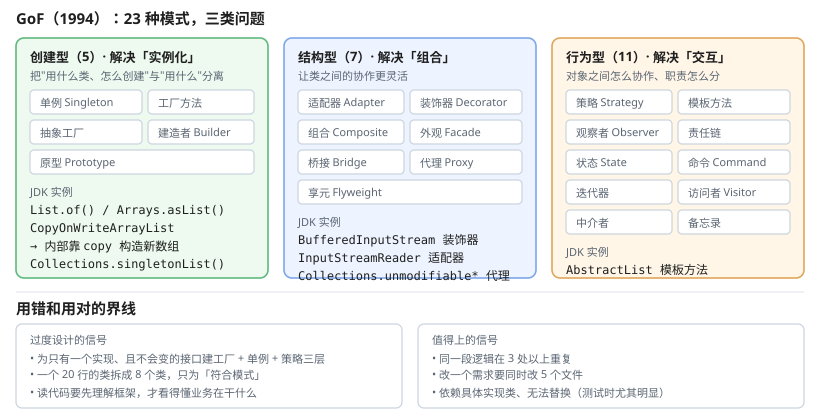

# 一、为什么需要设计模式

模式解决的是一类**重复出现的设计问题**。它带来的价值有三：

1. **复用经过验证的解决方案**——不用每次都重新推敲
2. **统一术语**——说「用工厂模式」对方就知道结构
3. **降低耦合**——把「什么会变」的部分隔离出去

代价是**增加了类数量和间接层**。模式不是越多越好，而是要在「改动会波及多处」的地方用。

# 二、GoF 二十三种分类

GoF 1994 年总结的 23 种模式分为三类。



## (一) 创建型（5 种）

解决**实例化**的问题，把"用什么类、怎么创建"与"用什么"分离。

| 模式 | 意图 | 典型场景 |
| --- | --- | --- |
| 单例 `Singleton` | 全局唯一实例 | 配置中心、线程池 |
| 工厂方法 `Factory Method` | 由子类决定创建哪个类 | 日志记录器（文件/控制台/远程） |
| 抽象工厂 `Abstract Factory` | 创建一族相关对象 | GUI 主题（深色/浅色整套控件） |
| 建造者 `Builder` | 分步构造复杂对象 | `StringBuilder`、HTTP 请求 |
| 原型 `Prototype` | 通过复制已有对象创建 | 大对象的浅拷贝 |

## (二) 结构型（7 种）

解决**组合**的问题，让类之间的协作更灵活。

| 模式 | 意图 | 典型场景 |
| --- | --- | --- |
| 适配器 `Adapter` | 把一个接口转成另一个 | `InputStreamReader` |
| 装饰器 `Decorator` | 动态添加职责 | `BufferedInputStream` |
| 组合 `Composite` | 树形结构的统一处理 | 文件系统节点 |
| 外观 `Facade` | 提供简化的高层接口 | Spring 的 `JdbcTemplate` |
| 桥接 `Bridge` | 抽象与实现分离两个维度 | 跨平台的消息推送 |
| 代理 `Proxy` | 用替身控制对真实对象的访问 | Spring AOP、动态代理 |
| 享元 `Flyweight` | 共享细粒度对象减少内存 | 字符串池、图形缓存 |

## (三) 行为型（11 种）

解决**交互与职责分配**的问题。

| 模式 | 意图 | 典型场景 |
| --- | --- | --- |
| 策略 `Strategy` | 封装可互换的算法 | 排序算法、支付方式 |
| 模板方法 `Template Method` | 定义算法骨架，步骤交给子类 | `AbstractList`、`Thread.run` |
| 观察者 `Observer` | 一对多依赖，自动通知 | 事件监听、`Flow` API |
| 责任链 `Chain of Responsibility` | 多对象依次尝试处理 | 过滤器链、`Flow` 操作符 |
| 状态 `State` | 用对象表示状态，行为随之改变 | 订单状态机 |
| 命令 `Command` | 把请求封装为对象 | 撤销/重做、任务队列 |
| 迭代器 `Iterator` | 顺序访问集合元素 | `Iterable`、`Iterator` |
| 访问者 `Visitor` | 在不改元素类的前提下加操作 | 编译器 AST |
| 中介者 `Mediator` | 用中介封装多对象复杂交互 | GUI 表单校验 |
| 备忘录 `Memento` | 捕获并恢复内部状态 | 快照、撤销 |
| 解释器 `Interpreter` | 用简单语法定义一门语言的文法 | SQL 解析、表达式求值 |

# 三、常用模式实现

## (一) 单例

五种写法，推荐最后一种。

```java
// 1. 懒加载 + 线程不安全
public class Config {
    private static Config instance;
    private Config() { }
    public static Config getInstance() {
        if (instance == null) { instance = new Config(); }
        return instance;
    }
}

// 2. 懒加载 + synchronized（每次调用都加锁）
public static synchronized Config getInstance() { ... }

// 3. 双重检查锁定（volatile 防指令重排）
public class Config {
    private volatile Config instance;
    private Config() { }
    public static Config getInstance() {
        if (instance == null) {
            synchronized (Config.class) {
                if (instance == null) { instance = new Config(); }
            }
        }
        return instance;
    }
}

// 4. 静态内部类（推荐）——JVM 保证类初始化线程安全，无锁且懒加载
public class Config {
    private Config() { }
    private static class Holder {
        static final Config INSTANCE = new Config();
    }
    public static Config getInstance() { return Holder.INSTANCE; }
}

// 5. 枚举（推荐）——还能防反射与反序列化破坏唯一性
public enum Config {
    INSTANCE;
    public void doSomething() { }
}
```

**现代 Java 更推荐用 `enum`** 或 `final class` + 静态字段。

## (二) 工厂方法

```java
interface Logger {
    void log(String msg);
}

abstract class LoggerFactory {
    // 工厂方法：由子类决定创建哪个产品
    abstract Logger createLogger();

    // 模板：使用产品，步骤固定
    public void log(String msg) {
        createLogger().log(msg);
    }
}

class ConsoleLogger extends Logger {
    @Override public void log(String msg) { System.out.println(msg); }
}

class FileLogger extends Logger {
    @Override public void log(String msg) { /* 写文件 */ }
}

// 具体工厂：每个子类只负责造自己的产品
class ConsoleLoggerFactory extends LoggerFactory {
    @Override Logger createLogger() { return new ConsoleLogger(); }
}

class FileLoggerFactory extends LoggerFactory {
    @Override Logger createLogger() { return new FileLogger(); }
}

LoggerFactory factory = new ConsoleLoggerFactory();
factory.log("hello");
```

## (三) 策略

```java
interface PaymentStrategy {
    double pay(int amount);          // 返回折后金额
}

public class Order {
    private PaymentStrategy strategy;      // 可在运行时替换

    public Order(PaymentStrategy strategy) { this.strategy = strategy; }

    public void setStrategy(PaymentStrategy s) { this.strategy = s; }

    public double discount(int amount) {
        return strategy.pay(amount);       // 委托给当前策略
    }
}

// Java 8 后可用 Lambda 简化
order.setStrategy(amount -> amount * 0.9);         // 九折
order.setStrategy(amount -> amount - 10);          // 减 10
```

**策略与工厂的分工**：策略在**运行时可切换**，工厂在**创建时决定**，两者常配合使用。

## (四) 模板方法

```java
abstract class Game {
    // 模板方法：算法骨架固定，final 防止子类改流程
    public final void play() {
        init();
        start();
        loop();
        end();
    }

    protected abstract void init();
    protected abstract void start();
    protected void loop() { }               // 有默认实现，可选覆盖
    protected abstract void end();
}
```

Java 里最常见的模板方法其实是 `Thread`：

```java
class MyThread extends Thread {
    @Override public void run() { /* 只需实现这里 */ }
}
```

`Thread.start()` → `run()` 的骨架由 JDK 写好。

## (五) 观察者

```java
interface Listener {
    void onEvent(String data);
}

class EventBus {
    private final List<Listener> listeners = new CopyOnWriteArrayList<>();

    public void subscribe(Listener l) { listeners.add(l); }
    public void unsubscribe(Listener l) { listeners.remove(l); }

    public void publish(String data) {
        for (Listener l : listeners) { l.onEvent(data); }
    }
}
```

JDK 的 `Observable`/`Observer` 已在 Java 9 废弃，应直接实现自己的机制。

## (六) 装饰器

```java
interface DataSource {
    void write(String data);
}

class FileDataSource implements DataSource {
    public void write(String data) { /* 写文件 */ }
}

class EncryptDataSource implements DataSource {      // 装饰器
    private final DataSource delegate;
    public EncryptDataSource(DataSource delegate) { this.delegate = delegate; }
    public void write(String data) {
        delegate.write(encrypt(data));              // 增强后委托
    }
}

class CompressDataSource implements DataSource {     // 装饰器
    private final DataSource delegate;
    public CompressDataSource(DataSource delegate) { this.delegate = delegate; }
    public void write(String data) {
        delegate.write(compress(data));
    }
}

// 自由组合，效果叠加
DataSource ds = new CompressDataSource(new EncryptDataSource(new FileDataSource()));
ds.write("data");     // 压缩 → 加密 → 写文件
```

**Spring 的 `BeanPostProcessor`、Java 的 `BufferedInputStream` 都是装饰器**——用继承实现会与目标类耦合，用组合则可以任意叠加。

## (七) 代理

```java
// 静态代理：接口 + 独立实现类
class UserServiceProxy implements UserService {
    private final UserService target;

    public UserServiceProxy(UserService target) { this.target = target; }

    public User save(User u) {
        log("开始");
        User result = target.save(u);
        log("结束");
        return result;
    }
}
```

**静态代理的问题**：每个接口都要写一个代理类。用**动态代理**（见「反射」一章）就不用写了——Spring AOP 就是基于它。

## (八) 建造者

```java
public class HttpRequest {
    private final String method;
    private final String url;
    private final Map<String, String> headers;
    private final String body;

    private HttpRequest(Builder b) {
        this.method = b.method;
        this.url = b.url;
        this.headers = Map.copyOf(b.headers);
        this.body = b.body;
    }

    public static class Builder {
        private String method = "GET";           // 默认值
        private String url;
        private final Map<String, String> headers = new HashMap<>();
        private String body;

        public Builder url(String url) { this.url = url; return this; }
        public Builder method(String m) { this.method = m; return this; }
        public Builder header(String k, String v) { headers.put(k, v); return this; }
        public Builder body(String b) { this.body = b; return this; }

        public HttpRequest build() {
            if (url == null) {
                throw new IllegalStateException("url 不能为空");
            }
            return new HttpRequest(this);          // ★构造器私有，只能通过 Builder 创建
        }
    }
}

// 使用：链式调用，可读性好
HttpRequest req = new HttpRequest.Builder()
        .url("https://example.com")
        .method("POST")
        .header("Content-Type", "application/json")
        .body(json)
        .build();
```

**建造者与可变参数构造器**：Java 没有具名参数，构造器参数超过 3–4 个时可读性就崩了。建造者还支持"部分构建、分步校验"，且能创建**不可变对象**。

## (九) 责任链

```java
interface Filter {
    boolean doFilter(Request req, Response resp);
    Filter setNext(Filter next);                    // 链式设置下一个处理器
}

abstract class AbstractFilter implements Filter {
    protected Filter next;

    @Override
    public Filter setNext(Filter next) {
        this.next = next;
        return next;                               // 返回 next 才能继续串下去
    }

    // 本处理器通过后交给下一个；返回 false 表示链条在此中断
    protected boolean proceed(Request req, Response resp) {
        return next == null || next.doFilter(req, resp);
    }
}

class AuthFilter extends AbstractFilter {
    @Override
    public boolean doFilter(Request req, Response resp) {
        if (req.getHeader("token") == null) {
            resp.setStatus(401);
            return false;                        // 中断链条
        }
        return proceed(req, resp);               // 交给下一个
    }
}

class LogFilter extends AbstractFilter {
    @Override
    public boolean doFilter(Request req, Response resp) {
        System.out.println("request: " + req.getPath());
        return proceed(req, resp);
    }
}

class RateLimitFilter extends AbstractFilter {
    @Override
    public boolean doFilter(Request req, Response resp) {
        return proceed(req, resp);
    }
}

// 组装成链：每个 setNext 返回的是「下一个」，所以连着调即可
AuthFilter chain = new AuthFilter();
chain.setNext(new LogFilter()).setNext(new RateLimitFilter());

chain.doFilter(request, response);
```

## (十) 状态

订单状态机的错误写法是「一堆布尔字段 + 满屏 if-else」：

```java
// 差：if (status == 1) { ... } else if (status == 2) { ... }
```

用状态模式让「状态」本身持有行为：

```java
interface OrderState {
    void pay(Order order);
    void cancel(Order order);
}

class PendingState implements OrderState {
    public void pay(Order o) { o.setState(new PaidState()); }
    public void cancel(Order o) { o.setState(new CancelledState()); }
}

class PaidState implements OrderState {
    public void pay(Order o) { throw new IllegalStateException("已支付"); }
    public void cancel(Order o) { o.refund(); }
}
```

新增状态只需加一个类，**不用改任何已有代码**——这是状态模式最大的价值。

# 四、Java 8 之后的"隐式模式"

很多设计模式已被语言特性覆盖，不一定要手写：

| 传统实现 | 现代替代 |
| --- | --- |
| 策略模式 | `List.sort(Comparator)`、Lambda |
| 模板方法 | 函数组合、接口默认方法 |
| 适配器 | Lambda、函数式接口 |
| 命令模式 | Lambda、`Runnable` |
| 建造者 | `StringBuilder`、record + 静态工厂 |
| 享元 | `String` 池、`Integer.valueOf` 缓存 |

**职责分离的原则没变**（如"可变集合"与"不可变集合"分工），但实现方式可以完全不同。

# 五、过度设计的信号

模式用错的典型征兆：

```java
// 1. 为一个只有一种实现、且不会变的接口建了工厂 + 单例 + 策略三层
// 2. 只有一个方法的接口被拆成 5 个类，只为"符合模式"
// 3. 类图比业务逻辑复杂，读者要先理解框架才能看懂业务
// 4. 一个 20 行的类被拆成 8 个类
```

**判断标准**：这个模式解决了什么"将来一定会变"的问题？如果没有明确的变点，模式就是负担。

反过来，下列情况**值得**上模式：

- 同一段逻辑在 3 处以上重复
- 改动一个需求需要同时修改 5 个文件
- 依赖具体实现类而无法替换
- 团队协作需要统一的扩展点约定

# 六、快速选型

| 场景 | 首选 |
| --- | --- |
| 全局一个配置实例 | 单例（静态内部类 / enum） |
| 一族有固定组合的对象 | 抽象工厂 |
| 对象很复杂、参数多 | 建造者 |
| 算法可按条件替换 | 策略 |
| 固定流程、个别步骤可变 | 模板方法 |
| 接口不兼容需要转换 | 适配器 |
| 动态叠加功能 | 装饰器 |
| 跨维度组合变化 | 桥接 |
| 一对多自动通知 | 观察者 |
| 状态决定行为 | 状态 |
| 多个处理器依次尝试 | 责任链 |
| 统一的简化入口 | 外观 |
| 控制对真实对象的访问 | 代理 |

# 七、参考资料

- 《设计模式：可复用的面向对象软件的基础》（GoF）— 23 种模式的原始定义与适用场景
- 《重构：改善既有代码的设计》（Martin Fowler）— 模式在真实代码演进中的应用
- [Java SE 22 API 文档](https://docs.oracle.com/en/java/javase/22/docs/api/) — JDK 源码中大量模式实例：`Collections.unmodifiable*`（代理）、`BufferedInputStream`（装饰器）、`AbstractList`（模板方法）、`CopyOnWriteArrayList`（观察者）
