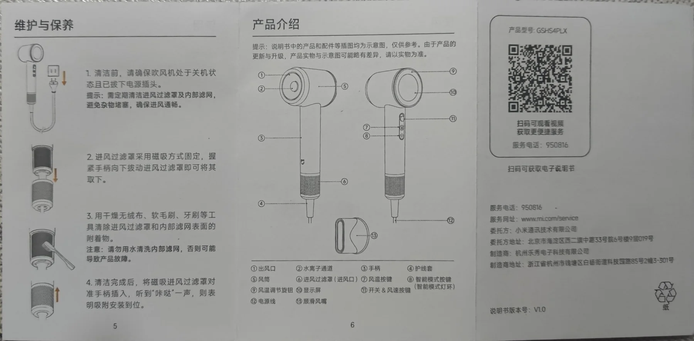
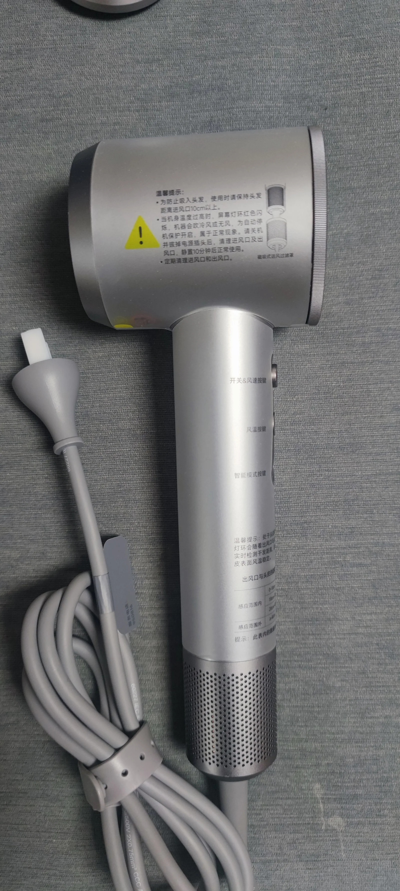
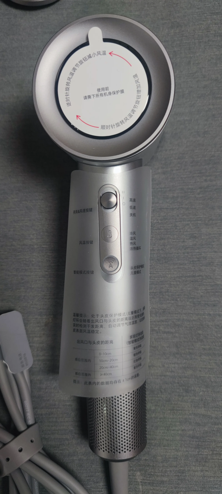
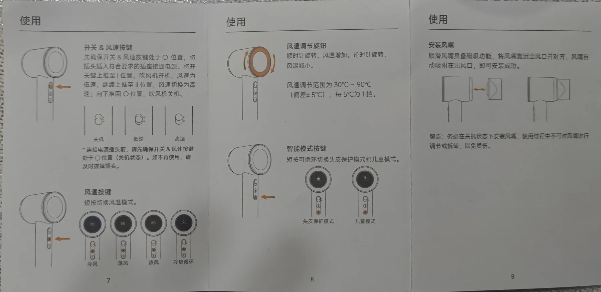
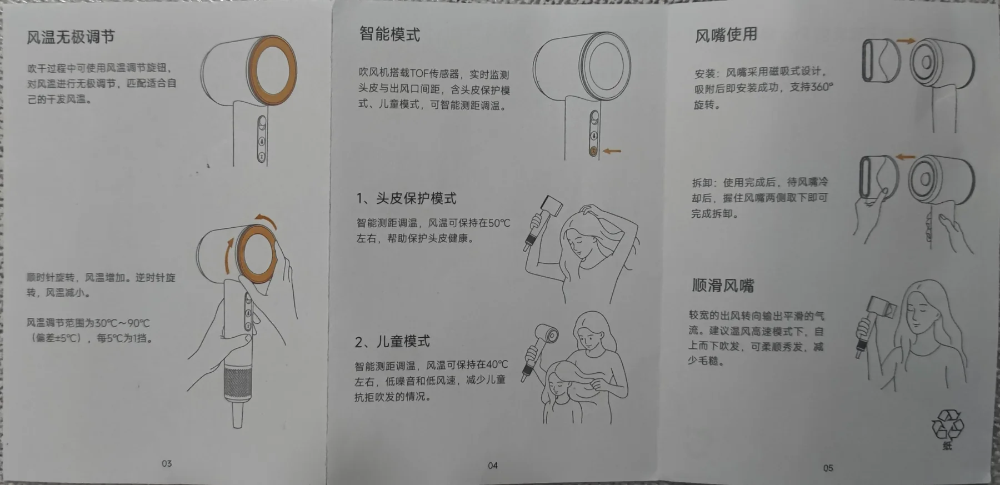
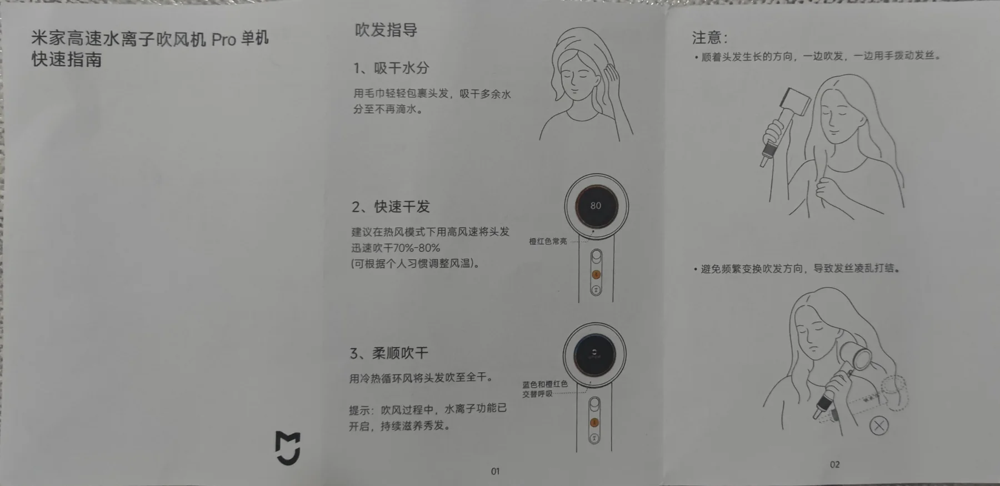

# 一、产品概述

米家高速水离子吹风机 Pro，产品型号 **GSHS4PLX**，由小米通讯技术有限公司委托、杭州乐秀电子科技有限公司制造。随机附「米家高速水离子吹风机Pro单机 快速指南」一张。说明书版本号 V1.0。

> 本文据机身随机说明书与快速指南照片整理。

## (一) 主要卖点

|卖点|说明|
|---|---|
|双针水离子|风筒内设水离子通道（部件②），出风同时释放水离子，中和静电、补充水分|
|ToF 距离感应器|实时监测头皮与出风口间距，据此自动调温（见「智能模式」）|
|高速无刷马达|12 万转/分钟，风速 72 m/s；短发约 30 秒、齐肩发约 3 分钟、长发约 5 分钟吹干|
|旋钮调温|风温调节旋钮 30 ℃~90 ℃ 无极调节，每 5 ℃ 一挡，偏差 ±5 ℃|
|头皮保护模式|智能测距调温，风温保持 50 ℃ 左右|
|儿童模式|智能测距调温，风温保持 40 ℃ 左右，低噪音、低风速|
|磁吸顺滑风嘴|自动吸附、360° 旋转，宽出风口输出平滑气流|

## (二) 部件名称

按说明书部件图（编号顺序）：① 出风口、② 水离子通道、③ 风筒、④ 手柄、⑤ 护线套、⑥ 进风过滤罩（进风口）、⑦ 风温按键、⑧ 智能模式按键（智能模式灯环）、⑨ 风温调节旋钮与显示屏、⑩ 开关&风速按键、⑪ 电源线、⑫ 顺滑风嘴。

## (三) 基本参数

|项目|参数|
|---|---|
|电源线长度|1.7 m|
|最大功率|1600 W|

## (四) 购买与保修

|项目|内容|
|---|---|
|购买时间|2026-11-11|
|收货时间|2026-11-12|
|购买金额|359 元|
|购买渠道|天猫小米旗舰店|
|购买链接|[天猫商品页](https://detail.tmall.com/item.htm?id=1040565166371)|
|质保期限|2 年|

<table><tr>
<td></td>
<td></td>
</tr></table>

# 二、常用功能

## (一) 开关与风速

先确保开关&风速按键处于 **O** 位置（关机状态），将插头插入符合要求的插座接通电源：

|档位|按键位置|风速|
|---|---|---|
|关机|O|不工作|
|低速|I|低速|
|高速|II|高速|

连接电源插头前，务必确认按键在 O 位置；不再使用时及时拔掉插头。

## (二) 风温调节

|模式|说明|
|---|---|
|冷风|冷风|
|温风|温风|
|热风|热风|
|冷热循环|热风、冷风循环|

短按**风温按键**循环切换上述四种风温模式。

**风温调节旋钮**：顺时针旋转风温升高，逆时针旋转风温降低，可在吹干过程中实时调节。调节范围 **30 ℃~90 ℃（偏差 ±5 ℃），每 5 ℃ 为 1 挡**。

## (三) 智能模式

短按**智能模式按键**，可在头皮保护模式与儿童模式之间循环切换。

吹风机搭载 **ToF 传感器**，实时监测头皮与出风口的间距，智能测距调温：

|模式|作用|
|---|---|
|头皮保护模式|智能测距调温，风温保持在 **50 ℃ 左右**，保护头皮健康|
|儿童模式|智能测距调温，风温保持在 **40 ℃ 左右**，低噪音、低风速，减少儿童抗拒吹发|

## (四) 风嘴安装与拆卸

顺滑风嘴为磁吸式：将风嘴靠近出风口并对齐，风嘴自动吸附在出风口，支持 **360° 旋转**。

拆卸时待风嘴冷却后，握住风嘴两侧取下即可。

> **警告**：务必在关机状态下安装风嘴；使用过程中不可对风嘴进行调节或拆卸，以免烫伤。

顺滑风嘴出风较宽，输出平滑气流。建议温风 + 高速档，自上而下吹发，可柔顺秀发、减少毛糙。

# 三、吹发指导

1. **吸干水分** —— 用毛巾轻轻包裹头发，吸干多余水分至不再滴水。
2. **快速干发** —— 建议在热风模式下用高风速将头发迅速吹干 **70%~80%**（可根据个人习惯调整风温）。
3. **柔顺吹干** —— 用冷热循环风将头发吹至全干。

提示：吹风过程中水离子功能已开启，持续滋养秀发。

注意：

- 顺着头发生长的方向，一边吹发，一边用手拨动发丝。
- 避免频繁变换吹发方向，导致发丝凌乱打结。

# 四、指示灯与清洁保养

## (一) 风温指示灯

|风温模式|指示灯状态|
|---|---|
|热风|橙红色常亮|
|冷热循环|蓝色和橙红色交替呼吸|

## (二) 智能模式灯环（距离提示）

处于头皮保护模式／儿童模式下，灯环会随出风口与头皮的距离远近而变化，实时检测干发距离、自动调节风温，使头皮表面风温稳定：

|出风口与头皮的距离|灯环状态|感应判定|
|---|---|---|
|0–10cm|黄色呼吸|感应范围内|
|10–20cm|橙色呼吸|感应范围内|
|20–40cm|红色呼吸|感应范围内|
|≥40cm|黄色呼吸|感应范围外|

提示：上表内的数据均存在 ±1cm 的误差。

## (三) 清洁保养

清洁前确保吹风机处于关机状态并已拔下电源插头。需定期清洁进风过滤罩及内部滤网，避免杂物堵塞，确保进风通畅。

1. 进风过滤罩采用磁吸方式固定，握紧手柄向下拨动进风过滤罩即可将其取下。
2. 用干燥无绒布、软毛刷、牙刷等工具清除进风过滤罩和内部滤网表面的附着物。
3. 清洁完成后，将磁吸进风过滤罩对准手柄插入，听到「咔哒」一声，则表明吸附安装到位。

> **注意**：请勿用水清洗内部滤网，否则可能导致产品故障。

## (四) 其他提示

- 为防止吸入头发，使用时请保持头发距离进风口 **10cm 以上**。
- 当机身温度过高时，屏幕灯环红色闪烁，机器会吹冷风或无风，为自动停机保护开启，属于正常现象。此时请关机并拔掉电源插头，清理进风口及出风口，静置 10 分钟后正常使用。
- 定期清理进风口和出风口。

产品售后服务电话 950816，服务网址 www.mi.com/service。
